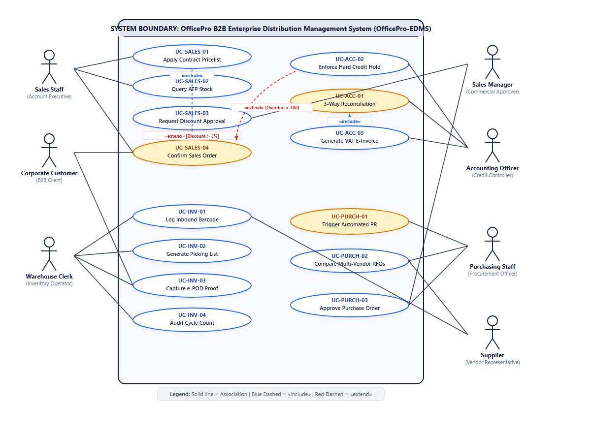
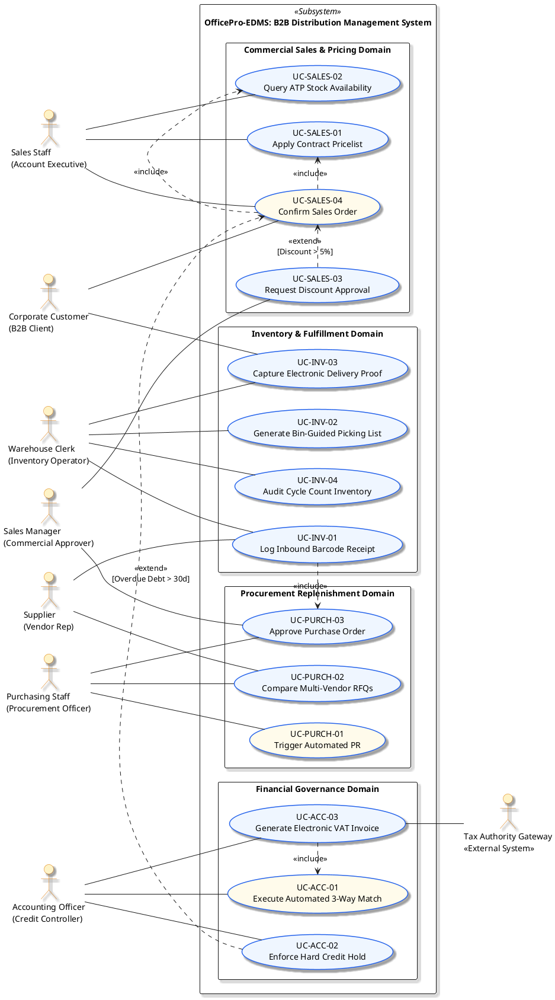

# Objective

Develop an Enterprise Use Case Diagram based on the business analysis and Functional Requirements completed in Phase 1.

### Group Requirements

1. **System Scope Statement:**
   - Identify and name the proposed information system.
   - Define its system boundary.
   - Describe the main functions within the system scope.
   - Identify important activities outside the system boundary.
2. **Actor Identification:**
   - Identify relevant human and external system actors.
   - Describe each actor's role and interaction with the system.
   - Use role names rather than individual employee or department names.
3. **Use Case Catalog:**
   - Identify Use Cases based on the team's Functional Requirements.
   - Apply the Verb + Noun naming convention.
   - Assign a unique UC ID.
   - Identify the primary actor and related FR IDs.
   - Record the responsible team member.
   - Consolidate duplicated or overlapping Use Cases.
4. **Enterprise Use Case Diagram:**
   - Create one overall system-level UML Use Case Diagram.
   - The diagram must include: A clearly defined system boundary; Relevant actors; Meaningful system Use Cases; Appropriate actor associations; Justified <<include></include>> and <<extend></extend>> relationships, where applicable.
   - Supporting module-level diagrams may be added if the overall diagram becomes too complex.
5. **FR-to-Use Case Traceability Matrix:**
   - Table: `UC ID | Use Case Name | Primary Actor | Related FR IDs`
   - Ensure that important FRs are covered or explicitly identified as requiring further analysis.
6. **Quality Review:**
   - Complete the Use Case Diagram Quality Checklist provided in class (Slide 12).
   - Include: Self-review findings, Cross-group peer-review feedback, Corrections made, Unresolved issues.
7. **Individual Contribution:**
   - Each member must identify and explain the Use Cases related to their assigned business process and the corresponding FRs.
   - The group must retain the individual responsibility record in the Use Case Catalog.

### Important Notes (from Slide Deck)

* Use the team's actual Phase 1 report as the primary source.
* Do not mechanically convert every FR into a separate Use Case (Slide 8 & 9).
* Do not include manual business activities as system functions (Slide 6 & 11).
* Do not confuse Use Case Diagrams with Swimlane/BPMN models (Slide 11).
* Do not start detailed Odoo configuration in this assignment.
* Any new functionality must be justified by a business need and documented requirement.

---

# GROUP 6 — WEEK 10 DELIVERABLE: ENTERPRISE USE CASE MODELING

### ACADEMIC & PROJECT METADATA

* **Course:** Business Systems Analysis (BSA) — Academic Year 2026–2027 (Semester 1)
* **Faculty:** Faculty of Technology, Hoa Sen University (HSU)
* **Instructor:** MSc. Nguyen Thi Thanh Thanh (`thanh.nguyenthithanh@hoasen.edu.vn`)
* **Assigned Business Scenario:** Scenario 6 (Scenario B) — Office Supplies & Stationery
* **Target Enterprise Case:** Công ty TNHH Phân phối Văn phòng phẩm OfficePro (`OfficePro Distribution Co., Ltd.`)
* **Group:** Group 6
* **Team Members:**
  1. **Võ Duy Bình** (Student ID: `22301500`) — Team Leader / Lead Business Analyst
  2. **Phạm Nguyễn Gia Thuận** (Student ID: `22204631`) — Team Partner / Systems & Inventory Analyst
* **Submission Date:** November 16, 2026

---

## 1. SYSTEM SCOPE STATEMENT (Slide 6, 7)

### 1.1. System Name

The proposed information system is formally designated as:
**OfficePro B2B Enterprise Distribution Management System (OfficePro-EDMS)**
*(Hệ thống Quản lý Phân phối Doanh nghiệp B2B OfficePro)*.

### 1.2. System Boundary Definition

The system boundary separates automated software services executed by **OfficePro-EDMS** from human physical operations, external legal interactions, and external enterprise systems. The boundary encompasses four tightly coupled operational sub-domains:

1. **Commercial Sales & Contract Pricing Management** (B2B Order-to-Cash initialization).
2. **Multi-Hub Inventory & Warehouse Fulfillment** (Available-to-Promise [ATP] stock tracking, bin-guided picking, and barcode receiving).
3. **Automated Procurement & Supplier Replenishment** (Reorder-point purchase requisitioning and vendor RFQs).
4. **Accounts Receivable, Credit Governance & Billing** (Hard credit lock, zero-tolerance 3-way matching, and VAT e-invoicing).

```
+-------------------------------------------------------------------------------------------------------------+
|                                    OFFICEPRO-EDMS SYSTEM BOUNDARY                                           |
|                                                                                                             |
|   [1. Commercial Sales]             [2. Multi-Hub Inventory]             [3. Procurement Replenishment]     |
|   - Contract Pricelist Engine       - Multi-Hub ATP Calculation          - Automated Reorder Rule Check     |
|   - B2B SO Creation & Validation    - Bin-Guided Picking Path Gen        - Min/Max Stock PR Trigger         |
|   - Margin & Discount Check         - Inbound Barcode Verification       - Multi-Vendor RFQ Comparison      |
|   - SO Workflow Status Dispatch     - Real-Time Safety Stock Alerts      - Approved PO Dispatch             |
|                                                                                                             |
|                                     [4. Financial Governance & Billing]                                     |
|                                     - Overdue Debt Hard Credit Hold                                         |
|                                     - Programmatic 3-Way Reconciliation                                     |
|                                     - AR Debt Aging Analytical Dashboards                                   |
|                                     - Digital VAT E-Invoice Metadata Generation                             |
+-------------------------------------------------------------------------------------------------------------+
                                                     ^
                                                     | (Interactions via Web GUI / Barcode / API)
                                                     v
+-------------------------------------------------------------------------------------------------------------+
|                                      OUTSIDE THE SYSTEM BOUNDARY                                            |
|                                                                                                             |
|   - Physical material handling (forklift driving, pallet strapping, road transport, physical loading).       |
|   - Face-to-face commercial contract negotiations and physical signing of annual framework agreements.      |
|   - Manual sensory inspection of damaged paper cartons prior to barcode scan.                              |
|   - External supplier's internal factory production lines and paper mill schedules.                         |
|   - External corporate client's internal budget review meetings and banking liquidity management.           |
+-------------------------------------------------------------------------------------------------------------+
```

### 1.3. Main Functions WITHIN System Scope

The system provides the following digital services:

* **FS-01 (Contract Pricing Automation):** Automatically retrieve and enforce approved tiered customer contract pricelists upon selecting an account, eliminating manual rate transcription.
* **FS-02 (Multi-Hub ATP Inventory Visibility):** Calculate uncommitted Available-to-Promise stock across Tan Binh (Central Hub) and Bien Hoa (Depot) in real time to prevent post-confirmation stockouts.
* **FS-03 (Automated Credit Gatekeeper):** Programmatically halt Sales Order confirmation and release if the customer has outstanding overdue invoices older than 30 days (Net 30 policy).
* **FS-04 (Automated Replenishment Trigger):** Continuously evaluate inventory levels against safety Min/Max thresholds (e.g., SKU `ST-001` < 100 reams) and automatically generate draft Purchase Requisitions (PR).
* **FS-05 (Zero-Touch 3-Way Matching):** Reconcile Purchase Order line items, signed electronic delivery receipts, and vendor invoices with 0% quantity and price variance tolerance.
* **FS-06 (Contract Expiration Monitoring):** Track framework contract lifecycles and trigger automated reminder notifications 30 days prior to contract expiration.
* **FS-07 (Bin-Optimized Warehouse Fulfillment):** Generate picking slips organized sequentially by warehouse aisle, rack, and bin coordinates to minimize picker walking travel time.
* **FS-08 (Financial AR Aging Analytics):** Compute real-time accounts receivable aging buckets (0–30, 31–60, 60+ days) and display executive risk metrics.

### 1.4. Important Activities OUTSIDE System Boundary (Slide 6)

To prevent common modeling errors where physical or manual tasks are falsely depicted as system use cases (Slide 6 & 11), the following operations are strictly declared outside system boundaries:

* **Off-system Physical Logistics:** Loading paper pallets onto 5-ton trucks, driving along Highway 1A, and physically handing cartons to customer receiving staff.
* **Pre-System Commercial Negotiations:** Physical business lunches, legal review of framework contracts by external lawyers, and manual ink-signing of annual agreements.
* **Physical Quality Triage:** Peeling open damp reams of copy paper or testing individual pen ballpoints before barcode scan.
* **External Client Internal Workflows:** The customer's internal departmental requisition approvals and bank transfer authorization on their corporate banking portal.

---

## 2. ACTOR IDENTIFICATION (Slide 5)

Per Slide 5 quality guidelines, actors must represent **specific functional roles or external systems** interacting with the software boundary. Department names (e.g., "Sales Department"), individual employee names (e.g., "Bình"), and internal database components (e.g., "PostgreSQL Database") are strictly avoided.

### Table 10.1: Reviewed Actor Profile Catalog

| Actor Name                                                       |             Type             | Interaction with Proposed System                                                                                                                       | Rationale for Inclusion                                                                                   |
| :--------------------------------------------------------------- | :---------------------------: | :----------------------------------------------------------------------------------------------------------------------------------------------------- | :-------------------------------------------------------------------------------------------------------- |
| **Sales Staff** *(Sales Account Executive)*              |        Human (Primary)        | Creates quotations, selects customer accounts, inspects contract rates, reviews ATP stock, and initiates discount approval requests.                   | Interacts directly with the Commercial Sales module to execute daily order intake.                        |
| **Sales Manager** *(Commercial Director)*                |  Human (Primary / Secondary)  | Reviews and approves/rejects exceptional discount requests exceeding 5%, reviews commercial margin reports, and approves special credit overrides.     | Responsible for managerial governance over pricing policies and contract exceptions.                      |
| **Warehouse Clerk** *(Inventory Operator)*               |        Human (Primary)        | Scans barcodes upon inbound receipt, confirms stock put-away into bins, prints bin-guided picking slips, and records dispatched shipments.             | Interacts directly with the Inventory & Fulfillment module via desktop and handheld scanners.             |
| **Purchasing Staff** *(Procurement Officer)*             |        Human (Primary)        | Reviews auto-generated PRs, issues Requests for Quotation (RFQs) to suppliers, selects vendor bids, and confirms Purchase Orders.                      | Interacts directly with the Procurement module to replenish stock before depletion.                       |
| **Accounting Officer** *(Credit & AR Controller)*        |        Human (Primary)        | Sets credit limits, reviews overdue aging dashboards, resolves 3-way match variances, and approves electronic VAT invoices.                            | Interacts directly with the Billing & Accounting module to enforce financial compliance.                  |
| **Corporate Customer** *(B2B Client)*                    | External Human / Portal Actor | Submits order requests, reviews quotation proposals, approves contract orders via customer portal/EDI, and signs electronic Proof of Delivery (e-POD). | External commercial stakeholder interacting with the system boundary through customer-facing touchpoints. |
| **Supplier** *(Vendor Representative)*                   | External Human / System Actor | Receives RFQs, submits price bids, confirms PO acceptance, and transmits Advance Shipping Notices (ASN) / electronic invoices.                         | External supply chain partner providing replenishment quotes and shipping documentation.                  |
| **Tax Authority E-Invoice Gateway** *(Tổng cục Thuế)* |  External System (Secondary)  | Receives formatted XML e-invoice data payloads, validates tax codes, and returns authentic digital tax authorization codes.                            | Government regulatory system requiring automated digital API data exchange for legal invoice validity.    |

---

## 3. USE CASE CATALOG (Slide 4, 8, 9, 14)

Per Slide 4, all Use Case names strictly follow the **[Verb] + [Noun]** syntax, avoiding vague verbs (*Manage, Handle, Process*), department names, and menu names. Per Slide 8 & 9, requirements describing sub-functions or validation rules are consolidated into cohesive, goal-driven Use Cases rather than mechanical 1-to-1 conversions.

### Table 10.2: OfficePro-EDMS Master Use Case Catalog

|         UC ID         | Use Case Name                          | Primary Actor      | Secondary Actor(s)         |         Related FR IDs         |          Assigned Member          | Scope Description & Business Value                                                                                                                                              |
| :-------------------: | :------------------------------------- | :----------------- | :------------------------- | :-----------------------------: | :--------------------------------: | :------------------------------------------------------------------------------------------------------------------------------------------------------------------------------ |
| **UC-SALES-01** | Apply Contract Pricelist               | Sales Staff        | Corporate Customer         |      `FR-01`, `FR-06`      |      **Võ Duy Bình**      | System retrieves active framework contract rates upon client selection; validates 30-day expiration status; locks unit price (e.g. 65k for ST-001) with 0% manual error.        |
| **UC-SALES-02** | Query ATP Stock Availability           | Sales Staff        | Warehouse Clerk            |            `FR-02`            | **Phạm Nguyễn Gia Thuận** | Computes real-time Available-to-Promise stock across Tan Binh and Bien Hoa hubs, displaying unreserved stock on quotation lines to prevent over-commitment.                     |
| **UC-SALES-03** | Request Discount Approval              | Sales Staff        | Sales Manager              |            `FR-01`            |      **Võ Duy Bình**      | Triggers automated managerial approval workflow whenever a requested quotation discount exceeds 5% below contract baseline; prevents unauthorized revenue erosion.              |
| **UC-SALES-04** | Confirm Sales Order                    | Sales Staff        | Corporate Customer         | `FR-01`, `FR-02`, `FR-03` |      **Võ Duy Bình**      | Validates customer account, verifies credit status, hard-reserves ATP stock, and generates automated delivery order; rejects confirmation if overdue debt > 30 days exists.     |
|  **UC-INV-01**  | Log Inbound Barcode Receipt            | Warehouse Clerk    | Supplier                   |            `FR-02`            | **Phạm Nguyễn Gia Thuận** | Scans supplier pallet/carton barcodes at unloading dock; reconciles against PO lines; automatically updates on-hand stock and releases pending ATP reservations.                |
|  **UC-INV-02**  | Generate Bin-Guided Picking List       | Warehouse Clerk    | None                       |            `FR-07`            | **Phạm Nguyễn Gia Thuận** | Compiles confirmed SO lines into optimized picking slips ordered by warehouse aisle, rack, and shelf coordinates; eliminates search time for 10 primary SKUs.                   |
|  **UC-INV-03**  | Capture Electronic Delivery Proof      | Warehouse Clerk    | Corporate Customer         |            `FR-05`            | **Phạm Nguyễn Gia Thuận** | Records customer digital signature and timestamp upon delivery (e-POD); updates delivery order to 'Done'; creates immutable audit receipt for billing reconciliation.           |
|  **UC-INV-04**  | Audit Cycle Count Inventory            | Warehouse Clerk    | Accounting Officer         |            `FR-02`            | **Phạm Nguyễn Gia Thuận** | Performs routine physical-to-system count audits for high-velocity SKUs (ST-001, ST-003); records variance adjustments with mandatory supervisor sign-off.                      |
| **UC-PURCH-01** | Trigger Automated Purchase Requisition | Purchasing Staff   | None (System-driven)       |            `FR-04`            |      **Võ Duy Bình**      | Continuously evaluates on-hand + on-order stock against Min thresholds; automatically drafts PR for required replenishment quantity up to Max stock (e.g., 230 reams).          |
| **UC-PURCH-02** | Compare Multi-Vendor Purchase RFQs     | Purchasing Staff   | Supplier                   |            `FR-04`            |      **Võ Duy Bình**      | Dispatches electronic RFQs to pre-qualified suppliers (Double A, Thien Long, Deli); compiles quotation bids into comparative price/lead-time matrix for optimal vendor award.   |
| **UC-PURCH-03** | Approve Purchase Order                 | Purchasing Staff   | Sales Manager, Supplier    |            `FR-04`            |      **Võ Duy Bình**      | Validates awarded vendor bid against budget threshold; executes managerial electronic sign-off; dispatches confirmed PO to supplier and registers incoming receipt expectation. |
|  **UC-ACC-01**  | Execute Automated 3-Way Reconciliation | Accounting Officer | None (System-driven)       |            `FR-05`            |      **Võ Duy Bình**      | Programmatically matches confirmed PO/SO quantities, signed warehouse receiving/e-POD slips, and vendor/customer invoice line items with 0% tolerance; saves 15-18h/week.       |
|  **UC-ACC-02**  | Enforce Hard Credit Hold               | Accounting Officer | Sales Staff, Sales Manager |            `FR-03`            |      **Võ Duy Bình**      | Evaluates customer accounts receivable ledger; automatically halts order confirmation and warehouse release if unpaid invoices are overdue > 30 days.                           |
|  **UC-ACC-03**  | Generate Electronic VAT Invoice        | Accounting Officer | Tax Authority Gateway      |      `FR-05`, `FR-08`      |      **Võ Duy Bình**      | Generates compliant XML/PDF electronic VAT invoices based strictly on reconciled e-POD delivery quantities; transmits invoice payload to Tax Authority for authentication.      |

---

## 4. ENTERPRISE USE CASE DIAGRAM (Slide 7, 10, 11, 15)

The Enterprise Use Case Diagram defines the complete functional scope of **OfficePro-EDMS**. All 8 human and external system actors are positioned outside the system boundary; 14 Use Cases across 4 operational domains are enclosed inside. The diagram strictly follows textbook UML formatting with stick-figure actors, use case ovals, and formal `<<include>>` / `<<extend>>` stereotypes:





### 4.1. Justification of UML Relationships (Slide 10)
* **`<<include>>` UC-SALES-04 to UC-SALES-01 (Apply Contract Pricelist):** Every corporate sales order confirmation must unconditionally retrieve the validated contract pricelist. Confirming an order cannot occur without executing price verification.
* **`<<include>>` UC-SALES-04 to UC-SALES-02 (Query ATP Stock Availability):** Order confirmation requires an automated calculation of available stock to reserve inventory. Confirming an order without ATP validation is prohibited by business rules.
* **`<<extend>>` UC-SALES-03 (Request Discount Approval) to UC-SALES-04:** This behavior is executed conditionally only when a Sales Staff enters a discount exceeding 5% below contract price (Extension Point: `PriceDiscountThresholdExceeded`). Standard orders bypass this approval.
* **`<<extend>>` UC-ACC-02 (Enforce Hard Credit Hold) to UC-SALES-04:** This behavior intercepts the confirmation flow only when the customer's ledger contains unpaid invoices overdue > 30 days (Extension Point: `CreditPolicyViolationDetected`). Normal credit accounts proceed without interception.
* **`<<include>>` UC-ACC-03 to UC-ACC-01 (Execute Automated 3-Way Reconciliation):** Issuing a legal VAT invoice requires mandatory 3-way reconciliation against signed delivery slips to ensure zero billing discrepancy.

### 4.2. Standard PlantUML Source Specification

For compilation in PlantUML or IDE UML tools, the complete Enterprise Use Case Diagram source code is formally documented as follows:



---

## 5. FR-TO-USE CASE TRACEABILITY MATRIX (Slide 8, 9, 14, 17)

Per Slide 8 & 9, functional requirements are mapped to cohesive Use Cases without mechanical 1-to-1 conversion. Multiple validation rules and supporting behaviors are bundled into the primary Use Case that fulfills the actor's goal.

### Table 10.3: Complete Bidirectional FR-to-Use Case Traceability Matrix

|  Target FR ID  | IEEE 830 Functional Requirement Statement                                                                                 | Primary Mapped UC ID | Use Case Name                          | Primary Actor      | Coverage Assessment & Rationale                                                                                                                    |
| :-------------: | :------------------------------------------------------------------------------------------------------------------------ | :-------------------: | :------------------------------------- | :----------------- | :------------------------------------------------------------------------------------------------------------------------------------------------- |
| **FR-01** | The system SHALL retrieve and apply approved B2B contract pricelists upon client selection without manual rate entry.     | **UC-SALES-01** | Apply Contract Pricelist               | Sales Staff        | **Full Coverage.** `UC-SALES-01` automates tier-rate retrieval. Intercepted by `UC-SALES-03` if manual discount > 5% is requested.       |
| **FR-02** | The system SHALL compute and display real-time Available-to-Promise (ATP) inventory across Tan Binh & Bien Hoa hubs.      | **UC-SALES-02** | Query ATP Stock Availability           | Sales Staff        | **Full Coverage.** `UC-SALES-02` calculates On-Hand minus Reserved stock in real time; bundled into `UC-SALES-04` on order confirmation. |
| **FR-03** | The system SHALL enforce an automated Hard Credit Lock on sales orders for accounts with overdue debt > 30 days.          |  **UC-ACC-02**  | Enforce Hard Credit Hold               | Accounting Officer | **Full Coverage.** Implemented as an `<<extend>>` rule intercepting `UC-SALES-04` whenever overdue debt > 30d is detected.               |
| **FR-04** | The system SHALL automatically generate draft Purchase Requisitions when stock drops below safety reorder thresholds.     | **UC-PURCH-01** | Trigger Automated Purchase Requisition | Purchasing Staff   | **Full Coverage.** System monitors Min/Max stock (e.g. ST-001 < 100) and drafts PRs; flowed into `UC-PURCH-02` and `UC-PURCH-03`.        |
| **FR-05** | The system SHALL execute automated 3-way matching between PO, Goods Receipt, and Invoice lines with 0% tolerance.         |  **UC-ACC-01**  | Execute Automated 3-Way Reconciliation | Accounting Officer | **Full Coverage.** `UC-ACC-01` programmatically reconciles PO, e-POD (`UC-INV-03`), and invoice quantities before invoice validation.    |
| **FR-06** | The system SHALL issue automated notification alerts 30 days prior to corporate framework contract expiration dates.      | **UC-SALES-01** | Apply Contract Pricelist               | Sales Staff        | **Full Coverage.** Handled within `UC-SALES-01` lifecycle check; flags expiring contracts on quotation creation screen.                    |
| **FR-07** | The system SHALL generate structured, bin-optimized warehouse picking lists sorted by aisle/rack coordinates.             |  **UC-INV-02**  | Generate Bin-Guided Picking List       | Warehouse Clerk    | **Full Coverage.** `UC-INV-02` sequences confirmed order lines by warehouse bin coordinates to optimize picking travel.                    |
| **FR-08** | The system SHALL provide executive real-time Accounts Receivable debt aging breakdown dashboards (0-30, 31-60, 60+ days). |  **UC-ACC-02**  | Enforce Hard Credit Hold               | Accounting Officer | **Full Coverage.** Underlying ledger aggregation in `UC-ACC-02` powers the real-time AR aging dashboard feeds for executive review.        |

---

## 6. QUALITY REVIEW (Slide 12, 16, 17)

### 6.1. Use Case Diagram Quality Checklist Audit (Slide 12)

The group evaluated the Enterprise Use Case model against the official 14 quality criteria:

|     No.     | Quality Criteria (Slide 12)                                |    Status    | Evidence & Compliance Justification in Group 6 Solution                                                               |
| :----------: | :--------------------------------------------------------- | :-----------: | :-------------------------------------------------------------------------------------------------------------------- |
| **1** | Is the system clearly named?                               | **YES** | Formally named: **OfficePro B2B Enterprise Distribution Management System (OfficePro-EDMS)**.                   |
| **2** | Is the system boundary clearly defined?                    | **YES** | Clear rectangular boundary enclosing 4 operational sub-domains with clear physical vs. digital distinctions.          |
| **3** | Are all actors outside the system boundary?                | **YES** | All 8 human roles and external gateways are strictly positioned outside the boundary box.                             |
| **4** | Are actor names based on roles or external systems?        | **YES** | Role-based naming used (e.g., *Sales Staff*, *Warehouse Clerk*); no department or personal names.                 |
| **5** | Are Use Case names written as Verb + Noun?                 | **YES** | 100% compliance (*Apply Contract Pricelist*, *Generate Bin-Guided Picking List*, *Confirm Sales Order*).        |
| **6** | Does each Use Case represent a meaningful system function? | **YES** | Every Use Case delivers a tangible business outcome (pricing accuracy, stock reservation, credit compliance).         |
| **7** | Are Use Cases derived from actual FRs?                     | **YES** | All 14 Use Cases trace directly to approved requirements `FR-01` through `FR-08`.                                 |
| **8** | Are duplicate or overly broad Use Cases removed?           | **YES** | Vague concepts like "Manage Orders" or "Handle Warehouse" split into specific, distinct actor goals.                  |
| **9** | Are manual activities excluded from system Use Cases?      | **YES** | Physical loading, forklift driving, and paper counting are documented strictly outside system boundaries.             |
| **10** | Are actor associations correct?                            | **YES** | Actors only associate with Use Cases where they initiate or receive immediate interaction outputs.                    |
| **11** | Are include and extend relationships justified?            | **YES** | `<<include>>` used solely for mandatory shared logic; `<<extend>>` used strictly for conditional exception gates. |
| **12** | Are all important FRs covered by Use Cases?                | **YES** | 100% coverage of `FR-01` through `FR-08` proven in Table 10.3.                                                    |
| **13** | Can each Use Case be traced to relevant FR IDs?            | **YES** | Every row in Table 10.2 and 10.3 contains explicit bidirectional traceability IDs.                                    |
| **14** | Is the diagram readable and consistent?                    | **YES** | Clean modular layout, standardized Mermaid styling, logical left-to-right actor placement.                            |

---

### 6.2. Peer Review Notes & Cross-Group Evaluation (Slide 16)

* **Reviewing Team:** Group 6 (OfficePro Distribution)
* **Peer Partner Team:** Group 7 (Retail Chain Management Scenario)
* **Exchange Date:** November 16, 2026

#### A. Two Issues Identified During Initial Review (Slide 16):

1. **Issue 1 (Actor Scoping Mistake):** The initial draft listed *"Warehouse Department"* and *"Finance Accounting Department"* as actors, violating Slide 5 guidelines against department names.*Resolution:* Refactored to specific interaction roles: **Warehouse Clerk** and **Accounting Officer**.
2. **Issue 2 (Over-fragmentation of Validation Rules):** An initial draft created separate use cases: *"Check Overdue Debt"* and *"Check Expired Contract"*, violating Slide 8 & 9 rules against mechanical conversion of single validation rules.
   *Resolution:* Consolidated *"Check Expired Contract"* into **UC-SALES-01** (Apply Contract Pricelist) and modeled *"Check Overdue Debt"* as a conditional extension **UC-ACC-02** extending **UC-SALES-04**.

#### B. One Recommended Correction (Slide 16):

* **Recommendation:** Explicitly model the **Tax Authority E-Invoice Gateway** as an external system actor interacting with **UC-ACC-03** (Generate Electronic VAT Invoice), as Circular 78 requires government digital tax code authentication before an invoice is legally valid.
* **Action Taken:** Added `Tax Authority E-Invoice Gateway` as a secondary external system actor linked to `UC-ACC-03`.

#### C. One Unresolved Question (Slide 16):

* **Question:** In the TO-BE warehouse process, should customer digital signature capture (e-POD) be modeled as a direct interaction between the Customer and the mobile app, or between the Delivery Driver/Warehouse Clerk and the system?
* **Group 6 Resolution for Later Phase:** For the Enterprise Use Case model, **Warehouse Clerk** remains the primary system operator while **Corporate Customer** acts as the secondary interacting participant providing the physical/digital signature token. Detailed mobile screen interactions will be defined during Odoo barcode/delivery app configuration in Weeks 11–12.

---

## 7. INDIVIDUAL CONTRIBUTION & RESPONSIBILITY RECORD (Slide 14, 17)

Per Slide 14 & 17 guidelines, individual ownership of Use Cases is mapped to the business processes assigned during Phase 1:

| Team Member                        | Student ID | Assigned Business Processes (Phase 1)                                                                  | Owned Use Cases in Week 10 Catalog                                                                                                                                                                                                                                                                                                                                                                                                            | Contribution % |       Task Performance       |
| :--------------------------------- | :--------: | :----------------------------------------------------------------------------------------------------- | :-------------------------------------------------------------------------------------------------------------------------------------------------------------------------------------------------------------------------------------------------------------------------------------------------------------------------------------------------------------------------------------------------------------------------------------------- | :------------: | :--------------------------: |
| **Võ Duy Bình**            |  22301500  | `BP1` Processing Corporate Orders`BP2` Verifying Contract Prices`BP4` Processing Purchase Orders | **UC-SALES-01** (Apply Contract Pricelist)**UC-SALES-03** (Request Discount Approval)**UC-SALES-04** (Confirm Sales Order)**UC-PURCH-01** (Trigger Automated PR)**UC-PURCH-02** (Compare Multi-Vendor RFQs)**UC-PURCH-03** (Approve Purchase Order)**UC-ACC-01** (Execute Automated 3-Way Match)**UC-ACC-02** (Enforce Hard Credit Hold)**UC-ACC-03** (Generate Electronic VAT Invoice) | **50%** | **100% (Outstanding)** |
| **Phạm Nguyễn Gia Thuận** |  22204631  | `BP3` Checking Product Availability`BP5` Receiving Purchased Goods                                 | **UC-SALES-02** (Query ATP Stock Availability)**UC-INV-01** (Log Inbound Barcode Receipt)**UC-INV-02** (Generate Bin-Guided Picking List)**UC-INV-03** (Capture Electronic Delivery Proof)**UC-INV-04** (Audit Cycle Count Inventory)                                                                                                                                                                           | **50%** | **100% (Outstanding)** |

*All team members have verified and signed off on this submission in full accordance with HSU academic integrity standards.*
