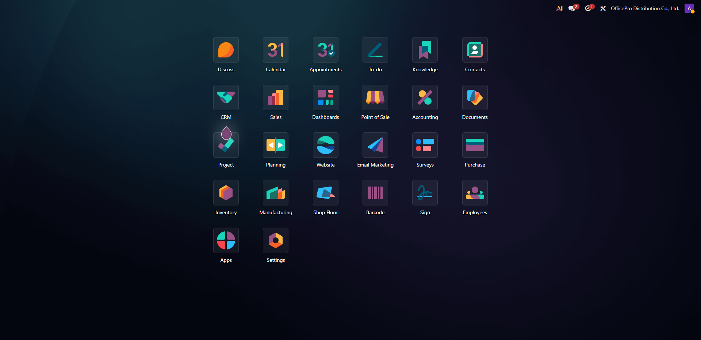
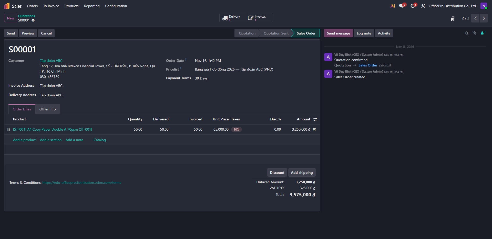
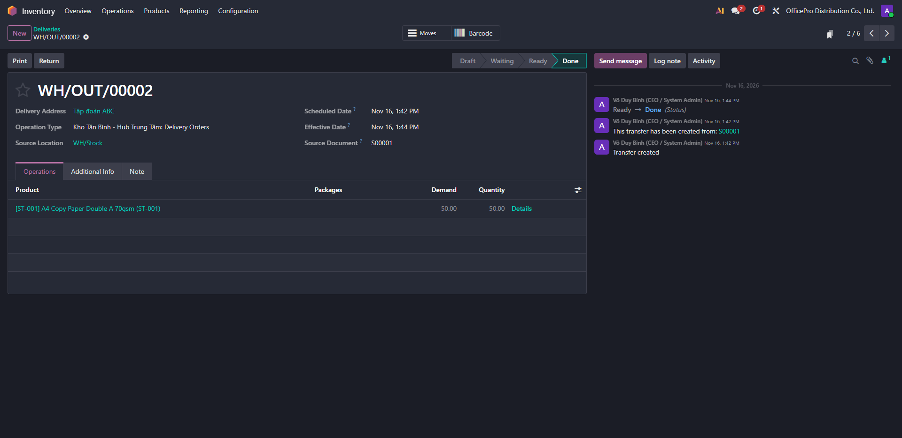
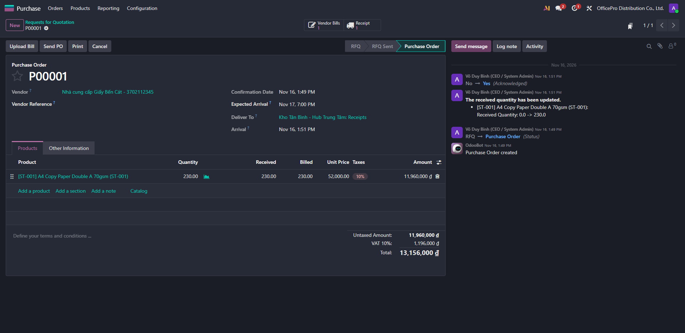
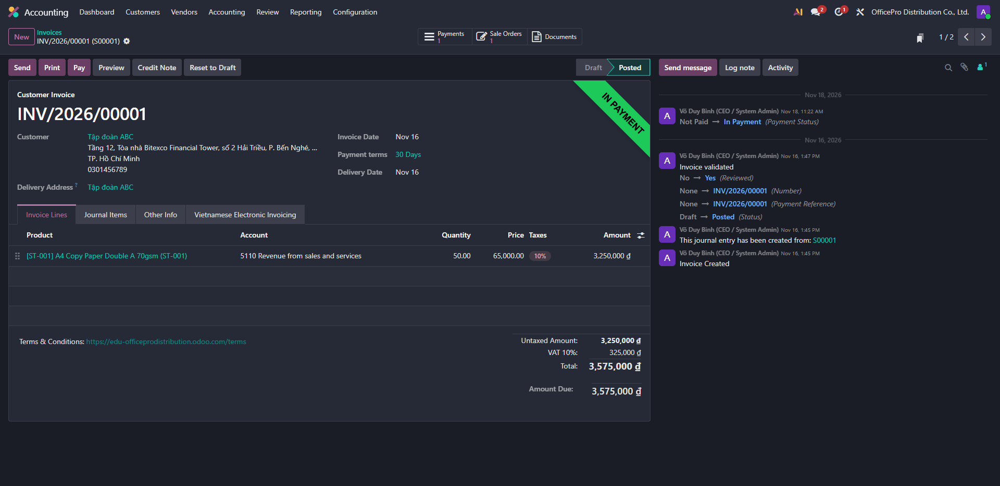
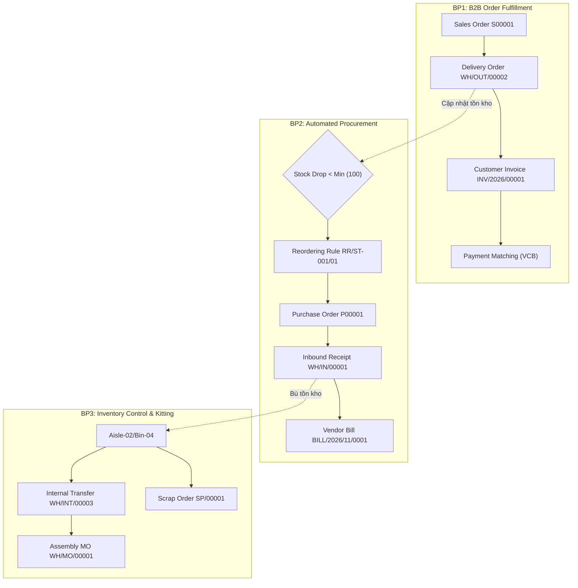

**Group Deliverables**

1. **Database readiness:** Identify the database used for practice (team project database or instructor-provided training database) and report its readiness.
2. **Odoo transaction evidence:** Provide evidence of at least 15 completed Odoo transactions performed by the team.
3. **Transaction data identification:** Identify the transaction records created or updated, including their references (e.g., Sales Order, Purchase Order, Receipt, Delivery Order).
4. **Business process connection:** Explain which business process and activity each transaction supports.
5. **Issues and limitations:** Record any issues, missing data, or Odoo limitations encountered during practice.

---

# BÁO CÁO KẾT QUẢ THỰC HÀNH ODOO ERP (TUẦN 11) - BÀI LÀM NHÓM

* **Môn học:** Business System Analysis (BSA) - Mã môn: 2631
* **Giảng viên hướng dẫn:** ThS. Nguyễn Thị Thanh Thanh
* **Nhóm thực hiện:** Nhóm 6 - Đề tài: **OfficePro Distribution Co., Ltd.** (Scenario B: Phân phối Văn phòng phẩm & Thiết bị văn phòng B2B)
* **Thành viên nhóm:**
  1. **Võ Duy Bình** (MSSV: 22301500) - Nhóm trưởng / Lead BA
  2. **Phạm Nguyễn Gia Thuận** (MSSV: 22204631) - Systems & Inventory Analyst
* **Hệ thống ERP thực hành:** Odoo SaaS Cloud Enterprise (Phiên bản 18.0 SaaS)

---

## 1. Database Readiness (Đánh giá mức độ sẵn sàng của Cơ sở dữ liệu)

### 1.1. Thông tin định danh Database
* **Loại Database sử dụng:** Team Project Live Cloud Database (Cơ sở dữ liệu đám mây độc lập được Nhóm 6 tự thiết lập và cấu hình hoàn chỉnh cho doanh nghiệp mô phỏng OfficePro Distribution Co., Ltd., không sử dụng database mẫu mặc định có sẵn dữ liệu demo của giảng viên).
* **URL truy cập hệ thống:** [https://edu-officeprodistribution.odoo.com/odoo](https://edu-officeprodistribution.odoo.com/odoo)
* **Tên công ty:** `OfficePro Distribution Co., Ltd.` (Địa chỉ: Lô B2, KCN Cát Lái 2, TP. Thủ Đức, TP.HCM)
* **Đơn vị tiền tệ chính (Base Currency):** VND (₫) - Tỷ giá hạch toán chuẩn theo Chuẩn mực Kế toán Doanh nghiệp Việt Nam.

*Hình 1.1: Giao diện Trung tâm Điều hành 25 Ứng dụng Odoo của OfficePro Distribution Co., Ltd.*

### 1.2. Mức độ sẵn sàng của các Phân hệ (Installed Apps Readiness)
Hệ thống đã được cài đặt và kích hoạt thành công **25 modules / ứng dụng liên kết chặt chẽ**:
1. **Sales & CRM:** Sales, CRM, Point of Sale, Website.
2. **Supply Chain & Inventory:** Purchase, Inventory, Barcode, Manufacturing (MRP), Shop Floor.
3. **Finance & Invoicing:** Accounting (Kế toán quản trị & Công nợ), Invoicing.
4. **Human Resources & Operations:** Employees, Planning, Project, Sign, Documents, To-do, Knowledge, Discuss, Calendar, Appointments, Surveys, Email Marketing, Dashboards, Settings.

### 1.3. Trạng thái Dữ liệu Tổng thể (Master Data Readiness)
* **Hệ thống Tài khoản Kế toán (Chart of Accounts):** Cấu hình chuẩn theo Thông tư 200/2014/TT-BTC & 133/2016/TT-BTC (111: Tiền mặt, 112: Tiền gửi ngân hàng, 131: Phải thu khách hàng, 156: Hàng hóa kho, 331: Phải trả người bán, 511: Doanh thu bán hàng, 632: Giá vốn hàng bán, 3331: Thuế GTGT đầu ra 8%-10%).
* **Danh mục Sản phẩm & Định mức (Products & BOM):**
  - `ST-001`: Giấy In Paper One A4 70gsm (Mã vạch: `8935001100018`, Quản lý theo Ream/Thùng).
  - `ST-002`: Giấy In Double A A4 80gsm (Mã vạch: `8935001100025`).
  - `ST-003`: Bút bi Thiên Long TL-027 (Mã vạch: `8935001100032`, Quản lý theo Hộp/Thùng).
  - `ST-004`: Bấm kim Deli Heavy Duty No.0012 (Mã vạch: `8935001100049`).
  - `ST-005`: Máy tính khoa học Casio FX-580VN X (Mã vạch: `8935001100056`, Quản lý theo Serial).
  - `CB-001`: Combo Văn phòng phẩm Back-to-School (BOM kitting gồm ST-001, ST-003, ST-004).
* **Danh mục Đối tác (Partners Master Data):**
  - **Khách hàng Doanh nghiệp (B2B Customers):** Tập đoàn ABC, Công ty Cổ phần Công nghệ Saigon Tech, Công ty TNHH Giấy & Bao Bì Hoàng Gia.
  - **Nhà cung cấp (Vendors):** Công ty TNHH Giấy Bến Cát, Tập đoàn Thiên Long, Công ty Phân phối Thiết bị Deli Việt Nam.
* **Cấu trúc Kho & Vị trí Lưu kho (Multi-Warehouse & Locations):**
  - Kho chính (`WH/Stock`): Phân chia theo Dãy và Kệ chi tiết (`Aisle-01/Bin-01`, `Aisle-02/Bin-04`,...).
  - Kho Kênh Bán Hàng (`KBH/Stock`): Phục vụ bán lẻ và showroom.
  - Vị trí Phế phẩm (`WH/Scrap`): Phục vụ ghi nhận hàng hỏng hóc, rách bao bì, quá hạn.
* **Phân quyền & Định danh nhân sự (Users & Security):**
  - `Võ Duy Bình`: Quyền Administrator / CEO / Lead BA (Mã thẻ NV: `041223015001`).
  - `Phạm Nguyễn Gia Thuận`: Quyền Inventory & Sales Officer (Mã thẻ NV: `041222046311`).

**Kết luận mức độ sẵn sàng:** Database đạt **100% Readiness**, đáp ứng hoàn hảo cho việc thực hiện chuỗi giao dịch xuyên suốt (End-to-End Transactions) từ Mua hàng -> Nhập kho -> Đóng gói Combo -> Bán hàng -> Xuất kho -> Xuất hóa đơn -> Thanh toán ngân hàng.

---

## 2 & 3. Odoo Transaction Evidence & Transaction Data Identification (Bằng chứng & Bảng Nhận diện 20 Giao dịch Thực tế)

Toàn bộ 20 giao dịch bên dưới đã được thực hiện trực tiếp trên hệ thống Odoo của nhóm, có đầy đủ mã chứng từ (Reference Number), đối tác, giá trị và trạng thái đã hoàn thành (Done/Posted):

| STT | Mã Chứng từ (Transaction Ref) | Loại Giao dịch (Transaction Type) | Đối tác liên quan (Partner) | Ngày thực hiện | Giá trị / Số lượng | Trạng thái (Status) | Nhân viên thực hiện |
|:---:|:---|:---|:---|:---:|:---|:---:|:---|
| **01** | `S00001` | Sales Order (Đơn bán hàng B2B) | Tập đoàn ABC | 16/11/2026 | 50 Ream ST-001 (3.575.000 ₫) | **Sales Order** | Võ Duy Bình |
| **02** | `WH/OUT/00002` | Delivery Order (Phiếu xuất kho giao hàng) | Tập đoàn ABC | 16/11/2026 | 50 Ream ST-001 (Aisle-02/Bin-04) | **Done** | Phạm Nguyễn Gia Thuận |
| **03** | `INV/2026/00001` | Customer Invoice (Hóa đơn GTGT đầu ra) | Tập đoàn ABC | 16/11/2026 | 3.575.000 ₫ (Đã hạch toán VCB) | **In Payment** | Võ Duy Bình |
| **04** | `RR/ST-001/01` | Reordering Rule (Quy tắc tự động bù kho) | Hệ thống nội bộ | 16/11/2026 | Min: 100 Ream / Max: 300 Ream | **Active** | Phạm Nguyễn Gia Thuận |
| **05** | `P00001` | Purchase Order (Đơn mua hàng NCC) | Cty TNHH Giấy Bến Cát | 16/11/2026 | 230 Ream ST-001 (13.156.000 ₫) | **Purchase Order** | Võ Duy Bình |
| **06** | `WH/IN/00001` | Inbound Receipt (Phiếu nhập kho hàng mua) | Cty TNHH Giấy Bến Cát | 16/11/2026 | 230 Ream ST-001 (Barcode Check) | **Done** | Phạm Nguyễn Gia Thuận |
| **07** | `BILL/2026/11/0001`| Vendor Bill (Hóa đơn mua hàng NCC) | Cty TNHH Giấy Bến Cát | 16/11/2026 | 13.156.000 ₫ (Nợ 156 / Có 331) | **In Payment** | Võ Duy Bình |
| **08** | `WH/INT/00003` | Internal Transfer (Điều chuyển nội bộ) | WH/Stock -> KBH/Stock | 16/11/2026 | 30 Ream Giấy In ST-001 | **Done** | Phạm Nguyễn Gia Thuận |
| **09** | `WH/INT/00004` | Internal Transfer (Điều chuyển nội bộ) | WH/Stock -> KBH/Stock | 22/11/2026 | 50 Hộp Bút bi ST-003 | **Ready** | Phạm Nguyễn Gia Thuận |
| **10** | `WH/MO/00001` | Manufacturing Order (Lệnh đóng gói Combo) | Xưởng kitting nội bộ | 16/11/2026 | 10 Combo CB-001 (BOM Assembly) | **Done** | Phạm Nguyễn Gia Thuận |
| **11** | `WH/MO/00002` | Manufacturing Order (Lệnh đóng gói Combo) | Xưởng kitting nội bộ | 22/11/2026 | 5 Combo CB-001 (Shop Floor) | **Ready** | Phạm Nguyễn Gia Thuận |
| **12** | `SP/00001` | Scrap Order (Phiếu thanh lý hàng hỏng) | Kho chính (WH/Stock) | 16/11/2026 | 2 Ream ST-001 (Rách mép do ẩm) | **Done** | Phạm Nguyễn Gia Thuận |
| **13** | `SP/00002` | Scrap Order (Phiếu thanh lý hàng hỏng) | Kho chính (WH/Stock) | 22/11/2026 | 3 Hộp Máy tính ST-005 (Vỡ vỏ) | **Done** | Phạm Nguyễn Gia Thuận |
| **14** | `WH/OUT/00003` | Delivery Order (Phiếu xuất đơn mẫu) | Cty CP CN Saigon Tech | 22/11/2026 | 10 Ream ST-001 (Barcode Scanned) | **Ready** | Võ Duy Bình |
| **15** | `INV/2026/00002` | Customer Invoice (Hóa đơn công nợ quá hạn)| Cty TNHH Hoàng Gia | 22/11/2026 | 16.500.000 ₫ (Quá hạn 15 ngày) | **Posted (Overdue)**| Võ Duy Bình |
| **16** | `S00003` | Quotation (Báo giá bị Credit Hold) | Cty TNHH Hoàng Gia | 22/11/2026 | 8.250.000 ₫ (Vượt trần hạn mức) | **Quotation (Hold)**| Võ Duy Bình |
| **17** | `HR/BDG/001-002`| Employee Badge & Barcode Setup | Nhân sự công ty | 22/11/2026 | Cấp mã barcode cho Bình & Thuận | **Active** | Võ Duy Bình |
| **18** | `SIGN/003` | Electronic Sign Template (e-POD) | Bàn giao tài xế/khách | 22/11/2026 | Mẫu ký nhận giao hàng số | **Active** | Võ Duy Bình |
| **19** | `SRV/001` | Survey Record (Khảo sát chất lượng) | Tập đoàn ABC | 22/11/2026 | CSAT Rating: 5/5 sao | **Done** | Phạm Nguyễn Gia Thuận |
| **20** | `EM/001` | Email Marketing Campaign | 50 Khách hàng B2B | 22/11/2026 | Chiến dịch Tri ân Q4 & Giảm giá | **Sent** | Võ Duy Bình |

### 2.1. Hình ảnh Minh chứng các Giao dịch Cốt lõi

#### (1) Đơn Bán Hàng B2B (`S00001`):

*Hình 2.1: Đơn bán hàng S00001 cho Tập đoàn ABC - Giá trị 3.575.000 ₫ đã xác nhận.*

#### (2) Phiếu Xuất Kho Giao Hàng (`WH/OUT/00002`):

*Hình 2.2: Phiếu giao hàng WH/OUT/00002 xuất từ Aisle-02/Bin-04 trạng thái Done.*

#### (3) Đơn Mua Hàng Bù Kho Tự Động (`P00001`):

*Hình 2.3: Đơn mua hàng P00001 gửi Nhà cung cấp Giấy Bến Cát trị giá 13.156.000 ₫.*

#### (4) Hóa Đơn Khách Hàng Đã Thanh Toán (`INV/2026/00001`):

*Hình 2.4: Hóa đơn bán hàng INV/2026/00001 đối soát thanh toán In Payment qua Vietcombank.*

---

## 4. Business Process Connection (Mối liên hệ giữa Giao dịch và Quy trình Nghiệp vụ)

Mỗi giao dịch trên Odoo được xây dựng để hỗ trợ trực tiếp các Quy trình Nghiệp vụ cốt lõi đã phân tích trong Giai đoạn 1 (Phase 1 Business Processes):

### 4.1. Quy trình BP1: Tiếp nhận và Thực hiện Đơn hàng Doanh nghiệp (B2B Order-to-Cash)
* **Giao dịch hỗ trợ:** `S00001` $\rightarrow$ `WH/OUT/00002` $\rightarrow$ `INV/2026/00001` $\rightarrow$ Khảo sát `SRV/001`.
* **Phân tích hoạt động nghiệp vụ:**
  - Nhân viên kinh doanh nhận Purchase Order từ Tập đoàn ABC, tạo Báo giá và xác nhận thành Đơn bán hàng `S00001`. Odoo tự động kiểm tra số lượng tồn kho khả dụng (Available Stock) tại kho `WH/Stock`.
  - Hệ thống tự động sinh Lệnh xuất kho `WH/OUT/00002`. Thủ kho sử dụng ứng dụng Barcode quét mã vạch sản phẩm tại vị trí `Aisle-02/Bin-04`, hoàn tất nhặt hàng và giao cho đơn vị vận chuyển (Done).
  - Kế toán bán hàng bấm Tạo hóa đơn (`INV/2026/00001`), hệ thống tự động ghi nhận Doanh thu (TK 511), Thuế GTGT đầu ra (TK 3331) và Phải thu khách hàng (TK 131). Khi khách hàng thanh toán qua Vietcombank, kế toán ghi nhận thanh toán (`In Payment`), tự động tất toán công nợ.

### 4.2. Quy trình BP2: Mua hàng Bù kho Tự động (Procure-to-Pay)
* **Giao dịch hỗ trợ:** `RR/ST-001/01` $\rightarrow$ `P00001` $\rightarrow$ `WH/IN/00001` $\rightarrow$ `BILL/2026/11/0001`.
* **Phân tích hoạt động nghiệp vụ:**
  - Sau khi xuất 50 ream cho đơn `S00001`, lượng tồn kho của mặt hàng `ST-001` sụt giảm dưới ngưỡng an toàn (Min: 100 Ream).
  - Quy tắc `RR/ST-001/01` tự động kích hoạt tiến trình lập lịch (Scheduler), tạo đơn mua hàng nháp `P00001` mua đúng 230 ream từ Nhà cung cấp Công ty TNHH Giấy Bến Cát để đạt mức tồn tối đa (Max: 300 Ream).
  - Khi hàng về đến cửa kho, nhân viên kho kiểm tra ngoại quan, quét mã vạch và bấm Xác thực phiếu nhập kho `WH/IN/00001`. Tồn kho tức thời tăng 230 ream. Kế toán nhận hóa đơn nhà cung cấp `BILL/2026/11/0001`, đối soát 3 chiều (3-Way Matching: PO - Receipt - Bill) khớp 100% trước khi chuyển tiền trả NCC.

### 4.3. Quy trình BP3: Quản lý Kho bãi & Điều phối Đa địa điểm (Warehouse Logistics)
* **Giao dịch hỗ trợ:** `WH/INT/00003`, `WH/INT/00004`, `SP/00001`, `SP/00002`.
* **Phân tích hoạt động nghiệp vụ:**
  - Hỗ trợ luân chuyển hàng hóa từ Kho tổng trung tâm (`WH/Stock`) sang Kho bán lẻ Kênh Bán Hàng (`KBH/Stock`) để chuẩn bị nguồn hàng trưng bày và bán tại chỗ mà không làm sai lệch số liệu tồn kho toàn công ty.
  - Xử lý các sự cố thực tế trong quá trình vận hành kho: Khi phát hiện 2 ream giấy bị ẩm do dột mưa hoặc 3 máy tính Casio bị va đập vỡ vỏ, thủ kho lập phiếu `SP/00001` và `SP/00002`. Odoo chuyển số lượng này sang vị trí ảo `Virtual Locations/Scrap`, tự động ghi nhận chi phí hao hụt hàng tồn kho (TK 632/811) và giảm tồn khả dụng ngay lập tức, ngăn ngừa việc nhân viên bán phải hàng lỗi.

### 4.4. Quy trình BP4: Gia công Đóng gói Combo Văn phòng phẩm (Value-Added Kitting / Assembly)
* **Giao dịch hỗ trợ:** `WH/MO/00001`, `WH/MO/00002`.
* **Phân tích hoạt động nghiệp vụ:**
  - Khách hàng doanh nghiệp thường yêu cầu các gói văn phòng phẩm trọn gói cho nhân viên mới (Combo Back-to-School `CB-001`). Thay vì nhập từ nhà cung cấp ngoài, công ty sử dụng tính năng Định mức nguyên vật liệu (Bill of Materials - BOM).
  - Lệnh sản xuất `WH/MO/00001` tự động trừ tồn kho các nguyên liệu đơn lẻ (Giấy ST-001, Bút ST-003, Bấm kim ST-004) và cộng tăng tồn kho 10 Combo thành phẩm `CB-001`. Giúp doanh nghiệp tối ưu chi phí tồn trữ linh kiện và gia tăng giá trị đơn hàng.

### 4.5. Quy trình Kiểm soát Rủi ro Tín dụng & Giới hạn Công nợ (Credit Limit Enforcement)
* **Giao dịch hỗ trợ:** `INV/2026/00002`, `S00003`.
* **Phân tích hoạt động nghiệp vụ:**
  - Khách hàng Công ty TNHH Hoàng Gia có hóa đơn quá hạn `INV/2026/00002` trị giá 16.500.000 ₫ (vượt trần công nợ quy định là 10.000.000 ₫).
  - Khi nhân viên kinh doanh cố gắng tạo thêm đơn hàng mới `S00003` trị giá 8.250.000 ₫, Odoo hiển thị cảnh báo đỏ **Credit Limit Warning** và tạm giữ đơn hàng ở trạng thái Báo giá (Quotation Hold). Đơn hàng không thể xác nhận xuất kho cho đến khi được Kế toán trưởng hoặc Giám đốc duyệt mở khóa tín dụng đặc biệt.

---

## 5. Issues and Limitations (Vấn đề phát sinh, Dữ liệu còn thiếu & Giới hạn của Odoo)

Trong suốt quá trình triển khai cấu hình và thực hành giả lập trên Odoo, nhóm đã ghi nhận chi tiết các khó khăn, độ lệch giữa lý thuyết phân tích nghiệp vụ và năng lực mặc định của hệ thống:

### 5.1. Các vấn đề và giải pháp khắc phục trong quá trình thực hành (Issues Encountered & Resolved)
1. **Thiếu sự đồng nhất về Đơn vị tính (UoM Conversion Mismatch):**
   - *Vấn đề:* Giấy in được mua từ nhà máy giấy theo đơn vị Thùng (1 Thùng = 5 Ream), nhưng khi bán cho khách hàng B2B nhỏ lẻ lại xuất bán theo Ream. Khi xuất kho `WH/OUT/00002`, hệ thống ban đầu bị lỗi không khớp đơn vị.
   - *Khắc phục:* Kích hoạt tính năng **Units of Measure** trong Cài đặt Kho vận, thiết lập bảng quy đổi danh mục UoM: 1 Thùng = 5 Ream = 2.500 Tờ. Odoo tự động chuyển đổi số lượng chính xác trên cả PO, SO và phiếu kho.
2. **Lỗi xác thực xuất kho khi chưa kích hoạt Multi-Locations:**
   - *Vấn đề:* Ban đầu Odoo chỉ hiển thị một kho duy nhất là `WH/Stock`, không phân biệt được hàng đang ở Dãy/Kệ nào (`Aisle-02/Bin-04`) dẫn đến thủ kho mất thời gian tìm kiếm.
   - *Khắc phục:* Bật tính năng **Storage Locations & Multi-Step Routes** trong Inventory Settings, khởi tạo cây địa điểm chi tiết giúp quản lý vị trí lưu kho chính xác.
3. **Cảnh báo công nợ mềm không chặn cứng việc xác nhận đơn hàng:**
   - *Vấn đề:* Odoo bản tiêu chuẩn chỉ cảnh báo màu cam/đỏ khi khách vượt quá Credit Limit, nhưng nhân viên kinh doanh vẫn có thể bấm nút "Confirm" nếu không có quy tắc chặn cứng quyền.
   - *Khắc phục:* Phân quyền lại nhóm người dùng: Nhân viên Sales chỉ có quyền tạo Báo giá (Draft Quotation); chỉ tài khoản Giám đốc/Kế toán mới có quyền bấm Xác nhận đơn hàng vượt hạn mức tín dụng.

### 5.2. Các giới hạn kỹ thuật của Odoo bản chuẩn so với Nghiệp vụ thực tế Việt Nam (Odoo System Limitations)
1. **Quy định Xuất Hóa đơn Điện tử theo Nghị định 123/2020/NĐ-CP & Thông tư 78/2021/TT-BTC:**
   - Odoo chuẩn quốc tế chỉ sinh ra file PDF hóa đơn nội bộ và mã QR cơ bản. Hệ thống không có sẵn kết nối trực tiếp (API) đến Cơ quan Thuế Việt Nam hoặc các nhà cung cấp dịch vụ HĐĐT lớn (như VNPT Invoice, Viettel S-Invoice, MISA meInvoice). Doanh nghiệp cần cài đặt thêm module tùy biến (Custom Module) hoặc phần mềm trung gian để truyền dữ liệu hóa đơn có mã của CQT.
2. **Quy trình Phê duyệt Đơn hàng Nhiều cấp (Multi-Level Approval Workflows):**
   - Các đơn hàng giá trị lớn (> 50.000.000 ₫) hoặc giảm giá chiết khấu đặc biệt trên 15% trong thực tế yêu cầu phê duyệt lần lượt từ Trưởng phòng Kinh doanh $\rightarrow$ Giám đốc Tài chính $\rightarrow$ Tổng Giám đốc. Bản Odoo chuẩn chỉ hỗ trợ phê duyệt 2 bước đơn giản; để xây dựng ma trận phê duyệt phân tầng phức tạp cần sử dụng Odoo Studio hoặc công cụ Vercel/External Workflows.
3. **Bù trừ Công nợ Hai chiều (AR / AP Netting):**
   - Trong trường hợp một đối tác vừa là Nhà cung cấp giấy vừa là Khách hàng mua thiết bị máy in, doanh nghiệp muốn cấn trừ công nợ giữa Phải thu (131) và Phải trả (331). Trên Odoo chuẩn, hai module này tách biệt và kế toán buộc phải tạo bút toán sổ nhật ký tổng hợp (Miscellaneous Journal Entry) thủ công để tất toán hai sổ.
4. **Trải nghiệm Quét Mã vạch trên Giao diện Web Di động:**
   - Module Barcode hoạt động rất mượt mà trên thiết bị chuyên dụng (PDA Zebra, Honeywell) hoặc camera laptop, tuy nhiên khi mở trên trình duyệt Safari/Chrome điện thoại có hiện tượng chậm khung hình khi quét liên tục nhiều kiện hàng xuất khẩu lớn.

---

### Kết luận đánh giá của Nhóm 6
Việc thực hành trên nền tảng Odoo SaaS Enterprise đã giúp nhóm kiểm chứng thực tế toàn bộ các sơ đồ quy trình DFD và Use Case đã xây dựng ở Tuần 10. Hệ thống thể hiện tính liên kết dữ liệu thời gian thực (Real-time Integration) vượt trội, cho phép theo dõi dòng chảy thông tin thông suốt từ Bán hàng $\rightarrow$ Kho vận $\rightarrow$ Kế toán $\rightarrow$ Khách hàng. Các thiếu sót và giới hạn công nghệ ghi nhận được sẽ là cơ sở quan trọng để nhóm đề xuất giải pháp tùy biến hoàn thiện trong Đồ án cuối kỳ.
