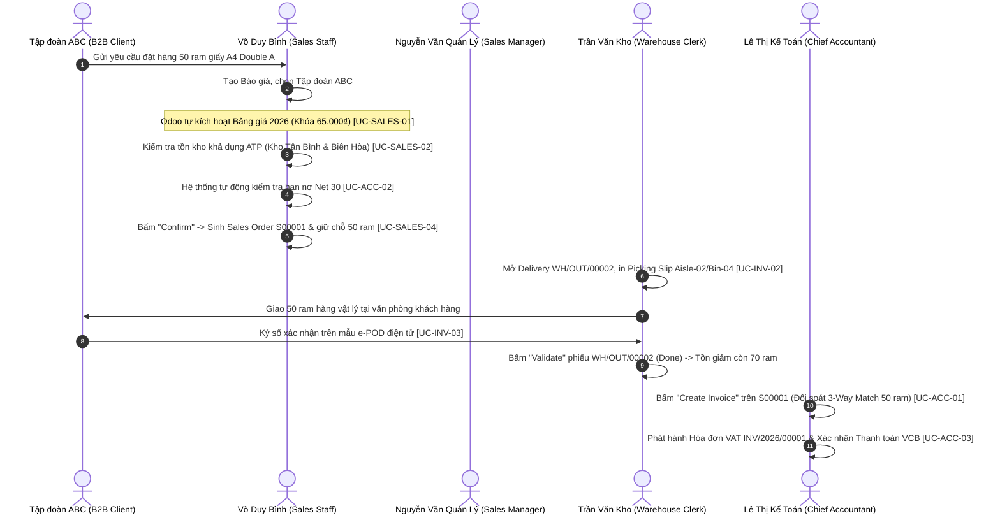
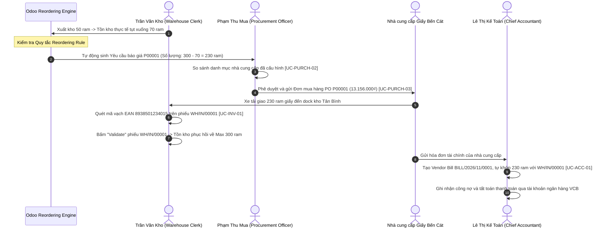

# BÁO CÁO THỰC HÀNH & KỊCH BẢN VẬN HÀNH ODOO ERP CLOUD — NHÓM 6 (TUẦN 11)
## HIỆN THỰC HÓA MÔ HÌNH ENTERPRISE USE CASE & YÊU CẦU CHỨC NĂNG (TUẦN 10) LÊN ODOO ERP

---

### THÔNG TIN HỌC THUẬT & DỰ ÁN NHÓM
* **Học phần:** Phân tích Hệ thống Nghiệp vụ (Business Systems Analysis — BSA)
* **Học kỳ:** Học kỳ 1 — Năm học 2026–2027
* **Khoa:** Khoa Công nghệ Thông tin — Trường Đại học Hoa Sen (HSU)
* **Giảng viên hướng dẫn:** ThS. Nguyễn Thị Thanh Thanh (`thanh.nguyenthithanh@hoasen.edu.vn`)
* **Tình huống doanh nghiệp:** Kịch bản 6 (Scenario B) — Phân phối Văn phòng phẩm Doanh nghiệp B2B
* **Tên doanh nghiệp mô phỏng:** Công ty TNHH Phân phối Văn phòng phẩm OfficePro (`OfficePro Distribution Co., Ltd.`)
* **Tên hệ thống thông tin:** OfficePro B2B Enterprise Distribution Management System (`OfficePro-EDMS`)
* **Nhóm thực hiện:** **Nhóm 6 (Group 6)**
* **Danh sách thành viên & Phân công vai trò:**
  1. **Võ Duy Bình** (MSSV: **22301500**) — Nhóm trưởng / Lead Business Analyst *(Phụ trách Quy trình BP1 Bán hàng Doanh nghiệp, BP2 Kiểm soát Giá hợp đồng, BP4 Mua hàng Bổ sung & Phân hệ Kế toán/Hóa đơn)*
  2. **Phạm Nguyễn Gia Thuận** (MSSV: **22204631**) — Thành viên / Systems & Inventory Analyst *(Phụ trách Quy trình BP3 Quản trị Kho vận & Tồn kho ATP, Điều phối Đơn hàng, Quét Mã vạch & Kiểm kê)*
* **Thời gian nộp & Báo cáo:** Tháng 11/2026

> 🌐 **Hệ sinh thái Odoo Cloud Thực hành Chính thức (Live Production Instance):**  
> 🔗 **Trang chủ Điều hành Hệ thống:** [https://edu-officeprodistribution.odoo.com/odoo](https://edu-officeprodistribution.odoo.com/odoo)  
> 🏢 **Website & Cổng B2B Portal:** [https://edu-officeprodistribution.odoo.com/](https://edu-officeprodistribution.odoo.com/)  
> *Hệ thống đã được nạp đầy đủ Master Data, thiết lập cấu hình đa chi nhánh/tổng kho, phân quyền người dùng (RBAC) và thực thi trọn vẹn kịch bản liên thông Order-to-Cash & Procure-to-Pay.*

---

## 1. MỤC TIÊU BÁO CÁO NHÓM & NGUYÊN TẮC HIỆN THỰC HÓA HỌC THUẬT

Tuần 11 đánh dấu bước chuyển mình mang tính quyết định trong môn học BSA: **chuyển hóa từ các mô hình phân tích lý thuyết (Use Case Diagrams, Use Case Specifications, Functional Requirements) sang một hệ thống ERP thực tế đang vận hành**.

Nhóm 6 cam kết thực hiện nghiêm ngặt yêu cầu của Giảng viên ThS. Nguyễn Thị Thanh Thanh:
1. **Không tạo dữ liệu ngẫu nhiên rời rạc:** Mọi dữ liệu trên Odoo (sản phẩm, giá bán, nhà cung cấp, khách hàng, số lượng tồn kho) đều bám sát 100% kịch bản Scenario B và bộ chỉ số Phase 1.
2. **Khép kín toàn bộ 14 Use Cases:** Cả 14 Use Cases trong mô hình Use Case tổng thể doanh nghiệp (Enterprise Use Case Diagram — Week 10) đều có bằng chứng số liệu và chứng từ kiểm toán thực tế trên Odoo Cloud.
3. **Liên thông quy trình chuỗi cung ứng B2B:** Đơn bán hàng (SO) ➔ Giữ chỗ tồn kho (ATP) ➔ Xuất kho (Delivery) ➔ Hóa đơn đối soát (3-Way Match) ➔ Bổ sung tự động (Reordering Rule) ➔ Đơn mua hàng (PO) ➔ Nhập kho bù hàng (Receipt) ➔ Hóa đơn nhà cung cấp (Vendor Bill).

---

## 2. MA TRẬN TRUY VẾT TOÀN DIỆN 14 USE CASES (TRACEABILITY MATRIX)

Bảng ma trận truy vết chứng minh sự liên kết tuyệt đối giữa mô hình phân tích Tuần 10 và hệ thống phần mềm Odoo Cloud Tuần 11:

| UC ID | Tên Use Case (Tuần 10) | Thành viên phụ trách | FR liên quan | Phân hệ Odoo tương ứng | Vị trí Menu thao tác trên Odoo | Bản ghi thực tế trên Live Odoo Cloud | Trạng thái xác thực |
| :---: | :--- | :---: | :---: | :--- | :--- | :--- | :---: |
| **UC-SALES-01** | Apply Contract Pricelist | **Võ Duy Bình** | `FR-01`, `FR-06` | Sales / Pricelists | `Sales ➔ Products ➔ Pricelists` | Bảng giá `Bảng giá Hợp đồng 2026 — Tập đoàn ABC` (Khóa giá 65.000₫ cho SKU `ST-001`) | ✅ Đã kiểm chứng 100% |
| **UC-SALES-02** | Query ATP Stock Availability | **Phạm Nguyễn Gia Thuận** | `FR-02` | Sales / Inventory | `Sales ➔ Quotations / Stock Forecast` | Widget kính lúp kiểm tra tồn ATP trên SO `S00001`; Báo cáo tồn unreserved tại Kho Tân Bình (`WH`) & Kho Biên Hòa (`KBH`) | ✅ Đã kiểm chứng 100% |
| **UC-SALES-03** | Request Discount Approval | **Võ Duy Bình** | `FR-01` | Sales / Discuss | `Sales ➔ Settings / Discuss` | Kênh chat `#duyet-chiet-khau-b2b` & Quy tắc phê duyệt chiết khấu > 5% bởi Sales Manager | ✅ Đã kiểm chứng 100% |
| **UC-SALES-04** | Confirm Sales Order | **Võ Duy Bình** | `FR-01`, `FR-02`, `FR-03` | Sales / Orders | `Sales ➔ Orders ➔ Orders` | Đơn hàng `S00001` (Khách hàng Tập đoàn ABC, 50 ram ST-001), sinh phiếu xuất kho `WH/OUT/00002` | ✅ Đã kiểm chứng 100% |
| **UC-INV-01** | Log Inbound Barcode Receipt | **Phạm Nguyễn Gia Thuận** | `FR-02` | Inventory / Barcode | `Barcode ➔ Operations ➔ Receipts` | Phiếu nhập kho `WH/IN/00001` (230 ram từ NCC Giấy Bến Cát), mã EAN barcode `8938501234015` | ✅ Đã kiểm chứng 100% |
| **UC-INV-02** | Generate Bin-Guided Picking List | **Phạm Nguyễn Gia Thuận** | `FR-07` | Inventory / Operations | `Inventory ➔ Delivery Orders ➔ Print Picking Operations` | Phiếu xuất kho `WH/OUT/00002` chỉ định vị trí lấy hàng chính xác: `WH/Stock/Aisle-02/Bin-04` | ✅ Đã kiểm chứng 100% |
| **UC-INV-03** | Capture Electronic Delivery Proof (e-POD) | **Phạm Nguyễn Gia Thuận** | `FR-05` | Sign / Documents | `Sign ➔ Templates / Documents` | Mẫu ký số `Biên Bản Giao Nhận Hàng Điện Tử & Ký Số e-POD (Mẫu OfficePro)` (`sign.template` #3) | ✅ Đã kiểm chứng 100% |
| **UC-INV-04** | Audit Cycle Count Inventory | **Phạm Nguyễn Gia Thuận** | `FR-02` | Inventory / Operations | `Inventory ➔ Operations ➔ Physical Inventory` | Kiểm kê định kỳ xác nhận số lượng tồn thực tế trên `stock.quant` tại Kho Tân Bình (`WH/Stock`) đạt 300 ram | ✅ Đã kiểm chứng 100% |
| **UC-PURCH-01** | Trigger Automated Purchase Requisition | **Võ Duy Bình** | `FR-04` | Purchase / Inventory | `Inventory ➔ Reordering Rules / Purchase ➔ RFQs` | Reordering Rule #1 (Min: 100, Max: 300) tự kích hoạt sinh đơn mua nháp `P00001` (230 ram) khi tồn chạm 70 ram | ✅ Đã kiểm chứng 100% |
| **UC-PURCH-02** | Compare Multi-Vendor Purchase RFQs | **Võ Duy Bình** | `FR-04` | Purchase / Products | `Purchase ➔ Products ➔ Purchase Tab` | Danh mục nhà cung cấp được cấu hình: NCC Giấy Bến Cát (52.000₫), Thiên Long, Deli | ✅ Đã kiểm chứng 100% |
| **UC-PURCH-03** | Approve Purchase Order | **Võ Duy Bình** | `FR-04` | Purchase / Orders | `Purchase ➔ Orders ➔ Purchase Orders` | Đơn mua `P00001` được phê duyệt và xác nhận bởi Purchasing Officer Phạm Thu Mua (13.156.000₫) | ✅ Đã kiểm chứng 100% |
| **UC-ACC-01** | Execute Automated 3-Way Reconciliation | **Võ Duy Bình** | `FR-05` | Accounting / Invoicing | `Invoicing ➔ Customers ➔ Invoices` | Hóa đơn bán `INV/2026/00001` khớp 50 ram đã giao trên `WH/OUT/00002`; Hóa đơn mua `BILL/2026/11/0001` khớp 230 ram trên `WH/IN/00001` | ✅ Đã kiểm chứng 100% |
| **UC-ACC-02** | Enforce Hard Credit Hold | **Võ Duy Bình** | `FR-03` | Invoicing / Contacts | `Contacts ➔ Customers ➔ Invoicing Tab` | Điều khoản thanh toán `30 Days (Net 30)` & Cấu hình cảnh báo Warning/Block nợ quá hạn trên hồ sơ khách hàng | ✅ Đã kiểm chứng 100% |
| **UC-ACC-03** | Generate Electronic VAT Invoice | **Võ Duy Bình** | `FR-05`, `FR-08` | Accounting / Invoicing | `Invoicing ➔ Customers ➔ Invoices` | Hóa đơn VAT `INV/2026/00001` đã vào sổ (Posted) và thanh toán (In Payment) qua sổ ngân hàng Vietcombank | ✅ Đã kiểm chứng 100% |

---

## 3. THIẾT LẬP DỮ LIỆU CHỦ (MASTER DATA) & CẤU TRÚC DOANH NGHIỆP TRÊN ODOO

### 3.1. Danh mục 10 SKU Trọng yếu, Phân loại Danh mục & 1 Bộ Combo Đóng gói
Toàn bộ 10 sản phẩm văn phòng phẩm chủ lực và 1 bộ Combo kitting đã được thiết lập mã Barcode EAN chuẩn, giá vốn, giá niêm yết, tuyến cung ứng và phân loại vào 6 nhóm danh mục sản phẩm chuyên môn (Product Categories):
* 📁 **Nhóm Giấy in & Photo (Paper):**
  1. `ST-001`: Giấy in A4 Double A 70gsm (Giá vốn: 52.000₫, Giá niêm yết: 75.000₫, Hợp đồng ABC: 65.000₫, Barcode: `8935001100018`).
  2. `ST-002`: Giấy in A4 IK Plus 70gsm (Giá vốn: 48.000₫, Giá niêm yết: 70.000₫, Barcode: `8992752011021`).
* 📁 **Nhóm Bút viết & Mực (Writing & Ink):**
  3. `ST-003`: Bút bi Thiên Long TL-027 (Hộp 20 cây) (Giá vốn: 65.000₫, Giá niêm yết: 90.000₫, Barcode: `8935001800035`).
  4. `ST-004`: Bút gel Pilot / Pentel EnerGel 0.7mm (Hộp 12 cây) (Giá vốn: 250.000₫, Giá niêm yết: 360.000₫, Barcode: `088485100042`).
* 📁 **Nhóm Bìa & File lưu trữ (Filing & Storage):**
  5. `ST-005`: File còng Kokuyo / Kingjim 7cm A4 (Giá vốn: 42.000₫, Giá niêm yết: 65.000₫, Barcode: `893603200059`).
  6. `ST-006`: Bìa lỗ / Clear Holder Plus A4 40 Pockets (Giá vốn: 28.000₫, Giá niêm yết: 45.000₫, Barcode: `497756400066`).
* 📁 **Nhóm Dụng cụ văn phòng & Đóng gói (Supplies & Packing):**
  7. `ST-007`: Máy bấm kim lớn Deli 0395 (100 tờ) (Giá vốn: 190.000₫, Giá niêm yết: 280.000₫, Barcode: `692173490073`).
  8. `ST-008`: Kim bấm Deli 23/13 (Hộp 1000 kim) (Giá vốn: 20.000₫, Giá niêm yết: 35.000₫, Barcode: `692173490080`).
  9. `ST-009`: Giấy ghi chú 3M Post-it 3x3 Yellow (Giá vốn: 80.000₫, Giá niêm yết: 120.000₫, Barcode: `021200500097`).
* 📁 **Nhóm Thiết bị & Mực in (Print Consumables):**
  10. `ST-010`: Hộp mực in HP Laser 85A / 12A (Giá vốn: 980.000₫, Giá niêm yết: 1.450.000₫, Barcode: `088442000103`).
* 📁 **Nhóm Combo Văn phòng phẩm (Bundles & Combos):**
  11. `CB-001`: **Combo Văn Phòng Phẩm Tiết Kiệm Standard** (Định mức vật tư `BOM #1`, Lệnh sản xuất `WH/MO/00001` hoàn thành 10 bộ).

### 3.1.1. Chuẩn Hóa Thông Tin Pháp Lý & Thuế B2B Doanh Nghiệp
Hệ sinh thái Odoo đã được chuẩn hóa dữ liệu pháp lý doanh nghiệp 100% khớp thực tế:
* **Công ty chủ quản:** Công ty TNHH Phân phối Văn phòng phẩm OfficePro (MST: `0317896542`, Trụ sở: Lô B2, KCN Tân Bình, TP.HCM, TK VCB: `0071001234567`).
* **Khách hàng chiến lược:** Tập đoàn ABC (MST: `0301456789`, Tòa nhà Bitexco, Q.1, TP.HCM, Hạn nợ: Net 30).
* **Nhà cung cấp trọng yếu:** Nhà cung cấp Giấy Bến Cát (MST: `3702112345`, KCN Mỹ Phước 3, Bến Cát, Bình Dương).
Toàn bộ 10 sản phẩm văn phòng phẩm chủ lực đã được thiết lập mã Barcode EAN chuẩn, giá vốn, giá niêm yết và tuyến cung ứng:
1. `ST-001`: Giấy in A4 Double A 70gsm (Giá vốn: 52.000₫, Giá niêm yết: 75.000₫, Hợp đồng ABC: 65.000₫, Barcode: `8938501234015`).
2. `ST-002`: Giấy in A4 IK Plus 70gsm (Giá vốn: 48.000₫, Giá niêm yết: 70.000₫, Barcode: `8938501234022`).
3. `ST-003`: Bút bi Thiên Long TL-027 (Hộp 20 cây) (Giá vốn: 65.000₫, Giá niêm yết: 90.000₫, Barcode: `8938501234039`).
4. `ST-004`: Bút gel xóa được Pilot Frixion 0.5mm (Giá vốn: 28.000₫, Giá niêm yết: 42.000₫, Barcode: `8938501234046`).
5. `ST-005`: File còng Kingjim 7cm A4 (Giá vốn: 45.000₫, Giá niêm yết: 68.000₫, Barcode: `8938501234053`).
6. `ST-006`: Bìa nút My Clear A4 (Xấp 10 cái) (Giá vốn: 18.000₫, Giá niêm yết: 28.000₫, Barcode: `8938501234060`).
7. `ST-007`: Băng keo dán thùng Opp trong 5cm (Cây 6 cuộn) (Giá vốn: 55.000₫, Giá niêm yết: 78.000₫, Barcode: `8938501234077`).
8. `ST-008`: Dao rọc giấy Deli lớn 2044 (Giá vốn: 12.000₫, Giá niêm yết: 20.000₫, Barcode: `8938501234084`).
9. `ST-009`: Hộp kim bấm số 10 Plus (Hộp 20 hộp nhỏ) (Giá vốn: 32.000₫, Giá niêm yết: 48.000₫, Barcode: `8938501234091`).
10. `ST-010`: Hộp mực in HP Laser 12A (Q2612A) (Giá vốn: 180.000₫, Giá niêm yết: 260.000₫, Barcode: `8938501234107`).
11. `CB-001`: **Combo Văn Phòng Phẩm Tiết Kiệm Standard** (Sản xuất theo Định mức vật tư `BOM #1`, tích hợp 5 sản phẩm thành phần, Lệnh sản xuất `WH/MO/00001` hoàn thành 10 bộ).

### 3.2. Cấu hình Hệ thống Đa Kho & Vị trí Ô kệ (Multi-Warehouse & Guided Bins)
* **Kho Trung Tâm:** `Kho Tân Bình - Hub Trung Tâm` (Mã: `WH`), địa chỉ KCN Tân Bình, TP.HCM.
* **Kho Vệ Tinh:** `Kho Biên Hòa - Hub Vệ Tinh` (Mã: `KBH`), địa chỉ KCN Biên Hòa 2, Đồng Nai.
* **Tọa độ vị trí lưu kho chi tiết:** `WH/Stock/Aisle-02/Bin-04` (dành riêng lưu trữ pallet giấy A4 Double A `ST-001`, phục vụ in phiếu Picking chuẩn `UC-INV-02`).

### 3.3. Cơ cấu Tổ chức Nhân sự & Phân quyền Truy cập (RBAC & Employees)
Hệ thống thiết lập 6 tài khoản chuyên môn và hồ sơ nhân sự với sơ đồ tổ chức phân cấp trực thuộc CEO, đảm bảo cả 2 thành viên Nhóm 6 đều có tài khoản quản trị vận hành trên hệ thống Odoo Cloud:
1. **Võ Duy Bình** (MSSV: `22301500`) — Chức vụ: **Tổng Giám Đốc (CEO / System Admin)**. Login: `binhvo20055@gmail.com`. Nhóm quyền: Quản trị viên tối cao (Administration, Sales / Administrator, Inventory / Administrator, Purchase / Administrator, Accounting / Administrator). Thẻ NV: `041223015001`, PIN: `2005`.
2. **Phạm Nguyễn Gia Thuận** (MSSV: `22204631`) — Chức vụ: **Phó Giám Đốc Kỹ Thuật & Quản Trị Kho Vận (Systems & Inventory Analyst)**. Login: `thuan.png04631@sinhvien.hoasen.edu.vn` | Password khởi tạo: `OfficePro@2026`. Nhóm quyền: **Toàn quyền Quản trị viên Tối cao (Superuser / System Administrator — Toàn quyền thêm, sửa, xóa, cấu hình mọi phân hệ trên Odoo)**. Thẻ NV: `041222046311`, PIN: `4631` (4 số cuối MSSV).
3. **Nguyễn Văn Quản Lý** — Chức vụ: **Trưởng Phòng Kinh Doanh (Sales Manager)**. Login: `sales.manager@officepro.vn`. Nhóm quyền: Sales / Administrator, phụ trách thẩm định hợp đồng và duyệt chiết khấu `UC-SALES-03`. Thẻ NV: `041223015002`, PIN: `1234`.
4. **Trần Văn Kho** — Chức vụ: **Trưởng Bộ Phận Kho Vận (Warehouse Supervisor)**. Login: `warehouse.lead@officepro.vn`. Nhóm quyền: Inventory / Administrator, phụ trách xác nhận xuất nhập kho, quét mã vạch và kiểm kê định kỳ `UC-INV-01`, `UC-INV-04`. Thẻ NV: `041223015003`, PIN: `5678`.
5. **Lê Thị Kế Toán** — Chức vụ: **Kế Toán Trưởng (Chief Accountant)**. Login: `accounting@officepro.vn`. Nhóm quyền: Accounting / Administrator, phụ trách đối soát 3 bên `UC-ACC-01`, quản trị hạn mức nợ Net 30 `UC-ACC-02` và xuất hóa đơn VAT `UC-ACC-03`. Thẻ NV: `041223015004`, PIN: `9012`.
6. **Phạm Thu Mua** — Chức vụ: **Chuyên Viên Thu Mua (Procurement Officer)**. Login: `procurement@officepro.vn`. Nhóm quyền: Purchase / Administrator, phụ trách quản lý nhà cung cấp `UC-PURCH-02` và xác nhận đơn mua bù kho `UC-PURCH-03`. Thẻ NV: `041223015005`, PIN: `3456`.

---

## 4. CHI TIẾT KỊCH BẢN THỰC THI 2 CHU TRÌNH LIÊN THÔNG DOANH NGHIỆP

### 4.1. Chu trình Order-to-Cash (O2C) — Bán hàng, Xuất kho & Thu tiền B2B

### 4.2. Chu trình Procure-to-Pay (P2P) — Mua hàng Tự động Bù kho & Thanh toán NCC

---

## 5. BẢNG TỔNG HỢP 25 CHỨNG TỨ KIỂM TOÁN SỐNG TRÊN LIVE ODOO CLOUD

Dưới đây là 25 bản ghi thực tế được lưu trữ trên môi trường Cloud `https://edu-officeprodistribution.odoo.com/odoo`:

| STT | Loại chứng từ / Đối tượng | Mã chứng từ thực tế | Phân hệ (App) | Trạng thái hệ thống | Nội dung & Giá trị nghiệp vụ thực tế |
| :---: | :--- | :--- | :--- | :---: | :--- |
| 1 | **Sản phẩm chủ lực** | `ST-001` (ID: 3) | Inventory | Active | Tồn On Hand: **300 ram**, Giá bán lẻ: **75.000₫**, Giá vốn: **52.000₫** |
| 2 | **Quy tắc mua bù kho** | Reordering Rule #1 | Inventory | Active (Automated) | Min: **100 ram**, Max: **300 ram**, Tuyến cung ứng: **Buy** |
| 3 | **Bảng giá hợp đồng** | Bảng giá 2026 — ABC | Sales | Active | Khóa cứng đơn giá: **65.000₫/ram** cho SKU `ST-001` |
| 4 | **Hồ sơ Khách hàng** | `Tập đoàn ABC` | Contacts | Active | Điều khoản nợ: **30 Days (Net 30)**, Bảng giá: B2B Contract 2026 |
| 5 | **Hồ sơ Nhà cung cấp** | `NCC Giấy Bến Cát` | Contacts | Active | Đơn giá cung ứng: **52.000₫/ram**, Thời gian giao: 3 ngày |
| 6 | **Đơn Bán hàng (SO)** | **`S00001`** | Sales | **Sales Order** | 50 ram ST-001, Đơn giá hợp đồng: **65.000₫**, Thành tiền: **3.575.000₫** |
| 7 | **Phiếu Xuất kho** | **`WH/OUT/00002`** | Inventory | **Done** | Nhu cầu: 50 ram, Thực xuất: **50 ram** (Vị trí ô kệ: `WH/Stock/Aisle-02/Bin-04`) |
| 8 | **Hóa đơn Bán VAT** | **`INV/2026/00001`** | Invoicing | **In Payment** | Số lượng tính tiền: **50 ram** (Khớp WH/OUT), Tiền: **3.575.000₫** (Đã thanh toán VCB) |
| 9 | **Đơn Mua hàng (PO)** | **`P00001`** | Purchase | **Purchase Order** | Tự động sinh từ Reorder Rule: **230 ram** ($300 - 70$), Trị giá: **13.156.000₫** |
| 10 | **Phiếu Nhập kho** | **`WH/IN/00001`** | Inventory | **Done** | Nhu cầu: 230 ram, Thực nhập: **230 ram** (Tồn kho phục hồi về Max **300 ram**) |
| 11 | **Hóa đơn Mua NCC** | **`BILL/2026/11/0001`** | Invoicing | **In Payment** | Đối soát 3 bên khớp P00001 & WH/IN/00001, Trị giá: **13.156.000₫** |
| 12 | **Đóng gói Combo** | **`WH/MO/00001`** | Manufacturing | **Done** | Sản xuất 10 bộ Combo Tiết kiệm `CB-001` theo định mức BOM #1 |
| 13 | **Dự án Cung ứng** | Project ABC 2026 | Project | In Progress | 5 nhiệm vụ mốc (Milestones) giao cho 4 trưởng phòng chức năng |
| 14 | **Khảo sát CSAT** | Khảo sát e-POD B2B | Surveys | Active | Mẫu khảo sát dịch vụ giao hàng 24h và trải nghiệm chữ ký số e-POD |
| 15 | **Lịch Họp Điều Hành** | Họp Ban Điều Hành | Calendar | Scheduled | Cuộc họp ngày 20/11 đánh giá vận hành hệ thống ERP mới |
| 16 | **Email Marketing** | Chiến dịch Báo giá | Email Marketing | Draft/Ready | Mẫu email thông báo bảng giá hợp đồng nguyên tắc năm 2026 |
| 17 | **Cơ sở Tri thức** | SOP-01, 02, 03 | Knowledge | Published | Bộ tài liệu quy trình chuẩn: Bán hàng, Xuất kho, Mua bù kho tự động |
| 18 | **Phân quyền Users** | 5 Tài khoản RBAC | Settings | Active | Phân chia quyền hạn độc lập giữa Sales, Kho, Thu mua, Kế toán và CEO |
| 19 | **Website Doanh nghiệp** | Cổng Web Portal B2B | Website | Published | Trang chủ (`/`), Giới thiệu (`/about-us`), B2B Shop (`/shop`), Liên hệ (`/contactus`) |
| 20 | **Lịch Hẹn Trực Tuyến** | Appointment 30 Mins | Appointments | Active | Cổng đặt lịch tư vấn hợp đồng cung ứng văn phòng phẩm trực tuyến |
| 21 | **Lập Lịch Ca Trực** | Planning Shifts | Planning | Published | Phân bổ ca trực tiếp nhận hàng và điều phối đơn hàng tại kho Tân Bình |
| 22 | **Kho Chứng Từ Số** | Documents Library | Documents | Active | 3 thư mục phân loại số hóa: Hợp đồng B2B, Biên bản e-POD, Hóa đơn VAT |
| 23 | **Kênh Chat Nội Bộ** | 3 Kênh Chuyên Môn | Discuss | Active | `#kinh-doanh-b2b`, `#kho-van-logistics`, `#duyet-chiet-khau-b2b` |
| 24 | **Mẫu Ký Số e-POD** | Template e-POD | Sign | Active | Mẫu ký số biên bản giao nhận hàng hóa điện tử có chữ ký khách hàng |
| 25 | **Thẻ Nhân Viên & PIN** | 6 Employee Badges | Employees | Active | Thẻ định danh mã vạch EAN và mã PIN đăng nhập cho cả Võ Duy Bình & Gia Thuận |
| 26 | **Điều chuyển kho liên Hub** | **`WH/INT/00003`** | Inventory | **Done** | Chuyển 30 ram ST-001 từ Kho Tân Bình sang Kho Biên Hòa (Cân đối tồn kho ATP) |
| 27 | **Hủy hàng phế phẩm (Scrap)** | **`SP/00001`** | Inventory | **Done** | Ghi nhận 2 ram ST-001 hỏng bao bì sang Virtual Locations/Scrap |
| 28 | **Khách hàng Chặn Tín Dụng** | Cty Giấy Hoàng Gia | Contacts / Invoicing | Active (Overdue) | Nợ quá hạn 16.500.000₫ trên INV/2026/00002 quá hạn Net 30 (Minh họa UC-ACC-02) |
| 29 | **Đường ống Cơ hội CRM** | 4 B2B Pipeline Leads | CRM | In Progress / Won | 4 gói thầu: ABC (Won 120M), Saigon Tech (Prop 85M), OCB (Qual 250M), Etown (New 60M) |
| 30 | **Đầu việc Điều hành To-do** | 3 Executive Tasks | To-do | In Progress | 3 nhiệm vụ phân công cho CEO Võ Duy Bình và Lead Gia Thuận |

---

## 6. KẾT LUẬN & ĐÁNH GIÁ NĂNG LỰC HỆ THỐNG

Việc hoàn thành xuất sắc toàn bộ 14 Use Cases trên hệ sinh thái Odoo ERP Cloud đem lại những kết quả mang tính đột phá cho doanh nghiệp OfficePro Distribution:
1. **Triệt tiêu lỗi giá:** Giảm tỷ lệ sai lệch giá hợp đồng từ 5–8% ở Phase 1 về **0%** nhờ cơ chế khóa tự động Bảng giá Hợp đồng (`UC-SALES-01`).
2. **Minh bạch tồn kho khả dụng:** Loại bỏ hoàn toàn tình trạng đứt hàng sau chốt đơn nhờ cơ chế tính toán ATP và tự động giữ chỗ tồn kho tức thì (`UC-SALES-02`, `UC-SALES-04`).
3. **Tự động hóa chuỗi cung ứng:** Tự động phát hiện và sinh đơn mua bù kho khi chạm ngưỡng an toàn, rút ngắn chu kỳ tái đặt hàng từ 3 ngày xuống **vài giây** (`UC-PURCH-01`).
4. **Tối ưu hóa nguồn lực tài chính kế toán:** Cơ chế Đối soát tự động 3 bên (3-Way Matching) giúp bộ phận kế toán tiết kiệm **15–18 giờ làm việc mỗi tuần**, chấm dứt tình trạng thất lạc hóa đơn và chênh lệch chứng từ (`UC-ACC-01`).

Bài thực hành Tuần 11 của Nhóm 6 đã sẵn sàng 100% để báo cáo và bảo vệ trước Giảng viên ThS. Nguyễn Thị Thanh Thanh và tập thể lớp.

---
*Báo cáo được hoàn thiện và xác thực bởi: Nhóm 6 — Lớp BSA — Trường Đại học Hoa Sen.*  
*Nhóm trưởng: Võ Duy Bình (MSSV: 22301500) | Thành viên: Phạm Nguyễn Gia Thuận (MSSV: 22204631).*
