## WEEK 5 — REVISED AS-IS PROCESS SUBMISSION

**Submission Type:** Group Assignment
**Responsible:** Group Leader

### Task Description

Based on your group's in-class review and peer feedback, the group leader consolidates the final results into one file.

### Required Contents

1. **Process Scope:** Process name, trigger, start point, end point, business outcome, and main actors.
2. **Process Table:** Steps, actors, activities, information, and handoffs.
3. **Revised AS-IS Flowchart:** A clear visual representation of the current process.
4. **Review Notes:** Key changes made and any unresolved questions or assumptions.

Ensure that the process table and flowchart are consistent with each other and reflect the available evidence.

**File Format:** PDF
**File Name:** `W5_ASIS_Group[GroupNumber].pdf`
**Submission:** One file per group, submitted by the group leader on Moodle.

**Important:** Document the current process based on evidence. Do not propose a TO-BE process or technology solution at this stage.

---

# GROUP 6 — REVISED AS-IS PROCESS SUBMISSION (WEEK 5)
## B2B WHOLESALE & DISTRIBUTION — OFFICE SUPPLIES & STATIONERY

* **Course:** Business Systems Analysis (BSA) — Academic Year 2026–2027 (Semester 1)
* **Instructor:** MSc. Nguyen Thi Thanh Thanh | Faculty of Technology, Hoa Sen University
* **Assigned Business Scenario:** Scenario B — B2B Wholesale & Distribution (Office Supplies & Stationery)
* **Enterprise Case:** Công ty TNHH Phân phối Văn phòng phẩm OfficePro (`OfficePro Distribution Co., Ltd.`)
* **Target Deliverable Filename:** `W5_ASIS_Group6.pdf`
* **Moodle Submission Responsible:** Group Leader

### 👥 Group Members & Role Assignments
1. **Võ Duy Bình (Student ID: 22301500)** — **Group Leader / Lead Business Analyst & Solutions Architect**  
   *Scope Responsibilities:* Order Inquiry Ingestion, Contract Pricing Agreement Verification, Commercial Margin Discount Evaluation & Procurement Logistics.
2. **Phạm Nguyễn Gia Thuận (Student ID: 22204631)** — **QA Specialist & Solution Configurator**  
   *Scope Responsibilities:* Warehouse Stock Verification, Order Picking & Packing, Physical Delivery Handoffs, Manual 3-Way Reconciliation & Accounts Receivable (AR) Invoicing.

---

## 1. PROCESS SCOPE

| Scope Attribute | Detailed Definition & Operational Boundaries |
| :--- | :--- |
| **Process Name** | **Fulfilling B2B Corporate Wholesale Orders under Framework Agreements** |
| **Process Trigger** | Corporate B2B Customer (e.g., Enterprise, School, Government Agency, Retail Dealer) submits a Purchase Inquiry / Request for Quotation (RFQ) via corporate Email or official Zalo OA containing requested SKUs (`ST-001` to `ST-010`), target quantities, and required delivery date. |
| **Start Point** | B2B Sales Representative receives the incoming inquiry in their email/Zalo inbox and initiates manual contract pricing lookups from decentralized customer agreement files. |
| **End Point** | Physical goods are inspected and delivered to the customer premises, customer signs and stamps the physical Delivery Note, AR Accountant completes manual 3-way matching, issues the official electronic VAT Invoice, and records the trade receivable balance under Net 30 payment terms. |
| **Business Outcome** | The B2B corporate customer receives the ordered stationery items in accordance with their contractual pricing terms, while OfficePro realizes B2B wholesale revenue, relieves warehouse stock inventory, and formally records trade credit debt under standard Net 30 payment terms. |
| **Main Actors (6 Roles)** | **1. B2B Corporate Customer:** External procurement officer requesting stationery supplies, verifying quotations, receiving goods, and executing payments. **2. B2B Sales Representative:** Commercial owner handling inquiry reception, contract price lookups, stock checks, discount requests, quotation generation, and paper sales order printing. **3. Sales Manager:** Department supervisor reviewing margin exceptions for discounts > 5% and authorizing informal verbal credit overrides for overdue accounts to meet revenue quotas. **4. Warehouse Keeper:** Logistics operator checking physical shelves at Tan Binh Central Hub, picking non-barcoded stock based on memory, packing cartons, and preparing printed delivery notes. **5. Delivery Driver:** Internal fleet driver transporting physical cartons, securing customer signatures on paper delivery slips, and returning signed slips to the office. **6. Accounts Receivable (AR) Accountant:** Finance staff manually cross-referencing paper sales orders, signed delivery notes, and billing spreadsheets, issuing VAT e-invoices, and logging Net 30 debt. |

---

## 2. REVISED AS-IS PROCESS TABLE

> **Status Legend:**  
> * **CONFIRMED:** Directly verified by Week 2 stakeholder interviews, physical artifacts, and Week 4 simulation observations.  
> * **REVISED:** Updated following Week 4 in-class simulation audit and peer review feedback to reflect operational realities and workarounds.  
> * **UNCERTAIN:** Information remains partially incomplete or lacks formal operational documentation.  
> * **ASSUMPTION:** Inferred operational practice based on prevailing wholesale industry standards.

| Step | Actor | Activity Phrasing   `[Verb] + [Noun]` | Information & Input Used | Output & Handoff | Evidence Status |
| :---: | :--- | :--- | :--- | :--- | :---: |
| **1.0** | **B2B Customer** | **Submits Order Inquiry** | • Purchase requisition list • Requested SKUs (`ST-001` to `ST-010`) • Target quantities & delivery deadline | Purchase Inquiry Email / Zalo message  ➔ *Handoff to Sales Rep* | **CONFIRMED**  *(Customer Interview & Week 4 In-Class Simulation)* |
| **2.0** | **Sales Rep** | **Looks Up Contract Unit Prices** | • Shared Drive Framework Agreement PDFs (`HĐ-2026/OP-B2B`) • Sales Rep's personal Excel lookup sheet (`BangGia_KhachHang_2026.xlsx`) | Validated contract unit prices per SKU (e.g., `ST-001` @ 65,000 VND vs. list price 72,000 VND) | **CONFIRMED**  *(Sales Manager Interview: key driver of 5–8% pricing error rate)* |
| **3.0** | **Sales Rep** | **Verifies Physical Stock Availability** | • Morning static Excel Inventory Export (`TonKho_TanBinh_Daily.xlsx`) • Informal direct phone call / Zalo chat with Warehouse Keeper | Verified stock availability status (In-Stock / Pending Receiving Delay / Stockout) | **REVISED**  *(Clarified after simulation: goods at receiving dock take 24–48h to become visible)* |
| **4.0** | **Sales Rep & Sales Manager** | **Evaluates Price Discount Threshold** | • Quoted line item margin threshold • Requested customer volume discount percentage (> 5% threshold) | Verbal / Zalo message discount approval or rejection  ➔ *Sales Manager to Sales Rep* | **REVISED**  *(Explicit decision gateway added following peer review)* |
| **5.0** | **Sales Rep** | **Checks Customer Credit Aging Status** | • Monthly Accounts Receivable Excel Ledger (`CongNo_AR_Monthly.xlsx`) • Corporate Credit Policy document | Credit health evaluation: Good Standing vs. Overdue Debt > 30 Days | **CONFIRMED**  *(Chief Accountant Interview: debt is tracked on static Excel sheets)* |
| **6.0** | **Sales Manager** | **Overrides Credit Hold Informally** | • Outstanding debt aging summary • Commercial revenue quota targets • Longstanding corporate account history | Verbal credit hold override authorization  ➔ *Handoff to Sales Rep* | **REVISED**  *(Simulation Audit: replaced theoretical strict block with real informal workaround)* |
| **7.0** | **Sales Rep** | **Drafts and Issues Sales Quotation** | • Validated contract unit prices • Confirmed warehouse stock availability • Standard Net 30 payment credit terms | Formal PDF Sales Quotation (`BG-2026-XXXX.pdf`) emailed  ➔ *Handoff to B2B Customer* | **CONFIRMED**  *(Standard operational procedure verified across all sales reps)* |
| **8.0** | **B2B Customer & Sales Rep** | **Confirms Quotation and Issues Paper Sales Order** | • Customer-signed Quotation / PO returned via email • Sales Rep workstation & laser printer | Two printed paper Sales Order copies (`ĐBH-XXXX`)  ➔ *Physical handoff to Warehouse & Accounting* | **REVISED**  *(Granular handoff clarified; captures physical paper dispatch friction)* |
| **9.0** | **Warehouse Keeper** | **Picks and Packs Physical Stock** | • Physical paper Sales Order (`ĐBH-XXXX`) • Warehouse keeper memory of bin shelf locations • Manual packaging cartons & strapping | Boxed stationery items + 2 printed Delivery Notes (`Phiếu Xuất Kho kiêm Vận Chuyển`)  ➔ *Handoff to Delivery Driver* | **CONFIRMED**  *(Warehouse Keeper Interview: no barcode scanners; picking relies on memory)* |
| **10.0** | **Delivery Driver & Customer** | **Transports Goods and Obtains Delivery Signature** | • Company delivery van • Boxed stationery shipments • Physical Delivery Note (2 paper copies) | Physical shipment accepted at client site; 1 signed/stamped Delivery Note returned  ➔ *Handoff to AR Accountant* | **CONFIRMED**  *(Logistics records & proof of delivery physical requirement)* |
| **11.0** | **AR Accountant** | **Reconciles Documents and Issues Customer VAT Invoice** | • Physical paper Sales Order • Customer-signed Delivery Note • Excel Billing Ledger (`TheoDoi_HoaDon_2026.xlsx`) • Electronic Tax Invoice Portal | Official electronic VAT Invoice transmitted to client; Net 30 trade debt balance updated in Excel | **CONFIRMED**  *(Chief Accountant Interview: manual 3-way matching takes 15–20h/week)* |

---

## 3. REVISED AS-IS FLOWCHART

The following flowchart strictly correlates 1-to-1 with the 11 steps, actor lanes, and decision gateways detailed in the Process Table above.

```mermaid
flowchart TD
    %% Start Event
    Start([1.0 START: Customer Submits Order Inquiry via Email/Zalo]) --> Step2[2.0 Sales Rep Looks Up Contract Unit Prices from Excel/PDF]
    
    %% Pricing & Stock Verification
    Step2 --> Step3[3.0 Sales Rep Verifies Stock via Phone Call / Daily Excel Dump]
    Step3 --> GateStock{Physical Stock Available?}
    
    GateStock -- No --> StockNegotiate[Sales Rep Calls Customer to Negotiate Partial Delivery or Extended Lead Time]
    StockNegotiate --> GateStockAccept{Customer Accepts Delay?}
    GateStockAccept -- No --> EndStockCancel([END: Order Cancelled Due to Stockout])
    GateStockAccept -- Yes --> GateDiscount
    
    GateStock -- Yes --> GateDiscount{Requested Discount > 5%?}
    
    %% Manager Approval Gate
    GateDiscount -- Yes --> Step4[4.0 Sales Rep Requests Verbal Discount Approval from Sales Manager]
    Step4 --> GateMgrDiscount{Sales Manager Approves Discount?}
    GateMgrDiscount -- No --> DisPriceRevise[Sales Rep Resets Price to Standard Contract Baseline]
    DisPriceRevise --> Step5
    GateMgrDiscount -- Yes --> Step5
    GateDiscount -- No --> Step5[5.0 Sales Rep Checks Customer Credit Aging Status in AR Excel]
    
    %% Credit Gate & Informal Override
    Step5 --> GateDebt{Customer Debt Overdue > 30 Days?}
    GateDebt -- Yes --> Step6[6.0 Workaround: Sales Manager Grants Verbal Credit Override]
    Step6 --> GateCreditApprove{Manager Authorizes Override?}
    GateCreditApprove -- No --> EndCreditHold([END: Order Placed on Indefinite Credit Hold])
    GateCreditApprove -- Yes --> Step7
    GateDebt -- No --> Step7[7.0 Sales Rep Drafts and Issues PDF Sales Quotation to Customer]
    
    %% Customer Confirmation Gate
    Step7 --> GateQuote{Customer Accepts & Signs Quotation?}
    GateQuote -- No --> EndQuoteReject([END: Order Cancelled / Price Renegotiation])
    GateQuote -- Yes --> Step8[8.0 Sales Rep Creates and Prints 2 Paper Sales Orders]
    
    %% Fulfillment & Logistics Execution
    Step8 --> Step9[9.0 Warehouse Keeper Picks Stock via Memory, Packs Cartons & Prints Delivery Note]
    Step9 --> Step10[10.0 Delivery Driver Transports Goods to Client Site & Obtains Stamped Signature]
    
    %% Invoicing & Debt Finalization
    Step10 --> Step11[11.0 AR Accountant Performs Manual 3-Way Match & Issues VAT Invoice]
    Step11 --> EndSuccess([11.0 END: Goods Delivered, VAT Invoice Issued & Net 30 Debt Ledger Updated])

    %% Styling Elements for Visual Hierarchy
    classDef startEnd fill:#1e293b,stroke:#0ea5e9,stroke-width:2px,color:#ffffff;
    classDef activity fill:#ffffff,stroke:#3b82f6,stroke-width:1.5px,color:#0f172a;
    classDef decision fill:#fef3c7,stroke:#f59e0b,stroke-width:1.5px,color:#78350f;
    classDef cancel fill:#fee2e2,stroke:#ef4444,stroke-width:1.5px,color:#7f1d1d;

    class Start,EndSuccess startEnd;
    class Step2,Step3,Step4,Step5,Step6,Step7,Step8,Step9,Step10,Step11,StockNegotiate,DisPriceRevise activity;
    class GateStock,GateStockAccept,GateDiscount,GateMgrDiscount,GateDebt,GateCreditApprove,GateQuote decision;
    class EndStockCancel,EndCreditHold,EndQuoteReject cancel;
```

---

## 4. REVIEW NOTES: EVIDENCE AUDIT, PEER FEEDBACK & UNRESOLVED QUESTIONS

### 4.1. Key Changes Made After Evidence Audit & In-Class Simulation
During the Week 4 in-class simulation and comparison against Week 2 interview records, our group audited the preliminary AS-IS model developed in Week 3. We identified four major operational discrepancies where our initial draft was overly idealized:

1. **Credit Control Realism (Informal Verbal Override vs. Strict Block):**
   * *Previous Draft (Week 3):* The process assumed that any customer with an overdue debt exceeding 30 days was automatically stopped by accounting policy.
   * *Evidence Audit Finding (Week 4 Simulation & Chief Accountant Interview):* In reality, no automated system lock exists. Sales Representatives actively lobby the Sales Manager, who routinely issues **informal verbal credit overrides** to prevent losing valuable wholesale accounts and to ensure sales reps meet monthly revenue quotas.
   * *Revision Made:* Step 6.0 and the corresponding decision gate were updated to reflect this manual workaround rather than an artificial, idealized enforcement.

2. **Inventory Visibility Lag ("Invisible Stock" at Receiving Dock):**
   * *Previous Draft (Week 3):* Stock checks were modeled as instantaneous lookups between the Sales Rep and the Warehouse inventory list.
   * *Evidence Audit Finding (Warehouse Keeper Interview):* Supplier replenishment shipments arriving at the Tan Binh warehouse dock sit in physical receiving staging for **24 to 48 hours** before staff log them into the static daily Excel sheet. Consequently, Sales Reps frequently declare items "out of stock" when they are physically on-site, or confirm orders that turn into post-confirmation stockouts (causing 3–4 order cancellations per week).
   * *Revision Made:* Step 3.0 was revised to specify that stock checks rely on static morning dumps (`TonKho_TanBinh_Daily.xlsx`) supplemented by informal phone calls/Zalo messages to warehouse personnel.

3. **Decentralized Excel Contract Pricing Silos:**
   * *Previous Draft (Week 3):* The model implied sales reps accessed a single, standardized contract price list.
   * *Evidence Audit Finding (Sales Manager Interview & Customer Billing Audit):* Because master framework agreements are stored as static PDFs on a shared network drive, individual sales reps maintain **their own detached, personal Excel spreadsheets**. Outdated versions lead to a **5% to 8% discrepancy rate** between quoted prices and contractually agreed prices, costing the firm approximately 50,000,000 VND monthly in delayed payments and billing disputes.
   * *Revision Made:* Step 2.0 explicitly models the personal Excel lookup behavior to preserve the current state's operational friction.

4. **Granular Handoff Separation (Physical Delivery vs. Accounting 3-Way Match):**
   * *Previous Draft (Week 3):* Delivery and invoicing were conflated into a single terminal activity.
   * *Evidence Audit Finding (Chief Accountant & Delivery Log Records):* Delivery and invoicing are decoupled by substantial time and manual friction. Physical transport occurs via delivery vans, requiring a physical signature on paper Delivery Notes. The paper document must then travel back to the headquarters office, where the AR Accountant spends **15 to 20 hours per week** performing manual 3-way reconciliation (Paper SO vs. Signed Delivery Note vs. Excel Billing Sheet) before an electronic VAT invoice can be issued.
   * *Revision Made:* Separated into two distinct sequential steps: Step 10.0 (Logistics Delivery & Signature Capture) and Step 11.0 (Manual 3-Way Document Reconciliation & VAT Invoicing).

---

### 4.2. Peer-Review Feedback Received & Corrections Applied

Following the Phase 4 Peer Review session in class, our AS-IS model was evaluated by an external peer group. The following structured feedback was addressed:

| Peer-Review Evaluation Area | Peer Review Observation & Question | Action Taken & Model Correction |
| :--- | :--- | :--- |
| **Exception Path Completeness** | *"Your Week 3 flowchart only showed the 'happy path'. What happens if the customer refuses the quotation or if the Sales Manager rejects the credit override?"* | **Corrected in Flowchart & Table:** Added explicit exception termination states: `[END: Order Placed on Credit Hold]` and `[END: Order Cancelled / Price Renegotiation]` to ensure non-happy paths are fully documented. |
| **Communication Medium Specificity** | *"Step 3 states 'Checks stock availability' but does not specify how the Sales Rep communicates with the warehouse without an ERP."* | **Corrected in Step 3.0:** Explicitly detailed the specific artifacts and communication channels used: morning static export file (`TonKho_TanBinh_Daily.xlsx`) followed by informal phone calls or direct Zalo messages to the warehouse keeper. |
| **Physical Artifact Handoffs** | *"How does the warehouse know what to pack if the Sales Rep receives a digital email from the client?"* | **Corrected in Step 8.0:** Added the explicit physical activity where the Sales Rep creates and physically prints two paper copies of the Sales Order (`ĐBH-XXXX`) and walks them over to the warehouse and accounting desks. |

---

### 4.3. Unresolved Questions for Subsequent Stakeholder Investigation

To further refine our understanding of the enterprise's operational boundaries in upcoming investigation phases, the following unresolved questions have been recorded:

1. **For the Sales Manager & Chief Financial Officer (Credit Policy Governance):**
   * *Question:* *"Is there an absolute monetary debt ceiling (e.g., > 100,000,000 VND) at which verbal credit overrides are strictly prohibited by executive leadership, or does manager discretion apply universally regardless of overdue amount or aging length?"*
   * *Information Needed:* Formal company financial bylaws or minutes from commercial credit committee meetings.

2. **For the Warehouse Supervisor (Stock Allocation Conflicts):**
   * *Question:* *"When two Sales Representatives submit paper Sales Orders simultaneously for the same remaining lot of high-velocity stationery items (e.g., Double A A4 80gsm `ST-001`), what exact rule governs who receives the stock? Is it strictly first-come-first-served, or do VIP corporate contract clients take precedence?"*
   * *Information Needed:* Direct observation of picking priority during stock contention events at the Tan Binh facility.

3. **For the Procurement Officer (Out-of-Stock Replenishment Triggers):**
   * *Question:* *"When a stockout is declared during order inquiry, does the Sales Rep notify Purchasing directly, or does Purchasing only reorder when the Warehouse Keeper manually flags an empty bin shelf on paper?"*
   * *Information Needed:* Procurement replenishment logs and vendor Purchase Order lead-time records.

---

### 4.4. Documented Assumptions Requiring Verification

The following operational assumptions are maintained in the current AS-IS baseline, pending final confirmation:

* **Assumption A1 (Warehouse Allocation Logic):** It is assumed that all orders originating from corporate clients within Ho Chi Minh City are fulfilled exclusively from the Tan Binh Central Logistics Hub (holding ~80% of total company inventory), whereas the Bien Hoa Depot is dedicated solely to industrial park clients in Dong Nai province.
* **Assumption A2 (Credit Term Uniformity):** It is assumed that standard Net 30 payment terms apply universally to all corporate clients holding active framework agreements, unless a customized addendum signed by the General Director specifies Net 15 or Net 45.

---

## 5. AS-IS PROCESS QUALITY CHECKLIST (SELF-ASSESSMENT)

In accordance with the Faculty of Technology quality rubric (Slide 7), Group 6 completed the following verification prior to final consolidation:

* [x] **Process Name and Scope:** Specific, bounded, and formatted strictly using `[Verb] + [Noun]` phrasing (`Fulfilling B2B Corporate Wholesale Orders under Framework Agreements`).
* [x] **Trigger and Start Point:** Precisely defined as the receipt of an inbound RFQ / inquiry via Email or Zalo OA.
* [x] **End Point and Business Outcome:** Clearly marks the receipt of customer-signed delivery documentation, VAT invoice transmission, and Net 30 debt ledger recording.
* [x] **Identifiable Actors:** Every single activity is assigned to an unambiguous organizational role (Customer, Sales Rep, Sales Manager, Warehouse Keeper, Delivery Driver, AR Accountant).
* [x] **Logical Sequencing & Handoffs:** All physical documents (Paper SO, Delivery Notes) and digital files (Excel sheets, PDF quotes) are mapped sequentially with clear handoff targets.
* [x] **Realistic Workarounds Preserved:** Informal verbal credit overrides and personal Excel pricing files are deliberately preserved (not sanitized or idealized).
* [x] **1-to-1 Diagram Alignment:** The Mermaid flowchart directly mirrors the 11 steps and decision gates of the revised process table without omission.
* [x] **Strict AS-IS Integrity:** Absolutely **NO TO-BE improvements, ERP recommendations, or future-state software solutions** are included in this deliverable.

