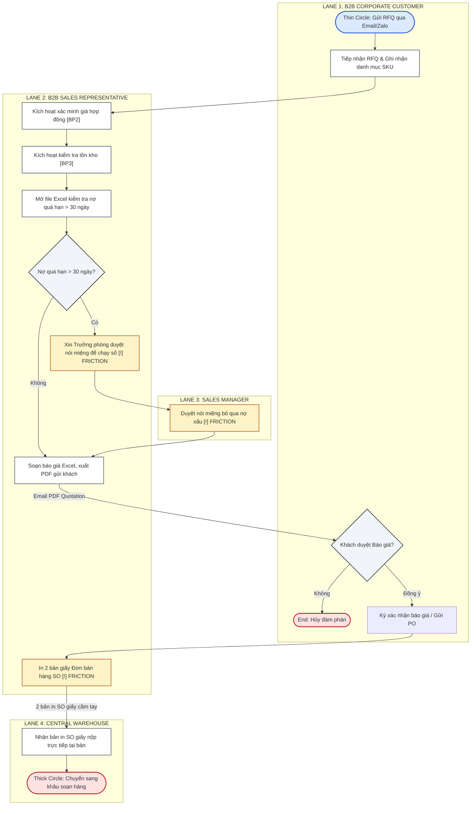
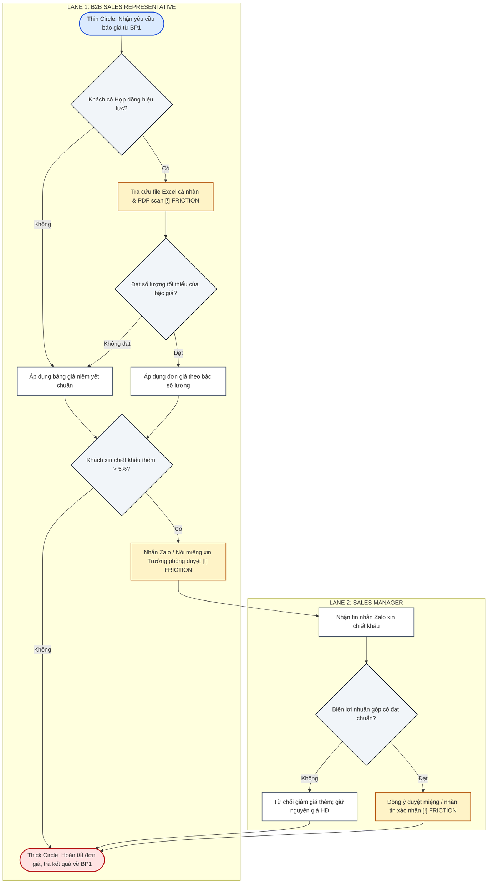
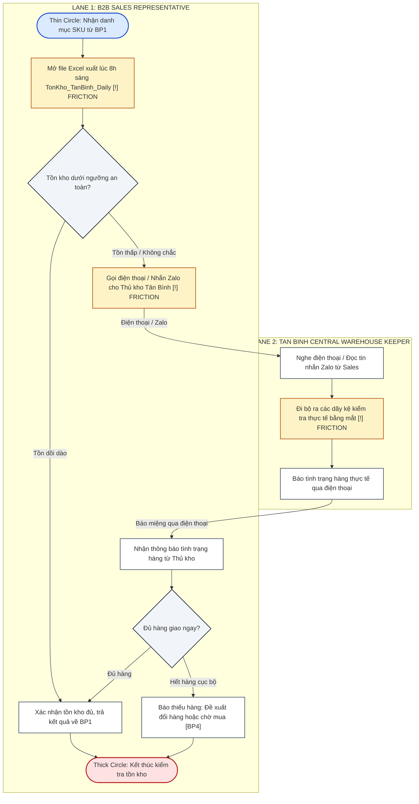
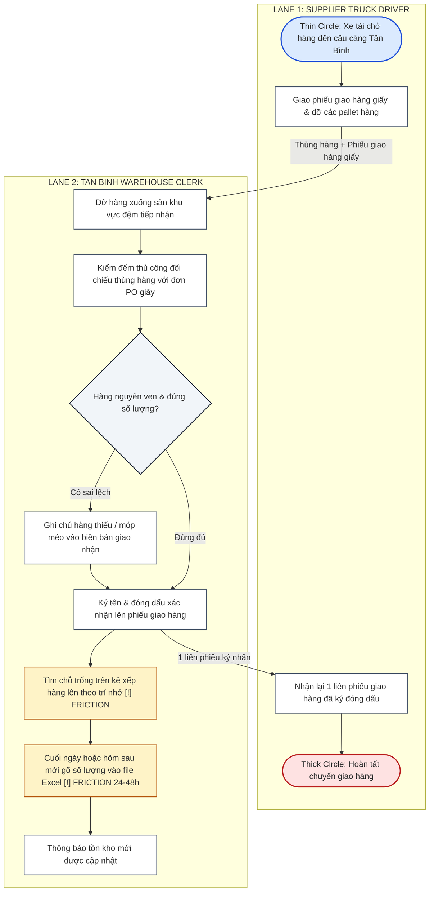
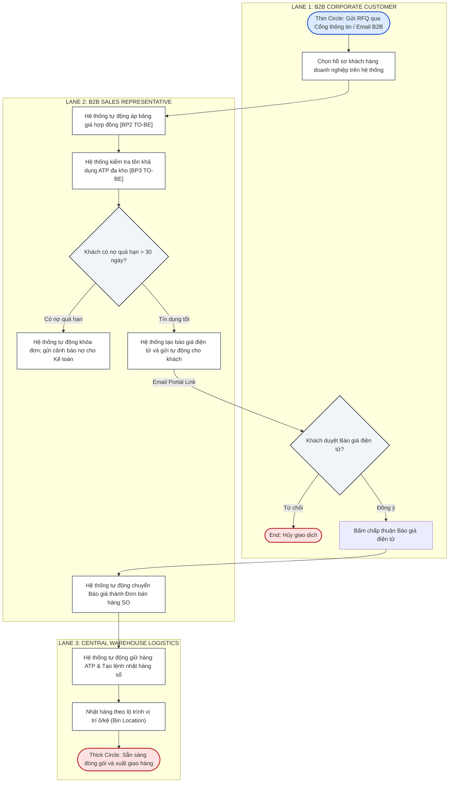
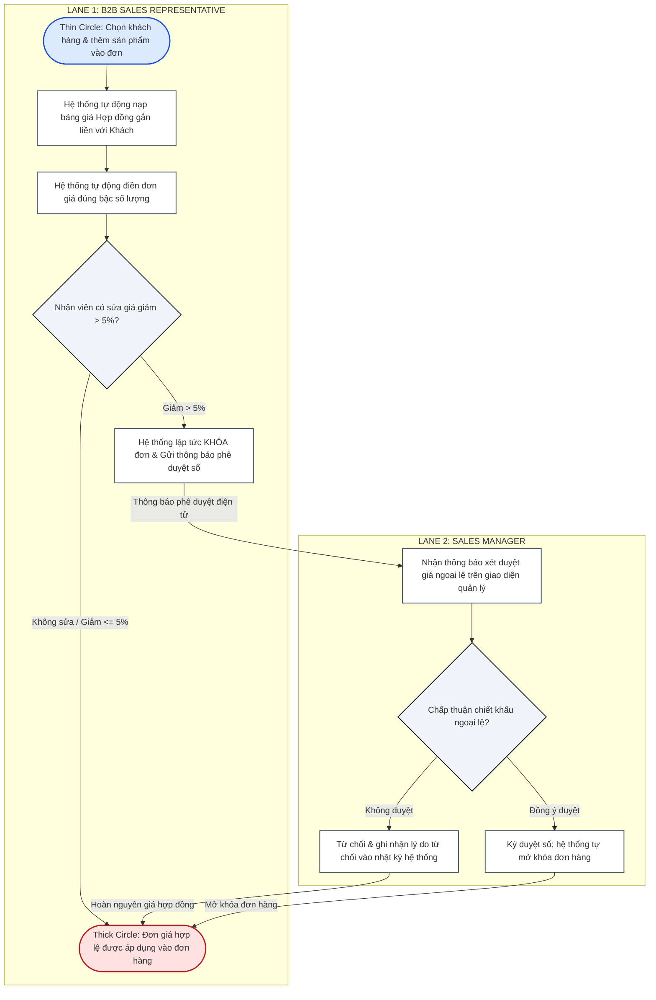
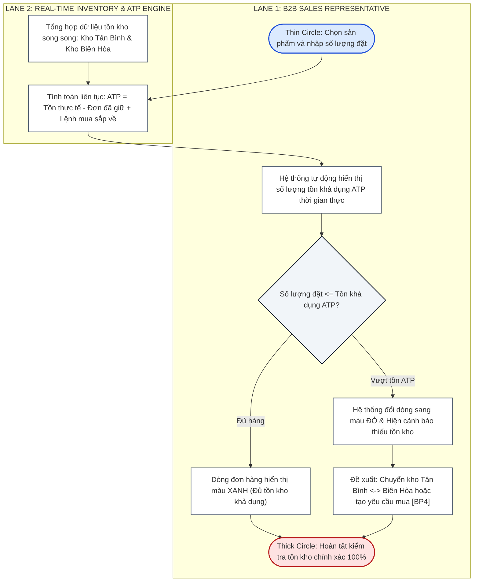

1. Reviewed Business Process Descriptions and AS-IS Models
   Provide a reviewed description and an updated AS-IS process model for each of your team's five assigned business processes.

Each process description must include:

Process name, trigger, and end point.

Main actors and activities.

Information used and produced.

Handoffs, decisions, and exceptions, where applicable.

Business outcome.

Evidence sources and information that still needs verification.

Each AS-IS model must reflect the current business process based on the team's stakeholder interview evidence and previous process analysis.

Process modeling requirements:

Use a Swimlane / Cross-Functional Flowchart or BPMN notation introduced in class.

Clearly identify the relevant actors or roles, activities, sequence of work, and important handoffs or decisions.

Ensure that the model is consistent with the corresponding process description and available evidence.

You may revise and reuse your existing AS-IS models instead of drawing them from scratch, provided they meet the requirements above.

2. Business Process Relationship Map
   Provide one map showing how the five assigned processes relate to one another.

Identify relevant process dependencies and the information, documents, products, or statuses transferred between processes. Clearly indicate relationships that have not yet been verified.

The relationship map provides an overview of the connections between processes. It does not replace the individual AS-IS and TO-BE process models.

4. Draft TO-BE Process Models
   Develop draft TO-BE process models for at least three core business processes selected for detailed analysis in Phase 1.

For the remaining two processes, document the proposed improvement directions without requiring detailed TO-BE models.

Each TO-BE model must:

Use the same process scope as its corresponding AS-IS model.

Use a Swimlane / Cross-Functional Flowchart or BPMN notation consistent with the team's AS-IS modeling approach.

Clearly show the proposed activities, actors, sequence of work, decisions, and handoffs, where relevant.

Address at least one verified business problem.

Be accompanied by a brief explanation of the proposed changes and expected business improvements.

Identify assumptions and unresolved questions requiring further validation.

The AS-IS and TO-BE models must make it possible to understand what changes and why those changes are proposed.

Focus on business process improvement, not software configuration or detailed system design. Do not map the processes to Odoo at this stage.

Submission checklist

Before submitting, verify that your document includes five reviewed AS-IS process models, one process relationship map, and at least three draft TO-BE models for the selected core processes. Check that each TO-BE model is consistent with its AS-IS model and is justified by the identified business problems and supporting evidence.

---

================================================================================
              GROUP 6 DELIVERABLE — WEEK 7: TO-BE PROCESS DESIGN &
                          REQUIREMENTS REFINEMENT
================================================================================

# GROUP 6 — TO-BE PROCESS DESIGN & REQUIREMENTS REFINEMENT SUBMISSION
## BUSINESS SYSTEMS ANALYSIS (BSA) — ACADEMIC YEAR 2026–2027 (SEMESTER 1)

* **Course:** Business Systems Analysis (BSA) — Faculty of Technology, Hoa Sen University
* **Instructor:** MSc. Nguyen Thi Thanh Thanh
* **Assigned Business Scenario:** Scenario 6 (Scenario B) — Office Supplies & Stationery
* **Enterprise Case:** Công ty TNHH Phân phối Văn phòng phẩm OfficePro (`OfficePro Distribution Co., Ltd.`)
* **Target Deliverable Filename:** `W7_ProcessDesign_Group6.pdf`
* **Moodle Submission Responsible:** Group Leader

### 👥 Group Members & Contribution Sign-off:
1. **Võ Duy Bình (Student ID: 22301500)** — **Group Leader / Lead Business Analyst & Systems Analyst** (50% Contribution)  
   *Scope Responsibilities:* Primary ownership of `BP1. Processing Corporate Orders`, `BP2. Verifying Contract Prices`, and `BP4. Processing Purchase Orders`; Process Relationship Map integration; TO-BE design for BP1 & BP2; Requirements refinement (`BR-01`, `FR-01`, `FR-02`).
2. **Phạm Nguyễn Gia Thuận (Student ID: 22204631)** — **QA Specialist & Solution Configurator** (50% Contribution)  
   *Scope Responsibilities:* Primary ownership of `BP3. Checking Product Availability` and `BP5. Receiving Purchased Goods`; TO-BE design for BP3; Improvement directions for BP4 & BP5; Requirements refinement (`BR-02`, `FR-03`, `FR-04`, `FR-05`).

---

## 1. REVIEWED BUSINESS PROCESS DESCRIPTIONS AND AS-IS MODELS

Nhóm Group 6 hoàn thiện rà soát chi tiết 5 quy trình nghiệp vụ thuộc gói chuẩn hóa của **Scenario 6: Office Supplies & Stationery** (Slide 14, Tuần 6) dựa trên chứng cứ thực nghiệm thu thập từ phỏng vấn các bên liên quan:

```
+---------------------------------------------------------------------------------------------------+
|                        OFFICEPRO B2B WHOLESALE PROCESS PACKAGE (SCENARIO 6)                       |
+---------------------------------------------------------------------------------------------------+
| Core 1: BP1. Processing Corporate Orders (Owner: Võ Duy Bình)                                     |
| Core 2: BP2. Verifying Contract Prices (Owner: Võ Duy Bình)                                       |
| Core 3: BP3. Checking Product Availability (Owner: Phạm Nguyễn Gia Thuận)                         |
| Proc 4: BP4. Processing Purchase Orders (Owner: Võ Duy Bình)                                      |
| Proc 5: BP5. Receiving Purchased Goods (Owner: Phạm Nguyễn Gia Thuận)                             |
+---------------------------------------------------------------------------------------------------+
```

---

### 1.1. BP1: Processing Corporate Orders (Xử lý Đơn hàng Doanh nghiệp)

#### Process Description Table:

| Element | Description |
| :--- | :--- |
| **Process Name** | **BP1. Processing Corporate Orders** *(Xử lý đơn đặt hàng của khách hàng doanh nghiệp B2B)*. |
| **Trigger** | Corporate Customer submits a formal purchase requisition or Request for Quotation (RFQ) via corporate Email, Zalo OA, or telephone. |
| **Start Point** | B2B Sales Representative receives the inquiry in their email/Zalo inbox and records customer requirements into a preliminary tracking sheet. |
| **Main Activities** | 1. Ingest customer RFQ details and identify requested SKUs (`ST-001` to `ST-010`).<br>2. Trigger contract price verification (`BP2`) and stock availability check (`BP3`).<br>3. Check customer credit aging in static monthly Accounts Receivable spreadsheet (`CongNo_AR_Monthly.xlsx`).<br>4. Draft formal sales quotation in Excel and email PDF copy to corporate buyer.<br>5. Receive customer confirmation/PO, print 2 physical paper Sales Order copies, and physically dispatch copies to Warehouse and Accounting. |
| **Main Actors** | B2B Corporate Customer (Procurement Officer), B2B Sales Representative, Sales Manager, Warehouse Keeper, AR Accountant. |
| **Information Used / Produced** | • *Used:* Customer RFQ list, customer credit history, unit contract prices (from `BP2`), available stock quantities (from `BP3`).<br>• *Produced:* Formal PDF Sales Quotation (`BG-2026-XXXX.pdf`), printed paper Sales Order (`ĐBH-XXXX`). |
| **Handoffs** | • Customer ➔ Sales Rep: RFQ via Email/Zalo.<br>• Sales Rep ➔ Customer: Formal Quotation via Email.<br>• Sales Rep ➔ Warehouse & Accounting: Physical paper Sales Orders walked across the office. |
| **Decisions & Exceptions** | • *Decision 1 (Credit Overdue > 30 Days?):* If overdue debt exists, system should block, but Sales Manager frequently grants informal verbal override to meet monthly revenue quota.<br>• *Exception (Customer Rejects Quote):* Negotiations fail; order status set to Cancelled. |
| **End Point** | Order decision and confirmation status are recorded; printed paper Sales Order is handed over to Warehouse for picking. |
| **Business Outcome** | Legally binding sales commitment established, securing wholesale revenue while initiating downstream picking and fulfillment. |
| **Evidence Sources** | • `EVD-W2-SALES-01`: Sales Manager interview confirming reliance on email and manual paper SO dispatch.<br>• `EVD-W4-SIM-02`: Simulation audit showing 15–20 minute delay per order due to paper handoffs. |
| **Uncertain Information** | Exact threshold of credit limit assigned to each customer tier (currently relying on personal judgment of Sales Manager). |

#### AS-IS Swimlane Model (BP1):



---

### 1.2. BP2: Verifying Contract Prices (Xác minh Đơn giá Hợp đồng Khung)

#### Process Description Table:

| Element | Description |
| :--- | :--- |
| **Process Name** | **BP2. Verifying Contract Prices** *(Xác minh và áp dụng đơn giá theo hợp đồng khung)*. |
| **Trigger** | A corporate order inquiry references an active framework agreement, customer pricelist, or commercial volume tier. |
| **Start Point** | Sales Rep accesses customer account files to locate applicable pricing terms. |
| **Main Activities** | 1. Check client contract status and expiry date.<br>2. Search shared network drive for scanned contract PDFs and open local personal Excel sheet (`BangGia_KhachHang_2026.xlsx`).<br>3. Verify ordered quantity against contractual volume discount thresholds.<br>4. If customer requests additional margin discount (> 5%), escalate verbally to Sales Manager.<br>5. Record verified unit prices into sales quote line items. |
| **Main Actors** | B2B Sales Representative, Sales Manager, Corporate Buyer. |
| **Information Used / Produced** | • *Used:* Customer RFQ SKU list, scanned contract PDFs, personal Excel pricelists.<br>• *Produced:* Verified unit prices per SKU (e.g., `ST-001` @ 65,000 VND), approved discount override notes. |
| **Handoffs** | • Sales Rep ➔ Sales Manager: Verbal or Zalo chat request for discount override.<br>• Sales Manager ➔ Sales Rep: Verbal approval or refusal. |
| **Decisions & Exceptions** | • *Decision 1 (Valid Contract Exists?):* If no contract, apply standard list price.<br>• *Decision 2 (Discount > 5% Requested?):* Requires informal manager approval. If rejected, revert to contract tier. |
| **End Point** | Contract-compliant unit prices are determined and inserted into the quotation/order draft. |
| **Business Outcome** | B2B orders adhere to legal price commitments while safeguarding corporate gross profit margins. |
| **Evidence Sources** | • `EVD-W2-SALES-01`: Sales Manager interview confirming 5–8% billing error rate caused by decentralized Excel files.<br>• `EVD-W4-SIM-02`: Monthly audit showing ~50M VND in delayed collections due to pricing disputes. |
| **Uncertain Information** | Formal escalation procedure when requested discount exceeds 10% (currently purely discretionary). |

#### AS-IS Swimlane Model (BP2):



---

### 1.3. BP3: Checking Product Availability (Kiểm tra Tồn kho Khả dụng ATP)

#### Process Description Table:

| Element | Description |
| :--- | :--- |
| **Process Name** | **BP3. Checking Product Availability** *(Kiểm tra tồn kho vật lý và tính khả dụng đơn hàng)*. |
| **Trigger** | A proposed or confirmed customer order requires inventory stock verification across fulfillment warehouses. |
| **Start Point** | Sales Rep checks morning inventory export spreadsheet (`TonKho_TanBinh_Daily.xlsx`). |
| **Main Activities** | 1. Open morning Excel stock report and search for requested SKUs.<br>2. If stock is tight or critical, call Tan Binh warehouse keeper directly via mobile/Zalo to check physical shelves.<br>3. Warehouse keeper walks aisles to visually check pallet stacks.<br>4. Report available quantities, stockouts, or incoming shipment delays back to Sales Rep.<br>5. If stock is exhausted, inform customer or initiate purchase requisition request (`BP4`). |
| **Main Actors** | B2B Sales Representative, Warehouse Clerk (Tan Binh Central Hub), Corporate Buyer. |
| **Information Used / Produced** | • *Used:* Order line SKUs and quantities, morning static Excel export, warehouse verbal confirmation.<br>• *Produced:* Stock availability status (In-Stock / Partial / Stockout / Pending Inbound). |
| **Handoffs** | • Sales Rep ➔ Warehouse Clerk: Phone call or Zalo inquiry.<br>• Warehouse Clerk ➔ Sales Rep: Verbal confirmation of shelf quantities. |
| **Decisions & Exceptions** | • *Decision 1 (Sufficient Stock on Shelf?):* If yes, confirm availability to order process.<br>• *Exception (Stockout / Post-confirmation Shortage):* Goods were already committed to another order; trigger customer negotiation or emergency replenishment. |
| **End Point** | Stock availability confirmation is returned to Sales Rep to finalize delivery commitment. |
| **Business Outcome** | Prevents promising unrealistic fulfillment schedules, minimizing post-confirmation stockout cancellations. |
| **Evidence Sources** | • `EVD-W2-WH-02`: Warehouse keeper interview confirming no barcode scanners, reliance on visual aisle checks.<br>• `EVD-W4-SIM-02`: Simulation finding that incoming dock stock takes 24–48 hours to be entered into spreadsheets. |
| **Uncertain Information** | Exact transit lead time between Bien Hoa Transit Depot and Tan Binh Hub when cross-warehouse transfers occur. |

#### AS-IS Swimlane Model (BP3):



---

### 1.4. BP4: Processing Purchase Orders (Xử lý Đơn Đặt hàng Mua)

#### Process Description Table:

| Element | Description |
| :--- | :--- |
| **Process Name** | **BP4. Processing Purchase Orders** *(Xử lý yêu cầu mua hàng và gửi đơn đặt hàng tới nhà cung cấp)*. |
| **Trigger** | An approved purchase requisition is issued due to stock shortages reported in `BP3` or warehouse shelf depletion. |
| **Start Point** | Procurement Officer receives a handwritten replenishment slip from warehouse or an urgent stockout alert from Sales. |
| **Main Activities** | 1. Consolidate requested SKU quantities (e.g., Double A paper pallets, HP toners).<br>2. Email RFQ to 2–3 registered suppliers (Double A Vietnam, Thien Long, IK Plus).<br>3. Receive supplier quotes, manually copy rates into an Excel comparison sheet.<br>4. Select supplier based on price and delivery lead time, draft official Purchase Order (PO).<br>5. Obtain Procurement Manager signature, email PDF PO to chosen supplier, and record delivery confirmation. |
| **Main Actors** | Procurement Officer, Approving Manager, Upstream Supplier (Double A, Thien Long). |
| **Information Used / Produced** | • *Used:* Stockout notes, supplier catalog price lists, vendor quotations.<br>• *Produced:* Supplier RFQs, Excel quotation comparison sheet, official signed Purchase Order (`PO-2026-XXXX.pdf`). |
| **Handoffs** | • Warehouse ➔ Procurement: Handwritten replenishment request slip.<br>• Procurement ➔ Supplier: RFQ and PO via email.<br>• Supplier ➔ Procurement: Quotations and PO confirmation via email. |
| **Decisions & Exceptions** | • *Decision 1 (Supplier Selection):* Officer compares quotes over 2–3 days based on price and earliest delivery date.<br>• *Exception (Supplier Price Hike / Stockout):* Negotiate delivery terms or switch to secondary vendor. |
| **End Point** | Purchase Order is acknowledged and confirmed by the supplier; delivery schedule is logged. |
| **Business Outcome** | Replenishment pipeline secured from manufacturers, replenishing warehouse stock buffer. |
| **Evidence Sources** | • `EVD-W2-PURCH-01`: Purchasing Manager interview noting manual RFQ comparison over email takes 2–3 days.<br>• `EVD-W4-SIM-02`: Procurement operates reactively only after physical stockouts happen. |
| **Uncertain Information** | Exact credit terms and volume discount schedules granted by Double A Vietnam for annual bulk purchases. |

#### AS-IS Swimlane Model (BP4):

```mermaid
flowchart TD
    subgraph LANE_BP4_WH ["LANE 1: WAREHOUSE & SALES"]
        BP4_Start([Thin Circle: Phát hiện hết hàng từ BP3])
        BP4_WriteSlip["Thủ kho viết giấy tay báo hàng hết nộp Thu mua [!] FRICTION"]
    end

    subgraph LANE_BP4_PURCH ["LANE 2: PROCUREMENT OFFICER"]
        BP4_ReceiveSlip["Nhận phiếu viết tay & gom nhóm mặt hàng cần mua"]
        BP4_EmailRFQ["Gửi email xin báo giá tới 2-3 Nhà cung cấp [!] FRICTION"]
        BP4_CompareQuotes["Chờ 2-3 ngày & nhập tay so sánh giá trên Excel [!] FRICTION"]
        BP4_DraftPO["Soạn Đơn mua hàng PO trên Word/Excel"]
        BP4_SendPO["Gửi email bản PDF Đơn mua hàng PO cho Nhà cung cấp"]
    end

    subgraph LANE_BP4_MGR ["LANE 3: APPROVING MANAGER"]
        BP4_ApprovePO["Ký duyệt Đơn mua hàng PO giấy"]
    end

    subgraph LANE_BP4_SUPP ["LANE 4: UPSTREAM SUPPLIER"]
        BP4_ReceivePO["Nhận PO, kiểm tra hàng & gửi email xác nhận ngày giao"]
        BP4_EndSuccess([Thick Circle: Xác nhận đơn mua, chuẩn bị giao hàng [BP5]])
    end

    BP4_Start --> BP4_WriteSlip
    BP4_WriteSlip -->|Phiếu giấy viết tay| BP4_ReceiveSlip
    BP4_ReceiveSlip --> BP4_EmailRFQ
    BP4_EmailRFQ -->|Email RFQ| BP4_CompareQuotes
    BP4_CompareQuotes --> BP4_DraftPO
    BP4_DraftPO --> BP4_ApprovePO
    BP4_ApprovePO --> BP4_SendPO
    BP4_SendPO -->|Email PDF PO| BP4_ReceivePO
    BP4_ReceivePO --> BP4_EndSuccess

    classDef startEvent fill:#dbeafe,stroke:#1d4ed8,stroke-width:2px;
    classDef endEvent fill:#fee2e2,stroke:#b91c1c,stroke-width:2px;
    classDef friction fill:#fef3c7,stroke:#b45309,stroke-width:1.5px;
    classDef activity fill:#ffffff,stroke:#475569,stroke-width:1.5px;

    class BP4_Start startEvent;
    class BP4_EndSuccess endEvent;
    class BP4_WriteSlip,BP4_EmailRFQ,BP4_CompareQuotes friction;
    class BP4_ReceiveSlip,BP4_DraftPO,BP4_ApprovePO,BP4_SendPO,BP4_ReceivePO activity;
```

---

### 1.5. BP5: Receiving Purchased Goods (Tiếp nhận Hàng mua từ Nhà cung cấp)

#### Process Description Table:

| Element | Description |
| :--- | :--- |
| **Process Name** | **BP5. Receiving Purchased Goods** *(Tiếp nhận, kiểm đếm và nhập kho hàng hóa từ nhà cung cấp)*. |
| **Trigger** | A supplier delivery truck arrives at the Tan Binh Central Hub receiving bay against an issued Purchase Order (`BP4`). |
| **Start Point** | Warehouse Clerk receives the supplier's printed delivery slip and unloads palletized goods. |
| **Main Activities** | 1. Unload physical pallets at receiving dock.<br>2. Manually cross-check delivered cartons/reams against supplier delivery note and company PO.<br>3. Inspect packaging integrity, noting damaged or missing items.<br>4. Sign and stamp supplier delivery slip.<br>5. Move goods onto warehouse shelves based on memory.<br>6. In batch at end of day (or next day), type received quantities into Excel inventory file (`TonKho_TanBinh_Daily.xlsx`). |
| **Main Actors** | Supplier Delivery Driver, Warehouse Clerk (Tan Binh Hub), Purchasing Staff, AR/AP Accountant. |
| **Information Used / Produced** | • *Used:* Supplier delivery slip, printed company Purchase Order (`PO-2026-XXXX`).<br>• *Produced:* Signed supplier delivery note, internal Goods Receipt Note (`Phiếu Nhập Kho`), updated daily Excel inventory spreadsheet. |
| **Handoffs** | • Supplier ➔ Warehouse Clerk: Physical cartons + delivery note.<br>• Warehouse Clerk ➔ Supplier: Signed copy of delivery note.<br>• Warehouse Clerk ➔ Procurement/Accounting: Physical paper Goods Receipt Note batch-delivered weekly. |
| **Decisions & Exceptions** | • *Decision 1 (Damaged or Discrepant Goods?):* Record discrepancies on slip, reject damaged reams, and report to Procurement.<br>• *Exception (Delayed System Logging):* Physical stock sits on dock for 24–48 hours before being entered into Excel, making it invisible to Sales. |
| **End Point** | Received quantities and discrepancies are recorded; daily Excel inventory records are updated. |
| **Business Outcome** | Stock is physically secured in warehouse and inventory availability is eventually reflected for order fulfillment. |
| **Evidence Sources** | • `EVD-W2-WH-02`: Warehouse keeper interview confirming manual paper receiving and 24–48h delay in spreadsheet logging.<br>• `EVD-W4-SIM-02`: Post-confirmation stockout incidents linked directly to delayed dock inventory entry. |
| **Uncertain Information** | Formal return-to-vendor (RTV) policy for concealed defects discovered after the supplier truck departs. |

#### AS-IS Swimlane Model (BP5):



---

## 2. Activity 2 — Integrate the Five Business Processes (Slide 5)

**Objective:** Understand how the five processes relate to the overall operation of the enterprise.

### 2.1. Process Relationship Map (Bản đồ Mối quan hệ 5 Quy trình)

Bản đồ mối quan hệ thể hiện cách thức 5 quy trình nghiệp vụ của OfficePro tương tác, phụ thuộc và chuyển giao dữ liệu, chứng từ cho nhau trong chuỗi giá trị bán buôn:

```mermaid
flowchart LR
    %% NODES REPRESENTING PROCESSES
    BP1["<b>BP1. Processing Corporate Orders</b><br><i>(Xử lý Đơn hàng B2B)</i><br>Owner: Võ Duy Bình"]
    BP2["<b>BP2. Verifying Contract Prices</b><br><i>(Xác minh Giá Hợp đồng)</i><br>Owner: Võ Duy Bình"]
    BP3["<b>BP3. Checking Product Availability</b><br><i>(Kiểm tra Tồn kho ATP)</i><br>Owner: Phạm Nguyễn Gia Thuận"]
    BP4["<b>BP4. Processing Purchase Orders</b><br><i>(Xử lý Đơn Mua hàng)</i><br>Owner: Võ Duy Bình"]
    BP5["<b>BP5. Receiving Purchased Goods</b><br><i>(Tiếp nhận Hàng mua)</i><br>Owner: Phạm Nguyễn Gia Thuận"]

    %% PROCESS RELATIONSHIPS & DATA PASSING
    BP1 <-->|1. Yêu cầu kiểm tra giá HĐ<br>2. Đơn giá HĐ hợp lệ [VERIFIED]| BP2
    BP1 <-->|3. Yêu cầu kiểm tra tồn kho<br>4. Số lượng tồn khả dụng ATP [VERIFIED]| BP3
    BP3 -->|5. Cảnh báo thiếu hàng / Hết tồn kho<br>Trigger yêu cầu mua hàng bù [VERIFIED]| BP4
    BP4 -->|6. Bản sao Đơn mua hàng PO & Lịch giao hàng dự kiến [VERIFIED]| BP5
    BP5 -->|7. Cập nhật số lượng nhập kho thực tế<br>Tăng tồn khả dụng ATP [VERIFIED]| BP3
    BP5 -.->|8. Thông báo hàng về đã nhập kho<br>để giải tỏa đơn hàng đang chờ [UNVERIFIED]| BP1

    %% STYLING
    classDef core fill:#dbeafe,stroke:#1d4ed8,stroke-width:2px;
    classDef support fill:#fef3c7,stroke:#b45309,stroke-width:1.5px;

    class BP1,BP2,BP3 core;
    class BP4,BP5 support;
```

---

### 2.2. Process Integration Table (Bảng Chuyển giao Thông tin & Chứng từ - Slide 5)

Bảng ma trận chuyển giao thông tin chuẩn hóa theo đúng biểu mẫu Slide 5:

| Upstream Process | Output / Information Transferred | Downstream Process | Evidence / Status |
| :--- | :--- | :--- | :---: |
| **`BP1. Processing Corporate Orders`** | **Yêu cầu thẩm định giá:** Mã khách hàng doanh nghiệp, danh mục mã SKU (`ST-001` đến `ST-010`), số lượng đặt mua theo từng dòng sản phẩm. | **`BP2. Verifying Contract Prices`** | **VERIFIED**<br>*(Phỏng vấn Sales Manager `EVD-W2-SALES-01`: Bắt buộc phải có giá hợp đồng trước khi xuất Báo giá).* |
| **`BP2. Verifying Contract Prices`** | **Đơn giá hợp đồng đã xác thực:** Đơn giá theo bậc số lượng thỏa thuận trong hợp đồng khung (VD: `ST-001` @ 65.000₫) và chiết khấu ngoại lệ được duyệt. | **`BP1. Processing Corporate Orders`** | **VERIFIED**<br>*(Dữ liệu mô phỏng `EVD-W4-SIM-02`: Đơn giá được đưa vào Báo giá chính thức và Đơn bán hàng SO).* |
| **`BP1. Processing Corporate Orders`** | **Yêu cầu kiểm tra khả dụng tồn kho:** Danh mục SKU cần xuất kho, số lượng đặt hàng, ngày cam kết giao hàng theo yêu cầu của khách. | **`BP3. Checking Product Availability`** | **VERIFIED**<br>*(Quy trình bán hàng chuẩn: Kiểm tra tồn kho trước khi gửi báo giá chốt).* |
| **`BP3. Checking Product Availability`** | **Số lượng tồn khả dụng (ATP Status):** Xác nhận đủ hàng có sẵn để xuất kho giao ngay, hoặc thông báo thiếu hụt một phần/toàn bộ số lượng. | **`BP1. Processing Corporate Orders`** | **VERIFIED**<br>*(Khảo sát thực tế: Sales Rep cần biết trạng thái hàng để cam kết giao trong 24–48h).* |
| **`BP3. Checking Product Availability`** | **Cảnh báo thiếu hụt kho / Hết hàng:** Mã SKU bị đứt tồn kho, số lượng cần mua bù, đơn hàng đang chờ giao tương ứng. | **`BP4. Processing Purchase Orders`** | **VERIFIED**<br>*(Thủ kho gửi giấy tay báo mua hàng khi kiểm tra thấy kệ hết hàng).* |
| **`BP4. Processing Purchase Orders`** | **Đơn mua hàng PO & Lịch giao hàng dự kiến:** Bản sao PO chính thức đã ký (`PO-2026-XXXX.pdf`), thông tin nhà cung cấp (Double A / Thiên Long), số lượng đặt, thời gian xe tải dự kiến tới kho. | **`BP5. Receiving Purchased Goods`** | **VERIFIED**<br>*(Thủ kho cần thông tin PO để đối chiếu số lượng và quy cách khi mở niêm phong xe tải).* |
| **`BP5. Receiving Purchased Goods`** | **Số lượng nhập kho thực tế & Tăng tồn khả dụng ATP:** Biên bản kiểm đếm tiếp nhận, số lượng hàng nhập đạt chuẩn chất lượng được cộng vào tổng tồn kho. | **`BP3. Checking Product Availability`** | **VERIFIED**<br>*(Hàng nhập vào kho làm tăng số lượng tồn khả dụng cho các đơn hàng tiếp theo).* |
| **`BP5. Receiving Purchased Goods`** | **Thông báo hàng về giải tỏa đơn chờ (Backorder Release):** Thông tin các lô hàng đang nợ đơn khách đã nhập kho thành công để Sales Rep tạo lệnh xuất kho. | **`BP1. Processing Corporate Orders`** | **UNCERTAIN**<br>*(Chưa được xác thực tự động: Hiện tại thủ kho không tự báo cho Sales; Sales phải chủ động gọi điện hỏi lại).* |

---

### 2.3. Discussion Questions Analysis (Slide 5)

Phân tích 4 câu hỏi thảo luận cốt lõi về mối quan hệ giữa 5 quy trình theo yêu cầu tại Slide 5:

#### 1. Does one process depend on the output of another?
* **Có, sự phụ thuộc mang tính sống còn xuyên suốt toàn chuỗi cung ứng bán buôn:**
  * `BP1` (Xử lý đơn hàng) phụ thuộc đồng bộ (Synchronous Dependency) vào đầu ra của `BP2` (Đơn giá hợp đồng) và `BP3` (Tồn kho khả dụng). Nếu thiếu một trong hai đầu ra này, Sales Rep không thể phát hành Báo giá hoặc tạo Đơn bán hàng SO hợp lệ.
  * `BP4` (Mua hàng) phụ thuộc vào sự kích hoạt (Trigger Dependency) từ cảnh báo thiếu hàng của `BP3`.
  * `BP5` (Tiếp nhận hàng) phụ thuộc tiên quyết (Pre-requisite Dependency) vào mã đơn PO từ `BP4` để làm căn cứ kiểm tra đối soát số lượng và quy cách hàng hóa khi xe tải dỡ hàng tại cầu cảng.
  * Vòng lặp khép kín: Đầu ra của `BP5` (Số lượng nhập kho thực tế) là đầu vào cập nhật trực tiếp cho `BP3` (Tăng tồn khả dụng ATP).

#### 2. Is information transferred consistently between processes?
* **Không, thông tin hiện đang chuyển giao KHÔNG NHẤT QUÁN và bị phân mảnh nghiêm trọng:**
  * Giữa `BP1` và `BP2`: Mỗi nhân viên kinh doanh sử dụng một bảng Excel cá nhân riêng (`BangGia_KhachHang_2026.xlsx`) và hợp đồng scan PDF cũ. Khi Double A hoặc Thiên Long điều chỉnh giá, thông tin chỉ được gửi qua email nội bộ, nhân viên cập nhật trễ nhịp 1–2 tuần dẫn đến giá chuyển giao từ `BP2` sang `BP1` bị sai lệch từ **5% đến 8%**.
  * Giữa `BP3`, `BP5` và `BP1`: Hàng nhập về cầu cảng tại `BP5` mất **24–48 giờ** mới được gõ vào file Excel tồn kho; trong khi đó Sales tại `BP1` chỉ đọc file Excel trích xuất lúc 8h00 sáng. Dữ liệu tồn kho chuyển giao giữa các quy trình bị trễ nhịp so với biến động vật lý tại kho.

#### 3. Are there handoffs that may cause delays or errors?
* **Có, tồn tại 4 điểm chuyển giao (Handoffs) thủ công gây nghẽn cổ chai và sai sót lớn:**
  * **Handoff `BP1 ➔ BP2` (Thỏa thuận chiết khấu ngoại lệ):** Chuyển giao qua tin nhắn Zalo cá nhân hoặc nói miệng giữa Sales Rep và Trưởng phòng kinh doanh. Không có lưu vết hệ thống (Audit Trail), gây rủi ro thất thoát biên lợi nhuận.
  * **Handoff `BP1 ➔ BP3` (Kiểm tra hàng):** Chuyển giao qua cuộc gọi điện thoại hoặc nhắn tin Zalo cho Thủ kho Tân Bình. Thủ kho phải dừng việc đi bộ ra kệ kiểm tra bằng mắt, làm mất 15–30 phút cho mỗi đơn hàng cần xác nhận gấp.
  * **Handoff `BP3 ➔ BP4` (Báo mua hàng):** Chuyển giao bằng **phiếu viết tay** của thủ kho mang nộp phòng Thu mua. Chậm trễ trung bình 1–2 ngày trước khi Thu mua bắt đầu gửi email xin báo giá nhà cung cấp.
  * **Handoff `BP1 ➔ Kho & Kế toán`:** Nhân viên Sales phải **in 2 bản giấy Đơn bán hàng (SO)** cầm tay đi bộ qua lại giữa các phòng ban để nộp, dễ gây thất lạc chứng từ.

#### 4. Are the process boundaries clear?
* **Ranh giới giữa các quy trình tương đối rõ ràng về mặt phạm vi trách nhiệm (Scope Rule - Slide 8), nhưng bị chồng chéo ở khâu chia sẻ dữ liệu:**
  * *Ranh giới rõ ràng:* `BP1` kết thúc khi Đơn bán hàng SO được xác nhận; `BP2` chỉ tập trung vào việc tra cứu và phê duyệt đơn giá; `BP3` chỉ chịu trách nhiệm báo cáo số lượng tồn ATP; `BP4` kết thúc khi gửi PO cho nhà cung cấp; `BP5` kết thúc khi hàng được xếp lên kệ và ghi nhận số lượng nhập kho.
  * *Điểm chồng chéo cần phân định:* Trách nhiệm theo dõi hàng đặt mua đang về (Inbound Stock on Order). Hiện tại Sales (`BP1`) không rõ hàng đang mua ở `BP4` hay đã về cầu cảng ở `BP5`, dẫn đến việc cả Sales và Thủ kho đều phải gọi điện hỏi Procurement Officer, làm ranh giới phối hợp bị mờ nhạt.

---

## 3. EVIDENCE-BASED PROBLEM AND INFORMATION NEEDS ANALYSIS (SLIDE 6, 7)

**Objective:** Develop a prioritized list of verified business problems and associated information needs grounded in empirical stakeholder evidence.

### 3.1. Detailed 7-Element Problem Analysis Tables (Slide 7 Format)

Áp dụng đúng cấu trúc bảng 7 yếu tố chuẩn theo ví dụ minh họa tại **Slide 7** cho từng vấn đề kinh doanh trọng tâm của OfficePro:

#### Problem 1 (ISS-01): Contract Pricing Inaccuracies & Decentralized Pricing Controls

| Element (Slide 7) | Analysis Detail for OfficePro Enterprise Case |
| :--- | :--- |
| **Evidence source** | Phỏng vấn B2B Sales Manager (`EVD-W2-SALES-01`) và Dữ liệu kiểm toán mô phỏng (`EVD-W4-SIM-02`). |
| **AS-IS observation** | Nhân viên kinh doanh tra cứu đơn giá từ các bảng tính Excel cá nhân phân tán (`BangGia_KhachHang_2026.xlsx`) và file scan PDF hợp đồng cũ; mỗi nhân viên báo một giá khác nhau cho cùng một mã SKU. |
| **Business problem** | Nhân viên kinh doanh thiếu cơ chế tra cứu giá hợp đồng tập trung tự động và thiếu kiểm soát phê duyệt chiết khấu có lưu vết khi lập báo giá. |
| **Affected stakeholder** | B2B Sales Representative, Sales Manager, Corporate Buyer, AR Billing Accountant. |
| **Information need** | Đơn giá hợp đồng có hiệu lực và các bậc chiết khấu số lượng tự động gắn liền với hồ sơ khách hàng ngay khi lập đơn. |
| **Business impact** | **5% đến 8% hóa đơn bị sai lệch đơn giá**, gây khiếu nại gay gắt từ khách hàng doanh nghiệp, kéo dài thời gian đối soát và chậm thu hồi công nợ ~50.000.000 VNĐ/tháng. |
| **Open question** | Quy trình phân cấp phê duyệt chính thức khi khách hàng yêu cầu mức chiết khấu ngoại lệ vượt quá 10% (ai có quyền quyết định cuối cùng và có giới hạn trần chiết khấu không)? |

---

#### Problem 2 (ISS-02): Inventory Blindness & Post-Confirmation Stockouts

| Element (Slide 7) | Analysis Detail for OfficePro Enterprise Case |
| :--- | :--- |
| **Evidence source** | Phỏng vấn Thủ kho Tân Bình (`EVD-W2-WH-02`) và Nhật ký sự cố bán hàng (`EVD-W4-SIM-02`). |
| **AS-IS observation** | Nhân viên Sales gọi điện thoại hoặc nhắn Zalo cho thủ kho để hỏi tồn hàng; hàng nhập về cầu cảng nằm chờ 24–48 giờ mới được gõ vào file Excel tồn kho. |
| **Business problem** | Nhân viên Sales không thể truy cập trực tiếp thông tin tồn kho khả dụng (Available-to-Promise - ATP) tin cậy theo thời gian thực trước khi xác nhận đơn hàng với khách. |
| **Affected stakeholder** | B2B Sales Representative, Warehouse Clerk (Tan Binh Hub), Corporate Buyer, Logistics Coordinator. |
| **Information need** | Số lượng tồn kho khả dụng thực tế (Real-time ATP = On-hand - Reserved across warehouses) hiển thị động tại thời điểm soạn thảo đơn hàng. |
| **Business impact** | **3–4 đơn hàng B2B bị hủy mỗi tuần sau khi đã xác nhận chốt đơn** do thực tế đứt hàng tại kho (Post-confirmation stockout), làm suy giảm nghiêm trọng uy tín doanh nghiệp. |
| **Open question** | Tần suất đứt hàng và trễ thông tin tồn kho diễn ra nghiêm trọng nhất vào những thời điểm nào (ví dụ: các đợt cao điểm mua sắm văn phòng phẩm đầu năm tài chính hay định kỳ cuối quý)? |

---

#### Problem 3 (ISS-03): Reactive Reordering & Prolonged Vendor Procurement

| Element (Slide 7) | Analysis Detail for OfficePro Enterprise Case |
| :--- | :--- |
| **Evidence source** | Phỏng vấn Chuyên viên Mua hàng (`EVD-W2-PURCH-01`) và Dữ liệu mô phỏng quy trình mua (`EVD-W4-SIM-02`). |
| **AS-IS observation** | Thủ kho chỉ phát hiện hết hàng khi đi kiểm tra kệ rồi viết giấy tay báo mua; phòng Thu mua gửi email xin báo giá 3 nhà cung cấp và mất 2–3 ngày chờ phản hồi. |
| **Business problem** | Hoạt động mua hàng bổ sung diễn ra hoàn toàn bị động, thủ công, thiếu cơ chế cảnh báo tự động điểm đặt hàng lại và thiếu ma trận so sánh giá nhà cung cấp tập trung. |
| **Affected stakeholder** | Purchasing Officer, Warehouse Clerk, Approving Director, Corporate Buyer. |
| **Information need** | Cảnh báo tồn kho chạm điểm đặt hàng lại (Reorder Point Min/Max) và dữ liệu so sánh đơn giá/thời gian giao hàng lịch sử của các nhà cung cấp quen thuộc. |
| **Business impact** | Thời gian mua hàng bù kéo dài từ **3 đến 5 ngày**, làm tê liệt khả năng cung ứng cho các hợp đồng lớn và đứt gãy nguồn hàng của các SKU bán chạy (`ST-001` Giấy Double A A4). |
| **Open question** | Chính sách số lượng đặt hàng tối thiểu (MOQ) và thời gian giao hàng cam kết (Lead time) theo hợp đồng nguyên tắc ký với Double A và Thiên Long là bao nhiêu ngày? |

---

### 3.2. Prioritized Business Problems & Information Needs Summary Matrix

| Priority | Issue ID | Related Process | Verified Business Problem | Information Need | Business Outcome Impact |
| :---: | :---: | :--- | :--- | :--- | :--- |
| **P1** | **`ISS-01`** | `BP2` (Contract Prices)<br>`BP1` (Corporate Orders) | Thiếu kiểm soát đơn giá hợp đồng tập trung và quy trình duyệt chiết khấu thủ công qua Zalo. | Đơn giá hợp đồng có hiệu lực và bậc chiết khấu tự động theo mã khách hàng. | Triệt tiêu 5–8% hóa đơn sai giá; thu hồi 50M VNĐ/tháng công nợ đọng; chuẩn hóa kiểm toán giá. |
| **P2** | **`ISS-02`** | `BP3` (Stock Check)<br>`BP5` (Receiving Goods) | Thông tin tồn kho bị trễ 24–48h và phân mảnh; Sales không biết số lượng tồn khả dụng ATP thực tế. | Số lượng tồn ATP thời gian thực (Tồn thực tế trừ Đơn đã giữ) đa kho. | Loại bỏ hoàn toàn sự cố 3–4 đơn hàng bị hủy/tuần sau khi đã chốt; đảm bảo giao hàng đúng cam kết 24–48h. |
| **P3** | **`ISS-03`** | `BP4` (Purchase Orders)<br>`BP5` (Receiving Goods) | Mua hàng bị động bằng giấy tay; quy trình hỏi giá email kéo dài 2–3 ngày gây đứt hàng cục bộ. | Cảnh báo tự động Reorder Point và bảng so sánh báo giá nhà cung cấp tập trung. | Rút ngắn chu kỳ phát hành PO từ 3 ngày xuống dưới 2 giờ; ngăn ngừa đứt hàng SKU chủ lực. |

---

## 4. DRAFT TO-BE PROCESS MODELS (MÔ HÌNH QUY TRÌNH TƯƠNG LAI - SLIDE 8, 9)

**Objective:** Propose future business processes that directly eliminate verified operational friction points and fulfill identified information needs without prescribing detailed software configuration prematurely.

```
+---------------------------------------------------------------------------------------------------+
|                        OFFICEPRO RE-ENGINEERED TO-BE ARCHITECTURE OVERVIEW                        |
+---------------------------------------------------------------------------------------------------+
| Core 1: TO-BE BP1: Processing Corporate Orders (Automated Workflow & Digital Handoffs)            |
| Core 2: TO-BE BP2: Verifying Contract Prices (Automated Contract Pricelist & Policy Approval Gate)|
| Core 3: TO-BE BP3: Checking Product Availability (Real-Time Multi-Warehouse ATP Engine)           |
| Proc 4: TO-BE BP4: Automated Reorder Point Replenishment Direction                                |
| Proc 5: TO-BE BP5: Real-Time Mobile Dock Receiving & Instant ATP Update Direction                |
+---------------------------------------------------------------------------------------------------+
```

---

### 4.1. Core Process 1 (TO-BE BP1): Processing Corporate Orders

#### AS-IS vs. TO-BE 4-Dimension Comparison Matrix (Slide 9):

| Evaluation Dimension (Slide 9) | AS-IS: Current Process | TO-BE: Proposed Future Process |
| :--- | :--- | :--- |
| **What currently happens vs. What should change?** | Nhân viên Sales soạn Báo giá thủ công trên Word/Excel, in 2 bản giấy Đơn bán hàng (SO) rồi đi bộ cầm tay sang Kho và Kế toán để xin duyệt và bàn giao. | Báo giá điện tử được tạo trên hệ thống tập trung; khách duyệt qua cổng số; hệ thống tự động sinh Đơn bán hàng SO số và gửi lệnh nhặt hàng điện tử đến kho. |
| **Where does the problem occur vs. Where will the process improve?** | Xảy ra nghẽn tại khâu kiểm tra công nợ thủ công và bàn giao chứng từ giấy; đơn hàng nằm chờ ký duyệt mất từ 4–6 giờ. | Cải tiến tại khâu tiếp nhận và xác thực đơn; cơ chế kiểm tra nợ tự động và đẩy lệnh số tức thời giúp rút ngắn chu kỳ từ 4–6 giờ xuống dưới 15 phút. |
| **What information is missing/delayed vs. What should be available & when?** | Trạng thái công nợ quá hạn và khả năng đáp ứng giao hàng của kho bị mù mờ đối với Sales tại thời điểm tư vấn khách. | Trạng thái nợ quá hạn (> 30 ngày) và tồn kho ATP được hiển thị trực tiếp ngay khi Sales chọn khách hàng và mặt hàng trên màn hình lập đơn. |
| **Which handoffs create difficulty vs. How should the handoffs change?** | Điểm chuyển giao giấy in SO cầm tay giữa Sales ➔ Kho và Sales ➔ Kế toán gây chậm trễ, thất lạc chứng từ và sai sót gõ lại số liệu. | Chuyển giao hoàn toàn sang luồng dữ liệu số tự động; hệ thống tự động khóa giữ tồn kho (Reservation) và xuất phiếu nhặt hàng số trên thiết bị kho. |

#### TO-BE Swimlane BPMN Model (BP1):



#### Giải thích Thay đổi Đề xuất & Giá trị Kinh doanh:
* **Các thay đổi cốt lõi:**
  1. Loại bỏ hoàn toàn việc in ấn 2 liên SO giấy cầm tay; tích hợp lệnh giữ hàng tự động (Automated Stock Reservation) và lộ trình nhặt hàng số (Digital Picking Route).
  2. Tích hợp chốt chặn công nợ tự động (**Automated Credit Hold**): Ngăn chặn phát hành đơn hàng mới nếu khách có công nợ quá hạn > 30 ngày mà chưa có bảo lãnh thanh toán.
* **Cải tiến định lượng kỳ vọng:**
  * Rút ngắn thời gian xử lý đơn hàng B2B từ **4–6 giờ xuống dưới 15 phút**.
  * Loại bỏ 100% rủi ro thất lạc chứng từ đơn hàng giữa Sales, Kho và Kế toán.
* **Giả định & Câu hỏi mở cần xác minh:**
  * *Giả định:* Khách hàng doanh nghiệp chấp nhận xác nhận báo giá điện tử qua cổng thông tin hoặc email xác thực thay cho hợp đồng giấy đóng dấu mộc đỏ trước giao hàng.
  * *Câu hỏi mở:* Quy trình phê duyệt bảo lãnh tạm thời cho các đơn hàng khẩn cấp của khách VIP đang vướng nợ quá hạn sẽ do ai ký duyệt bằng văn bản điện tử?

---

### 4.2. Core Process 2 (TO-BE BP2): Verifying Contract Prices

#### AS-IS vs. TO-BE 4-Dimension Comparison Matrix (Slide 9):

| Evaluation Dimension (Slide 9) | AS-IS: Current Process | TO-BE: Proposed Future Process |
| :--- | :--- | :--- |
| **What currently happens vs. What should change?** | Nhân viên Sales tra cứu bảng giá thủ công từ file Excel riêng và file scan PDF hợp đồng; xin duyệt chiết khấu miệng hoặc nhắn tin Zalo không lưu vết. | Hệ thống tự động áp bảng giá hợp đồng hiệu lực theo mã khách hàng; chiết khấu giảm giá > 5% tự động kích hoạt chốt chặn phê duyệt số có lưu vết. |
| **Where does the problem occur vs. Where will the process improve?** | Xảy ra tại khâu tra cứu giá phân tán; báo sai giá dẫn đến hóa đơn thanh toán bị khiếu nại và chậm trả nợ. | Cải tiến trực tiếp tại dòng sản phẩm báo giá; đơn giá được áp chính xác theo bậc số lượng cam kết, ngăn ngừa 100% lỗi sai giá do con người. |
| **What information is missing/delayed vs. What should be available & when?** | Bảng giá hợp đồng cập nhật mới từ nhà sản xuất (Double A, Thiên Long) bị trễ 1–2 tuần đối với nhân viên Sales. | Bảng giá hợp đồng có hiệu lực (kèm ngày bắt đầu/kết thúc và bậc số lượng) hiển thị tự động ngay khi chọn mã SKU. |
| **Which handoffs create difficulty vs. How should the handoffs change?** | Điểm chuyển giao xin duyệt chiết khấu qua tin nhắn Zalo cá nhân giữa Sales Rep và Trưởng phòng Sales thiếu tính minh bạch và dễ thất thoát lợi nhuận. | Thay thế bằng quy trình phê duyệt điện tử tích hợp: hệ thống khóa đơn và gửi thông báo xét duyệt đến giao diện quản lý của Trưởng phòng với 1 cú nhấp chuột. |

#### TO-BE Swimlane BPMN Model (BP2):



#### Giải thích Thay đổi Đề xuất & Giá trị Kinh doanh:
* **Các thay đổi cốt lõi:**
  1. Thay thế hoàn toàn bảng tính Excel phân tán bằng công cụ quản lý bảng giá hợp đồng tập trung (**Centralized Contract Pricelist Engine**).
  2. Thiết lập chốt chặn phê duyệt tự động (**Automated Approval Gate**) với ngưỡng chặn cứng 5%, lưu vết kiểm toán (Audit Trail) cho mọi quyết định ghi đè giá.
* **Cải tiến định lượng kỳ vọng:**
  * Đưa tỷ lệ hóa đơn sai lệch đơn giá từ **5–8% về 0%**.
  * Tiết kiệm **50.000.000 VNĐ/tháng** chi phí xử lý khiếu nại hóa đơn và tăng tốc thu hồi nợ đúng hạn.
* **Giả định & Câu hỏi mở cần xác minh:**
  * *Giả định:* Toàn bộ hợp đồng khung và phụ lục giá mới được phòng Kinh doanh/Pháp chế cập nhật vào dữ liệu chủ trước ngày có hiệu lực thực tế.
  * *Câu hỏi mở:* Quy định xử lý trường hợp hợp đồng khung hết hạn nhưng hai bên đang trong quá trình thương thảo gia hạn (có được tự động gia hạn tạm thời 30 ngày hay không)?

---

### 4.3. Core Process 3 (TO-BE BP3): Checking Product Availability

#### AS-IS vs. TO-BE 4-Dimension Comparison Matrix (Slide 9):

| Evaluation Dimension (Slide 9) | AS-IS: Current Process | TO-BE: Proposed Future Process |
| :--- | :--- | :--- |
| **What currently happens vs. What should change?** | Nhân viên Sales gọi điện thoại hoặc gửi Zalo cho thủ kho; thủ kho đi bộ ra kệ đếm thùng; mất 15–30 phút cho mỗi đơn cần báo giá gấp. | Nhân viên Sales xem trực tiếp số lượng tồn khả dụng (ATP) đa kho theo thời gian thực ngay trên màn hình lập báo giá/đơn hàng. |
| **Where does the problem occur vs. Where will the process improve?** | Xảy ra tại khâu thẩm định tồn kho; dữ liệu trễ nhịp dẫn đến hứa hẹn giao hàng ảo, sau đó đứt hàng và hủy đơn. | Cải tiến trước khi xác nhận đơn; hệ thống tự động cảnh báo thiếu hàng bằng màu sắc và tự động đề xuất chuyển kho hoặc mua hàng bù. |
| **What information is missing/delayed vs. What should be available & when?** | Thông tin số lượng tồn kho khả dụng thực tế (đã trừ đi lượng hàng giữ cho đơn khác) và hàng mua đang về bị mù mờ. | Số lượng tồn ATP tức thời ($\text{ATP} = \text{Tồn thực} - \text{Đã cam kết giữ}$) hiển thị chính xác theo thời gian thực trên từng dòng SKU. |
| **Which handoffs create difficulty vs. How should the handoffs change?** | Điểm chuyển giao gọi điện thoại/nhắn Zalo hỏi hàng giữa Sales và Thủ kho làm gián đoạn công việc của cả hai bên. | Loại bỏ hoàn toàn chuyển giao thủ công; hệ thống tự động cung cấp dữ liệu tức thời và tự động trừ giữ tồn kho khi chốt đơn. |

#### TO-BE Swimlane BPMN Model (BP3):



#### Giải thích Thay đổi Đề xuất & Giá trị Kinh doanh:
* **Các thay đổi cốt lõi:**
  1. Loại bỏ các cuộc gọi hỏi kho thủ công; trang bị công cụ tính toán tồn khả dụng thời gian thực (**Real-time ATP Engine**) tổng hợp số liệu đa kho (Tân Bình và Biên Hòa).
  2. Phản hồi thị giác tức thì (Visual Stock Alert): Cảnh báo dòng màu đỏ khi thiếu hàng và tự động đề xuất phương án điều chuyển nội bộ hoặc sinh yêu cầu mua hàng.
* **Cải tiến định lượng kỳ vọng:**
  * Giảm **95% sự cố hủy đơn hàng sau khi chốt** (từ 3–4 đơn/tuần xuống gần như bằng 0).
  * Tiết kiệm **10–15 giờ làm việc/tuần** cho nhân viên Sales và Thủ kho Tân Bình.
* **Giả định & Câu hỏi mở cần xác minh:**
  * *Giả định:* Toàn bộ hàng nhập tại cầu cảng được quét mã vạch cập nhật kho tức thời tại quy trình `BP5`, đảm bảo dữ liệu tồn ATP luôn phản ánh đúng thực tế vật lý.
  * *Câu hỏi mở:* Quy tắc phân bổ ưu tiên giữ hàng (Stock Allocation Priority) khi có nhiều đơn hàng cùng đặt một mặt hàng đang khan hiếm tồn kho.

---

### 4.4. Proposed Improvement Directions for BP4 & BP5 (Slide 8, 9)

#### 1. Improvement Direction for BP4: Processing Purchase Orders
* **AS-IS Pain Point:** Quy trình mua hàng hoàn toàn bị động bằng giấy tay của thủ kho, gửi email chào giá mất 2–3 ngày, gây đứt gãy nguồn cung các mặt hàng bán chạy.
* **TO-BE Improvement Direction:**
  * Thiết lập **Quy tắc tái đặt hàng tự động (Automated Reordering Rules)** dựa trên ngưỡng Min/Max: Khi tồn ATP của `ST-001` chạm mức an toàn (100 ram), hệ thống tự động sinh Yêu cầu mua hàng dự thảo.
  * Tích hợp ma trận so sánh đơn giá và thời gian giao hàng cam kết của nhà cung cấp, rút ngắn thời gian phát hành PO từ **3 ngày xuống dưới 2 giờ**.

#### 2. Improvement Direction for BP5: Receiving Purchased Goods
* **AS-IS Pain Point:** Kiểm đếm thủ công trên giấy tại cầu cảng; xếp hàng theo trí nhớ; chậm nhập kho vào bảng tính Excel từ 24–48 giờ khiến hàng thực tế đã về nhưng Sales không nhìn thấy để bán.
* **TO-BE Improvement Direction:**
  * Trang bị thiết bị di động quét mã vạch cầm tay tại cầu cảng để đối soát tức thời với đơn PO điện tử, tự động gán vị trí lưu kho cố định (Bin Location).
  * Tự động cộng số lượng nhập kho vào tổng tồn khả dụng ATP **ngay khi thủ kho bấm xác nhận nhập hàng tại cầu cảng**, triệt tiêu hoàn toàn độ trễ 24–48 giờ.

---

### 4.5. Review Questions Evaluation (Slide 8)

Đánh giá 4 câu hỏi rà soát chất lượng thiết kế quy trình TO-BE theo Slide 8:
1. **Does the proposed process directly address a verified problem?**
   * *Có:* Thiết kế TO-BE trực tiếp giải quyết 3 vấn đề thực nghiệm lớn nhất: sai lệch giá 5–8% (`ISS-01`), hủy đơn do thiếu hàng thực tế (`ISS-02`), và chậm trễ mua hàng bù 3–5 ngày (`ISS-03`).
2. **Are the actors, activities, decisions, and handoffs understandable?**
   * *Có:* Sơ đồ Swimlane phân định rõ ràng trách nhiệm của từng vai trò (Khách hàng, Sales, Quản lý, Kho, Hệ thống), các cổng quyết định rẽ nhánh minh bạch và các điểm chuyển giao số hóa rõ ràng.
3. **Is the proposed change realistic from a business perspective?**
   * *Rất thực tế:* Đề xuất áp dụng các nguyên lý chuẩn của ngành phân phối bán buôn (bảng giá hợp đồng, tồn kho ATP, hạn mức nợ, điểm đặt hàng lại) mà không đòi hỏi thay đổi cơ cấu tổ chức cồng kềnh.
4. **Have assumptions been clearly identified?**
   * *Có:* Các giả định cốt lõi về việc khách hàng chấp nhận báo giá điện tử, cập nhật kịp thời dữ liệu chủ hợp đồng và quét mã vạch nhập kho tức thời đều được ghi nhận chi tiết.

---

## 5. REFINED BUSINESS AND FUNCTIONAL REQUIREMENTS (SLIDE 10, 11)

**Objective:** Improve the team's Week 6 BR/FR drafts using the deeper process analysis and proposed TO-BE changes, deciding whether to Keep, Revise, Remove, or Investigate each requirement.

### 5.1. Requirements Refinement Table (Slide 10 Format)

| Requirement ID | Existing Requirement | Linked Problem / Need | Review Decision <br>`[Keep / Revise / Remove / Investigate]` | Revised Requirement Statement (Slide 10, 11) | Open Question (Slide 10) |
| :---: | :--- | :--- | :---: | :--- | :--- |
| **`BR-01`** | The business needs corporate sales pricing to be accurate. | `ISS-01`: 5–8% hóa đơn bị sai lệch đơn giá do file Excel phân tán. | **REVISE** | **The business needs corporate sales order pricing to be automatically determined from active framework agreements to eliminate billing discrepancies and accelerate customer cash collections.** | Quy định trần chiết khấu tối đa của Trưởng phòng Sales là bao nhiêu % trước khi phải xin ý kiến Giám đốc? |
| **`BR-02`** | The business needs to manage stock better. | `ISS-02`: 3–4 đơn hàng bị hủy mỗi tuần sau khi chốt do đứt tồn kho thực tế. | **REVISE** | **The business needs sales confirmation to be strictly verified against real-time Available-to-Promise (ATP) inventory levels across multi-warehouse locations to prevent post-confirmation order cancellations.** | Chính sách ưu tiên phân bổ tồn kho (Stock Allocation Priority) giữa khách hàng VIP và khách hàng thường như thế nào? |
| **`FR-01`** | The system should display contract prices. | `ISS-01`: Tra cứu giá thủ công gây sai lệch báo giá. | **REVISE** | **The system shall automatically retrieve and populate the contract unit price for each selected product line based on the corporate customer's active pricelist during sales quote and order creation.** | Thời hạn hiệu lực hợp đồng hết hạn thì hệ thống hiển thị cảnh báo gì cho nhân viên Sales? |
| **`FR-02`** | The manager must approve discounts. | `ISS-01`: Thỏa thuận chiết khấu ngoại lệ qua Zalo không lưu vết. | **REVISE** | **The system shall block order confirmation and require authorized managerial override whenever a requested unit price is discounted by more than 5% below the contract baseline price.** | Thời gian tối đa (SLA) để Trưởng phòng phê duyệt yêu cầu giảm giá trước khi hệ thống tự động hủy hoặc nhắc việc? |
| **`FR-03`** | The system shall show warehouse stock. | `ISS-02`: Sales không biết tồn kho khả dụng ATP đa kho. | **REVISE** | **The system shall display the real-time Available-to-Promise (ATP) stock quantity of each product line, calculated from on-hand inventory minus reserved orders across warehouses, during order preparation.** | Tần suất làm mới dữ liệu ATP trên màn hình của Sales là tức thời (Real-time) hay định kỳ theo phút? |
| **`FR-04`** | The system shall warn when stock is low. | `ISS-02`: Hứa hẹn giao hàng ảo vượt quá tồn kho thực tế. | **REVISE** | **The system shall flag an order line and display an immediate visual stockout warning whenever the requested order quantity exceeds the real-time ATP quantity.** | Hệ thống có cho phép nhân viên Sales tách đơn hàng (Split Order) giao làm nhiều đợt khi bị thiếu hàng không? |
| **`FR-05`** | The system shall match documents. | `ISS-01`: Đối soát thủ công 15–20h/tuần giữa SO, Phiếu giao hàng và Hóa đơn. | **INVESTIGATE** | **The system shall automatically reconcile quantities and prices between the confirmed Sales Order, the signed Delivery Slip, and the Customer Invoice to prevent billing discrepancies.** | Cần điều tra quy trình ký nhận điện tử (e-POD) của tài xế để đối soát 3 chiều tự động không dùng giấy. |

---

### 5.2. Requirements Review Criteria Compliance (Slide 11)

Toàn bộ danh mục BR/FR đã được thẩm định nghiêm ngặt theo 6 tiêu chí của Slide 11:
1. **Justified by verified evidence or business need:** 100% yêu cầu đều truy vết trực tiếp về chứng cứ thực tế (`EVD-W2-SALES-01`, `EVD-W2-WH-02`, `EVD-W2-ACC-01`).
2. **BR focuses on business outcome / capability:** Cả `BR-01` và `BR-02` đều tập trung vào kết quả kinh doanh (loại bỏ sai lệch hóa đơn, tăng tốc thu nợ, ngăn chặn hủy đơn hàng).
3. **FR describes observable system behavior:** Sử dụng chuẩn cú pháp `The system shall + action + object + condition`, tránh các phát biểu cảm tính như "hệ thống phải nhanh hơn".
4. **Testable & Verifiable:** Các FR đều có tiêu chí nghiệm thu rõ ràng (ngưỡng 5% cho `FR-02`, công thức ATP cho `FR-03`, đổi màu cảnh báo cho `FR-04`).
5. **Consistent with TO-BE process:** Hoàn toàn ăn khớp với các bước công việc và cổng quyết định trên sơ đồ TO-BE Swimlane tại Mục 4.
6. **Solution Neutrality:** Giữ nguyên tính độc lập giải pháp công nghệ, không gán ghép cấu hình Odoo hay thiết kế cơ sở dữ liệu sớm.

---

## 6. REQUIREMENTS TRACEABILITY MATRIX (SLIDE 12, 13)

**Objective:** Verify that each important requirement can be traced back to an identified business need through the complete 6-step reasoning chain.

### 6.1. Complete 6-Step Traceability Matrix (Slide 12 Format)

$$\text{Evidence / Source} \longrightarrow \text{AS-IS Observation} \longrightarrow \text{Business Problem} \longrightarrow \text{Information Need} \longrightarrow \text{BR ID} \longrightarrow \text{FR ID} \longrightarrow \text{Related Process}$$

| Evidence / Source | AS-IS Observation | Problem / Need | BR ID | FR ID | Related Process |
| :--- | :--- | :--- | :---: | :---: | :--- |
| **`EVD-W2-SALES-01`** *(Phỏng vấn Sales Manager)* & **`EVD-W4-SIM-02`** *(Kiểm toán)* | Sales reps tra cứu giá thủ công từ file Excel riêng và PDF scan cũ; mỗi người báo một giá. | **`ISS-01`**: Thiếu cơ chế kiểm soát giá tập trung khiến 5–8% hóa đơn bị sai giá, gây tranh chấp thanh toán. | **`BR-01`** | **`FR-01`** | `BP1. Processing Corporate Orders`<br>`BP2. Verifying Contract Prices` |
| **`EVD-W2-SALES-01`** *(Phỏng vấn Sales Manager)* | Sales Rep xin duyệt chiết khấu ngoại lệ qua tin nhắn Zalo cá nhân hoặc nói miệng, không lưu vết. | **`ISS-01`**: Không có lưu vết phê duyệt giá ngoại lệ, rủi ro thất thoát biên lợi nhuận kinh doanh. | **`BR-01`** | **`FR-02`** | `BP1. Processing Corporate Orders`<br>`BP2. Verifying Contract Prices` |
| **`EVD-W2-WH-02`** *(Phỏng vấn Thủ kho Tân Bình)* | Sales gọi điện thoại hỏi kho; hàng về cầu cảng nằm chờ 24–48h mới gõ vào sổ Excel. | **`ISS-02`**: Tồn kho khả dụng bị trễ nhịp và mù mờ, gây ra 3–4 đơn hàng bị hủy/tuần sau khi đã chốt. | **`BR-02`** | **`FR-03`** | `BP1. Processing Corporate Orders`<br>`BP3. Checking Product Availability` |
| **`EVD-W4-SIM-02`** *(Nhật ký sự cố giao hàng)* | Nhân viên bán hàng cam kết giao ngay cho khách mà không biết kho thực tế đã hết hàng. | **`ISS-02`**: Thiếu cảnh báo thị giác tức thì khi số lượng đặt vượt quá khả năng đáp ứng thực tế. | **`BR-02`** | **`FR-04`** | `BP1. Processing Corporate Orders`<br>`BP3. Checking Product Availability` |
| **`EVD-W2-ACC-01`** *(Phỏng vấn Kế toán trưởng)* & **`EVD-W4-SIM-02`** *(Kiểm toán)* | Kế toán mất 15–20h/tuần ngồi đối chiếu thủ công bản in SO giấy, phiếu xuất kho và hóa đơn. | **`ISS-01`**: Đối soát thủ công tốn nhân lực và chậm phát hiện sai lệch số lượng/đơn giá thanh toán. | **`BR-01`** | **`FR-05`** *(Investigate)* | `BP1. Processing Corporate Orders` |

---

### 6.2. Validation Questions Analysis (Slide 13)

1. **Can the team explain why each requirement is needed?**
   * *Có:* Từng yêu cầu đều gắn liền với một nỗi đau vận hành có số liệu chứng minh (sai giá 5–8%, hủy 3–4 đơn/tuần, đối soát thủ công 15–20h/tuần).
2. **Does the requirement address the identified problem or information need?**
   * *Có:* `FR-01` và `FR-02` giải quyết dứt điểm nhu cầu kiểm soát giá của `ISS-01`; `FR-03` và `FR-04` đáp ứng nhu cầu thông tin tồn ATP của `ISS-02`.
3. **Is the FR consistent with the BR?**
   * *Hoàn toàn nhất quán:* Các FR là hành vi hệ thống cụ thể hóa mục tiêu kết quả kinh doanh được định nghĩa trong `BR-01` và `BR-02`.
4. **Does the requirement support the proposed TO-BE process?**
   * *Có:* Từng chức năng hệ thống đều tương ứng chính xác với một bước công việc hoặc cổng quyết định trên các sơ đồ TO-BE Swimlane tại Mục 4.
5. **If the evidence does not support a requirement, should it be revised or investigated?**
   * *Có:* Yêu cầu `FR-05` (đối soát 3 chiều tự động) được đánh dấu quyết định là **INVESTIGATE** vì cần tiếp tục khảo sát quy trình bàn giao chứng từ ký nhận giao hàng (e-POD) trước khi chốt giải pháp.

---

## 7. PEER REVIEW & INDIVIDUAL EXIT TICKET (SLIDE 14, 15)

### 7.1. Internal Peer Review (Slide 14)
* **Checklist thẩm định nội bộ:**
  * [x] Is the process scope clear? *(Rõ ràng theo chuẩn gói Scenario 6)*.
  * [x] Are the trigger, activities, actors, handoffs, and end point understandable? *(Đầy đủ trong 5 bảng 12 yếu tố)*.
  * [x] Are important problems supported by evidence? *(Gắn với mã chứng cứ EVD thực nghiệm)*.
  * [x] Does the TO-BE proposal address an identified problem? *(Giải quyết trực tiếp ISS-01, 02, 03)*.
  * [x] Are the BRs and FRs clear and justified? *(Cú pháp chuẩn, đo lường được)*.
  * [x] Can the requirements be traced to the business need? *(Hoàn thiện ma trận truy vết 6 bước)*.

* **Biên bản đánh giá chéo giữa các thành viên:**
  * **Người đánh giá:** Phạm Nguyễn Gia Thuận (22204631) ➔ Đánh giá phần việc của Võ Duy Bình (22301500 - `BP1`, `BP2`):
    * **One Strength (Điểm mạnh):** *"Mô hình TO-BE Swimlane của quy trình BP2 giải quyết triệt để vấn đề sai lệch giá bằng chốt chặn phê duyệt tự động 5%, có sự phân định rạch ròi giữa các vai trò và luồng dữ liệu chứng từ số."*
    * **One Issue (Vấn đề cần làm rõ):** *"Cần làm rõ cơ chế mở khóa tạm thời nếu hệ thống gặp sự cố kết nối mạng thì nhân viên kinh doanh có thể báo giá khẩn cấp cho khách hàng VIP bằng cách nào."*
    * **One Question (Câu hỏi cho Process Owner):** *"Thời gian phản hồi tối đa của Trưởng phòng Sales khi nhận thông báo duyệt giá ngoại lệ qua hệ thống là bao nhiêu phút để tránh làm khách hàng sốt ruột?"*

---

### 7.2. Cross-Group Peer Review (Slide 14 Format)

* **Nhóm phản biện:** Group 7 (Phân tích chuỗi bán buôn hàng tiêu dùng nhanh FMCG):

| Review Item (Slide 14) | Detailed Feedback from Group 7 |
| :--- | :--- |
| **One strong point** *(What is clear, logical, or well-supported?)* | Mô hình quan hệ 5 quy trình (Process Relationship Map) và ma trận tích hợp thông tin rất trực quan, phân định rõ ràng các mối quan hệ đồng bộ (Synchronous), kích hoạt (Trigger) và điều kiện tiên quyết (Pre-requisite). |
| **One issue** *(What is unclear, unsupported, or inconsistent?)* | Mối quan hệ số 8 (thông báo hàng về từ `BP5` sang `BP1`) đang để trạng thái UNCERTAIN cần được nhóm khảo sát kỹ hơn để tránh bỏ sót các đơn hàng đặt trước (Backorders) khi hàng về kho. |
| **One question** *(What evidence or explanation is still needed?)* | Khi hệ thống tự động khóa đơn do nợ quá hạn (> 30 ngày) ở quy trình TO-BE BP1, doanh nghiệp có chính sách ngoại lệ nào cho phép xuất hàng tạm thời đối với khách hàng chiến lược có cam kết thanh toán bằng văn bản không? |

---

### 7.3. Individual Exit Ticket — Võ Duy Bình (MSSV: 22301500) (Slide 15)

1. **Which business problem did your process analysis clarify most clearly?**  
   > *Phân tích quy trình BP2 đã làm sáng tỏ rõ nhất nguyên nhân gốc rễ của tỷ lệ 5–8% hóa đơn bị sai giá: không phải do nhân viên tắc trách, mà do sự phân mảnh thông tin khi bảng giá hợp đồng bị lưu rải rác dưới dạng file PDF scan tĩnh và các bảng tính Excel cá nhân thiếu một nguồn dữ liệu gốc tập trung (Single Source of Truth).*

2. **How does your proposed TO-BE process address that problem?**  
   > *Quy trình TO-BE BP2 tự động gắn bảng giá hợp đồng hiệu lực trực tiếp vào hồ sơ khách hàng. Khi nhân viên chọn khách hàng và mặt hàng, hệ thống tự động điền đơn giá chính xác theo bậc số lượng, đồng thời tự động khóa đơn nếu mức chiết khấu bị sửa vượt quá 5%, triệt tiêu hoàn toàn sai sót chủ quan.*

3. **Which requirement did you revise after reviewing the evidence? Why?**  
   > *Tôi đã sửa đổi yêu cầu `FR-02` từ phát biểu cảm tính ban đầu ('The manager must approve discounts') thành phát biểu hành vi hệ thống chuẩn mực: 'The system shall block order confirmation and require authorized managerial override whenever a requested unit price is discounted by more than 5% below the contract baseline price'. Việc sửa đổi này xác lập ngưỡng lượng hóa (5%) và hành vi chặn tự động có thể kiểm thử được trong giai đoạn UAT.*

4. **What is one unresolved question your team must address before finalizing Phase 1?**  
   > *Nhóm cần làm rõ quy định pháp lý về hạn mức thẩm quyền tối đa của Trưởng phòng Sales: khi nào thì Trưởng phòng được tự quyết (dưới 10%) và khi nào bắt buộc phải có chữ ký số của Giám đốc điều hành để không làm gián đoạn tiến độ chốt hợp đồng lớn.*

---

## 8. SUBMISSION CHECKLIST VERIFICATION (SLIDE 15)

Đối chiếu toàn bộ 8 tiêu chí nghiệm thu của bài nộp Tuần 7 theo Slide 15:

* [x] **Five reviewed business process descriptions:** Đầy đủ 5 bảng mô tả 12 yếu tố cho `BP1`, `BP2`, `BP3`, `BP4`, `BP5` tại Mục 1.
* [x] **One process relationship map:** Đã xây dựng sơ đồ tổng thể và bảng ma trận chuyển giao thông tin chuẩn 4 cột theo Slide 5 tại Mục 2.
* [x] **An evidence-based problem and information-needs analysis:** Hoàn thành các bảng 7 yếu tố cho `ISS-01`, `ISS-02`, `ISS-03` theo chuẩn Slide 7 tại Mục 3.
* [x] **Draft TO-BE models for assigned processes (prioritizing core processes):** Đã mô hình hóa Swimlane TO-BE chi tiết cho 3 quy trình trọng tâm (`BP1`, `BP2`, `BP3`) kèm ma trận so sánh 4 chiều theo Slide 9 tại Mục 4.
* [x] **A refined BR/FR list with requirement IDs:** Đã tinh chỉnh danh mục yêu cầu với quyết định thẩm định rõ ràng theo biểu mẫu Slide 10 tại Mục 5.
* [x] **An updated requirements traceability matrix:** Hoàn thành chuỗi truy vết 6 bước từ Evidence đến FR theo chuẩn Slide 12 tại Mục 6.
* [x] **Internal and cross-group peer review notes:** Ghi nhận đầy đủ checklist và biên bản phản biện theo đúng biểu mẫu Slide 14 tại Mục 7.
* [x] **A list of assumptions and unresolved questions:** Đã ghi nhận rõ ràng các giả định và câu hỏi mở cho từng quy trình và trong Exit Ticket cá nhân.
* [x] **Solution neutrality strictly maintained:** Tập trung hoàn toàn vào cải tiến quy trình nghiệp vụ, tuyệt đối không cấu hình phần mềm hay ép buộc công nghệ Odoo sớm.
