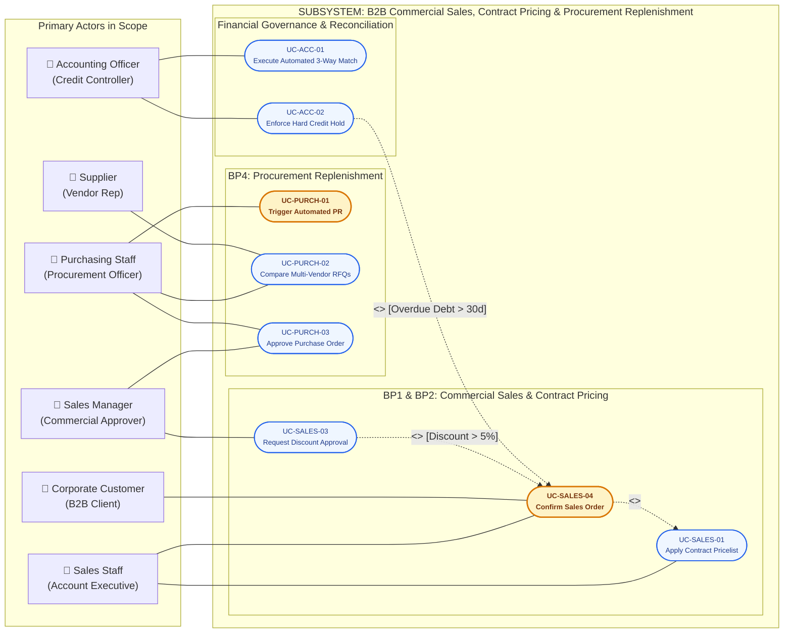

Each member must identify and explain the Use Cases related to their assigned business process and the corresponding FRs.

### Individual Task Focus (from Lecture Slide Deck WEEK 10: USE CASE MODELING)

1. **Activity 1: Review System Scope and FRs (Slide 13):** Review the FRs related to assigned business processes. Identify important system functions, requirements that are only internal business rules, requirements that describe manual activities, and requirements that are unclear or overlapping.
2. **Activity 2: Propose Candidate Use Cases (Slide 14):** Formulate Use Cases using the Verb + Noun convention, link to FR IDs, and identify primary actors.
3. **Deep Dive Use Case Specifications (Slide 17):** Explain in full detail the Use Cases related to assigned processes, corresponding FRs, actors involved, and how the Use Cases support the proposed system and resolve Phase 1 operational friction.
4. **Methodological Reflection (Slide 8, 11):** Reflect on avoiding mechanical conversion and distinguishing Use Case models from Swimlane process flows.

---

# INDIVIDUAL DELIVERABLE WEEK 10 — VÕ DUY BÌNH (ID: 22301500)

### STUDENT & PROJECT METADATA

* **Course:** Business Systems Analysis (BSA) — Academic Year 2026–2027 (Semester 1)
* **Faculty:** Faculty of Technology, Hoa Sen University (HSU)
* **Instructor:** MSc. Nguyen Thi Thanh Thanh (`thanh.nguyenthithanh@hoasen.edu.vn`)
* **Student Name:** **Võ Duy Bình**
* **Student ID:** **22301500**
* **Group:** Group 6 — Scenario 6 (Scenario B): Office Supplies & Stationery (`OfficePro Distribution Co., Ltd.`)
* **Assigned Role:** Team Leader / Lead Business Analyst
* **Assigned Core Business Processes (Phase 1):**
  1. `BP1. Processing Corporate Orders`
  2. `BP2. Verifying Contract Prices`
  3. `BP4. Processing Purchase Orders`
* **Owned Functional Requirements:** `FR-01`, `FR-03`, `FR-04`, `FR-05`, `FR-06`
* **Submission Date:** November 16, 2026

---

## 1. ACTIVITY 1: REVIEW SYSTEM SCOPE AND FRs FOR ASSIGNED PROCESSES (Slide 13)

As the lead analyst responsible for `BP1` (Corporate Orders), `BP2` (Contract Pricing), and `BP4` (Purchase Orders), I conducted a thorough scoping review of the approved Functional Requirements to prepare for Use Case modeling, adhering to the analytical criteria specified in Slide 13.

### 1.1. Identification of Important System Functions (Slide 13)

The core interactive software capabilities that the proposed **OfficePro-EDMS** must deliver for my assigned processes include:

* **Contract Pricelist Retrieval & Application (`FR-01`):** The system must programmatically fetch customer-specific agreed rate matrices upon selecting a corporate account in the quotation screen (e.g., retrieving the locked 65,000 VND contract price for SKU `ST-001` for Tập đoàn ABC).
* **Multi-Tier Contract Expiration Detection (`FR-06`):** The system must continuously evaluate legal agreement dates and fire proactive alerts on the order creation interface 30 days prior to contract termination.
* **Automated Credit Gatekeeping (`FR-03`):** The system must calculate real-time accounts receivable aging and halt the order confirmation event if the account has unpaid debt past the 30-day payment threshold.
* **Stock-Triggered Replenishment PR Generation (`FR-04`):** The system must compute net stock availability against safety reorder thresholds (Min/Max rules) and automatically create draft Purchase Requisitions with awarded supplier records.
* **Automated 3-Way Cross-Document Matching (`FR-05`):** The system must automatically reconcile confirmed Sales Order lines, signed electronic delivery receipts (e-POD), and draft billing lines with zero price and quantity variance.

### 1.2. Identification of Internal Business Rules (Slide 13)

Per Slide 13, analysts must distinguish between **interactive system use cases** (which deliver an observable goal to an actor) and **underlying business rules** (which govern data validation and decision logic within a use case):

* **Rule BR-RULE-01 (Contract Price Invariance):** Sales Staff are strictly prohibited from manually modifying unit prices that originate from an active corporate framework agreement unless approved by management.
* **Rule BR-RULE-02 (Commercial Margin Protection):** Any discretionary discount exceeding **5%** below the approved contract baseline price must trigger an automated escalation to the Sales Manager.
* **Rule BR-RULE-03 (Hard Credit Lock Policy):** A corporate client with any outstanding accounts receivable invoice overdue by more than **30 calendar days (Net 30)** cannot be confirmed for new product dispatches, regardless of salesperson relationship.
* **Rule BR-RULE-04 (Automated Replenishment Formula):** When Available-to-Promise stock drops below the Minimum threshold ($ATP < Min$), the replenishment quantity must equal:

  $$
  ext{Reorder Quantity} = 	ext{Maximum Threshold} - 	ext{Current Net Stock}
  $$

  *(For flagship SKU `ST-001`: when stock drops to 70 reams [$< 100$], the system drafts a PR for $300 - 70 = 230$ reams).*
* **Rule BR-RULE-05 (Zero-Tolerance 3-Way Match):** The billed invoice quantity must strictly match the signed delivered quantity recorded in the e-POD. Any discrepancy $
  eq 0$ automatically shifts invoice status to 'Variance Flagged'.

> **Analytical Note:** None of these rules should be modeled as standalone Use Cases (Slide 8). Instead, they are embedded as preconditions, invariant checks, and extension points inside parent Use Cases (`UC-SALES-01`, `UC-SALES-04`, `UC-PURCH-01`, `UC-ACC-01`).

### 1.3. Identification of Manual Activities Excluded from System Boundary (Slide 6, 11, 13)

In strict compliance with Slide 6 (*"What Is Inside and Outside?"*) and Slide 11 (*"Use Case Diagram vs. Swimlane"*), the following physical and organizational activities identified during Phase 1 AS-IS investigation are declared **outside the software boundary**:

* **Physical Contract Negotiations:** In-person meetings, phone negotiations between Sales Executives and Corporate Procurement Directors, and signing physical paper contracts with wet ink seals.
* **Physical Stock Put-Away & Warehouse Handling:** Pallet unstrapping, driving forklifts into Aisle 02, and manually stacking cartons of Double A copy paper onto steel shelves.
* **Vendor Physical Delivery:** Driving transport trucks from the supplier's paper mill in Binh Duong to OfficePro's Tan Binh dock.
* **Customer Internal Accounting Approvals:** The internal bureaucratic voucher signing process inside the client's finance department prior to making a bank transfer.

### 1.4. Analysis of Unclear or Overlapping Requirements (Slide 13)

During initial Phase 1 drafting, requirements `FR-01` and `FR-06` showed potential overlap regarding contract pricing and validity.

* *Finding:* `FR-01` specified contract price application, while `FR-06` specified a 30-day expiration alert.
* *Resolution:* Instead of creating two fragmented Use Cases that would confuse the sales workflow, I unified them into **UC-SALES-01: Apply Contract Pricelist**. When an actor selects a customer account, the system checks contract expiration first (`FR-06` rule); if valid, it applies the locked rate (`FR-01`); if within the 30-day expiration window, it displays a non-blocking warning banner advising the sales rep to initiate renewal discussions.

---

## 2. INDIVIDUAL PROPOSED USE CASE CATALOG (Slide 4, 14)

Applying the **Verb + Noun** naming convention (Slide 4) and avoiding vague verbs (*Manage, Handle, Process*), I formulated 9 candidate Use Cases covering my assigned business processes and corporate governance workflows:

### Table 10.4: Individual Proposed Use Case Catalog (Owned by Võ Duy Bình)

|         UC ID         | Use Case Name                          | Primary Actor      | Secondary Actor / System   |          Mapped FR IDs          | Assigned Business Process           |
| :-------------------: | :------------------------------------- | :----------------- | :------------------------- | :-----------------------------: | :---------------------------------- |
| **UC-SALES-01** | Apply Contract Pricelist               | Sales Staff        | Corporate Customer         |      `FR-01`, `FR-06`      | `BP2` Verifying Contract Prices   |
| **UC-SALES-03** | Request Discount Approval              | Sales Staff        | Sales Manager              |            `FR-01`            | `BP2` Verifying Contract Prices   |
| **UC-SALES-04** | Confirm Sales Order                    | Sales Staff        | Corporate Customer         | `FR-01`, `FR-02`, `FR-03` | `BP1` Processing Corporate Orders |
| **UC-PURCH-01** | Trigger Automated Purchase Requisition | Purchasing Staff   | None (System Timer/Daemon) |            `FR-04`            | `BP4` Processing Purchase Orders  |
| **UC-PURCH-02** | Compare Multi-Vendor Purchase RFQs     | Purchasing Staff   | Supplier                   |            `FR-04`            | `BP4` Processing Purchase Orders  |
| **UC-PURCH-03** | Approve Purchase Order                 | Purchasing Staff   | Sales Manager, Supplier    |            `FR-04`            | `BP4` Processing Purchase Orders  |
|  **UC-ACC-01**  | Execute Automated 3-Way Reconciliation | Accounting Officer | None (System Engine)       |            `FR-05`            | Cross-Process Governance            |
|  **UC-ACC-02**  | Enforce Hard Credit Hold               | Accounting Officer | Sales Staff, Sales Manager |            `FR-03`            | Cross-Process Governance            |
|  **UC-ACC-03**  | Generate Electronic VAT Invoice        | Accounting Officer | Tax Authority Gateway      |      `FR-05`, `FR-08`      | Cross-Process Governance            |

---

## 2.1. Individual Subsystem Use Case Diagram: Commercial Sales, Pricing & Procurement

To clearly illustrate the interaction scope owned by **Võ Duy Bình** (covering `BP1`, `BP2`, and `BP4`), the following UML Use Case diagram defines the subsystem functional boundary, primary actor associations, and formal `<<include>>` / `<<extend>>` relationships:



> **UML Design Integrity Check:**  
> 1. **No Process Flow Confusions (Slide 11):** Sơ đồ không sử dụng các mũi tên tuần tự `-->` (vốn là của Swimlane/BPMN). Mọi tương tác chỉ là đường kết nối actor (`---`) hoặc quan hệ định chuẩn UML (`<<include>>`, `<<extend>>`).  
> 2. **Role-based Actors (Slide 5):** Tuyệt đối không dùng tên phòng ban hay database nội bộ.  
> 3. **Non-mechanical Conversion (Slide 8):** Các quy tắc kiểm tra con (như kiểm tra nợ quá hạn, kiểm tra chiết khấu 5%) không bị băm nhỏ thành use case rời rạc mà được gắn kết logic bằng `<<extend>>` vào Use Case mục tiêu `UC-SALES-04`.

---

## 3. DEEP DIVE USE CASE SPECIFICATIONS FOR OWNED CORE USE CASES (Slide 17)

To satisfy the individual explanation requirement of Slide 17, I provide complete Alistair Cockburn structured specifications for my three primary flagship Use Cases.

### 3.1. Detailed Specification: UC-SALES-01 (Apply Contract Pricelist)

| Specification Field                          | Field Value / Content                                                                                                                                                                                                                                                                                                                                                                                                                                                                                                                                                                                                                                                                                                                                                                                                                                                                                                                                                                                                                                                                                                                                                        |
| :------------------------------------------- | :--------------------------------------------------------------------------------------------------------------------------------------------------------------------------------------------------------------------------------------------------------------------------------------------------------------------------------------------------------------------------------------------------------------------------------------------------------------------------------------------------------------------------------------------------------------------------------------------------------------------------------------------------------------------------------------------------------------------------------------------------------------------------------------------------------------------------------------------------------------------------------------------------------------------------------------------------------------------------------------------------------------------------------------------------------------------------------------------------------------------------------------------------------------------------- |
| **Use Case ID & Name**                 | **UC-SALES-01: Apply Contract Pricelist** *(Áp dụng Bảng giá Hợp đồng B2B)*                                                                                                                                                                                                                                                                                                                                                                                                                                                                                                                                                                                                                                                                                                                                                                                                                                                                                                                                                                                                                                                                                   |
| **Primary Actor**                      | **Sales Staff** *(Sales Account Executive)*                                                                                                                                                                                                                                                                                                                                                                                                                                                                                                                                                                                                                                                                                                                                                                                                                                                                                                                                                                                                                                                                                                                          |
| **Secondary Actor**                    | **Corporate Customer** *(B2B Client)*                                                                                                                                                                                                                                                                                                                                                                                                                                                                                                                                                                                                                                                                                                                                                                                                                                                                                                                                                                                                                                                                                                                                |
| **Trigger**                            | Sales Staff selects a corporate customer account while creating a new Quotation or Sales Order.                                                                                                                                                                                                                                                                                                                                                                                                                                                                                                                                                                                                                                                                                                                                                                                                                                                                                                                                                                                                                                                                              |
| **Scope & Level**                      | OfficePro-EDMS                                                                                                                                                                                                                                                                                                                                                                                                                                                                                                                                                                                                                                                                                                                                                                                                                                                                                                                                                                                                                                                                                                                                                               |
| **Mapped Requirements**                | **FR-01** (Automated Contract Pricing), **FR-06** (30-Day Expiration Notification)                                                                                                                                                                                                                                                                                                                                                                                                                                                                                                                                                                                                                                                                                                                                                                                                                                                                                                                                                                                                                                                                               |
| **Preconditions**                      | 1. The corporate customer profile exists and is linked to an approved Contract Pricelist in the master database.2. Selected product SKUs (e.g., `ST-001` to `ST-010`) are active in the system catalog.                                                                                                                                                                                                                                                                                                                                                                                                                                                                                                                                                                                                                                                                                                                                                                                                                                                                                                                                                                  |
| **Postconditions**                     | **Success Guarantee:** Standard retail prices are automatically replaced by contracted rates (e.g., SKU `ST-001` locked at 65,000 VND instead of 75,000 VND). Pricing fields are locked against manual alteration.**Minimal Guarantee:** An audit log registers the timestamp, user ID, and applied pricelist ID.                                                                                                                                                                                                                                                                                                                                                                                                                                                                                                                                                                                                                                                                                                                                                                                                                                              |
| **Main Success Scenario (Happy Path)** | 1. Sales Staff initiates a new Quotation and selects the corporate customer (e.g., Tập đoàn ABC).2. System validates the customer's legal identity and searches for an active contract agreement.3. System verifies that the contract expiration date is greater than 30 days from the current date.4. System binds the validated contract pricelist (`PL-ABC-2026`) to the current transaction session.5. Sales Staff adds line item SKU `ST-001` (A4 Double A 70gsm) and specifies quantity (e.g., 50 reams).6. System retrieves the contracted tier unit price of 65,000 VND, calculates line subtotal (3,250,000 VND), and locks the unit price cell.7. System displays confirmation badge *"Contract Price Applied — Verified against Framework Agreement #HD-2026/ABC"*.                                                                                                                                                                                                                                                                                                                                                                                     |
| **Extensions & Exception Flows**       | **3a. Contract Expiration within 30-Day Warning Window (FR-06):**&nbsp;&nbsp;&nbsp;&nbsp;3a1. System detects current date is within 30 days of contract expiry.&nbsp;&nbsp;&nbsp;&nbsp;3a2. System displays amber warning banner: *"Warning: Corporate Framework Contract expires on [Date]. Please initiate contract extension."*&nbsp;&nbsp;&nbsp;&nbsp;3a3. System allows transaction to proceed with current rates, while queuing an automated renewal task for the assigned Account Manager.**4a. No Active Contract Pricelist Exists for Customer:**&nbsp;&nbsp;&nbsp;&nbsp;4a1. System defaults to Standard Wholesale Public Pricelist (e.g., 75,000 VND for `ST-001`).&nbsp;&nbsp;&nbsp;&nbsp;4a2. System prompts Sales Staff: *"Client has no negotiated contract. Standard rates applied."***6a. Sales Staff Attempts Manual Price Override:**&nbsp;&nbsp;&nbsp;&nbsp;6a1. System blocks direct text editing in unit price field.&nbsp;&nbsp;&nbsp;&nbsp;6a2. If discount is entered via discount percentage column, system evaluates discount against Rule BR-RULE-02. If discount > 5%, system triggers `<<extend>> UC-SALES-03: Request Discount Approval`. |

---

### 3.2. Detailed Specification: UC-ACC-02 (Enforce Hard Credit Hold)

| Specification Field                                           | Field Value / Content                                                                                                                                                                                                                                                                                                                                                                                                                                                                                                                                                                                                                                                                                                                                                                                                                                                                                                                                                                                                                |
| :------------------------------------------------------------ | :----------------------------------------------------------------------------------------------------------------------------------------------------------------------------------------------------------------------------------------------------------------------------------------------------------------------------------------------------------------------------------------------------------------------------------------------------------------------------------------------------------------------------------------------------------------------------------------------------------------------------------------------------------------------------------------------------------------------------------------------------------------------------------------------------------------------------------------------------------------------------------------------------------------------------------------------------------------------------------------------------------------------------------- |
| **Use Case ID & Name**                                  | **UC-ACC-02: Enforce Hard Credit Hold** *(Khóa Tín dụng Cứng cho Đơn hàng Quá hạn)*                                                                                                                                                                                                                                                                                                                                                                                                                                                                                                                                                                                                                                                                                                                                                                                                                                                                                                                                 |
| **Primary Actor**                                       | **Accounting Officer** *(Credit & AR Controller)*                                                                                                                                                                                                                                                                                                                                                                                                                                                                                                                                                                                                                                                                                                                                                                                                                                                                                                                                                                            |
| **Secondary Actor(s)**                                  | **Sales Staff**, **Sales Manager**                                                                                                                                                                                                                                                                                                                                                                                                                                                                                                                                                                                                                                                                                                                                                                                                                                                                                                                                                                                       |
| **Trigger**                                             | Sales Staff clicks "Confirm Order" on a quotation, or Accounting Officer runs the automated credit audit daemon.                                                                                                                                                                                                                                                                                                                                                                                                                                                                                                                                                                                                                                                                                                                                                                                                                                                                                                                     |
| **Scope & Level**                                       | OfficePro-EDMS                                                                                                                                                                                                                                                                                                                                                                                                                                                                                                                                                                                                                                                                                                                                                                                                                                                                                                                                                                                                                       |
| **Mapped Requirements**                                 | **FR-03** (Automated Hard Credit Lock), **FR-08** (AR Debt Aging Calculation)                                                                                                                                                                                                                                                                                                                                                                                                                                                                                                                                                                                                                                                                                                                                                                                                                                                                                                                                            |
| **Preconditions**                                       | 1. Customer account has established credit terms (Net 30) and an active credit limit.2. General ledger accounts receivable entries are synchronized with posted invoices.                                                                                                                                                                                                                                                                                                                                                                                                                                                                                                                                                                                                                                                                                                                                                                                                                                                            |
| **Postconditions**                                      | **Success Guarantee (Clean Account):** Customer has zero invoices overdue > 30 days and total balance within credit limit; Sales Order confirmation proceeds to stock reservation.**Success Guarantee (Violating Account):** Order status is locked in 'Credit Blocked' state; automated alert is sent to Chief Accountant; warehouse delivery order generation is completely suppressed.**Minimal Guarantee:** System logs credit check audit trail with exact overdue invoice numbers and aging days.                                                                                                                                                                                                                                                                                                                                                                                                                                                                                                            |
| **Main Success Scenario (Happy Path - Clean Customer)** | 1. System receives order confirmation trigger from `UC-SALES-04` for customer order S00001.2. System queries the customer's open invoice ledger.3. System calculates aging for each open invoice relative to invoice due date ($Due Date = Invoice Date + 30 days$).4. System verifies that zero open invoices have an overdue duration $> 0$ days past due.5. System verifies that $(Current Outstanding Debt + Current Order Total) le Approved Credit Limit$.6. System validates credit clearance and returns control to `UC-SALES-04` to generate warehouse delivery order.                                                                                                                                                                                                                                                                                                                                                                                                                                            |
| **Extensions & Exception Flows**                        | **4a. Customer Possesses Overdue Invoices > 30 Days (FR-03 Rule Violation):**&nbsp;&nbsp;&nbsp;&nbsp;4a1. System detects at least one unpaid invoice with $(Current Date - Due Date) > 30$ days.&nbsp;&nbsp;&nbsp;&nbsp;4a2. System instantly halts order confirmation and transitions quotation state to `Blocked: Overdue Debt`.&nbsp;&nbsp;&nbsp;&nbsp;4a3. System displays modal alert to Sales Staff: *"Order Confirmation Blocked: Customer has unpaid invoice(s) overdue > 30 days (Invoice #INV/2026/00042: 45 days overdue). Release requires Chief Accountant approval or debt clearance."*&nbsp;&nbsp;&nbsp;&nbsp;4a4. System dispatches high-priority notification to Accounting Officer and Sales Manager.**5a. Order Exceeds Approved Credit Limit (Balance Breach):**&nbsp;&nbsp;&nbsp;&nbsp;5a1. If customer has no overdue debt but current order pushes balance beyond limit (e.g. Total debt > 500M VND), system shifts order to `Blocked: Credit Limit Exceeded` requiring formal credit increase request. |

---

### 3.3. Detailed Specification: UC-PURCH-01 (Trigger Automated Purchase Requisition)

| Specification Field                          | Field Value / Content                                                                                                                                                                                                                                                                                                                                                                                                                                                                                                                                                                                                                                                                                                                                                                                                                                                                                                                                                                                                                                                          |
| :------------------------------------------- | :----------------------------------------------------------------------------------------------------------------------------------------------------------------------------------------------------------------------------------------------------------------------------------------------------------------------------------------------------------------------------------------------------------------------------------------------------------------------------------------------------------------------------------------------------------------------------------------------------------------------------------------------------------------------------------------------------------------------------------------------------------------------------------------------------------------------------------------------------------------------------------------------------------------------------------------------------------------------------------------------------------------------------------------------------------------------------- |
| **Use Case ID & Name**                 | **UC-PURCH-01: Trigger Automated Purchase Requisition** *(Kích hoạt Yêu cầu Mua hàng Tự động)*                                                                                                                                                                                                                                                                                                                                                                                                                                                                                                                                                                                                                                                                                                                                                                                                                                                                                                                                                                 |
| **Primary Actor**                      | **Purchasing Staff** *(Procurement Officer)*                                                                                                                                                                                                                                                                                                                                                                                                                                                                                                                                                                                                                                                                                                                                                                                                                                                                                                                                                                                                                           |
| **Secondary Actor(s)**                 | None (Automated System Cron / Stock Event Engine)                                                                                                                                                                                                                                                                                                                                                                                                                                                                                                                                                                                                                                                                                                                                                                                                                                                                                                                                                                                                                              |
| **Trigger**                            | A Sales Order confirmation decreases Available-to-Promise (ATP) stock below the Minimum Reorder Point ($ATP < Min$), or the scheduled nightly replenishment audit fires.                                                                                                                                                                                                                                                                                                                                                                                                                                                                                                                                                                                                                                                                                                                                                                                                                                                                                                     |
| **Scope & Level**                      | OfficePro-EDMS                                                                                                                                                                                                                                                                                                                                                                                                                                                                                                                                                                                                                                                                                                                                                                                                                                                                                                                                                                                                                                                                 |
| **Mapped Requirements**                | **FR-04** (Automated Purchase Requisitions at Reorder Thresholds)                                                                                                                                                                                                                                                                                                                                                                                                                                                                                                                                                                                                                                                                                                                                                                                                                                                                                                                                                                                                        |
| **Preconditions**                      | 1. Master Data Min/Max inventory reordering rules are defined for each SKU (e.g., `ST-001`: Min = 100, Max = 300 reams).2. Default certified supplier and lead-time matrices are configured for each SKU.                                                                                                                                                                                                                                                                                                                                                                                                                                                                                                                                                                                                                                                                                                                                                                                                                                                                    |
| **Postconditions**                     | **Success Guarantee:** A draft Purchase Requisition (PR) / Request for Quotation (RFQ) is generated in the Procurement module with exact reorder quantities and vendor assignment, eliminating stockout risk without human latency.**Minimal Guarantee:** Replenishment event log records stock levels, trigger timestamp, and created PR document ID.                                                                                                                                                                                                                                                                                                                                                                                                                                                                                                                                                                                                                                                                                                             |
| **Main Success Scenario (Happy Path)** | 1. System inventory monitor registers a stock decrement event for SKU `ST-001` (e.g., following delivery reservation for S00001).2. System calculates current Net Available Stock: $Net = Physical On-Hand - Reserved + Incoming Approved POs$.3. System compares Net Available Stock (e.g., 70 reams) against configured Minimum Safety Stock (100 reams).4. System determines that Net Stock is below Minimum threshold ($70 < 100$), triggering replenishment rule `OP-REORDER-ST001`.5. System computes required replenishment quantity to replenish inventory back to Maximum capacity: $Qty = 300 - 70 = 230$ reams.6. System retrieves the designated primary supplier for SKU `ST-001` (Double A International Paper Co., Ltd.) and current contract supply price (52,000 VND/ream).7. System automatically creates draft Purchase Document `P00004` for 230 reams at unit cost 52,000 VND (Total: 11,960,000 VND).8. System routes draft document to Purchasing Staff dashboard with status 'Draft RFQ Ready for Review' and sends system notification. |
| **Extensions & Exception Flows**       | **2a. An Approved Purchase Order Already Exists for SKU:**&nbsp;&nbsp;&nbsp;&nbsp;2a1. If an incoming PO is already confirmed and awaiting delivery at dock, system adds incoming quantity into Net Stock calculation.&nbsp;&nbsp;&nbsp;&nbsp;2a2. If Net Stock including incoming PO $ge Min$, system suppresses duplicate PR generation and logs status *"Replenishment already pipeline-committed"*.                                                                                                                                                                                                                                                                                                                                                                                                                                                                                                                                                                                                                                                                    |

---

## 4. HOW THESE USE CASES SUPPORT THE PROPOSED SYSTEM & ELIMINATE PHASE 1 FRICTION (Slide 17)

Per Slide 17 (*"Each member must be able to explain how the Use Cases support the proposed system"*), the three Use Cases designed under my ownership directly eliminate the root causes and empirical friction points documented in our Phase 1 investigation:

```
+-------------------------------------------------------------------------------------------------------------+
|                                PHASE 1 DIAGNOSIS ➔ PHASE 2 USE CASE RESOLUTION                             |
|                                                                                                             |
|   PHASE 1 OPERATIONAL FRICTION                   PHASE 2 USE CASE ARCHITECTURE                              |
|                                                                                                             |
|   [Friction 1: Contract Pricing Errors]          [UC-SALES-01: Apply Contract Pricelist]                   |
|   - Reps looked up prices in private Excel.      - Direct binding to validated contract pricelist.          |
|   - 5–8% price error rate on corporate SOs.      - System locks unit price (ST-001 @ 65k).                  |
|   - 4 hours wasted per disputed invoice.         - Result: Pricing error rate drops to ZERO.                |
|                                                                                                             |
|   [Friction 2: Verbal Credit Overrides]          [UC-ACC-02: Enforce Hard Credit Hold]                      |
|   - Sales managers gave verbal approvals.        - System-enforced Net 30 gatekeeper rule.                  |
|   - Overdue debt accumulated unchecked.          - Blocks order release if debt > 30 days overdue.          |
|   - Severe working capital liquidity risk.       - Result: 100% compliance with credit governance.          |
|                                                                                                             |
|   [Friction 3: Late Stockout Replenishment]      [UC-PURCH-01: Trigger Automated Purchase Requisition]      |
|   - Reorders placed via manual email.            - Automated Min/Max reorder point trigger.                 |
|   - Reordering only after stock was zero.        - Instantly drafts PR for 230 reams at Min = 100.         |
|   - 3–5 day vendor lead-time stockouts.          - Result: Eliminates stockout-induced SO cancellations.    |
+-------------------------------------------------------------------------------------------------------------+
```

1. **Elimination of Pricing Inconsistencies (`P-01` via `UC-SALES-01`):**In Phase 1, our empirical interviews (`EVD-W1-SALES-01`) revealed that sales representatives relied on disparate personal spreadsheets, causing 5–8% billing disputes and 50M VND in monthly write-offs. `UC-SALES-01` completely centralizes and locks the price resolution mechanism within the database, removing human transcription error.
2. **Restoration of Financial Credit Governance (`P-03` via `UC-ACC-02`):**In Phase 1, the Chief Accountant (`EVD-W3-FIN-03`) reported that verbal overrides allowed high-risk corporate accounts to bypass payment rules. `UC-ACC-02` replaces verbal handoffs with an unbypassable digital gatekeeper that halts warehouse fulfillment for accounts with debt overdue > 30 days.
3. **Prevention of Stock Depletion (`P-02` via `UC-PURCH-01`):**
   In Phase 1, warehouse stockouts occurred 3–4 times per week because purchasing staff only discovered depleted stock after warehouse clerks sounded an alarm. `UC-PURCH-01` establishes an automated, proactive replenishment trigger that ensures orders are queued days before safety stock is breached.

---

## 5. METHODOLOGICAL REFLECTION ON BSA MODELING RULES (Slide 8, 11)

### 5.1. Distinguishing Swimlane/BPMN Models from Use Case Diagrams (Slide 11)

During Week 10, a vital learning insight was mastering the boundary between **Process Modeling (BPMN Swimlane)** and **Functional Modeling (UML Use Case)** as highlighted on Slide 11:

* *Swimlane models* describe the chronological sequence of operational work, physical handoffs between human lanes, and business decision gateways across time.
* *Use Case models* describe software functional boundaries, actor goals, and system services without representing procedural flow or temporal sequence.
* *Application in OfficePro:* A task like *"Warehouse clerk drives forklift to pick 50 reams"* belongs in the TO-BE Swimlane, whereas *"Generate Bin-Guided Picking List"* (`UC-INV-02`) is the software service modeled in the Use Case diagram.

### 5.2. Avoiding Mechanical 1-to-1 Functional Requirement Conversion (Slide 8, 9)

Slide 8 & 9 warn against the common novice error of mechanically turning every single FR or validation rule into a separate Use Case:

* In our requirements catalog, we had `FR-01` (Contract pricing), `FR-06` (Contract expiration alert), and a rule requiring discount verification.
* If converted mechanically, one might mistakenly create three disconnected Use Cases: *"Retrieve Price"*, *"Check Expiration"*, and *"Validate Discount"*. This would produce an unreadable, fragmented diagram.
* Following Slide 8 best practices, I consolidated these rules into **UC-SALES-01 (Apply Contract Pricelist)** as a single, meaningful actor goal, with discount escalation modeled properly via an **`<<extend>>`** relationship to **UC-SALES-03**.

---

### INDIVIDUAL SUBMISSION SIGN-OFF

* **Submitted By:** Võ Duy Bình (Student ID: 22301500)
* **Role:** Lead Business Analyst / Team Leader Group 6
* **Verification:** *I confirm that this deliverable reflects my original analysis, accurately models the assigned processes, and adheres strictly to the HSU BSA course guidelines.*
