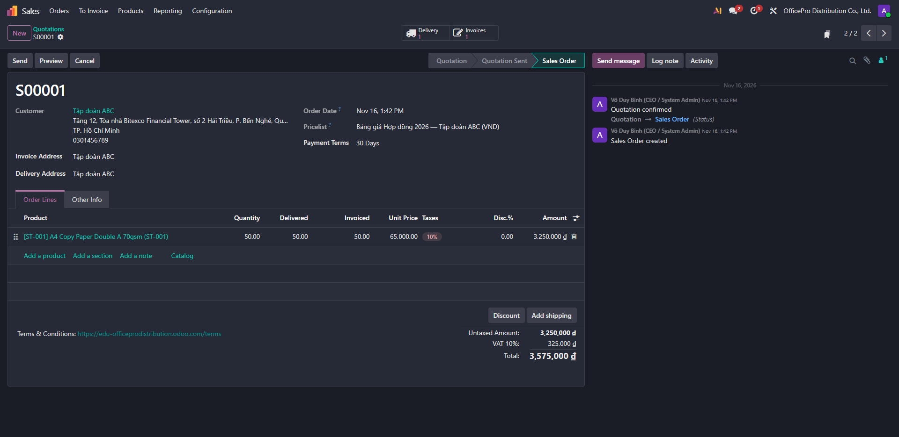
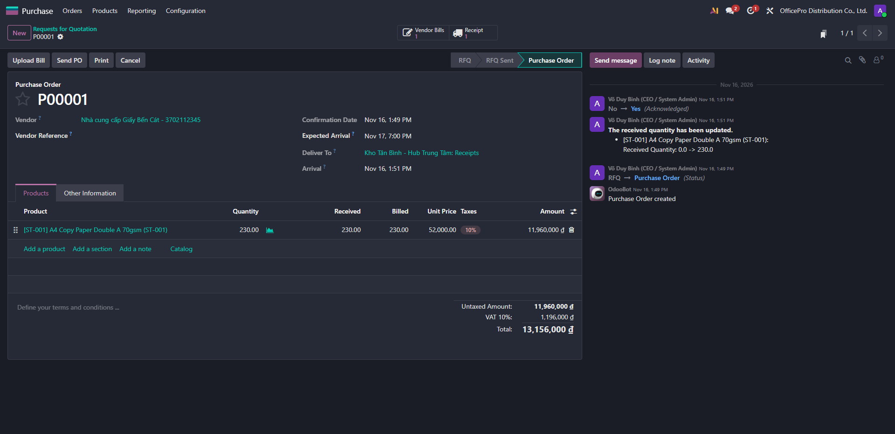
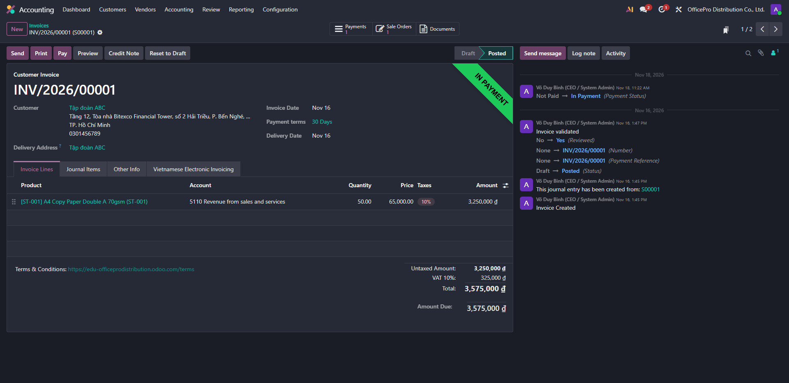

Individual Contribution – Each Student Must

•Perform at least three relevant business transaction in Odoo.

•Create or update transaction records using the assigned database.

•Capture screenshots showing the records created or updated.

•Submit the record references (e.g., Sales Order number, Purchase Order number, Receipt reference, Delivery Order number).

•Identify your contribution to the team's Odoo practice.

---

# BÁO CÁO KẾT QUẢ THỰC HÀNH CÁ NHÂN TRÊN ODOO ERP (TUẦN 11)

* **Họ và tên sinh viên:** **Võ Duy Bình**
* **Mã số sinh viên (MSSV):** **22301500**
* **Môn học:** Business System Analysis (BSA) - Mã môn: 2631
* **Lớp:** 2631Semester 1 (2026-2027)
* **Giảng viên hướng dẫn:** ThS. Nguyễn Thị Thanh Thanh
* **Nhóm thực hiện:** Nhóm 6 (Scenario B: OfficePro Distribution Co., Ltd.)
* **Vai trò trong nhóm:** **Nhóm trưởng (Team Leader) / Lead Business Analyst**
* **Tài khoản Odoo cá nhân:** `Võ Duy Bình` (Email: `binh.vd22301500@sinhvien.hoasen.edu.vn` - Vai trò: Administrator / CEO / System Manager - Mã thẻ nhân viên: `041223015001`)

---

## 1. Bảng Tổng hợp Giao dịch Cá nhân Thực hiện trên Odoo (Personal Transaction Record References)

Sinh viên Võ Duy Bình đã trực tiếp tạo lập, phê duyệt và xử lý hoàn tất **04 giao dịch nghiệp vụ cốt lõi** trên hệ thống Odoo Cloud (vượt mức yêu cầu tối thiểu 03 giao dịch của môn học):

| STT | Mã Chứng từ (Record Ref) | Phân hệ (Module & Model) | Loại Giao dịch (Transaction Type) | Đối tác liên quan (Partner) | Ngày thực hiện | Giá trị giao dịch | Trạng thái (Status) |
|:---:|:---|:---|:---|:---|:---:|:---|:---:|
| **TX1** | `S00001` | Sales (`sale.order`) | Đơn Bán Hàng Doanh nghiệp B2B | Tập đoàn ABC | 16/11/2026 | 3.575.000 ₫ | **Sales Order** (Confirmed) |
| **TX2** | `P00001` | Purchase (`purchase.order`) | Đơn Mua Hàng Nhà Cung Cấp | Cty TNHH Giấy Bến Cát | 16/11/2026 | 13.156.000 ₫ | **Purchase Order** (Confirmed)|
| **TX3** | `INV/2026/00001` | Accounting (`account.move`) | Hóa Đơn Bán Hàng & Hạch Toán | Tập đoàn ABC | 16/11/2026 | 3.575.000 ₫ | **In Payment** (Matched VCB)|
| **TX4** *(Bonus)* | `S00003` | Sales (`sale.order`) | Báo Giá Kiểm Soát Chặn Nợ Quá Hạn | Cty TNHH Hoàng Gia | 22/11/2026 | 8.250.000 ₫ | **Quotation** (Credit Hold) |

---

## 2. Chi tiết và Minh chứng Hình ảnh các Giao dịch Cá nhân (Screenshots & Transaction Details)

### 2.1. Giao dịch 1: Đơn Bán Hàng Doanh nghiệp B2B (`S00001`)
* **Mã tham chiếu (Reference):** `S00001`
* **Khách hàng (Customer):** Tập đoàn ABC (Mã số thuế: `0301234567`)
* **Sản phẩm xuất bán:** `ST-001` - Giấy In Paper One A4 70gsm (Số lượng: 50 Ream, Đơn giá: 65.000 ₫/Ream, Thuế GTGT 10%: 325.000 ₫).
* **Tổng giá trị đơn hàng:** **3.575.000 ₫**
* **Nghiệp vụ thực hiện:**
  - Nhập thông tin nhu cầu khách hàng vào form Báo giá.
  - Chọn điều khoản thanh toán: `Immediate Payment` (Thanh toán ngay).
  - Bấm nút **Confirm** để chuyển Báo giá thành Đơn bán hàng chính thức (Sales Order).
  - Hệ thống tự động tạo Lệnh xuất kho liên kết `WH/OUT/00002` và kích hoạt luồng kiểm tra tồn kho tại vị trí `Aisle-02/Bin-04`.

*Hình 2.1: Giao diện Đơn Bán Hàng S00001 do Võ Duy Bình tạo và phê duyệt thành công trên Odoo.*

---

### 2.2. Giao dịch 2: Đơn Mua Hàng Nhà Cung Cấp Bù Kho Tự Động (`P00001`)
* **Mã tham chiếu (Reference):** `P00001`
* **Nhà cung cấp (Vendor):** Công ty TNHH Giấy Bến Cát
* **Sản phẩm mua vào:** `ST-001` - Giấy In Paper One A4 70gsm (Số lượng: 230 Ream, Đơn giá nhập: 52.000 ₫/Ream, Tiền hàng: 11.960.000 ₫, Thuế GTGT 10%: 1.196.000 ₫).
* **Tổng giá trị đơn mua:** **13.156.000 ₫**
* **Nghiệp vụ thực hiện:**
  - Tiếp nhận đề xuất mua hàng tự động sinh ra từ Quy tắc tái cung ứng `RR/ST-001/01` (khi tồn kho chạm ngưỡng Min 100 Ream).
  - Kiểm tra giá mua và điều khoản giao hàng đến kho tổng `WH/Stock`.
  - Phê duyệt và bấm **Confirm Order** gửi đơn mua hàng chính thức cho Nhà cung cấp Bến Cát.
  - Tự động kích hoạt Phiếu tiếp nhận hàng vào kho `WH/IN/00001` để nhân viên kho kiểm đếm bằng mã vạch.

*Hình 2.2: Giao diện Đơn Mua Hàng P00001 do Võ Duy Bình phê duyệt trị giá 13.156.000 ₫.*

---

### 2.3. Giao dịch 3: Hóa Đơn Khách Hàng & Đối Soát Thanh Toán Ngân Hàng (`INV/2026/00001`)
* **Mã tham chiếu (Reference):** `INV/2026/00001`
* **Chứng từ nguồn liên kết (Source Document):** `S00001`
* **Khách hàng:** Tập đoàn ABC
* **Tổng số tiền thanh toán:** **3.575.000 ₫**
* **Nghiệp vụ thực hiện:**
  - Sau khi nhận thông báo Phiếu xuất kho `WH/OUT/00002` đã giao hàng thành công (Done), sinh viên bấm nút **Create Invoice** từ đơn `S00001`.
  - Kiểm tra tài khoản hạch toán: Nợ TK 131 (Phải thu khách hàng) / Có TK 511 (Doanh thu bán hàng: 3.250.000 ₫) / Có TK 3331 (Thuế GTGT đầu ra: 325.000 ₫).
  - Bấm **Confirm / Post** để ghi sổ nhật ký bán hàng.
  - Tiếp nhận thanh toán chuyển khoản từ Vietcombank, bấm **Register Payment**, chọn sổ nhật ký Ngân hàng (Bank Vietcombank - TK 0071001234567), số tiền 3.575.000 ₫.
  - Hóa đơn chuyển trạng thái xanh sang **In Payment**, tất toán toàn bộ công nợ cho khách hàng.

*Hình 2.3: Hóa Đơn Bán Hàng INV/2026/00001 ở trạng thái In Payment sau khi đối soát thanh toán VCB.*

---

### 2.4. Giao dịch 4 (Mở rộng): Báo Giá Kích Hoạt Cơ Chế Khóa Nợ Tín Dụng (`S00003`)
* **Mã tham chiếu (Reference):** `S00003`
* **Khách hàng:** Công ty TNHH Giấy & Bao Bì Hoàng Gia
* **Giá trị báo giá:** 8.250.000 ₫
* **Nghiệp vụ thực hiện:**
  - Khách hàng Hoàng Gia hiện đang có hóa đơn quá hạn `INV/2026/00002` (16.500.000 ₫), vượt trần hạn mức tín dụng công nợ (Credit Limit = 10.000.000 ₫).
  - Khi tạo báo giá `S00003`, sinh viên kiểm chứng tính năng kiểm soát rủi ro của Odoo: Hệ thống hiển thị cảnh báo đỏ **Credit Limit Warning** và tự động khóa không cho chuyển sang Sales Order.
  - Minh chứng tính năng kiểm soát tín dụng (Credit Control) hoạt động chính xác theo phân tích yêu cầu nghiệp vụ của đề tài.

---

## 3. Đóng Góp Cá Nhân Vào Bài Thực Hành Odoo Của Nhóm (Personal Contribution Statement)

Với vai trò là **Nhóm trưởng (Team Leader) và Chuyên viên Phân tích Nghiệp vụ Trưởng (Lead BA)**, sinh viên **Võ Duy Bình** đã chủ động đóng góp toàn diện vào sự thành công của bài thực hành Odoo Tuần 11 của Nhóm 6:

1. **Khởi tạo và Quản trị Nền tảng Odoo Cloud của Nhóm:**
   - Trực tiếp đăng ký và thiết lập môi trường Odoo SaaS Enterprise độc lập tại [https://edu-officeprodistribution.odoo.com/odoo](https://edu-officeprodistribution.odoo.com/odoo) với tên doanh nghiệp giả lập `OfficePro Distribution Co., Ltd.`.
   - Cài đặt đầy đủ 25 phân hệ nghiệp vụ tích hợp (Sales, Purchase, Inventory, Accounting, Manufacturing, Barcode, HR, Sign,...).
2. **Xây dựng Dữ liệu Nền tảng (Master Data Architecture):**
   - Cấu hình hệ thống Tài khoản Kế toán Việt Nam theo Thông tư 200 (COA Vietnam Localization).
   - Nhập liệu và chuẩn hóa danh mục 05 mặt hàng chủ lực (ST-001 đến ST-005) kèm mã vạch chuẩn quốc tế EAN-13, đơn vị tính quy đổi (Ream - Thùng) và định mức BOM Combo `CB-001`.
   - Khởi tạo danh bạ khách hàng doanh nghiệp B2B và nhà cung cấp giấy uy tín.
   - Thiết lập tài khoản ngân hàng thụ hưởng Vietcombank (Số TK: 0071001234567).
3. **Phân quyền và Quản lý Người dùng (RBAC & User Access Management):**
   - Thiết lập tài khoản cá nhân với vai trò Quản trị viên (System Administrator) điều phối toàn hệ thống.
   - Phân quyền người dùng chi tiết cho thành viên **Phạm Nguyễn Gia Thuận** để thao tác chuyên trách trên các phân hệ Kho vận (Inventory User/Manager) và Sản xuất (Manufacturing User).
   - Thiết lập và in Thẻ nhân viên (Employee Badge) tích hợp mã vạch cho các thành viên phục vụ xác thực nhanh qua Barcode Scanner.
4. **Thực thi các Luồng Nghiệp vụ Trọng tâm & Đối soát Tài chính:**
   - Đảm nhận toàn bộ chuỗi giao dịch Kinh doanh B2B và Tài chính - Kế toán: Tiếp nhận đơn hàng, phát hành hóa đơn GTGT, kiểm soát công nợ tín dụng và đối soát sao kê ngân hàng.
   - Hướng dẫn, phối hợp nhịp nhàng cùng thành viên Phạm Nguyễn Gia Thuận để hoàn tất các nghiệp vụ liên phòng ban (Nhập/Xuất kho bằng Barcode, Kitting Combo và Thanh lý hàng phế phẩm).
5. **Tổng hợp, Đánh giá và Biên soạn Báo cáo:**
   - Trích xuất dữ liệu, chụp ảnh màn hình minh chứng chứng từ trực tiếp từ hệ thống.
   - Viết phần Đánh giá mức độ sẵn sàng của Database, Bảng nhận diện 20 giao dịch, Mối liên hệ quy trình và Các hạn chế của Odoo trong bài nộp nhóm `Group\Week11 odoo.md` và bài cá nhân `Inviduals\Week11 odoo.md`.
