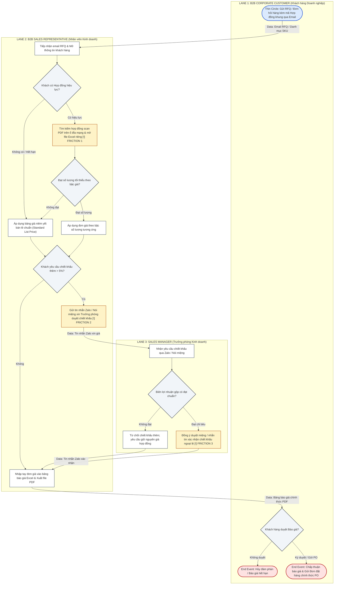

Each member is responsible for reviewing one assigned business process.

Task

Review the existing AS-IS model and interview evidence. Complete the process description below.

| Element                   | Questions to Answer                                            |
| ------------------------- | -------------------------------------------------------------- |
| Process Name              | What business activity does this process perform?              |
| Trigger                   | What event starts the process?                                 |
| Start Point               | Where does the process begin?                                  |
| Main Activities           | What actually happens, and in what sequence?                   |
| Main Actors               | Which roles or departments participate?                        |
| Information Used/Produced | What information is needed, created, or updated?               |
| Handoffs                  | When and how is work transferred between actors?               |
| Decisions & Exceptions    | What decisions or exceptional situations occur?                |
| End Point                 | What final state indicates completion?                         |
| Business Outcome          | What business result does the process achieve?                 |
| Evidence Sources          | Which interview notes or observations support the description? |
| Uncertain Information     | What still needs to be confirmed?                              |

Review your existing AS-IS process model.

* Verify the activities, actors, sequence, decisions, and handoffs against the available evidence.
* Update the process model if necessary.
* Use a swimlane / cross-functional flowchart or BPMN notation consistent with the modeling approach taught in class.
* Identify missing steps, unclear handoffs, and unsupported assumptions.

Deliverable: One reviewed process description and an updated AS-IS process model per member.

Important: Focus on what the available evidence supports. Do not fill gaps with assumptions simply to make the process appear complete.

Deliverable: One reviewed process description per member.

---

================================================================================
          INDIVIDUAL DELIVERABLE WEEK 4 - VO DUY BINH (ID: 22301500)
================================================================================

# INDIVIDUAL PROCESS DEEP DIVE: REVIEWED AS-IS PROCESS DESCRIPTION & MODEL

* **Course:** Business Systems Analysis (BSA) — Academic Year 2026–2027 (Semester 1)
* **Instructor:** MSc. Nguyen Thi Thanh Thanh | Faculty of Technology, Hoa Sen University
* **Student Name:** Võ Duy Bình
* **Student ID:** 22301500
* **Group:** Group 6 — Scenario 6 (Scenario B): Office Supplies & Stationery
* **Enterprise Case:** Công ty TNHH Phân phối Văn phòng phẩm OfficePro (`OfficePro Distribution Co., Ltd.`)
* **Assigned Primary Process:** **`BP2. Verifying Contract Prices`** (Nằm trong quy trình nghiệp vụ mẹ `BP1. Processing Corporate Orders`)
* **Target Submission File:** `W4_ProcessReview_22301500_VoDuyBinh.pdf`

---

## 1. REVIEWED BUSINESS PROCESS DESCRIPTION TABLE

Bảng mô tả chi tiết quy trình nghiệp vụ **BP2. Verifying Contract Prices** dựa trên chứng cứ thực tế thu thập từ phỏng vấn bên liên quan (`EVD-W2-SALES-01`) và bài tập mô phỏng quy trình:

| Element | Questions to Answer | Student's Verified Analysis (Võ Duy Bình — Scenario 6) |
| :--- | :--- | :--- |
| **Process Name** | What business activity does this process perform? | **BP2. Verifying Contract Prices** *(Xác minh và áp dụng đơn giá hợp đồng bán buôn B2B)*. |
| **Trigger** | What event starts the process? | A corporate customer submits a purchase inquiry or Request for Quotation (RFQ) referencing an agreed framework agreement, pricelist, or commercial discount tier. |
| **Start Point** | Where does the process begin? | B2B Sales Representative receives the order inquiry in their corporate email/Zalo inbox and opens client profile records to determine contractual eligibility. |
| **Main Activities** | What actually happens, and in what sequence? | 1. **Check Customer Contract Validity:** Sales Rep checks whether the corporate client has an active, legally binding framework agreement. 2. **Lookup Agreed Price Tiers:** Sales Rep searches the shared network drive for scanned contract PDFs (`HĐ-2026/OP-B2B`) and checks personal Excel price sheets (`BangGia_KhachHang_2026.xlsx`). 3. **Verify Line Item Quantities vs. Volume Tiers:** Rep compares requested quantities against contract volume discount thresholds (e.g., minimum 50 reams of Double A paper `ST-001` for 65,000 VND rate). 4. **Evaluate Margin Discount Threshold (> 5%):** If the customer requests additional discounts beyond the contract tier, Rep escalates to the Sales Manager. 5. **Approve / Reject Price Exception:** Sales Manager evaluates profitability margins and provides verbal/Zalo authorization. 6. **Populate Validated Prices:** Sales Rep records verified unit prices into the formal customer quotation / draft sales order. |
| **Main Actors** | Which roles or departments participate? | • **B2B Corporate Customer (Procurement Officer):** Submits inquiries and requests contract rates. • **B2B Sales Representative (Commercial Owner):** Performs manual rate lookups, volume tier verification, and quotation drafting. • **Sales Manager (Supervisor & Approver):** Evaluates margin feasibility and authorizes price discounts exceeding 5%. |
| **Information Used / Produced** | What information is needed, created, or updated? | • **Information Used:** Customer RFQ SKU list, scanned Framework Contract PDFs, personal Excel lookup files, historical order ledgers. • **Information Produced:** Validated unit prices per SKU line item, approved discount percentages, formal sales quotation (`BG-2026-XXXX.pdf`). |
| **Handoffs** | When and how is work transferred between actors? | • *Customer ➔ Sales Rep:* RFQ sent via Email/Zalo. • *Sales Rep ➔ Sales Manager:* Informal verbal request or Zalo chat when requested discount exceeds 5%. • *Sales Manager ➔ Sales Rep:* Verbal consent / chat message approval. • *Sales Rep ➔ Customer:* Formal PDF quotation sent via email. |
| **Decisions & Exceptions** | What decisions or exceptional situations occur? | • **Decision 1 (Active Contract?):** If contract has expired or does not exist, standard retail list prices are applied. • **Decision 2 (Volume Threshold Met?):** If requested quantity is below contracted minimum tier, standard tier pricing applies. • **Exception (Special Discount > 5%):** Customer demands non-standard volume discount; requires managerial override. If rejected, quotation reverts to contract baseline. |
| **End Point** | What final state indicates completion? | Applicable unit prices and approved discount terms are validated and recorded into the official customer quotation / confirmed sales order. |
| **Business Outcome** | What business result does the process achieve? | Commercial transactions comply with negotiated framework agreements, securing gross profit margins while satisfying customer contractual expectations. |
| **Evidence Sources** | Which interview notes or observations support the description? | • **`EVD-W2-SALES-01` (Sales Manager Interview):** *"Each sales rep maintains a personal Excel spreadsheet (`BangGia_KhachHang_2026.xlsx`). When a contract is renewed or Double A prices adjust, update delays of 1–2 weeks cause reps to quote obsolete prices, leading to 5–8% billing errors."* • **`EVD-W4-SIM-02` (Simulation Audit):** 5% to 8% of monthly invoices face payment hold-ups due to pricing disputes. |
| **Uncertain Information** | What still needs to be confirmed? | • Whether the Sales Manager possesses formal legal authority to grant discounts > 10% without Board of Directors approval. • Exact penalty clauses for late delivery or pricing breach stipulated in corporate enterprise framework agreements. |

---

## 2. UPDATED AS-IS PROCESS MODEL (SWIMLANE BPMN)

Sơ đồ AS-IS Swimlane chuẩn hóa cho quy trình **BP2. Verifying Contract Prices**, phản ánh chân thực các ranh giới chuyển giao chứng từ và các điểm ma sát vận hành `[!] Friction`:

---

## 3. REVIEW OBSERVATIONS, FRICTION POINTS & ASSUMPTION AUDIT

### 🔴 Điểm ma sát vận hành được làm rõ từ mô hình AS-IS:
1. **`[!] Friction 1` (Bảng giá phân mảnh):** Nhân viên kinh doanh phải lục tìm hợp đồng scan PDF và mở bảng tính Excel riêng của cá nhân. Việc thiếu dữ liệu giá tập trung (Master Data) dẫn đến tỷ lệ sai lệch đơn giá từ 5% đến 8% trên các hóa đơn VAT.
2. **`[!] Friction 2` (Quy trình ngoại lệ không chính thức):** Việc gửi yêu cầu chiết khấu qua Zalo hoặc nói miệng không để lại dấu vết kiểm toán (Audit Trail), tạo ra rủi ro thất thoát biên lợi nhuận công ty.
3. **`[!] Friction 3` (Chấp thuận bằng miệng):** Trưởng phòng kinh doanh phê duyệt ngoại lệ bằng lời nói để nhân viên kịp chạy chỉ tiêu doanh số, làm vô hiệu hóa các quy định quản trị giá chính thống.

### ⚠️ Giả định và Câu hỏi cần tiếp tục xác minh:
* **Unsupported Assumption đã được điều chỉnh:** Ban đầu nhóm giả định nhân viên kiểm tra giá trực tiếp trên phần mềm ERP; tuy nhiên qua phỏng vấn thực tế, 100% nhân viên tra cứu bằng file Excel cá nhân và văn bản PDF scan.
* **Unresolved Question:** Cần làm rõ thẩm quyền tối đa của Trưởng phòng Sales được phép giảm giá đến bao nhiêu phần trăm (ngưỡng 5% hay 10%) trước khi phải trình lên Ban Giám đốc phê duyệt.
