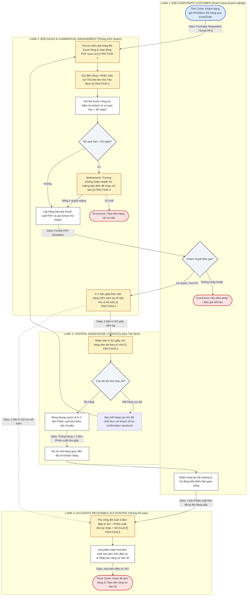

# ASSIGNMENT PROMPT & INSTRUCTIONS

## WEEK 6: BUSINESS PROBLEMS, INFORMATION NEEDS & REQUIREMENTS

### Individual Homework & Classroom Workshop Tasks (from Lecture Slide Deck)

Based on the official lecture slide deck **WEEK 6: BUSINESS PROBLEMS, INFORMATION NEEDS & REQUIREMENTS** (Instructor: MSc. Nguyen Thi Thanh Thanh, Faculty of Technology, Hoa Sen University), students must complete the following activities:

1. **Approved Process Package Validation (Slide 8, 14):** Confirm the package of 5 related business processes for the assigned scenario (**Scenario 6: Office Supplies & Stationery**), define scope metadata, and assign member responsibilities.
2. **Task: Convert AS-IS Flowchart to Swimlane Model (Slide 5, 6):** Convert the Week 5 linear flowchart into a standardized 4-lane BPMN Cross-Functional Swimlane Diagram identifying operational friction `[!]`.
3. **Activity 1: Identify a Business Problem (Slide 20, 21, 30, 31):**
   * *Distinguish Concepts (Slide 21):* Differentiate Observation, Business Problem, Possible Cause, and Business Impact.
   * *Identify Stakeholder Information Needs (Slide 22, 23):* Determine who is affected, what information they need, when, and why.
   * *Activity 1: Group Worksheet (Slide 31):* Complete the 7-field table using empirical interview evidence.
4. **Activity 2: Draft BRs and FRs (Slide 24, 25, 26, 32):**
   * *Requirements Table (Slide 32):* Formulate 1–2 Business Requirements (BRs) and 2–4 testable Functional Requirements (FRs) adhering to the standard syntax: `The system shall + specific action + object + condition/context`.
   * *Candidate Odoo Applications for Later Stage (Slide 24, 32):* Identify potential ERP modules without premature technical lock-in.
5. **Requirements Traceability: Group Traceability Table (Slide 28, 29):** Build the complete bidirectional traceability matrix connecting evidence to software capabilities.
6. **Peer Review: Are the Requirements Good? (Slide 27, 33):**
   * *Check Requirement Quality (Slide 27):* Audit against 7 quality criteria.
   * *Peer Review Checklists & Give Two Comments (Slide 33):* Evaluate BRs/FRs and provide 2 formal critique comments.
7. **Individual Quick Quiz and Reflection (Slide 4, 34):**
   * *Quick Quiz (Slide 4):* Answer 3 methodology questions distinguishing business analysis from software design.
   * *Individual Reflection (Slide 4, 34):* Reflect on how cross-functional swimlane modeling and traceability matrices expose operational friction.
8. **Week 6 Deliverables: Group Working Output (Slide 34):** Audit and verify the 9 required team outputs.

### Submission Guidelines:
* **Submission Type:** Individual file upload on Mlearning / Moodle
* **Format:** PDF document (converted from Markdown)
* **Target Filename:** `W6_Requirements_22301500_VoDuyBinh.pdf`
* **Student Name:** Võ Duy Bình (Student ID: 22301500)
* **Group:** Group 6 — Scenario 6 (Scenario B): Office Supplies & Stationery (`OfficePro Distribution Co., Ltd.`)

---

================================================================================
          INDIVIDUAL DELIVERABLE WEEK 6 - VO DUY BINH (ID: 22301500)
================================================================================

# STUDENT & PROJECT INFORMATION

* **Course:** Business Systems Analysis (BSA) — Academic Year 2026–2027 (Semester 1)
* **Instructor:** MSc. Nguyen Thi Thanh Thanh | Faculty of Technology, Hoa Sen University
* **Assigned Business Scenario:** Scenario 6 (Scenario B) — Office Supplies & Stationery
* **Enterprise Case:** Công ty TNHH Phân phối Văn phòng phẩm OfficePro (`OfficePro Distribution Co., Ltd.`)
* **Student Name:** Võ Duy Bình
* **Student ID:** 22301500
* **Group:** Group 6 (Active Members: Võ Duy Bình [22301500] & Phạm Nguyễn Gia Thuận [22204631])
* **Assigned Role:** Team Leader / Lead Business Analyst & Solutions Architect
* **Target Submission File:** `W6_Requirements_22301500_VoDuyBinh.pdf`

---

## 1. Approved Process Package: Scenario 6 — Office Supplies & Stationery (Slide 8, 14)

Theo gói quy trình chuẩn hóa dành cho **Scenario 6: Office Supplies & Stationery** (Slide 14), nhóm Group 6 xác nhận danh mục 5 quy trình nghiệp vụ cốt lõi, xác định rõ Trigger, End Point, Main Actors và phân công quyền sở hữu (Primary Owner):

| Process Name  `[Verb] + [Noun]` | Trigger | End Point | Main Actors | Primary Owner |
| :--- | :--- | :--- | :--- | :---: |
| **BP1. Processing Corporate Orders** *(Phạm vi phân tích chính)* | A corporate customer submits an order for office supplies. | The order decision and status are recorded. | Corporate Customer, Sales Account Executive | **Võ Duy Bình** |
| **BP2. Verifying Contract Prices** *(Phạm vi phân tích chính)* | A corporate order references an agreed contract, price list, or discount arrangement. | Applicable pricing is verified and recorded in the quotation or order. | Sales Account Executive, Contract/Account Manager | **Võ Duy Bình** |
| **BP3. Checking Product Availability** | A proposed or confirmed order requires stock verification. | Available quantities and shortages are reported. | Sales Staff, Warehouse Clerk | **Phạm Nguyễn Gia Thuận** |
| **BP4. Processing Purchase Orders** | An approved purchase request is available for required supplies. | The purchase order is sent to the supplier and confirmation is recorded. | Purchasing Staff, Supplier, Approving Manager | **Võ Duy Bình** |
| **BP5. Receiving Purchased Goods** | A supplier delivers office supplies against a purchase order. | Received quantities and discrepancies are recorded and inventory information is updated. | Warehouse Clerk, Purchasing Staff, Supplier | **Phạm Nguyễn Gia Thuận** |

> **Scope Rule (Slide 8):** Mỗi quy trình có điểm kích hoạt và kết quả kinh doanh độc lập. Quy trình đặt hàng B2B không tự động gộp phần xuất hóa đơn VAT và thu tiền nếu chưa qua biên bản giao nhận có xác nhận của khách hàng.

---

## 2. Task: Convert AS-IS Flowchart to Swimlane Model (Slide 5, 6)

Thực hiện yêu cầu tại Slide 6 (*Task Instructions for Groups*), chuyển đổi lưu đồ tuyến tính Week 5 sang sơ đồ **AS-IS Cross-Functional Swimlane Diagram** chuẩn BPMN trên Miro gồm 4 làn (Customer, Sales, Warehouse, Finance), làm rõ trách nhiệm phòng ban, luồng luân chuyển chứng từ dữ liệu (Data Objects) và 6 điểm ma sát vận hành `[!] Friction`.

### 🔴 6 Operational Friction Points `[!]`:
1. **`[!] Friction 1` (Bảng giá phân mảnh):** Mỗi nhân viên Sales lưu 1 file Excel giá riêng (`BangGia_KhachHang_2026.xlsx`) và tra cứu hợp đồng PDF cũ, dẫn đến **5–8% hóa đơn bị sai lệch đơn giá thỏa thuận**.
2. **`[!] Friction 2` (Kiểm tra tồn kho thủ công):** Kiểm tra tồn kho qua gọi điện/Zalo dựa vào file Excel xuất lúc 8h00 sáng (`TonKho_TanBinh_Daily.xlsx`), thông tin trễ nhịp so với biến động thực tế tại kho.
3. **`[!] Friction 3` (Chốt chặn nợ bị vô hiệu hóa):** Không có cơ chế khóa tự động; Trưởng phòng Sales duyệt nói miệng bỏ qua nợ quá hạn > 30 ngày để nhân viên kịp chạy chỉ tiêu doanh số.
4. **`[!] Friction 4` (Lệ thuộc chứng từ giấy):** Mọi lệnh giao nhận đều phụ thuộc vào bản in SO giấy cầm tay đi bộ nộp qua lại giữa các phòng ban.
5. **`[!] Friction 5` (Soạn hàng bằng trí nhớ):** Kho Tân Bình không có mã vạch/vị trí kệ hàng (bin location); thủ kho nhặt hàng theo thói quen, dễ nhầm lẫn quy cách ram và thùng giấy (`ST-001` vs `ST-002`).
6. **`[!] Friction 6` (Thắt nút cổ chai đối soát 3 bên):** Kế toán công nợ mất **15–20 giờ/tuần** ngồi đối chiếu thủ công bản in SO + Phiếu xuất kho ký nhận + Sổ Excel trước khi xuất hóa đơn VAT.

---

## 3. Activity 1: Identify a Business Problem (Slide 20, 21, 30, 31)

### 3.1. Distinguish Observation, Problem, Cause, and Impact (Slide 21)

Theo hướng dẫn tại Slide 21 (*Distinguish Observation, Problem, Cause, and Impact*), nhóm phân định rạch ròi 4 khái niệm cốt lõi cho tình huống OfficePro:

| Concept | Meaning (Slide 21) | OfficePro Example (Scenario 6) |
| :--- | :--- | :--- |
| **Observation** | What was observed in the current process | Sales Reps manually copy-paste unit prices from personal Excel files and search scanned PDF contracts in shared drives when preparing customer quotations. |
| **Business Problem** | What is not working effectively | Sales Reps cannot reliably access authorized, active contract pricing rules during quotation and order entry. |
| **Possible Cause** | A factor that may contribute to the problem | Contract price agreements are stored as decentralized static PDF files and disconnected local spreadsheets without centralized master data management. |
| **Business Impact** | The effect on the process or organization | **5% to 8% of monthly corporate invoices contain pricing discrepancies**, triggering customer disputes, manual credit note adjustments, delayed payments of ~50,000,000 VND/month, and 15–20 hours/week of accounting rework. |

---

### 3.2. Identify Stakeholder Information Needs (Slide 22, 23)

Theo quy định tại Slide 22 (*Identify Stakeholder Information Needs*), phân tích nhu cầu thông tin của các bên liên quan trực tiếp đến quy trình đặt hàng và bảng giá:

| Stakeholder | Information Need | When Needed | Why Needed |
| :--- | :--- | :--- | :--- |
| **Sales Staff (Sales Rep)** | Current authorized contract unit price, allowed discount tier, and real-time product availability (ATP). | During quotation and sales order preparation. | To issue 100% accurate quotes compliant with contracts and prevent promising out-of-stock items. |
| **Manager (Sales Manager)** | Visibility of order lines with discount > 5% and overdue debt balances > 30 days. | Before quotation approval and order release. | To safeguard gross profit margins and prevent bad debt exposure. |
| **Warehouse Staff (Warehouse Clerk)** | Accurate picking list with SKU codes, packaging units (Ream/Box), bin shelf locations, and delivery priority. | When a sales order is confirmed. | To pick and pack goods efficiently without memory reliance or SKU mix-ups. |
| **Finance / Accounting (AR Accountant)** | Automated 3-way reconciliation data between confirmed SO, delivered quantities, and contract pricing. | Upon receiving proof-of-delivery confirmation. | To generate electronic VAT invoices immediately without 15–20 hours/week of manual checking. |
| **Customer (Corporate Buyer)** | Transparent contract pricing, accurate delivery schedule, and real-time account balance under Net 30 terms. | Upon submitting RFQ and upon delivery receipt. | To verify contractual compliance and process invoice payments on time. |

---

### 3.3. Activity 1: Group Worksheet (Slide 31)

Thực hiện bảng mẫu chuẩn hóa tại Slide 31 (*Activity 1: Group Worksheet*):

| Item | Group's Answer |
| :--- | :--- |
| **Business Scenario** | **Scenario 6:** Office Supplies & Stationery (Công ty TNHH Phân phối Văn phòng phẩm OfficePro). |
| **Selected Process** | **BP2. Verifying Contract Prices** (Nằm trong quy trình lớn **BP1. Processing Corporate Orders**). |
| **AS-IS Evidence** | • Phỏng vấn Trưởng phòng Sales (Tuần 2): *"Mỗi nhân viên tự lưu bảng giá riêng. Khi hợp đồng ký mới hoặc điều chỉnh giá giấy Double A, thông tin cập nhật chậm từ 1-2 tuần, dẫn đến nhân viên báo giá cũ."* • Dữ liệu kiểm toán hóa đơn: 5–8% hóa đơn B2B bị khách hàng khiếu nại sai đơn giá mỗi tháng. |
| **Business Problem** | Doanh nghiệp thiếu cơ chế quản lý và áp dụng bảng giá hợp đồng tập trung tự động, khiến nhân viên kinh doanh báo giá sai thỏa thuận khung, gây ra tranh chấp hóa đơn và chậm thu hồi công nợ. |
| **Affected Stakeholder** | • **B2B Sales Representatives:** Mất thời gian sửa báo giá, giảm hoa hồng do hóa đơn điều chỉnh. • **Sales Manager:** Không kiểm soát được biên lợi nhuận thực tế và chiết khấu vượt chuẩn. • **AR Accountant:** Mất 15–20h/tuần đối soát thủ công và xử lý hóa đơn sai lệch. • **Corporate Clients:** Nhận hóa đơn sai giá, ách tắc quy trình thanh toán. |
| **Stakeholder Need** | Nhân viên kinh doanh cần **thông tin đơn giá hợp đồng có hiệu lực và điều khoản chiết khấu theo số lượng chính xác, tự động gắn liền với từng mã khách hàng** ngay tại màn hình soạn thảo báo giá/đơn hàng. |
| **Unresolved Question** | *"Quy trình phê duyệt ngoại lệ về giá (khi khách hàng VIP yêu cầu chiết khấu thêm ngoài hợp đồng khung) được quy định bằng văn bản pháp lý với hạn mức thẩm quyền cụ thể ra sao, hay hoàn toàn phụ thuộc vào thỏa thuận miệng cá nhân của Trưởng phòng?"* |

---

## 4. Activity 2: Draft BRs and FRs (Slide 24, 25, 26, 32)

### 4.1. Specification Principles (Slide 24–26)
* **Business Requirement (BR):** Mô tả năng lực hoặc kết quả kinh doanh cần đạt được, giải quyết trực tiếp một nỗi đau vận hành, hoàn toàn trung lập với công nghệ (không được nêu tên phần mềm Odoo).
* **Functional Requirement (FR):** Mô tả hành vi cụ thể mà hệ thống phần mềm phải thực hiện để hỗ trợ nhu cầu kinh doanh. Tuân thủ cú pháp chuẩn: `The system shall + specific action + object + condition/context`.
* **Solution:** Phương án kỹ thuật hoặc cấu hình phần mềm cụ thể (chỉ đưa vào mục tham khảo kiến trúc ở giai đoạn sau).

### 4.2. Activity 2: Requirements Table (Slide 32)

Bảng yêu cầu chính thức theo mẫu chuẩn tại Slide 32:

| ID | Requirement | Related Problem / Need | Related Process |
| :---: | :--- | :--- | :---: |
| **`BR-01`** | **The business needs corporate sales order pricing to be automatically determined from active framework agreements to eliminate billing discrepancies and accelerate customer cash collections.** | Solves 5–8% invoice price errors and delayed Net 30 debt collection (~50M VND/month). | `BP1. Processing Corporate Orders` `BP2. Verifying Contract Prices` |
| **`BR-02`** | **The business needs sales confirmation to be strictly verified against real-time Available-to-Promise (ATP) inventory levels across multi-warehouse locations to prevent post-confirmation order cancellations.** | Solves invisible receiving dock stock and 3–4 post-confirmation stockout cancellations/week. | `BP1. Processing Corporate Orders` `BP3. Checking Product Availability` |
| **`FR-01`** | **The system shall automatically retrieve and populate the contract unit price for each selected product line based on the corporate customer's active pricelist during sales quote and order creation.** | Supports `BR-01`: Eliminates manual lookups and copy-pasting from local Excel pricelists. | `BP2. Verifying Contract Prices` |
| **`FR-02`** | **The system shall block order confirmation and require authorized managerial override whenever a requested unit price is discounted by more than 5% below the contract baseline price.** | Supports `BR-01`: Replaces informal verbal price approvals with automated system governance. | `BP1. Processing Corporate Orders` |
| **`FR-03`** | **The system shall display the real-time Available-to-Promise (ATP) stock quantity of each product line, calculated from on-hand inventory minus reserved orders across warehouses, during order preparation.** | Supports `BR-02`: Provides immediate stock visibility to Sales Reps without phone calls to warehouse. | `BP3. Checking Product Availability` |
| **`FR-04`** | **The system shall flag an order line and display an immediate visual stockout warning whenever the requested order quantity exceeds the real-time ATP quantity.** | Supports `BR-02`: Prevents sales reps from confirming unfulfillable orders. | `BP1. Processing Corporate Orders` `BP3. Checking Product Availability` |
| **`FR-05`** | **The system shall automatically reconcile quantities and prices between the confirmed Sales Order, the signed Delivery Slip, and the Customer Invoice to prevent billing discrepancies.** | Supports `BR-01`: Automates 3-way matching and eliminates 15–20h/week accounting bottleneck. | `BP1. Processing Corporate Orders` |

### 4.3. Candidate Odoo Applications for Later Stage (Slide 24, 32)
* **Odoo Sales (with Advanced Pricelists):** Quản lý bảng giá hợp đồng riêng cho từng khách B2B (`Pricelists`), tự động áp đơn giá cố định hoặc chiết khấu bậc thang theo số lượng.
* **Odoo Inventory (with Multi-Warehouses & Reordering Rules):** Quản lý tồn kho đa điểm (Kho Tân Bình & Kho Biên Hòa), tự động tính tồn khả dụng ATP và kích hoạt mua bù tự động.
* **Odoo Invoicing (with 3-Way Matching):** Tự động đối soát 3 chiều giữa Đơn bán hàng, Phiếu giao hàng và Hóa đơn GTGT, kiểm soát thời hạn thanh toán Net 30 ngày.

---

## 5. Requirements Traceability: Group Traceability Table (Slide 28, 29)

Thiết lập chuỗi truy xuất nguồn gốc yêu cầu hai chiều (Bidirectional Traceability Chain) hoàn chỉnh theo cấu trúc chuẩn tại Slide 28, 29:

$$\text{Evidence} \longrightarrow \text{AS-IS Observation} \longrightarrow \text{Business Problem} \longrightarrow \text{Information Need} \longrightarrow \text{BR} \longrightarrow \text{FR} \longrightarrow \text{Candidate Odoo App}$$

Bảng ma trận truy xuất nguồn gốc chuẩn Slide 29:

| Field (Slide 29) | Group's Traceability Analysis |
| :--- | :--- |
| **Evidence ID / Source** | **`EVD-W2-SALES-01`** (Sales Manager Interview Week 2) & **`EVD-W4-SIM-02`** (Invoice Simulation Audit Week 4). |
| **AS-IS Observation** | Sales Reps maintain individual, unsynchronized Excel pricelists (`BangGia_KhachHang_2026.xlsx`) and copy-paste prices into quotes manually. |
| **Business Problem** | Lack of centralized contract pricing governance causes 5% to 8% monthly invoice errors, billing disputes, and overdue cash collection. |
| **Affected Stakeholder** | B2B Sales Representatives, Sales Manager, AR Accountant, Corporate Clients. |
| **Information Need** | Active, legally binding framework unit prices and volume discount rules automatically linked to customer accounts during quote generation. |
| **BR ID** | **`BR-01`** *(The business needs corporate sales order pricing to be automatically determined from active framework agreements).* |
| **FR ID(s)** | **`FR-01`** *(Auto-populate contract prices)*, **`FR-02`** *(Enforce > 5% discount approval gate)*, **`FR-05`** *(Automated 3-way invoice matching)*. |
| **Related Business Process** | `BP1. Processing Corporate Orders` & `BP2. Verifying Contract Prices`. |
| **Candidate Odoo App** | **Odoo Sales** (*Pricelists Module*) & **Odoo Invoicing** (*3-Way Matching*). |

---

## 6. Peer Review: Are the Requirements Good? (Slide 27, 33)

### 6.1. Check Requirement Quality (Slide 27)

Kiểm toán 7 tiêu chí chất lượng yêu cầu phần mềm theo Slide 27:

| Quality Check (Slide 27) | Guiding Question | Group 6 Self-Audit Verification |
| :--- | :--- | :---: |
| **Business relevance** | What problem or information need does it address? | **✓ Clear** (Trực tiếp giải quyết lỗi sai giá 5–8% và đọng vốn 50M VND). |
| **Clarity** | Can different readers understand the same meaning? | **✓ Clear** (Thuật ngữ chuẩn xác, dễ hiểu cho cả nhân viên nghiệp vụ và lập trình viên). |
| **Specificity** | Does it describe one main need or behavior? | **✓ Clear** (Mỗi FR chỉ mô tả duy nhất một hành vi hệ thống độc lập). |
| **Testability** | Can we determine whether it has been satisfied? | **✓ Clear** (Kiểm thử UAT xác định Pass/Fail rõ ràng: Nhập SKU, hệ thống tự hiển thị 65.000₫). |
| **Traceability** | Can we trace it back to evidence and the related process? | **✓ Clear** (100% yêu cầu truy ngược được về `EVD-W2-SALES-01` và `BP1/BP2`). |
| **Scope** | Does it belong to the assigned business scenario? | **✓ Clear** (Nằm trọn vẹn trong Scenario 6: Phân phối văn phòng phẩm B2B). |
| **Solution neutrality** | Does it avoid prescribing technology too early? | **✓ Clear** (Phát biểu FR dùng `The system shall...`, tuyệt đối không ép buộc "phải dùng Odoo"). |

---

### 6.2. Peer Review Checklists & Give Two Comments (Slide 33)

#### Business Requirement Check (Slide 33):
* [x] The BR responds to an identifiable business problem or need.
* [x] It describes a business outcome or capability.
* [x] It does not simply name a software product.
* [x] It is clear and understandable.

#### Functional Requirement Check (Slide 33):
* [x] The FR describes a specific system behavior.
* [x] The FR is clear enough to test.
* [x] The FR is linked to a business requirement or information need.
* [x] The FR is related to a process in the assigned scenario.
* [x] The FR does not prematurely prescribe a technical implementation.

#### Give Two Comments (Slide 33):
1. **One requirement that is clear and well justified:**
   > *"Requirement **`FR-01`** and **`FR-02`** are exceptionally clear and well justified. They directly trace back to interview evidence (`EVD-W2-SALES-01`) regarding the 5–8% billing error rate. The acceptance criteria are unambiguous: if a sales rep enters customer `Saigon Tech Corp` and item `ST-001`, the system must auto-populate 65,000 VND, and any manual discount exceeding 5% must immediately lock the order. This provides an exact, testable benchmark for UAT."*

2. **One requirement that needs revision, with a reason:**
   > *"The draft requirement 'The system should improve inventory management' was initially rejected because it was vague, unmeasurable, and untestable. It was successfully revised into **`FR-03`**: 'The system shall display the real-time Available-to-Promise (ATP) stock quantity of each product line, calculated from on-hand inventory minus reserved orders across warehouses, during order preparation'. This revised statement replaces subjective wishful thinking with a concrete, verifiable system calculation."*

---

## 7. Individual Quick Quiz and Reflection (Slide 4, 34)

### 7.1. Individual Quick Quiz (Slide 4)

#### Question 1: How do you distinguish an Observation, a Business Problem, and a Technical Solution?
* **Answer:**  
  * An **Observation** is an empirical fact seen or heard during investigation (e.g., *Sales Reps call warehouse staff via phone to check stock*). It is not inherently a problem.
  * A **Business Problem** is an operational obstacle causing tangible damage to organizational performance, cost, time, or quality (e.g., *Sales lacks real-time stock visibility, causing 3–4 post-confirmation order cancellations per week*).
  * A **Technical Solution** is a specific software tool or implementation approach (e.g., *Deploying Odoo Inventory*). A critical BA error is declaring "lack of software" as a business problem. Businesses exist to serve customers profitably, not to use software.

#### Question 2: Why must Business Requirements (BRs) remain Solution-Neutral?
* **Answer:**  
  * Stating *"The business needs Odoo Sales"* ties the organization prematurely to a specific technical vendor before business needs are fully analyzed. If business constraints force a change to SAP, custom code, or an alternate tool, the requirement collapses.
  * Stating *"The business needs corporate sales order pricing to be automatically determined from active framework agreements"* captures the enduring business capability, leaving system architects free to choose the most cost-effective and scalable platform.

#### Question 3: What project risk does the Requirements Traceability chain mitigate?
* **Answer:**  
  * It eliminates **Scope Creep** (uncontrolled feature growth) and **Gold Plating** (developers building unrequested features). Any proposed software feature must prove its direct lineage back to a verified stakeholder pain point. If a feature has no parent business need, it is immediately discarded to protect budget and delivery schedules.

---

### 7.2. Individual Reflection (Slide 4, 34)

> **Reflection Prompt (Slide 4, 34):**  
> *How did converting from a simple flowchart to a cross-functional swimlane model and building the bidirectional traceability matrix change your understanding of operational friction at OfficePro?*

**Personal Reflection by Võ Duy Bình (Student ID: 22301500):**
> *"In Week 5, our simple linear flowchart made OfficePro's order fulfillment look deceivingly sequential and orderly. However, converting it to a 4-lane BPMN Swimlane Diagram in Week 6 completely exposed the organizational reality: an ordinary B2B stationery order is forced to cross departmental boundaries over 8 times through paper handoffs, phone calls, and informal verbal appeals! The swimlane visually unmasked where accountability breaks down—especially at the boundaries between Sales and Warehouse, and between Logistics and Accounting.*  
>  
> *Furthermore, constructing the Requirements Traceability Matrix solidified my understanding of the 'Business-First, Technology-Second' principle. Enterprise software is not magic; every field and rule we configure in Odoo (such as contract pricelists or ATP stock warnings) must exist solely as an answer to a documented operational wound. This traceability discipline gives me complete confidence to defend our group's business requirements before the academic committee."*

---

## 8. Week 6 Deliverables: Group Working Output Checklist (Slide 34)

Đối chiếu toàn diện 9 đầu ra bắt buộc của Tuần 6 theo Slide 34:

* [x] **A confirmed package of five related business processes:** Đã xác nhận đầy đủ BP1 đến BP5 cho Scenario 6 tại Mục 1.
* [x] **A clear process assignment for each group member:** Phân bổ rõ ràng giữa Võ Duy Bình (BP1, BP2, BP4) và Phạm Nguyễn Gia Thuận (BP3, BP5).
* [x] **One selected process linked to the revised AS-IS model:** Quy trình `BP2. Verifying Contract Prices` gắn kết trực tiếp trong mô hình Swimlane tại Mục 2.
* [x] **Evidence supporting one important business problem:** Trích dẫn chứng cứ phỏng vấn `EVD-W2-SALES-01` và số liệu sai sót 5–8% tại Mục 3.
* [x] **An identified stakeholder and information need:** Phân tích nhu cầu thông tin của 5 nhóm tác nhân tại Mục 3.2.
* [x] **Preliminary Business Requirements:** Xác lập `BR-01` và `BR-02` chuẩn hóa tại Mục 4.2.
* [x] **Preliminary Functional Requirements:** Soạn thảo `FR-01` đến `FR-05` có khả năng kiểm thử tại Mục 4.2.
* [x] **A traceability table connecting evidence, needs and requirements:** Hoàn thiện bảng ma trận 9 trường tại Mục 5.
* [x] **Candidate Odoo applications for later consideration:** Đề xuất Odoo Sales, Odoo Inventory và Odoo Invoicing tại Mục 4.3.
