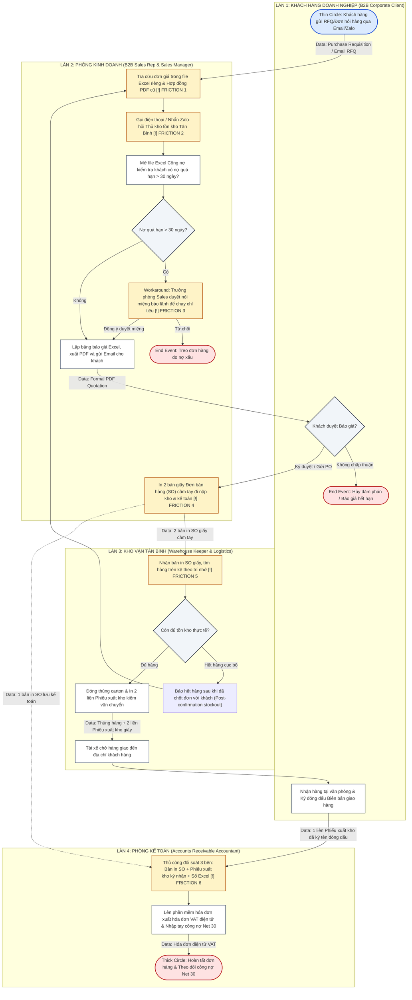

# WEEK 6: BUSINESS PROBLEMS, INFORMATION NEEDS & REQUIREMENTS
## INDIVIDUAL HOMEWORK & CLASSROOM WORKSHOP DELIVERABLE

* **Course:** Business Systems Analysis (BSA) — Academic Year 2026–2027 (Semester 1)
* **Instructor:** MSc. Nguyen Thi Thanh Thanh | Faculty of Technology, Hoa Sen University
* **Assigned Business Scenario:** Scenario 6 (Scenario B) — Office Supplies & Stationery
* **Enterprise Case:** Công ty TNHH Phân phối Văn phòng phẩm OfficePro (`OfficePro Distribution Co., Ltd.`)
* **Student Name:** Võ Duy Bình
* **Student ID:** 22301500
* **Group:** Group 6 (Role: Team Leader / Lead Business Analyst & Solutions Architect)
* **Target File Submission:** `W6_Requirements_22301500_VoDuyBinh.pdf`

---

### 📋 ASSIGNMENT PROMPT & LEARNING OBJECTIVES (SLIDE OVERVIEW)

Based on the official lecture slide **WEEK 6: BUSINESS PROBLEMS, INFORMATION NEEDS & REQUIREMENTS**, students must complete the sequential progression from current operational evidence to testable system specifications:

$$\text{Evidence (AS-IS)} \longrightarrow \text{Business Problem} \longrightarrow \text{Information Needs} \longrightarrow \text{Business Requirements (BRs)} \longrightarrow \text{Functional Requirements (FRs)} \longrightarrow \text{Traceability}$$

#### Key Tasks Required:
1. **Swimlane Process Conversion:** Convert the Week 5 flowchart into a standardized 4-lane AS-IS Cross-Functional Swimlane Diagram identifying operational friction `[!]`.
2. **Process Package Definition:** Validate the 5 approved business processes for **Scenario 6: Office Supplies & Stationery**.
3. **Activity 1 — Identify a Business Problem:** Complete the Business Problem & Information Need Worksheet supported by interview evidence.
4. **Distinguish Concepts:** Articulate the precise boundary between Observation, Problem, Cause, and Impact.
5. **Activity 2 — Formulate BRs and FRs:** Draft 2 Business Requirements and 4 testable Functional Requirements adhering to the standard syntax: `The system shall + action + object + condition/context`.
6. **Requirements Traceability Matrix (RTM):** Establish a bidirectional traceability chain connecting Evidence $\rightarrow$ Problem $\rightarrow$ Need $\rightarrow$ BR $\rightarrow$ FR $\rightarrow$ Candidate Odoo App.
7. **Peer Review & Quality Audit:** Evaluate requirements quality against the 7-criteria checklist and provide structured feedback.
8. **Individual Quick Quiz & Reflection:** Answer core analytical questions regarding solution neutrality and evidence grounding.

---

================================================================================
          INDIVIDUAL DELIVERABLE WEEK 6 - VO DUY BINH (ID: 22301500)
================================================================================

# PHẦN 1: SCENARIO 6 PROCESS PACKAGE & PHÂN CÔNG QUY TRÌNH (SLIDE 7, 8, 14)

Theo gói quy trình chuẩn hóa dành riêng cho **Scenario 6: Office Supplies & Stationery** (Slide 14), doanh nghiệp OfficePro vận hành 5 quy trình nghiệp vụ cốt lõi sau:

| Mã quy trình | Tên quy trình nghiệp vụ  `[Verb] + [Noun]` | Sự kiện kích hoạt (Trigger) | Điểm kết thúc & Kết quả (End Point) | Vai trò chính (Main Actors) | Thành viên phụ trách |
| :---: | :--- | :--- | :--- | :--- | :---: |
| **BP1** | **Processing Corporate Orders** *(Quy trình trọng tâm phân tích)* | Khách hàng doanh nghiệp gửi đơn hỏi hàng / yêu cầu mua văn phòng phẩm qua Email/Zalo. | Đơn hàng được phê duyệt hoặc từ chối; trạng thái đơn được ghi nhận vào sổ theo dõi. | Khách hàng B2B, Nhân viên kinh doanh (Sales Rep), Trưởng phòng kinh doanh | **Võ Duy Bình** (Lead BA - Chịu trách nhiệm chính) |
| **BP2** | **Verifying Contract Prices** *(Quy trình con kiểm soát giá)* | Đơn hỏi hàng tham chiếu đến Hợp đồng khung, Phụ lục giá hoặc Thỏa thuận chiết khấu đã ký. | Đơn giá hợp đồng được đối soát, chuẩn hóa và ghi nhận chính xác vào báo giá hoặc đơn bán. | Nhân viên kinh doanh (Sales Rep), Quản lý hợp đồng (Sales Manager) | **Võ Duy Bình** (Chịu trách nhiệm chính) |
| **BP3** | **Checking Product Availability** | Đơn hàng dự kiến hoặc đã ký cần xác minh tồn kho khả dụng để giao hàng. | Số lượng tồn kho thực tế khả dụng (ATP) hoặc số lượng thiếu hụt được báo cáo về Sales. | Nhân viên kinh doanh, Thủ kho trung tâm (Warehouse Keeper) | **Phạm Nguyễn Gia Thuận** |
| **BP4** | **Processing Purchase Orders** | Có yêu cầu mua hàng bổ sung (Purchase Requisition) được phê duyệt khi hàng dưới định mức. | Đơn mua hàng (PO) chính thức được gửi cho nhà cung ứng và xác nhận giao hàng được lưu vết. | Nhân viên mua hàng (Purchasing), Nhà cung ứng (Supplier), Giám đốc duyệt | **Võ Duy Bình** |
| **BP5** | **Receiving Purchased Goods** | Nhà cung cấp giao hàng văn phòng phẩm đến cầu cảng kho trung tâm theo PO. | Số lượng hàng thực nhận được kiểm đếm, ghi nhận sai lệch và cập nhật thẻ kho. | Thủ kho, Nhân viên mua hàng, Đại diện nhà cung ứng | **Phạm Nguyễn Gia Thuận** |

> **Phạm vi phân tích sâu của cá nhân (Individual Focus):**  
> Tôi (**Võ Duy Bình**) chịu trách nhiệm phân tích chuyên sâu cụm quy trình **BP1 (Processing Corporate Orders)** và **BP2 (Verifying Contract Prices)** — nơi phát sinh điểm nghẽn nghiêm trọng nhất về sai lệch giá và công nợ của OfficePro.

---

# PHẦN 2: CHUYỂN ĐỔI SANG SƠ ĐỒ SWIMLANE BPMN CHUẨN HÓA (SLIDE 5, 6)

Chuyển đổi lưu đồ tuyến tính tuần 5 thành sơ đồ **Cross-Functional Swimlane Diagram (Phân làn trách nhiệm 4 làn: Customer, Sales, Warehouse, Finance)**, thể hiện rõ dòng chứng từ (Data Objects), cổng quyết định rẽ nhánh (Exclusive Gateways XOR) và các điểm nghẽn ma sát vận hành `[!]`.

### 🔴 6 Điểm ma sát vận hành (Operational Friction Points `[!]`):
1. **`[!] Friction 1` (Bảng giá phân mảnh):** Mỗi Sales Rep giữ một file Excel giá riêng (`BangGia_KhachHang_2026.xlsx`) và mở hợp đồng PDF quét cũ, dẫn đến **5–8% hóa đơn bị sai lệch đơn giá** so với thỏa thuận khung.
2. **`[!] Friction 2` (Kiểm tra tồn kho thủ công):** Kiểm tra hàng bằng gọi điện / Zalo dựa trên file Excel tồn kho xuất từ sáng sớm (`TonKho_TanBinh_Daily.xlsx`), thông tin trễ nhịp so với biến động kho.
3. **`[!] Friction 3` (Chặn nợ bị vô hiệu hóa):** Không có chốt chặn hệ thống; Trưởng phòng Sales duyệt nói miệng ghi đè chính sách nợ quá hạn 30 ngày để nhân viên kịp chạy doanh số tháng.
4. **`[!] Friction 4` (Lệ thuộc chứng từ giấy):** Mọi lệnh giao hàng đều phụ thuộc vào bản in SO giấy cầm tay đi bộ từ phòng kinh doanh xuống kho và phòng kế toán.
5. **`[!] Friction 5` (Soạn hàng theo trí nhớ):** Kho Tân Bình không có mã vạch định vị kệ hàng (bin location); thủ kho nhặt hàng theo thói quen ghi nhớ, dễ nhầm lẫn quy cách thùng và ram giấy (`ST-001` vs `ST-002`).
6. **`[!] Friction 6` (Thắt nút cổ chai đối soát 3 bên):** Kế toán công nợ mất **15–20 giờ/tuần** ngồi đối chiếu thủ công từng dòng giữa bản in SO giấy, phiếu xuất kho có chữ ký tài xế mang về và file Excel theo dõi công nợ trước khi dám xuất hóa đơn điện tử VAT.

---

# PHẦN 3: ACTIVITY 1 — BẢNG PHÂN TÍCH VẤN ĐỀ NGHIỆP VỤ & NHU CẦU THÔNG TIN (SLIDE 20–23, 30–31)

### 3.1. Phân định rõ: Quan sát (Observation) $\rightarrow$ Vấn đề (Problem) $\rightarrow$ Nguyên nhân (Cause) $\rightarrow$ Tác động (Impact) (Slide 21)

Để đảm bảo phân tích nghiệp vụ đúng phương pháp luận, không nhầm lẫn giữa hiện tượng quan sát và bản chất vấn đề:

* **Quan sát thực tế (Observation):** Nhân viên kinh doanh phải mở hợp đồng scan dạng PDF trong Google Drive và copy-paste đơn giá từ file Excel cá nhân vào bảng báo giá của khách hàng.
* **Vấn đề nghiệp vụ cốt lõi (Business Problem):** Nhân viên kinh doanh **không thể truy cập bảng giá hợp đồng chuẩn hóa và hợp lệ ngay tại thời điểm tạo đơn hàng**, dẫn đến sai sót báo giá lặp đi lặp lại.
* **Nguyên nhân tiềm tàng (Possible Cause):** Thông tin bảng giá hợp đồng khung bị phân tán trong các tài liệu giấy/PDF và các file Excel cá nhân không được đồng bộ hóa tập trung vào một cơ sở dữ liệu dùng chung.
* **Tác động kinh doanh (Business Impact):** Tỷ lệ hóa đơn bán hàng bị khách khiếu nại sai giá lên đến **5–8% mỗi tháng**, làm ách tắc dòng tiền thanh toán bình quân **50.000.000 VND/tháng**, tốn thêm 15–20 giờ làm việc của kế toán và làm suy giảm nghiêm trọng uy tín doanh nghiệp.

---

### 3.2. Bảng thực hành Activity 1: Business Problem Worksheet (Slide 31)

| Mục phân tích (Item) | Nội dung phân tích chi tiết của Nhóm 6 (Group's Answer) |
| :--- | :--- |
| **Kịch bản nghiệp vụ (Business Scenario)** | **Scenario 6:** Office Supplies & Stationery Distribution (Công ty TNHH Phân phối Văn phòng phẩm OfficePro). |
| **Quy trình lựa chọn (Selected Process)** | **BP2. Verifying Contract Prices** (Nằm trong quy trình lớn **BP1. Processing Corporate Orders**). |
| **Bằng chứng AS-IS (AS-IS Evidence)** | • Biên bản phỏng vấn Trưởng phòng Kinh doanh (Tuần 2): *"Mỗi nhân viên tự lưu bảng giá chiết khấu riêng trên máy tính. Khi hợp đồng ký mới hoặc điều chỉnh giá giấy Double A, thông tin cập nhật chậm từ 1-2 tuần, dẫn đến nhân viên báo giá cũ."* • Dữ liệu kiểm toán hóa đơn: Sai lệch giá chiếm 5–8% số lượng đơn hàng B2B hàng tháng. |
| **Vấn đề nghiệp vụ (Business Problem)** | Doanh nghiệp thiếu cơ chế quản lý và áp dụng bảng giá hợp đồng tập trung tự động, khiến nhân viên kinh doanh báo giá sai thỏa thuận khung, gây ra tranh chấp hóa đơn và chậm thu hồi công nợ. |
| **Bên liên quan bị ảnh hưởng (Affected Stakeholders)** | 1. **Khách hàng doanh nghiệp:** Nhận báo giá và hóa đơn sai lệch, chậm trễ giải ngân thanh toán. 2. **Nhân viên kinh doanh:** Mất thời gian sửa báo giá, bị giảm hoa hồng khi phải xuất hóa đơn điều chỉnh. 3. **Kế toán công nợ (AR):** Mất 15–20h/tuần đối soát thủ công và xử lý biên bản điều chỉnh hóa đơn sai. 4. **Trưởng phòng kinh doanh:** Không kiểm soát được biên lợi nhuận thực tế và tỷ lệ chiết khấu vượt chuẩn. |
| **Nhu cầu thông tin (Information Need)** | Nhân viên kinh doanh cần **thông tin đơn giá hợp đồng có hiệu lực và điều khoản chiết khấu theo số lượng chính xác, tự động gắn liền với từng mã khách hàng** ngay tại màn hình soạn thảo báo giá/đơn hàng. |
| **Câu hỏi chưa giải quyết (Unresolved Question)** | *"Quy trình phê duyệt ngoại lệ về giá (khi khách hàng VIP yêu cầu chiết khấu thêm ngoài hợp đồng khung) được quy định bằng văn bản pháp lý với hạn mức thẩm quyền cụ thể ra sao, hay hoàn toàn phụ thuộc vào thỏa thuận miệng cá nhân của Trưởng phòng?"* |

---

# PHẦN 4: MA TRẬN NHU CẦU THÔNG TIN CỦA CÁC BÊN LIÊN QUAN (SLIDE 22)

Áp dụng cấu trúc chuẩn từ Slide 22, bảng sau mô tả nhu cầu thông tin phục vụ ra quyết định và vận hành:

| Bên liên quan (Stakeholder) | Nhu cầu thông tin (Information Need) | Thời điểm cần (When Needed) | Mục đích nghiệp vụ (Why Needed) |
| :--- | :--- | :--- | :--- |
| **Nhân viên kinh doanh (Sales Rep)** | Đơn giá hợp đồng có hiệu lực, hạn mức chiết khấu cho phép và trạng thái tồn kho khả dụng (ATP). | Ngay khi mở form tạo báo giá cho khách hàng. | Đảm bảo báo giá chính xác 100% theo hợp đồng, không bị từ chối đơn hàng và không bán vượt tồn kho. |
| **Trưởng phòng kinh doanh (Sales Manager)** | Báo cáo các đơn hàng có mức chiết khấu > 5% và danh sách các tài khoản khách hàng có nợ quá hạn > 30 ngày. | Trước khi ký duyệt báo giá hoặc duyệt đơn bán hàng. | Kiểm soát biên lợi nhuận gộp của công ty và ngăn chặn rủi ro thất thoát nợ xấu. |
| **Thủ kho trung tâm (Warehouse Keeper)** | Danh sách các dòng hàng cần soạn, quy cách đóng gói (ram/thùng), vị trí kệ hàng và độ ưu tiên giao hàng. | Ngay khi đơn hàng chuyển sang trạng thái đã chốt (Confirmed SO). | Soạn hàng chính xác, giảm thiểu thời gian tìm kiếm vật lý và tránh nhầm lẫn giữa các mã sản phẩm tương đồng. |
| **Kế toán công nợ (AR Accountant)** | Dữ liệu đối soát tự động giữa số lượng đặt (SO), số lượng thực xuất giao (Delivery Note) và đơn giá hợp đồng. | Khi nhận được xác nhận giao hàng thành công từ tài xế. | Phát hành hóa đơn điện tử VAT tức thì mà không cần 15–20 giờ đối soát giấy thủ công. |
| **Khách hàng doanh nghiệp (B2B Customer)** | Báo giá chính xác đúng thỏa thuận khung, tiến độ giao hàng dự kiến và số dư công nợ chi tiết theo hạn Net 30. | Khi gửi RFQ và khi nhận hàng kèm hóa đơn. | Đảm bảo quyền lợi thương mại theo hợp đồng và lên kế hoạch thanh toán đúng kỳ hạn. |

---

# PHẦN 5: ACTIVITY 2 — XÂY DỰNG YÊU CẦU NGHIỆP VỤ (BR) VÀ YÊU CẦU CHỨC NĂNG (FR) (SLIDE 24–26, 32)

### 5.1. Phân biệt 3 cấp độ đặc tả (Slide 24):
* **Yêu cầu nghiệp vụ (Business Requirement - BR):** Tuyên bố về mục tiêu kinh doanh hoặc năng lực cần đạt được của tổ chức (Độc lập với công nghệ, trả lời câu hỏi: *Doanh nghiệp cần gì?*).
* **Yêu cầu chức năng (Functional Requirement - FR):** Đặc tả hành vi cụ thể mà hệ thống phần mềm phải thực hiện để hỗ trợ cho BR (Trả lời câu hỏi: *Hệ thống phần mềm phải làm gì?* Định dạng chuẩn: `The system shall + action + object + condition/context`).
* **Giải pháp công nghệ (Solution):** Phần mềm hoặc cấu hình kỹ thuật cụ thể (ví dụ: module Odoo Sales & Inventory) — chỉ đánh giá ở Phase 2, **tuyệt đối không đưa tên phần mềm vào phát biểu BR/FR ở giai đoạn này**.

---

### 5.2. Bảng đặc tả Yêu cầu Activity 2 (Requirements Table - Slide 32)

| Mã ID | Phát biểu Yêu cầu chuẩn hóa (Requirement Statement)   *(Tuân thủ cú pháp `The system shall...` đối với FR)* | Vấn đề nghiệp vụ / Nhu cầu liên kết (Related Problem / Need) | Quy trình liên quan (Related Process) |
| :---: | :--- | :--- | :---: |
| **`BR-01`** | **The business needs corporate sales order pricing to be automatically determined from active framework agreements to eliminate billing discrepancies and accelerate customer cash collections.** | Giải quyết vấn đề sai lệch đơn giá 5–8% trên hóa đơn và chậm thu hồi dòng tiền nợ Net 30. | `BP1. Processing Corporate Orders` `BP2. Verifying Contract Prices` |
| **`BR-02`** | **The business needs sales confirmation to be strictly verified against real-time Available-to-Promise (ATP) inventory levels across multi-warehouse locations to prevent post-confirmation order cancellations.** | Giải quyết vấn đề tồn kho vô hình tại bãi nhận hàng và 3–4 vụ hủy đơn hàng mỗi tuần do hết hàng. | `BP1. Processing Corporate Orders` `BP3. Checking Product Availability` |
| **`FR-01`** | **The system shall automatically retrieve and populate the contract unit price for each selected product line based on the corporate customer's active pricelist during sales quote and order creation.** | Đáp ứng `BR-01`: Đảm bảo nhân viên kinh doanh không phải tra cứu và nhập tay giá từ file Excel cá nhân. | `BP2. Verifying Contract Prices` |
| **`FR-02`** | **The system shall block order confirmation and require authorized managerial override whenever a requested unit price is discounted by more than 5% below the contract baseline price.** | Đáp ứng `BR-01`: Thiết lập chốt chặn kiểm soát chiết khấu tự động, loại bỏ tình trạng duyệt miệng tùy tiện. | `BP1. Processing Corporate Orders` |
| **`FR-03`** | **The system shall display the real-time Available-to-Promise (ATP) stock quantity of each product line, calculated from on-hand inventory minus reserved orders across warehouses, during order preparation.** | Đáp ứng `BR-02`: Cung cấp thông tin tồn kho khả dụng tức thì cho Sales Rep mà không cần gọi điện thoại cho thủ kho. | `BP3. Checking Product Availability` |
| **`FR-04`** | **The system shall flag an order line and display an immediate visual stockout warning whenever the requested order quantity exceeds the real-time ATP quantity.** | Đáp ứng `BR-02`: Ngăn chặn việc nhân viên xác nhận đơn hàng ảo khi kho không đủ lượng hàng giao. | `BP1. Processing Corporate Orders` `BP3. Checking Product Availability` |
| **`FR-05`** | **The system shall automatically reconcile quantities and prices between the confirmed Sales Order, the signed Delivery Slip, and the Customer Invoice to prevent billing discrepancies.** | Đáp ứng `BR-01`: Tự động hóa khâu đối soát 3 bên (3-Way Matching), cắt giảm 15–20h làm việc thủ công của kế toán. | `BP1. Processing Corporate Orders` |

---

# PHẦN 6: MA TRẬN TRUY XUẤT YÊU CẦU (GROUP TRACEABILITY TABLE - SLIDE 28, 29)

Thiết lập chuỗi truy xuất nguồn gốc hai chiều (Bidirectional Traceability Chain) khép kín từ Bằng chứng phỏng vấn đến Ứng dụng giải pháp dự kiến:

$$\text{Evidence} \rightarrow \text{Observation} \rightarrow \text{Problem} \rightarrow \text{Information Need} \rightarrow \text{BR} \rightarrow \text{FR} \rightarrow \text{Candidate Odoo App}$$

| Trường thông tin (Field) | Nội dung phân tích truy xuất của Nhóm 6 (Group's Analysis) |
| :--- | :--- |
| **Evidence ID / Source** | **`EVD-W2-SALES-01`** (Phỏng vấn Trưởng phòng Kinh doanh Tuần 2) & **`EVD-W4-SIM-02`** (Quan sát mô phỏng đối soát hóa đơn Tuần 4). |
| **AS-IS Observation** | Nhân viên kinh doanh lưu bảng giá trong các file Excel cá nhân rời rạc; đơn giá được copy-paste thủ công vào báo giá và bản in SO giấy. |
| **Business Problem** | Thiếu bảng giá tập trung dẫn đến sai sót giá trên 5–8% hóa đơn GTGT hàng tháng, gây tranh chấp thanh toán và tồn đọng ~50.000.000 VND công nợ quá hạn. |
| **Affected Stakeholder** | B2B Sales Representatives, Sales Manager, Chief Accountant, Corporate Clients. |
| **Information Need** | Đơn giá hợp đồng có hiệu lực và chính sách chiết khấu bậc thang theo số lượng chính xác của từng khách hàng B2B ngay khi soạn đơn. |
| **BR ID** | **`BR-01`** *(Tự động hóa định giá theo thỏa thuận hợp đồng khung)*. |
| **FR ID(s)** | **`FR-01`** *(Tự động lấy giá hợp đồng)*, **`FR-02`** *(Chặn chiết khấu > 5%)*, **`FR-05`** *(Khớp hóa đơn tự động 3-way match)*. |
| **Related Business Process** | `BP1. Processing Corporate Orders` & `BP2. Verifying Contract Prices`. |
| **Candidate Odoo App (Later Stage)** | Phân hệ **Odoo Sales** (với tính năng *Pricelists - Advanced price rules*) & **Odoo Invoicing** (với tính năng *3-Way Matching*). |

---

# PHẦN 7: KIỂM SOÁT CHẤT LƯỢNG YÊU CẦU & PHẢN BIỆN CHÉO (SLIDE 27, 33)

### 7.1. Bảng tự kiểm tra chất lượng yêu cầu (7 Quality Checks - Slide 27)

* [x] **Tính phù hợp nghiệp vụ (Business Relevance):** Các yêu cầu giải quyết đúng nỗi đau sai giá 5–8% và hủy đơn do thiếu hàng được ghi nhận trong phỏng vấn tuần 2.
* [x] **Tính rõ ràng (Clarity):** Phát biểu ngắn gọn, mạch lạc; cả nhân viên kinh doanh và chuyên viên IT đều hiểu thống nhất một nghĩa.
* [x] **Tính cụ thể (Specificity):** Mỗi yêu cầu chức năng (FR) chỉ tập trung vào một hành vi hệ thống duy nhất, không gộp nhiều tính năng phức tạp.
* [x] **Tính kiểm thử được (Testability):** Có thể nghiệm thu dễ dàng qua kịch bản UAT (ví dụ: Nhập khách hàng A và mã `ST-001`, kiểm tra đơn giá tự nhảy 65.000₫ $\rightarrow$ Pass/Fail rõ ràng).
* [x] **Tính truy xuất được (Traceability):** 100% yêu cầu đều truy ngược được về bằng chứng thực tế (`EVD-W2-SALES-01`), không tự ý bịa đặt tính năng.
* [x] **Phạm vi kịch bản (Scope):** Nằm gọn trong phạm vi bán hàng phân phối văn phòng phẩm B2B của OfficePro.
* [x] **Tính trung lập giải pháp (Solution Neutrality):** Phát biểu FR mô tả *"Hệ thống phải làm gì"* (`The system shall...`), tuyệt đối không bị ràng buộc vào tên phần mềm *"Hệ thống phải dùng Odoo"*.

---

### 7.2. Phiếu phản biện chéo yêu cầu (Peer Review Comments - Slide 33)

Đóng vai trò chuyên viên BA đánh giá bộ yêu cầu:

1. **Điểm rõ ràng và được biện minh chặt chẽ (One requirement that is clear and well justified):**
   > *"Yêu cầu `FR-01` và `FR-02` rất xuất sắc vì được gắn kết trực tiếp với dữ liệu định lượng (5–8% lỗi giá và ngưỡng chặn 5%). Tiêu chí nghiệm thu rất rõ ràng: nếu nhân viên giảm giá 6% mà hệ thống không khóa đơn thì kiểm thử Fail ngay lập tức. Đây là đặc tả chuẩn mực cho phân tích nghiệp vụ."*

2. **Điểm cần điều chỉnh và lý do (One requirement that needs revision, with a reason):**
   > *"Phát biểu ban đầu 'The system shall improve warehouse inventory management' quá mơ hồ, không thể đo lường và không thể viết test case UAT. Nhóm đã điều chỉnh lại thành `FR-03`: 'The system shall display the real-time Available-to-Promise (ATP) stock quantity of each product line during order preparation' — biến một mong muốn cảm tính thành một hành vi phần mềm cụ thể và kiểm thử được."*

---

# PHẦN 8: BÀI TẬP TRẮC NGHIỆM NHANH & BÀI HỌC SUY NGẪM CÁ NHÂN (SLIDE 4, 34)

### 8.1. Trả lời 4 câu hỏi phương pháp luận phân tích nghiệp vụ

#### Câu 1: Làm thế nào để phân biệt giữa một "Hiện tượng quan sát" (Observation), một "Vấn đề nghiệp vụ" (Problem) và một "Giải pháp kỹ thuật" (Solution)?
* **Trả lời:**
  - *Observation* là những gì ta trực tiếp nhìn thấy hoặc nghe thấy tại hiện trường (ví dụ: *"Sales Rep gọi điện thoại cho thủ kho"*). Đây chưa chắc là vấn đề, mà là một hành vi thực tế.
  - *Business Problem* là sự cản trở vận hành gây thiệt hại về tiền, thời gian hoặc chất lượng (ví dụ: *"Sales không biết chính xác lượng hàng tồn kho khả dụng khi chốt đơn, dẫn đến tỷ lệ hủy đơn 5%"*).
  - *Solution* là cách thức công nghệ giải quyết vấn đề (ví dụ: *"Cài đặt module Odoo Inventory"*). Lỗi phổ biến nhất của sinh viên là xem việc "thiếu phần mềm Odoo" là một vấn đề kinh doanh. Doanh nghiệp không tồn tại để dùng phần mềm; doanh nghiệp chỉ cần giải quyết nỗi đau vận hành của họ.

#### Câu 2: Tại sao một Yêu cầu Nghiệp vụ (BR) bắt buộc phải "Trung lập với Giải pháp" (Solution-Neutral)?
* **Trả lời:**
  - Nếu ta viết: *"Doanh nghiệp cần cài đặt phân hệ Odoo Sales"*, ta đã tự giới hạn tư duy phân tích vào một công cụ duy nhất. Nếu sau này doanh nghiệp đổi ý dùng SAP, NetSuite hay viết phần mềm nội bộ thì yêu cầu trên trở nên vô giá trị.
  - Viết chuẩn: *"Doanh nghiệp cần cơ chế tự động áp dụng đơn giá hợp đồng khi lập đơn bán hàng"*. Phát biểu này nắm giữ bản chất nhu cầu kinh doanh, cho phép đội ngũ kỹ thuật tự do lựa chọn giải pháp tối ưu nhất (dù là Odoo, ERP khác hay một bảng tính thông minh).

#### Câu 3: Chuỗi truy xuất yêu cầu (Requirements Traceability Chain) mang lại giá trị gì trong quản trị dự án phần mềm?
* **Trả lời:**
  - Giúp loại bỏ hoàn toàn **Scope Creep (Phình đại phạm vi)** và **Gold Plating (Thêm tính năng thừa)**: Bất kỳ lập trình viên hay BA nào muốn thêm tính năng đều phải trả lời câu hỏi: *"Tính năng này giải quyết vấn đề gì, dựa trên bằng chứng nào từ người dùng?"* Nếu không chứng minh được chuỗi truy xuất về bằng chứng, yêu cầu đó phải bị loại bỏ để tiết kiệm ngân sách và thời gian.

---

### 8.2. Bài học suy ngẫm cá nhân (Individual Reflection)

> **Câu hỏi suy ngẫm:**  
> *Việc chuyển đổi từ lưu đồ quy trình đơn giản (Simple Flowchart) sang mô hình Phân làn trách nhiệm (Swimlane Diagram) và xây dựng Ma trận truy xuất nguồn gốc (RTM) đã thay đổi nhận thức của bạn như thế nào về các rắc rối vận hành tại OfficePro?*

**Bài học của tôi (Võ Duy Bình - 22301500):**
> *"Trước Tuần 6, khi nhìn vào lưu đồ đơn giản ở Tuần 5, tôi chỉ thấy các bước diễn ra rất 'trơn tru' theo thứ tự thời gian. Tuy nhiên, khi chuyển sang sơ đồ Swimlane phân làn ở Tuần 6, tôi mới thực sự 'giật mình' nhận ra sự phân mảnh khủng khiếp giữa 4 phòng ban: một đơn hàng B2B tưởng như đơn giản nhưng chứng từ giấy và cuộc gọi Zalo phải 'nhảy qua nhảy lại' qua ranh giới giữa Khách hàng, Sales, Kho và Kế toán tới hơn 8 lần!*  
>  
> *Đặc biệt, việc thực hành xây dựng Ma trận Traceability giúp tôi thấu hiểu sâu sắc nguyên lý cốt lõi của nghề BA: 'Business-First, Technology-Second'. Phần mềm ERP Odoo không phải là cây đũa thần tự nhiên sinh ra; mọi nút bấm, mọi trường dữ liệu trên Odoo (như Bảng giá hợp đồng hay Tồn kho ATP mà tôi đã cấu hình thử nghiệm) đều là câu trả lời trực tiếp cho một nỗi đau có thật bằng xương bằng thịt của người dùng. Kỹ năng truy xuất nguồn gốc yêu cầu này chính là vũ khí quan trọng nhất giúp tôi tự tin bảo vệ đồ án trước Hội đồng Giảng viên."*
