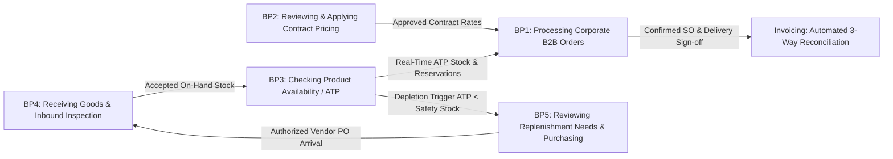
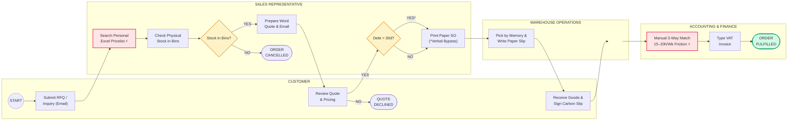

# FACULTY OF TECHNOLOGY — HOA SEN UNIVERSITY

## COURSE: BUSINESS SYSTEMS ANALYSIS (BSA) — ACADEMIC YEAR 2026–2027, SEMESTER 1

---

# PROJECT REPORT ON

# BUSINESS REQUIREMENTS DOCUMENT FOR B2B WHOLESALE & DISTRIBUTION (OFFICE SUPPLIES & STATIONERY): OFFICEPRO DISTRIBUTION CO., LTD.

| Project Attribute                          | Details                                                                                                                                                                |
| ------------------------------------------ | ---------------------------------------------------------------------------------------------------------------------------------------------------------------------- |
| **Course Domain / Enterprise Model** | Scenario B — B2B Wholesale & Distribution (Office Supplies & Stationery)                                                                                              |
| **Submitted by**                     | **Vo Duy Binh** (Student ID: 22301500) — Team Leader / Lead Business Analyst**Pham Nguyen Gia Thuan** (Student ID: 22204631) — QA & Requirements Analyst |
| **Class**                            | BA2631 — Semester 1 (2026–2027)                                                                                                                                      |
| **Under The Guidance Of**            | MSc. Nguyen Thi Thanh Thanh                                                                                                                                            |
| **Milestone / Assessment**           | **Phase 1 Mid-Term Assessment (Sections 1–4 Baseline — 30% Weight)**                                                                                           |
| **Month, Year**                      | October 2026                                                                                                                                                           |

---

## EXECUTIVE SUMMARY

OfficePro Distribution Co., Ltd. (**OfficePro Distribution**) is a regional B2B wholesale distributor specializing in commercial office stationery, commercial copy paper products, and printer consumables across Southern Vietnam. The enterprise currently serves over 250 active corporate clients, educational institutions, and stationery retail sub-dealers from two primary facilities: Tan Binh Central Warehouse (2,500 m²) and Bien Hoa Regional Depot (800 m²).

As the enterprise expands, it faces critical operational bottlenecks stemming from legacy paper and spreadsheet procedures:

1. **Contract Price Discrepancies:** Framework contract prices are decentralized across individual sales reps' personal spreadsheets, producing a **5–8% billing error rate** on client invoices and costing **~50 million VND monthly** in dispute adjustments.
2. **Post-Confirmation Stockouts:** Warehouse goods receipts take **24–48 hours** to be entered into spreadsheets. Sales reps confirm delivery commitments based on outdated morning stock sheets, triggering **3–4 stockouts per week post-confirmation**.
3. **Manual 3-Way Matching Overhead:** Accounts Receivable expends **15–20 hours weekly** manually reconciling paper Sales Orders, physical Delivery Notes, and Billing Invoices, while credit hold policies are verbally bypassed.

In strict accordance with the **BSA Course BRD Template**, this report establishes a **Pure Business Systems Analysis (Phase 1)** covering:

* **Section 1:** Enterprise profile, 10-SKU Master Data catalog, facilities network, and team governance.
* **Section 2:** Stakeholder Power/Interest matrix, verified elicitation evidence, information needs, and open assumptions.
* **Section 3:** Five core business processes, AS-IS BPMN friction points, 5-Whys root cause analysis, TO-BE re-engineered workflows, and expected business benefits.
* **Section 4:** Solution-neutral Business Requirements (`BR-01` to `BR-05`), MoSCoW Functional Requirements (`FR-01` to `FR-08`), Core Business Rules (`BR-R01` to `BR-R06`), and Requirements Traceability Matrix (RTM).
* **Sections 5 & 6:** Phase 2 roadmaps for Use Case specifications and Odoo ERP solution mapping (deferred to Weeks 8–15 per course guidelines).

---

## TABLE OF CONTENTS

| Section / Deliverable Heading                                                                                                  | Template Page Reference |
| ------------------------------------------------------------------------------------------------------------------------------ | :---------------------: |
| **EXECUTIVE SUMMARY**                                                                                                    |       **i**       |
| **TABLE OF CONTENTS**                                                                                                    |      **ii**      |
| **ACKNOWLEDGEMENTS**                                                                                                     |      **iv**      |
| **TABLE OF FIGURES**                                                                                                     |       **v**       |
| **LIST OF TABLES**                                                                                                       |      **vi**      |
| **GLOSSARY & ABBREVIATIONS**                                                                                             |      **vii**      |
| **TEAM MEMBERS & PROCESS RESPONSIBILITY MATRIX**                                                                         |     **viii**     |
| **SECTION 1. ENTERPRISE CONTEXT AND SCOPE**                                                                              |       **1**       |
| &nbsp;&nbsp;&nbsp;&nbsp;**1.1. Enterprise Profile**                                                                      |            1            |
| &nbsp;&nbsp;&nbsp;&nbsp;&nbsp;&nbsp;&nbsp;&nbsp;1.1.1. Business Model and Operational Overview                                 |            1            |
| &nbsp;&nbsp;&nbsp;&nbsp;&nbsp;&nbsp;&nbsp;&nbsp;1.1.2. Products, Services, and Target Customers                                |            1            |
| &nbsp;&nbsp;&nbsp;&nbsp;&nbsp;&nbsp;&nbsp;&nbsp;1.1.3. Organizational Structure and Key Roles                                  |            1            |
| &nbsp;&nbsp;&nbsp;&nbsp;**1.2. Business Objectives & Key Operational Challenges**                                        |            1            |
| &nbsp;&nbsp;&nbsp;&nbsp;**1.3. Enterprise Scope & Out-of-Scope Boundaries**                                              |            1            |
| &nbsp;&nbsp;&nbsp;&nbsp;**1.4. Team Member & Process Responsibility Matrix**                                             |            1            |
| **SECTION 2. STAKEHOLDER ANALYSIS & ELICITATION**                                                                        |       **2**       |
| &nbsp;&nbsp;&nbsp;&nbsp;**2.1. Stakeholder Identification & Power/Interest Grid**                                        |            2            |
| &nbsp;&nbsp;&nbsp;&nbsp;**2.2. Elicitation Summary & Verified Evidence Log (Verified Evidence vs. Initial Assumptions)** |            2            |
| &nbsp;&nbsp;&nbsp;&nbsp;**2.3. Stakeholder Information Needs**                                                           |            2            |
| &nbsp;&nbsp;&nbsp;&nbsp;**2.4. Assumptions, Uncertain Information & Follow-up Questions**                                |            2            |
| **SECTION 3. BUSINESS PROCESS ANALYSIS (AS-IS & TO-BE)**                                                                 |       **3**       |
| &nbsp;&nbsp;&nbsp;&nbsp;**3.1. Business Process Overview & Process Scope**                                               |            3            |
| &nbsp;&nbsp;&nbsp;&nbsp;**3.2. Current Business Processes (AS-IS BPMN/Swimlane Models)**                                 |            3            |
| &nbsp;&nbsp;&nbsp;&nbsp;&nbsp;&nbsp;&nbsp;&nbsp;3.2.1. Business Process 1: Processing Customer Orders                          |            3            |
| &nbsp;&nbsp;&nbsp;&nbsp;&nbsp;&nbsp;&nbsp;&nbsp;3.2.2. Business Process 2: Checking Product Availability                       |            3            |
| &nbsp;&nbsp;&nbsp;&nbsp;&nbsp;&nbsp;&nbsp;&nbsp;3.2.3. Business Process 3: Reviewing Replenishment Needs                       |            3            |
| &nbsp;&nbsp;&nbsp;&nbsp;**3.3. Process Problems, Bottlenecks & Root Cause Analysis**                                     |            3            |
| &nbsp;&nbsp;&nbsp;&nbsp;**3.4. Proposed Business Processes (TO-BE BPMN / Swimlane Models)**                              |            3            |
| &nbsp;&nbsp;&nbsp;&nbsp;**3.5. Expected Process Improvements & Business Benefits**                                       |            3            |
| **SECTION 4. BUSINESS AND FUNCTIONAL REQUIREMENTS**                                                                      |       **4**       |
| &nbsp;&nbsp;&nbsp;&nbsp;**4.1. Business Requirements (BRs)**                                                             |            4            |
| &nbsp;&nbsp;&nbsp;&nbsp;**4.2. Functional Requirements (FRs)**                                                           |            4            |
| &nbsp;&nbsp;&nbsp;&nbsp;**4.3. Business Rules & Operational Constraints**                                                |            4            |
| &nbsp;&nbsp;&nbsp;&nbsp;**4.4. Requirements Traceability Matrix**                                                        |            4            |
| **SECTION 5. USE CASE ANALYSIS**                                                                                         |       **5**       |
| &nbsp;&nbsp;&nbsp;&nbsp;**5.1. Enterprise Use Case Diagram**                                                             |            5            |
| &nbsp;&nbsp;&nbsp;&nbsp;**5.2. Use Case Identification & Catalog**                                                       |            5            |
| &nbsp;&nbsp;&nbsp;&nbsp;**5.3. Detailed Use Case Specifications**                                                        |            5            |
| &nbsp;&nbsp;&nbsp;&nbsp;**5.4. Use Case Validation & Alignment with Functional Requirements**                            |            5            |
| **SECTION 6. ODOO-BASED SOLUTION DESIGN AND VALIDATION**                                                                 |       **6**       |
| &nbsp;&nbsp;&nbsp;&nbsp;**6.1. Proposed Solution Scope & Odoo Application Mapping**                                      |            6            |
| &nbsp;&nbsp;&nbsp;&nbsp;**6.2. Mapping Business Processes and Requirements to Odoo Workflows**                           |            6            |
| &nbsp;&nbsp;&nbsp;&nbsp;**6.3. Odoo Configuration and Master Data Setup**                                                |            6            |
| &nbsp;&nbsp;&nbsp;&nbsp;**6.4. End-to-End Scenario Demonstration & Test Cases**                                          |            6            |
| &nbsp;&nbsp;&nbsp;&nbsp;**6.5. Requirements Coverage, Gaps & Workarounds**                                               |            6            |
| **CONCLUSION & LESSONS LEARNED**                                                                                         |       **7**       |
| &nbsp;&nbsp;&nbsp;&nbsp;Summary of Proposed Business Value                                                                     |            7            |
| &nbsp;&nbsp;&nbsp;&nbsp;Team Reflection & Individual Lessons Learned                                                           |            7            |
| **REFERENCES**                                                                                                           |       **8**       |
| **APPENDICES**                                                                                                           |       **9**       |
| &nbsp;&nbsp;&nbsp;&nbsp;Appendix A. Raw Elicitation Notes / Evidence                                                           |            9            |
| &nbsp;&nbsp;&nbsp;&nbsp;Appendix B. Individual Contribution Sign-off                                                           |            9            |

---

## ACKNOWLEDGEMENTS

The project team would like to express our deepest gratitude to **MSc. Nguyen Thi Thanh Thanh** for her invaluable academic guidance, structured lectures, and continuous mentoring throughout the Business Systems Analysis course at Hoa Sen University. Her feedback during weekly workshops has been instrumental in shaping our understanding of enterprise process re-engineering and solution-neutral requirements engineering.

---

## TABLE OF FIGURES

* **Figure 1.1:** Organizational Hierarchy & Operational Departmental Structure
* **Figure 2.1:** Stakeholder Power/Interest Matrix (2x2 Grid)
* **Figure 3.1:** Five Core Business Processes Integration Relationship Map
* **Figure 3.2:** AS-IS Cross-Functional Swimlane BPMN Diagram — Current Order Fulfillment
* **Figure 3.3:** TO-BE Cross-Functional Swimlane BPMN Diagram — Automated Order Fulfillment

---

## LIST OF TABLES

* **Table G.1:** Glossary of Key Business Systems Analysis & Wholesale Terms
* **Table 0.1:** Team Members & Process Responsibility RACI Matrix
* **Table 1.1:** Master Data Scope — 10 Primary SKUs & Standard vs. Contract Price Catalog
* **Table 1.2:** Individual Module Ownership Matrix & Academic Responsibilities
* **Table 1.2.1:** Phase 1 Milestone RACI Assignment Matrix & Governance (Aligned 1:1 with Slide 12)
* **Table 2.1:** Elicitation Verification Log (Baseline Assumptions vs. Interview Evidence)
* **Table 2.2:** Cross-Functional Stakeholder Information Needs Matrix
* **Table 2.3:** Assumptions, Uncertain Information & Follow-up Tracking Log
* **Table 3.1:** Selected Core Business Process Metadata & Operational Boundary
* **Table 3.2:** Process Operational Scope (In-Scope vs. Out-of-Scope)
* **Table 3.3:** Inter-Process Handoffs, Transferred Artifacts & Verification Status
* **Table 3.4:** Sequential Step Breakdown of AS-IS Order Fulfillment Process
* **Table 3.4.1:** AS-IS BPMN Swimlane Step-by-Step Specification (Aligned 1:1 with Slide 12)
* **Table 3.5:** Field Elicitation Evidence Register
* **Table 3.6:** Identified Operational Problems, Root Causes, and Business Impact
* **Table 3.7:** 5-Whys Root Cause Analysis Breakdown by Core Problem
* **Table 3.8:** Key Operational Changes from AS-IS to TO-BE
* **Table 3.8.1:** TO-BE BPMN Swimlane Step-by-Step Specification (Aligned 1:1 with Slide 16)
* **Table 3.9:** Expected Process Improvements and Justified Business Benefits
* **Table 4.1:** Formal Business Requirements (BR-01 through BR-05)
* **Table 4.2:** Prioritized Functional Requirements Catalog (FR-01 to FR-08) with Verification Ideas
* **Table 4.3:** Core Enterprise Business Rules Matrix
* **Table 4.4:** End-to-End Requirements Traceability Matrix (RTM)
* **Table B.1:** Individual Contribution Sign-off & Academic Integrity Confirmation

---

## GLOSSARY & ABBREVIATIONS

**Table G.1:** Glossary of Key Business Systems Analysis & Wholesale Terms

| Abbreviation / Term           | Full Name / Definition                                                                                 |
| ----------------------------- | ------------------------------------------------------------------------------------------------------ |
| **ATP**                 | Available-to-Promise Inventory (On-hand stock minus hard reservations plus scheduled inbound receipts) |
| **B2B**                 | Business-to-Business Wholesale Commerce                                                                |
| **BPMN**                | Business Process Model and Notation (Standard visual cross-functional modeling notation)               |
| **BR**                  | Business Requirement (High-level business capability or outcome statement)                             |
| **BRD**                 | Business Requirements Document                                                                         |
| **FR**                  | Functional Requirement (System behavior specification: *The system shall...*)                        |
| **Framework Agreement** | Annual commercial contract governing negotiated price tiers, lead times, and Net 30 terms              |
| **MoSCoW**              | Prioritization Framework (Must have, Should have, Could have, Won't have)                              |
| **PO**                  | Purchase Order (Issued by OfficePro to upstream manufacturers)                                         |
| **RACI**                | Responsible, Accountable, Consulted, Informed Governance Matrix                                        |
| **RFQ**                 | Request for Quotation (Supplier price solicitation)                                                    |
| **RTM**                 | Requirements Traceability Matrix                                                                       |
| **SKU**                 | Stock Keeping Unit (Unique product identification code)                                                |
| **SO**                  | Sales Order (Commercial delivery commitment issued to corporate accounts)                              |
| **UoM**                 | Unit of Measure                                                                                        |

---

## TEAM MEMBERS & PROCESS RESPONSIBILITY MATRIX

*(R - Responsible | A - Accountable | C - Consulted | I - Informed)*

**Table 0.1:** Team Members & Process Responsibility RACI Matrix

| Student Name                    | Student ID         | Assigned Core Business Processes                                                                            | Role in Project                     | Governance RACI Status                                             |
| ------------------------------- | ------------------ | ----------------------------------------------------------------------------------------------------------- | ----------------------------------- | ------------------------------------------------------------------ |
| **Vo Duy Binh**           | **22301500** | **BP1:** Processing Customer Orders<br/>**BP2:** Verifying Contract Prices<br/>**BP4:** Reviewing Replenishment Needs   | Team Leader / Lead Business Analyst | **A / R** (Sales & Purchasing Domains, Master BRD)           |
| **Pham Nguyen Gia Thuan** | **22204631** | **BP3:** Checking Product Availability (ATP)<br/>**BP5:** Receiving Goods & Inspection<br/>**BP-INV:** Invoicing Reconciliation | QA & Requirements Analyst           | **A / R** (Inventory & Invoicing Domains, Quality Assurance) |

### Detailed Phase 1 Deliverable Responsibilities:

* **Vo Duy Binh (Team Leader / Lead BA):**
  - Section 1: Enterprise Profile, Case Background, Scope Boundaries, and RACI Governance.
  - Section 2: AI Stakeholder Elicitation (Sales Manager & Purchasing Manager interviews), Open Assumptions Log.
  - Section 3: Process Relationship Map, AS-IS BPMN for BP1 & BP4, 5-Whys Root Cause Analysis, TO-BE Re-engineering Design, Master BRD Compilation.
  - Section 4: Business Requirements (`BR-01`, `BR-04`), Business Rules (`BR-R01` to `BR-R03`), Traceability Matrix.
* **Pham Nguyen Gia Thuan (QA & Requirements Analyst):**
  - Section 1: Facilities Network Definition and 10 SKUs Master Data catalog review.
  - Section 2: AI Stakeholder Elicitation (Warehouse Keeper & Chief Accountant interviews), Cross-Functional Information Needs Matrix.
  - Section 3: AS-IS BPMN for BP3 & BP5, AS-IS vs. TO-BE Operational Comparison Table.
  - Section 4: Business Requirements (`BR-02`, `BR-03`, `BR-05`), MoSCoW Functional Requirements Catalog (`FR-01` to `FR-08`), Business Rules (`BR-R04` to `BR-R06`), QA Review.

---

# SECTION 1. ENTERPRISE CONTEXT AND SCOPE

## 1.1. Enterprise Profile

### 1.1.1. Business Model and Operational Overview

**OfficePro Distribution Co., Ltd.** is a specialized regional B2B wholesale distributor operating across Southern Vietnam (Ho Chi Minh City, Dong Nai, Binh Duong, and surrounding industrial manufacturing corridors). The company bridges upstream stationery manufacturers and downstream commercial consumers, supplying over **250 active corporate accounts**, higher education institutions, and stationery retail sub-dealers.

The wholesale operational model is built upon three structural pillars:

1. **High-Volume Upstream Procurement:** OfficePro purchases commercial stationery, copy paper products, and printer consumables in bulk pallets directly from certified manufacturers including Double A (Thailand/Vietnam), IK Plus (APP Indonesia), Thien Long Group, Pilot Corporation, and HP Vietnam.
2. **Annual Framework Agreements:** High-volume commercial accounts execute annual agreements establishing fixed contracted discount tiers, guaranteed replenishment lead times, and negotiated credit privileges.
3. **Commercial Credit Policy:** Qualified corporate accounts operate under standard **Net 30-day commercial payment terms**, allowing monthly consolidated billing against verified delivery notes.

---

### 1.1.2. Products, Services, and Target Customers

#### 1. Master Data Scope: 10 Primary SKUs

To ground requirements engineering in concrete wholesale realities, OfficePro's core catalog comprises **10 primary SKUs** across four product categories:

**Table 1.1:** Master Data Scope — 10 Primary SKUs & Standard vs. Contract Price Catalog

| No. | SKU Code   | Product Description                              | Category            | UoM     | Standard List Price (VND) | Contract Price Tier (VND) |
| --- | ---------- | ------------------------------------------------ | ------------------- | ------- | ------------------------- | ------------------------- |
| 1   | `ST-001` | A4 Copy Paper Double A 70gsm (500 sheets/ream)   | Paper Products      | Ream    | 75,000                    | **65,000**          |
| 2   | `ST-002` | A4 Copy Paper IK Plus 80gsm (500 sheets/ream)    | Paper Products      | Ream    | 85,000                    | **75,000**          |
| 3   | `ST-003` | Thien Long TL-027 Blue Ballpoint Pen (Box of 20) | Writing Instruments | Box     | 90,000                    | **80,000**          |
| 4   | `ST-004` | Pilot G2 Black Gel Pen 0.7mm (Box of 12)         | Writing Instruments | Box     | 320,000                   | **290,000**         |
| 5   | `ST-005` | King Jim A4 Display Book 60 Pockets              | Filing Supplies     | Piece   | 45,000                    | **38,000**          |
| 6   | `ST-006` | Deli A5 Spiral Notebook 160 Pages                | Filing Supplies     | Piece   | 35,000                    | **29,000**          |
| 7   | `ST-007` | Kangaro HD-10 Heavy Duty Stapler                 | Office Tools        | Piece   | 28,000                    | **24,000**          |
| 8   | `ST-008` | Kangaro No.10 Staples (Box of 20 small packs)    | Office Tools        | Big Box | 42,000                    | **36,000**          |
| 9   | `ST-009` | Original HP 107a Black Laser Toner Cartridge     | Printer Consumables | Box     | 1,150,000                 | **1,050,000**       |
| 10  | `ST-010` | Pentel WB1 Whiteboard Marker (Box of 12)         | Writing Instruments | Box     | 180,000                   | **155,000**         |

*Note on B2B Pricing Logic:* In wholesale distribution, legal framework agreements guarantee discounted price tiers. For fast-mover `ST-001` Double A Paper, the standard retail list price is 75,000 VND/ream, but corporate contract clients are legally billed at **65,000 VND/ream**. Ensuring that systems automatically enforce this 65,000 VND rate upon customer selection is essential to eliminating invoice disputes.

#### 2. Target Customer Segments

1. **Corporate Enterprise Accounts (60% of Revenue):** Commercial offices, multinational corporations, and banks ordering monthly consolidated shipments. Governed by framework contracts, custom pricing tiers, and Net 30 payment terms.
2. **Educational Institutions (25% of Revenue):** Universities, vocational colleges, and international schools placing large seasonal batch orders prior to academic semesters. Disbursements tied to formal state/institutional invoice approval cycles.
3. **Stationery Sub-Dealers & Retailers (15% of Revenue):** Small local retail stationery stores purchasing medium reorder volumes under tiered wholesale quantity discounts.

---

### 1.1.3. Organizational Structure and Key Roles

```
                     ┌────────────────────────┐
                     │   Board of Directors   │
                     │    / Business Owner    │
                     └───────────┬────────────┘
                                 │
         ┌───────────────────────┼───────────────────────┐
         │                       │                       │
┌────────┴────────┐     ┌────────┴────────┐     ┌────────┴────────┐
│   Sales Dept    │     │Purchasing Dept  │     │ Warehouse Dept  │
│ (Sales Manager  │     │ (Procurement    │     │(Warehouse Keeper│
│  & B2B Reps)    │     │    Officer)     │     │ & Dispatchers)  │
└─────────────────┘     └─────────────────┘     └─────────────────┘
                                 │
                        ┌────────┴────────┐
                        │ Accounting Dept │
                        │(Chief Accountant│
                        │ & AR Officers)  │
                        └─────────────────┘
```

*Figure 1.1: Organizational Hierarchy & Operational Departmental Structure*

* **Executive Leadership (Business Owner):** Oversees strategic growth, operating margins, capital allocation, and client retention.
* **Sales Department (Sales Manager & B2B Reps):** Manages corporate client framework contracts, negotiates pricing tiers, issues quotations, and inputs Sales Orders.
* **Purchasing Department (Procurement Manager):** Monitors inventory depletion, solicits supplier RFQs, compares vendor costs/lead-times, and issues Purchase Orders.
* **Warehouse & Logistics Department (Warehouse Keeper & Logistics Staff):** Manages inbound receiving inspection, pallet storage, bin picking/packing, and delivery handoffs.
* **Finance & Accounting Department (Chief Accountant & AR Accountants):** Validates 3-way invoice matching, monitors customer credit limits, issues VAT electronic invoices, and enforces Net 30 debt collection.

#### Facilities Network & Operational Hubs

* **Corporate Headquarters & Commercial Office:** District 3, Ho Chi Minh City. Houses Executive Leadership, B2B Account Representatives, Procurement Officers, and Finance & Accounting.
* **Central Distribution Warehouse (Tan Binh IP, HCMC):** Total floor area: **2,500 m²**. Stores 80% of palletized stock (paper pallets, toner cartridges). Functions as the primary supplier receiving dock and cross-docking terminal.
* **Regional Transit Depot (Bien Hoa 2 IP, Dong Nai):** Total floor area: **800 m²**. Maintains fast-moving stock to execute same-day deliveries to manufacturing enterprises across Dong Nai and Binh Duong industrial parks.

---

## 1.2. Business Objectives & Key Operational Challenges

### Quantified Business Objectives

* **Eliminate Contract Pricing Errors:** Reduce quotation pricing error rates from 5–8% down to **0%**.
* **Eliminate Post-Confirmation Stockouts:** Decrease post-confirmation order cancellations by **95%** via real-time Available-to-Promise (ATP) stock visibility.
* **Enforce Commercial Credit Compliance:** Enforce 100% automated credit locks on accounts with unpaid balances overdue > 30 days.
* **Accelerate Financial Matching:** Reduce accounting 3-way invoice matching duration by **90%**, dropping from 15–20 hours/week down to 2 hours/week.

### Primary Operational Challenges

1. **Contract Price Discrepancies:** Decentralized Excel price sheets cause reps to copy incorrect rates, triggering billing disputes and **50 million VND monthly** in credit note adjustments.
2. **Post-Confirmation Stockouts:** Reps commit to orders using morning stock dumps; 24–48 hour receiving backlogs cause **3–4 stockouts per week** post-confirmation.
3. **Manual 3-Way Matching:** Accounting manually matches paper Sales Orders, driver delivery notes, and PDF VAT invoices, expending **15–20 hours weekly**.

---

## 1.3. Enterprise Scope & Out-of-Scope Boundaries

### In-Scope (Phase 1 Pure Business Analysis)

* Analysis of B2B quotation workflows, contract pricelist agreements, and approval thresholds.
* Available-to-Promise (ATP) inventory visibility across Tan Binh and Bien Hoa facilities.
* Stock replenishment rules and automated draft purchase requisitions.
* Outbound warehouse order fulfillment, picking slip generation, and delivery handoffs.
* Accounts Receivable 3-way matching and Net 30 credit policy enforcement.

### Out-of-Scope (Strict Boundaries)

* Human Resources management, attendance tracking, and monthly payroll calculation.
* Complex multi-level Bill of Materials (BOM) manufacturing assembly.
* Point-of-Sale (POS) consumer retail cash register operations.
* International customs clearance and bonded freight logistics.

---

## 1.4. Team Member & Process Responsibility Matrix

**Table 1.2:** Individual Module Ownership Matrix & Academic Responsibilities

| Student Name                    | Student ID         | Assigned Core Business Processes                                                                          | Primary Phase 1 Responsibilities                                                                                                                                                                                       |
| ------------------------------- | ------------------ | --------------------------------------------------------------------------------------------------------- | ---------------------------------------------------------------------------------------------------------------------------------------------------------------------------------------------------------------------- |
| **Vo Duy Binh**           | **22301500** | **BP1:** Processing Customer Orders<br/>**BP2:** Verifying Contract Prices<br/>**BP4:** Reviewing Replenishment Needs | Scope definition, contract pricing engine rules, quotation approval workflows, reorder point thresholds, purchase requisition workflows, AS-IS/TO-BE sales modeling, 5-Whys root cause analysis, master BRD authoring. |
| **Pham Nguyen Gia Thuan** | **22204631** | **BP3:** Checking Product Availability<br/>**BP5:** Receiving Goods & Inspection<br/>**BP-INV:** Invoicing Reconciliation | Multi-warehouse stock tracking, real-time ATP inventory logic, bin location routing, automated 3-way invoice matching, Net 30 credit control policy, MoSCoW requirements framing, QA review.                           |

**Table 1.2.1:** Phase 1 Milestone RACI Assignment Matrix & Governance (Aligned 1:1 with Slide 12)

| Phase 1 Milestone / Deliverable | Vo Duy Binh (Student ID: 22301500)<br/>*Lead BA & Systems Analyst* | Pham Nguyen Gia Thuan (Student ID: 22204631)<br/>*QA & Solution Configurator* | Operational Output & Scope |
| :--- | :---: | :---: | :--- |
| **Enterprise Profile & Scope Definition** | **Accountable / Responsible** | Responsible | Case background, 10 SKUs, facilities, and boundaries. |
| **Stakeholder Elicitation & Info Needs** | **Accountable / Responsible** *(Sales & Purchasing)* | Responsible *(Warehouse & Accounting)* | AI stakeholder interviews; Information Needs Matrix. |
| **AS-IS Process & Bottleneck Modeling** | **Accountable / Responsible** *(Sales Order & RFQ)* | Responsible *(Stock Check & Invoicing)* | Maps manual Excel/paper workflows and quantifies friction. |
| **5-Whys Root Cause Analysis** | **Accountable / Responsible** | Responsible | Analyzes root causes for pricing errors, stockouts, and billing. |
| **TO-BE Process Re-engineering Design** | **Accountable / Responsible** | Responsible | Designs cross-functional TO-BE integrated BPMN flow. |
| **MoSCoW Requirements Catalog Framing** | Responsible | **Accountable / Responsible** | Frames FR-01 to FR-08 with Must/Should/Could priorities. |
| **Phase 1 Master BRD Report Compilation** | **Accountable / Responsible** *(Lead Author)* | Responsible *(QA Review & Editing)* | Compiles Sections 1, 2, and 3 matching course guidelines. |

---

# SECTION 2. STAKEHOLDER ANALYSIS & ELICITATION

## 2.1. Stakeholder Identification & Power/Interest Grid

```
                  HIGH POWER
                      |
     KEEP SATISFIED   |    MANAGE CLOSELY
   - Chief Accountant |  - Sales Manager
   - Purchasing Mgr   |  - Business Owner
----------------------+----------------------
      MONITOR         |    KEEP INFORMED
   - Sub-Dealers      |  - Sales Executives
   - External Vendors |  - Warehouse Keepers
                      |
                  LOW POWER ---------------> HIGH INTEREST
```

*Figure 2.1: Stakeholder Power/Interest Matrix (2x2 Grid)*

* **Manage Closely (High Power / High Interest):**
  * *Sales Manager:* Protects operating margins, enforces contract pricelists, and approves price discounts (> 5%).
  * *Business Owner:* Demands enterprise operational visibility, elimination of revenue leaks, and customer retention.
* **Keep Satisfied (High Power / Med Interest):**
  * *Chief Accountant:* Enforces strict adherence to Net 30 commercial credit terms and eliminates billing disputes through exact invoice reconciliation.
* **Keep Informed (Low Power / High Interest):**
  * *Warehouse Keeper:* Needs advance shipment schedules to organize receiving bays and structured picking slips.
  * *B2B Sales Representative:* Requires instant access to client contract rates and reliable real-time ATP stock availability.
* **Monitor (Low Power / Low Interest):** External paper suppliers and stationery retail sub-dealers.

### Stakeholder Perspective Gaps (Simulation Findings)

* **Sales vs. Warehouse:** Sales asserts that warehouse stock records are always outdated, requiring phone verification. Warehouse counters that Sales confirms orders without checking actual stock and shifts blame when physical stock is exhausted.
* **Sales vs. Accounting:** Accounting notes that Sales frequently bypasses credit holds to capture sales, exposing the company to bad debt. Sales claims Accounting holds up legitimate orders from high-volume accounts.
* *Analytic Takeaway:* Operational friction occurs *at the interfaces between departments*, proving the necessity of an integrated cross-functional system.

---

## 2.2. Elicitation Summary & Verified Evidence Log (Verified Evidence vs. Initial Assumptions)

During requirement elicitation, Group 6 conducted structured interviews using AI Stakeholder Agents to validate project assumptions against wholesale realities:

**Table 2.1:** Elicitation Verification Log (Baseline Assumptions vs. Interview Evidence)

| No.         | Baseline Project Assumption                                               | Elicitation Evidence Obtained (Stakeholder Interview)                                                                            | Verification Status & Analytical Conclusion                                                         |
| ----------- | ------------------------------------------------------------------------- | -------------------------------------------------------------------------------------------------------------------------------- | --------------------------------------------------------------------------------------------------- |
| **1** | Sales reps look up contract prices manually from Excel sheets.            | Sales Manager confirmed reps maintain personal client Excel files and copy-paste rates, causing 5–8% pricing errors monthly.    | **CONFIRMED**Decentralized price records directly cause billing disputes and revenue leakage. |
| **2** | Sales confirms orders based on informal phone checks with Warehouse.      | Sales Manager admitted reps rely on static morning Excel sheets or phone calls, causing 3–4 post-confirmation stockouts weekly. | **CONFIRMED**Physical stock levels are invisible to sales during daily customer order entry.  |
| **3** | Credit holds for overdue accounts (> 30 days) are automatically enforced. | Sales Manager clarified credit policy exists on paper, but reps frequently request verbal manager overrides to hit sales quotas. | **REVISED**Credit policy exists formally, but enforcement is entirely manual and bypassable.  |
| **4** | Stock replenishment is triggered automatically when stock is low.         | Purchasing Manager stated replenishment is triggered manually via handwritten notes from warehouse staff after stock is low.     | **CONFIRMED**Procurement operates reactively rather than proactively.                         |

---

## 2.3. Stakeholder Information Needs

**Table 2.2:** Cross-Functional Stakeholder Information Needs Matrix

| Stakeholder Role             | Key Information Required                                                     | Timing / Operational Trigger                                                   | Operational Decision Made                                                            |
| ---------------------------- | ---------------------------------------------------------------------------- | ------------------------------------------------------------------------------ | ------------------------------------------------------------------------------------ |
| **B2B Sales Rep**      | Customer-specific contract unit prices; Agreement validity dates.            | Upon receiving corporate client inquiry via email or Zalo.                     | Issue binding quotation with accurate contract pricing without manual lookups.       |
| **B2B Sales Rep**      | Real-time Available-to-Promise (ATP) stock levels across both warehouses.    | Before signing off and confirming customer Sales Order.                        | Commit to achievable delivery schedules without causing stockouts.                   |
| **Purchasing Manager** | Depletion alerts when stock hits reorder point; Vendor price/lead time data. | When ATP stock drops below minimum threshold (e.g., 100 reams for `ST-001`). | Issue vendor Purchase Orders (PO) to prevent stockouts on fast-movers.               |
| **Warehouse Keeper**   | Inbound supplier shipment schedules; Digital outbound picking lists.         | Upon supplier truck arrival at dock; Upon order confirmation release.          | Verify goods against PO; pick items accurately according to warehouse bin locations. |
| **AR Accountant**      | Confirmed Sales Orders, signed Delivery Notes, customer payment ledgers.     | Following order dispatch and goods delivery receipt.                           | Execute 3-way invoice matching; enforce Net 30 credit lock policies.                 |

---

## 2.4. Assumptions, Uncertain Information & Follow-up Questions

**Table 2.3:** Assumptions, Uncertain Information & Follow-up Tracking Log

| Item ID          | Domain     | Baseline Operational Assumption                                                    | Level of Certainty | Follow-up Question for Stakeholders / Phase 2                                                                    |
| ---------------- | ---------- | ---------------------------------------------------------------------------------- | :----------------: | ---------------------------------------------------------------------------------------------------------------- |
| **ASM-01** | Sales      | Corporate clients accept electronic delivery notes via SMS/Email sign-off.         |     Uncertain     | Will state-owned educational institutions accept digital delivery sign-offs for institutional invoice clearance? |
| **ASM-02** | Warehouse  | Barcode scanners will be introduced at Tan Binh dock during Phase 2.               |        High        | Does the warehouse have sufficient Wi-Fi mesh coverage across all 2,500 m² pallet aisles?                       |
| **ASM-03** | Purchasing | Upstream paper mills (Double A, IK Plus) support automated EDI / email PO receipt. |       Medium       | What is the minimum order lead time variance during peak back-to-school seasonal rushes?                         |
| **ASM-04** | Finance    | Overdue interest penalties are not legally charged on Net 30 framework agreements. |     Confirmed     | How are partial client bank transfers matched when the transfer memo omits invoice numbers?                      |

---

# SECTION 3. BUSINESS PROCESS ANALYSIS (AS-IS & TO-BE)

## 3.1. Business Process Overview & Process Scope

### 3.1.1. Core Business Process Identification & Metadata

The primary business process selected for end-to-end analysis across Phase 1 is **Processing Corporate B2B Orders** (Order-to-Cash / Quote-to-Cash fulfillment) for OfficePro Distribution Co., Ltd.

**Table 3.1:** Selected Core Business Process Metadata & Operational Boundary

| Metadata Item              | Project Operational Description (OfficePro Distribution Co., Ltd.)                                                                                                                                                                                                                                                                                                                                                                                                                                                                                                                                         |
| -------------------------- | ---------------------------------------------------------------------------------------------------------------------------------------------------------------------------------------------------------------------------------------------------------------------------------------------------------------------------------------------------------------------------------------------------------------------------------------------------------------------------------------------------------------------------------------------------------------------------------------------------------- |
| **Process Name**     | **Processing Corporate B2B Orders**                                                                                                                                                                                                                                                                                                                                                                                                                                                                                                                                                                  |
| **Naming Structure** | Verb + Noun Phrase: *Processing* (Verb) + *Corporate B2B Orders* (Noun Phrase)                                                                                                                                                                                                                                                                                                                                                                                                                                                                                                                         |
| **Process Trigger**  | A corporate client submits an inquiry or Request for Quotation (RFQ) for stationery products via email, telephone, or digital procurement channel.                                                                                                                                                                                                                                                                                                                                                                                                                                                         |
| **Start Point**      | The Sales Representative receives and logs the customer inquiry, identifying the corporate account and requested SKU quantities.                                                                                                                                                                                                                                                                                                                                                                                                                                                                           |
| **End Point**        | The process terminates at one of four mutually exclusive operational outcomes:1. **Order Fulfilled & Invoiced (Success):** Goods delivered, e-POD confirmed, and VAT e-invoice dispatched.2. **Quotation Declined (Alternative):** Client formally rejects the submitted quotation and price terms.3. **Order Cancelled (Stockout Exception):** Confirmed order cannot be fulfilled due to stockout and client declines backorder.4. **Order Blocked on Credit Hold (Policy Exception):** Order is locked because client has debt overdue past 30 days and fails credit clearance. |
| **Main Actors**      | **External:** B2B Corporate Customer.**Internal:** Sales Representative, Warehouse Operations (Tan Binh Central Hub & Bien Hoa Depot), Chief Accountant / Finance Officer, Procurement Officer.*(The TO-BE model introduces the Central Order & Inventory Management System).*                                                                                                                                                                                                                                                                                                               |

### 3.1.2. Process Scope Boundaries (In-Scope vs. Out-of-Scope)

To preserve project rigor and prevent scope creep, the operational boundaries are explicitly defined in Table 3.2.

**Table 3.2:** Process Operational Scope (In-Scope vs. Out-of-Scope)

| In-Scope Operational Activities                                                                                                                                                                                                                                                                                                                                                                                                                                                                                                                                                                                                                                                                                                                    | Out-of-Scope Operational Activities                                                                                                                                                                                                                                                                                                                                                                                                                         |
| -------------------------------------------------------------------------------------------------------------------------------------------------------------------------------------------------------------------------------------------------------------------------------------------------------------------------------------------------------------------------------------------------------------------------------------------------------------------------------------------------------------------------------------------------------------------------------------------------------------------------------------------------------------------------------------------------------------------------------------------------- | ----------------------------------------------------------------------------------------------------------------------------------------------------------------------------------------------------------------------------------------------------------------------------------------------------------------------------------------------------------------------------------------------------------------------------------------------------------- |
| • Receiving, logging, and reviewing corporate order inquiries.• Retrieving agreed framework contract prices & discount ceilings.• Checking real-time Available-to-Promise (ATP) stock across Tan Binh & Bien Hoa hubs.• Verifying commercial credit standing (Net 30 payment terms and overdue debt status).• Preparing, approving, and transmitting standardized quotations.• Confirming Sales Orders and allocating/reserving physical inventory.• Warehouse picking, staging, and dispatching against digital pick-lists.• Capturing customer proof-of-delivery (e-POD) sign-off.• Executing automated 3-way matching and issuing electronic VAT invoices.• Triggering automated purchase requisitions when safety stock is breached. | • B2C retail e-commerce web storefront and retail walk-in point-of-sale.• Raw material pulp harvesting and paper manufacturing/milling.• Real-time GPS telematics and vehicle maintenance of third-party logistics (3PL) fleets.• Cross-border international freight forwarding and customs clearance.• Legal debt collection litigation and corporate bankruptcy processing.• Post-delivery customer satisfaction surveying and marketing campaigns. |

### 3.1.3. Process Objective

The primary business objective is to **ensure that every corporate wholesale order is accepted and committed only when pre-negotiated contract prices are accurately applied (0% rate errors), multi-facility Available-to-Promise (ATP) stock is guaranteed (preventing stockouts), commercial customer credit is verified in good standing (no debt overdue > 30 days), and physical delivery is digitally verified before electronic VAT invoices are released.**

### 3.1.4. Inter-Process Relationship Map

The core order processing workflow (BP1) operates within an integrated network of four satellite supporting processes, as modeled in Figure 3.1 and detailed in Table 3.3.



*Figure 3.1: Five Core Business Processes Integration Relationship Map*

**Table 3.3:** Inter-Process Handoffs, Transferred Artifacts & Verification Status

| Upstream Process                   | Output / Information Transferred                               | Downstream Process                 |         Verification Status         |
| ---------------------------------- | -------------------------------------------------------------- | ---------------------------------- | :----------------------------------: |
| **BP2 (Contract Prices)**    | Agreed unit price tiers (`ST-001` @ 65k) & discount ceilings | **BP1 (Customer Orders)**    | **Verified (EVD-W2-SALES-01)** |
| **BP3 (Stock Availability)** | Real-time multi-hub Available-to-Promise (ATP) quantities      | **BP1 (Customer Orders)**    |  **Verified (EVD-W2-WH-02)**  |
| **BP3 (Stock Availability)** | Depletion alert when unreserved stock < safety threshold       | **BP5 (Replenishment)**      | **Verified (EVD-W3-PROC-04)** |
| **BP5 (Replenishment)**      | Authorized Vendor Purchase Order & expected arrival date       | **BP4 (Receiving Goods)**    | **Verified (EVD-W3-PROC-04)** |
| **BP4 (Receiving Goods)**    | Verified dock receipt slip & accepted on-hand inventory        | **BP3 (Stock Availability)** |  **Verified (EVD-W2-WH-02)**  |
| **BP1 (Customer Orders)**    | Confirmed Sales Order, delivery address, and credit terms      | **Warehouse Fulfillment**    | **Verified (EVD-W2-SALES-01)** |
| **Warehouse Fulfillment**    | Driver-signed delivery slip & actual dispatched quantities     | **Invoicing Reconciliation** | **Verified (EVD-W3-ACCT-03)** |

---

## 3.2. Current Business Processes (AS-IS BPMN / Swimlane Models)

### 3.2.1. AS-IS Process Description

In the current operational state at OfficePro Distribution Co., Ltd., order processing is fragmented across personal spreadsheets, phone calls, and physical paper transit. Table 3.4 details the step-by-step sequential activity flow and departmental handoffs.

**Table 3.4:** Sequential Step Breakdown of AS-IS Order Fulfillment Process

|     Step     | Responsible Lane               | Current Operational Activity / Outcome                                                      | Diagnosed Operational Friction                                              |
| :----------: | ------------------------------ | ------------------------------------------------------------------------------------------- | --------------------------------------------------------------------------- |
| **1** | **Customer**             | Submits inquiry/RFQ with list of requested SKUs via Email, Zalo, or phone.                  | Unstructured request formats; missing SKU details.                          |
| **2** | **Sales Representative** | Opens local personal Excel spreadsheet to search for agreed client contract prices.         | **5–8% rate error rate;** outdated price sheets.                     |
| **3** | **Sales Representative** | Telephones Tan Binh warehouse clerk to verbally inquire about stock availability.           | Time-consuming phone tag; no record of reservation.                         |
| **4** | **Warehouse Operations** | Walks the warehouse aisles or inspects morning inventory printouts to check bins.           | **24–48h dock receiving lag;** stock invisibly sitting in receiving. |
| **5** | **Sales Representative** | Drafts quote in Word/Excel based on verbal stock check and emails quote to client.          | Rep confirms delivery dates on guesswork.                                   |
| **6** | **Customer**             | Reviews draft quotation and decides whether to accept or decline price terms.               | Manual turnaround takes 1 to 2 business days.                               |
| **7** | **Sales Representative** | Obtains verbal approval to bypass credit holds for clients with overdue balances > 30 days. | **Credit policy bypassed;** bad debt accumulation risk.               |
| **8** | **Warehouse Operations** | Warehouse pickers manually pick items from memory; discover out-of-stock items post-SO.     | **3–4 stockouts/week;** emergency order cancellations.               |
| **9** | **Warehouse Operations** | Dispatches goods with handwritten, triple-copy carbon paper Delivery Slips.                 | High risk of lost or damaged paper delivery slips.                          |
| **10** | **Accounting & Finance** | Collects signed physical delivery notes; line-by-line cross-checks against paper SOs.       | **15–20 hours/week** manual matching overhead.                       |

> **READ THE GATEWAYS (AS-IS DECISION LOGIC):**
> The AS-IS process contains three separate decision gateways:
>
> 1. *Is Service/Stock Available?* (Warehouse evaluates physical stock).
> 2. *Does the Customer Accept the Quotation?* (Customer evaluates price and lead time).
> 3. *Is Credit Status Approved?* (Informal check, frequently overridden verbally).
>    In the AS-IS state, these decisions are executed informally without systematic data validation.


*Figure 3.2: AS-IS Cross-Functional Swimlane BPMN Diagram — Current Order Fulfillment (Aligned 1:1 with Slide 12)*

<details>
<summary><b>Click to view BPMN 2.0 Mermaid Code (Figure 3.2)</b></summary>



</details>

* **Interpretation of AS-IS Model (Week 7 Rubric):** Figure 3.2 illustrates the current fragmented workflow across four functional swimlanes (Customer, Sales, Warehouse, and Finance & Accounting), matching Slide 12 of the defense deck. The process contains one Start Event, three Decision Gateways, and four distinct End Events. Red and amber highlighted nodes represent acute operational friction points where information disconnects cause pricing discrepancies (`P-01`), post-confirmation cancellations (`P-02`), credit risk exposure, and excessive manual labor (`P-03`).

**Table 3.4.1:** AS-IS BPMN Swimlane Step-by-Step Specification (Aligned 1:1 with Figure 3.2 & Slide 12)

|                  Step Label                  | Swimlane / Department          | Actor                 | Action Description                                                                          | Primary Artifact / Input            | Transferred Output             | Failure Mode / Operational Friction                                                                                   |
| :------------------------------------------: | :----------------------------- | :-------------------- | :------------------------------------------------------------------------------------------ | :---------------------------------- | :----------------------------- | :-------------------------------------------------------------------------------------------------------------------- |
|    **Submit RFQ / Inquiry (Email)**    | **CUSTOMER**             | Corporate Buyer       | Submits inquiry/RFQ with list of requested SKUs via Email.                                  | Unstructured RFQ email / message    | Draft quote request            | Unstructured request formats; missing SKU details or delivery date requirements.                                      |
| **Search Personal Excel Pricelist ⚡** | **SALES REPRESENTATIVE** | B2B Sales Rep         | Searches personal Excel sheet stored on local laptop to look up client contract rates.      | Local personal Excel pricelist      | Draft line prices              | **[P-01]** Decentralized pricelists; 5–8% billing error rate costing ~50M VND monthly in adjustments.          |
|    **Check Physical Stock in Bins**    | **SALES / WAREHOUSE**    | Sales Rep & Warehouse | Sales telephones Tan Binh warehouse clerk to check physical stock in bins.                  | Phone call inquiry                  | Verbal confirmation            | Informal verbal check; no inventory reservation; static morning sheets miss dock changes.                             |
|      **Stock in Bins? (Gateway)**      | **WAREHOUSE OPERATIONS** | Warehouse Keeper      | Evaluates if requested goods physically exist on pallet racks.                              | Visual inspection                   | Decision (YES / NO)            | If stock unavailable: **ORDER CANCELLED**. Stock may look present but be already promised to another sales rep. |
|     **Prepare Word Quote & Email**     | **SALES REPRESENTATIVE** | B2B Sales Rep         | Types formal quotation in Word/Excel template and emails PDF to client procurement officer. | Quotation template + verbal confirm | Formal quotation PDF           | Time lag of 4–8 hours to issue quote; customer accepts or declines.                                                  |
|       **Review Quote & Pricing**       | **CUSTOMER**             | Corporate Buyer       | Evaluates quoted unit prices, delivery timeline, and commercial payment terms.              | Received quotation document         | Decision (YES / NO)            | If client declines: **QUOTE DECLINED**.                                                                         |
|       **Debt > 30d? (Gateway)**       | **SALES REPRESENTATIVE** | B2B Sales Rep         | Checks customer debt aging; if debt > 30 days, requests verbal management override.         | Paper AR list / verbal check        | Decision (YES* / NO)           | **[P-03]** Credit policy exists on paper but is routinely bypassed verbally to hit monthly sales quotas.        |
|   **Print Paper SO (*Verbal Bypass)**   | **SALES REPRESENTATIVE** | B2B Sales Rep         | Prints paper Sales Order (SO) with verbal bypass exception and commits delivery.            | Confirmed order commitment          | Printed Paper SO               | Sales commitment made without reserving physical inventory in warehouse.                                              |
| **Pick by Memory & Write Paper Slip** | **WAREHOUSE OPERATIONS** | Warehouse Picker      | Walks aisles relying on memory to pick items; handwrites 3-ply carbon delivery slip.        | Printed paper SO copy               | Carbon Delivery Slip + Pallet  | Inefficient picking paths; **3–4 stockouts/week** post-SO; illegible carbon handwriting.                       |
|  **Receive Goods & Sign Carbon Slip**  | **CUSTOMER**             | Receiving Clerk       | Inspects physical goods at receiving bay and signs hard-copy carbon delivery slip.          | Physical shipment + Paper slip      | Signed Carbon Slip (Hard copy) | Transit delays; delivery slip physical copy takes 1–3 days to return to headquarters.                                |
|       **Manual 3-Way Match ⚡**       | **ACCOUNTING & FINANCE** | AR Accountant         | Collects returned paper slips and manually performs line-by-line 3-way matching.            | Paper SO + Carbon Slip + Price list | Manual cross-check result      | **[P-03] 15–20 hours/week** manual matching overhead; high discrepancy friction.                               |
|          **Type VAT Invoice**          | **ACCOUNTING & FINANCE** | Billing Officer       | Manually types verified line items into standalone electronic invoice portal.               | Matching verification result        | Electronic VAT Invoice         | Redundant manual data re-entry; billing delayed by 5–7 days (**ORDER FULFILLED**).                             |

---

## 3.3. Process Problems, Bottlenecks & Root Cause Analysis

### 3.3.1. Field Evidence Register

Findings gathered during stakeholder elicitation sessions are cataloged in Table 3.5.

**Table 3.5:** Field Elicitation Evidence Register

| Evidence ID               | Stakeholder Source & Role             | Verbatim Stakeholder Evidence Statement                                                                                                                                                                                                      | AS-IS Factual Observation                                                                                                                  |
| ------------------------- | ------------------------------------- | -------------------------------------------------------------------------------------------------------------------------------------------------------------------------------------------------------------------------------------------- | ------------------------------------------------------------------------------------------------------------------------------------------ |
| **EVD-W2-SALES-01** | Lê Thị Mai*(Sales Supervisor)*      | *"Each sales rep keeps their own Excel sheet of customer prices. When Double A updated prices last quarter, two reps kept using the old sheet for three weeks. We had to issue credit notes for 8 orders totaling 52 million VND."*        | Contract unit prices are retrieved from unmanaged local spreadsheets rather than a central database; 5–8% pricing error rate on invoices. |
| **EVD-W2-WH-02**    | Trần Hùng*(Tan Binh Warehouse Mgr)* | *"Supplier delivery trucks arrive and goods sit in the receiving bay for up to two days before someone enters them into the inventory sheet. Sales calls to ask if we have stock, we say no, but the pallet was sitting right by dock 2."* | Inbound receiving logs take 24–48 hours to enter into spreadsheets; sales operates without visibility into newly arrived stock.           |
| **EVD-W3-ACCT-03**  | Trần Thị Mai*(Chief Accountant)*    | *"We spend almost half our working week matching paper delivery slips to sales orders and invoice drafts. When a customer has overdue debt past 30 days, sales often begs management for a verbal exception to hit monthly targets."*      | Accounting spends 15–20 hours weekly on manual line-by-line paper matching; paper credit hold rules are circumvented via verbal appeals.  |
| **EVD-W3-PROC-04**  | Phạm Tuấn*(Procurement Officer)*    | *"We only know we are out of Double A paper when the warehouse supervisor walks over with a handwritten note saying the shelf is empty. By the time we email suppliers and get quotes back, 3 to 5 days have passed."*                     | Replenishment is triggered reactively only after physical stockouts occur; supplier RFQ negotiation takes 2 to 3 days over email.          |

### 3.3.2. Identified Problems and Root Causes

Table 3.6 synthesizes the operational problems, their underlying root causes, and business impact.

**Table 3.6:** Identified Operational Problems, Root Causes, and Business Impact

| Problem ID     | Operational Problem / Bottleneck                                                                                | Likely Root Cause in Enterprise Context                                                                                            | Quantified Business Impact                                                                                                |
| -------------- | --------------------------------------------------------------------------------------------------------------- | ---------------------------------------------------------------------------------------------------------------------------------- | ------------------------------------------------------------------------------------------------------------------------- |
| **P-01** | **Contract Pricing Discrepancies:** Unit prices on invoices diverge from signed framework agreements.     | Lack of a centralized contract-based pricing engine that automatically enforces contracted unit prices upon customer selection.    | 5%–8% of monthly invoices contain price errors; ~50 million VND in disputed credit notes; payment delays of 15–20 days. |
| **P-02** | **Post-Confirmation Stockouts:** Sales commits to delivery dates for orders that cannot be fulfilled.     | Lack of a real-time Available-to-Promise (ATP) inventory visibility engine connecting Sales and multi-warehouse hubs.              | 3–4 stockout emergencies per week; SLA delivery failure on 12% of orders; emergency procurement at premium prices.       |
| **P-03** | **Manual 3-Way Matching Overhead:** Accounting spends 15–20 hours weekly cross-checking paper documents. | Lack of automated digital 3-way matching and systematic hard credit hold enforcement connecting SOs, Delivery Notes, and Invoices. | 15–20 hours/week accounting labor wasted; delayed VAT invoice release (3–5 days); unblocked overdue debt (>30 days).    |

> **IMPORTANT ANALYTICAL DISTINCTION:**
> A *problem* describes what is not working well in the business. A *root cause* explains why it occurs. We do NOT label a proposed software feature (such as *"add a dashboard"* or *"install an ERP"*) as the root cause. The root cause must explain the fundamental underlying process, data, or governance failure.

### 3.3.3. Rigorous 5-Whys Root Cause Analysis

To rigorously isolate the true process failures, the 5-Whys technique was executed for each identified problem (Table 3.7).

**Table 3.7:** 5-Whys Root Cause Analysis Breakdown by Core Problem

|        Iteration Level        | Problem P-01: Contract Pricing Errors                                                                              | Problem P-02: Post-Confirmation Stockouts                                                                             | Problem P-03: Manual 3-Way Matching Overhead                                                                                  |
| :---------------------------: | ------------------------------------------------------------------------------------------------------------------ | --------------------------------------------------------------------------------------------------------------------- | ----------------------------------------------------------------------------------------------------------------------------- |
|  **Problem Statement**  | 5%–8% of customer invoices have incorrect unit prices.                                                            | Sales confirms orders that warehouse cannot fulfill.                                                                  | Accounting spends 15–20 hours weekly reconciling invoices.                                                                   |
|       **Why #1?**       | Why? Sales reps copy-paste prices from personal Excel files.                                                       | Why? Sales confirms orders based on morning stock sheets or calls.                                                    | Why? Accounting manually cross-references paper slips line by line.                                                           |
|       **Why #2?**       | Why personal files? Each rep manages separate files for assigned accounts.                                         | Why outdated sheets? Warehouse inventory updates are entered in batch at end of day.                                  | Why manual cross-checking? Signed Delivery Notes are physical paper slips.                                                    |
|       **Why #3?**       | Why separate files? Framework contracts are filed as scanned PDFs.                                                 | Why end-of-day batch entry? Goods receiving requires manual paper ledger logging (24–48h).                           | Why physical paper slips? Delivery confirmations are not captured electronically.                                             |
|       **Why #4?**       | Why scanned PDFs? No central database maps contracted SKUs to client IDs.                                          | Why manual paper receiving? Receiving docks operate disconnected from PO records.                                     | Why no electronic matching? Sales, Warehouse, and Billing operate in isolated departmental silos.                             |
| **Why #5 (Root Cause)** | **Lack of a centralized contract pricing engine that auto-enforces contracted rates upon client selection.** | **Lack of a real-time Available-to-Promise (ATP) inventory visibility engine connecting Sales and Warehouses.** | **Lack of automated digital 3-way matching and hard credit hold control connecting SOs, Delivery Notes, and Invoices.** |

---

## 3.4. Proposed Business Processes (TO-BE BPMN / Swimlane Models)

### 3.4.1. TO-BE Process Description & Key Changes

The proposed TO-BE business process eliminates manual paper silos by integrating Sales, Warehouse, Purchasing, and Invoicing through a central automated digital backbone. Table 3.8 outlines the specific operational transformations.

**Table 3.8:** Key Operational Changes from AS-IS to TO-BE

| AS-IS Operational Issue                                                 | Proposed TO-BE Operational Change                                                                                                               | Problem Addressed |
| ----------------------------------------------------------------------- | ----------------------------------------------------------------------------------------------------------------------------------------------- | :---------------: |
| Reps search personal Excel files; copy-paste rates manually.            | System automatically retrieves approved framework contract prices upon selecting a corporate customer account.                                  |  **P-01**  |
| Stock availability checked via phone calls; 24–48h dock receiving lag. | Real-time Available-to-Promise (ATP) stock calculation across Tan Binh and Bien Hoa hubs with automatic stock reservation upon SO confirmation. |  **P-02**  |
| Customer credit checked informally on paper; verbal bypasses common.    | Automated hard Credit Hold gatekeeper blocks order confirmation for customer accounts with unpaid balances overdue > 30 days.                   |  **P-03**  |
| Warehouse pickers pick from memory; frequent SKU mix-ups.               | Digital pick-lists generated with optimized bin location routing and barcode verification scanning at loading dock.                             |  **P-02**  |
| Drivers carry paper delivery notes; physical signatures collected.      | Electronic Proof of Delivery (e-POD) sign-off captured on mobile tablet upon physical customer receipt.                                         |  **P-03**  |
| Accounting manually cross-checks paper slips; 15–20h/wk overhead.      | Automated 3-way matching between digital SO, e-POD delivery confirmation, and draft invoice auto-generates electronic VAT invoices.             |  **P-03**  |
| Replenishment triggered reactively only after warehouse runs out.       | Automated reorder point rules generate draft Purchase Requisitions when fast-moving paper stock falls below safety stock threshold.             |  **P-02**  |


*Figure 3.3: TO-BE Cross-Functional Swimlane BPMN Diagram — Automated Order Fulfillment (Aligned 1:1 with Slide 16)*

```mermaid
flowchart LR
    subgraph CUSTOMER["CUSTOMER"]
        T_START((START)) --> TC1["Submit RFQ<br/>(Digital Portal/Email)"]
        TC2["Review Quote<br/>& Lock Rate"]
        GW2{"Accepts?"}
        TC2 --> GW2
        GW2 -->|NO| T_END1(["QUOTE<br/>DECLINED"])
        TC3["Receive Goods<br/>& Sign e-POD"]
    end

    subgraph SYSTEM["CENTRAL SYSTEM (ERP ENGINE)"]
        TC1 --> TS1["Auto Contract Price<br/>FR-01 (ST-001 @ 65k)"]
        TS1 --> TS2["Query Multi-Hub<br/>ATP Stock FR-02"]
        TS2 --> GW1{"ATP > 0?"}
        GW1 -->|NO| TS4["Auto PR FR-04"]
        TS4 --> T_END2(["BACKORDER"])
        GW1 -->|YES| TC2
        GW2 -->|YES| GW3{"Debt > 30d?"}
        GW3 -->|YES| T_END3(["CREDIT<br/>LOCKED"])
        TS9["Automated 3-Way<br/>Match FR-05 (0% err)"]
    end

    subgraph SALES["SALES REPRESENTATIVE"]
        GW3 -->|NO| S1["Auto-Reserve ATP<br/>& Release SO"]
    end

    subgraph WAREHOUSE["WAREHOUSE OPERATIONS"]
        S1 --> TW1["Bin-Guided Picking<br/>FR-07 (Aisle/Rack)"]
        TW1 --> TW2["Scan Barcodes<br/>& Dispatch"]
        TW2 --> TC3
    end

    subgraph FINANCE["ACCOUNTING & FINANCE"]
        TC3 --> TS9
        TS9 --> FA1["Auto VAT E-Invoice<br/>(Direct Sync)"]
        FA1 --> T_END4(["FULFILLED &<br/>RECONCILED"])
    end

    classDef blueNode fill:#DBEAFE,stroke:#2563EB,stroke-width:1.5px;
    classDef greenNode fill:#D1FAE5,stroke:#059669,stroke-width:1.5px;
    classDef amberNode fill:#FEF3C7,stroke:#D97706,stroke-width:1.8px;
    classDef redNode fill:#FEE2E2,stroke:#DC2626,stroke-width:1.8px;
    classDef redEnd fill:#FFE4E6,stroke:#E11D48,stroke-width:2px;
    classDef greenEnd fill:#D1FAE5,stroke:#059669,stroke-width:2px;

    class TS1,TS2,TS9 blueNode;
    class S1,TC3,FA1 greenNode;
    class GW1,GW2,TS4 amberNode;
    class GW3,T_END3 redNode;
    class T_END1 redEnd;
    class T_END4 greenEnd;
```

<details>
<summary><b>Click to view BPMN 2.0 Mermaid Code (Figure 3.3)</b></summary>



</details>

* **Interpretation of TO-BE Model (Week 7 Rubric):** Figure 3.3 establishes the integrated future-state process model across five functional swimlanes (Customer, Central System ERP, Sales, Warehouse, and Finance & Accounting), exactly matching Slide 16 of the presentation deck. The introduction of the **Central System** lane automates routine data validation, real-time stock reservation, credit gating, and 3-way reconciliation. The model preserves the same business scope as the AS-IS model while providing clear handling for all four BPMN 2.0 alternative and exceptional outcomes: quote declined (**End 1**), backorder replenishment (**End 2**), credit hold (**End 3**), and fulfilled & reconciled (**End 4**).

**Table 3.8.1:** TO-BE BPMN Swimlane Step-by-Step Specification (Aligned 1:1 with Figure 3.3 & Slide 16)

|              Step Label / Node              | Swimlane / Department                 | Automated Engine / Actor | Action Description                                                                                        |    Associated FR ID    | System Input                                      | System Output                                 | Elimination of AS-IS Bottleneck                                                                                               |
| :-----------------------------------------: | :------------------------------------ | :----------------------- | :-------------------------------------------------------------------------------------------------------- | :--------------------: | :------------------------------------------------ | :-------------------------------------------- | :---------------------------------------------------------------------------------------------------------------------------- |
| **Submit RFQ (Digital Portal/Email)** | **CUSTOMER**                    | Corporate Buyer          | Submits electronic purchase RFQ via customer digital portal or email.                                     |           —           | Digital RFQ document                              | Unstructured data parsed into system fields   | Eliminates illegible handwriting and incomplete quotation requests.                                                           |
|     **Auto Contract Price FR-01**     | **CENTRAL SYSTEM (ERP ENGINE)** | Automated Pricing Engine | System automatically queries and applies verified framework contract price upon customer selection.       |    **FR-01**    | Customer Account ID + SKU Codes                   | Locked Contract Unit Price (`ST-001` @ 65k) | **Eliminates P-01:** Completely eliminates personal Excel files; 0% price error rate on quotes.                         |
|  **Query Multi-Hub ATP Stock FR-02**  | **CENTRAL SYSTEM (ERP ENGINE)** | Inventory Engine         | System calculates network-wide Available-to-Promise across Tan Binh and Bien Hoa facilities.              |    **FR-02**    | SKU quantities + Real-time warehouse balance      | Real-time ATP quantity per warehouse location | **Eliminates P-02:** Eliminates phone calls and morning spreadsheet blindspots; real-time visibility.                   |
|        **ATP > 0? (Gateway)**        | **CENTRAL SYSTEM (ERP ENGINE)** | Inventory Gateway        | Evaluates whether current unreserved ATP quantity meets or exceeds order requirements.                    |    **FR-02**    | Order quantity vs. ATP quantity                   | Decision: YES / NO                            | Prevents commitments on exhausted stock; bifurcates into quote review vs. auto PR.                                            |
|    **Auto PR FR-04 -> BACKORDER**    | **CENTRAL SYSTEM (ERP ENGINE)** | Replenishment Engine     | Generates draft Purchase Requisition when inventory is insufficient; triggers backorder.                  |    **FR-04**    | Depleted inventory trigger (< 100 reams)          | Draft Vendor Purchase Requisition             | **Eliminates P-02:** Transitions procurement from reactive notes to proactive auto-replenishment (**BACKORDER**). |
|     **Review Quote & Lock Rate**     | **CUSTOMER**                    | Corporate Buyer          | Reviews quotation with contract prices and locked delivery dates; decides acceptance.                     |    **FR-01**    | Confirmed line items + Approved contract prices   | Customer Decision (YES / NO)                  | Reduces quote turnaround from 4–8 hours down to minutes. If NO: **QUOTE DECLINED**.                                    |
|       **Debt > 30d? (Gateway)**       | **CENTRAL SYSTEM (ERP ENGINE)** | Credit Gating Engine     | Programmatic credit check: tests whether customer account has receivables overdue > 30 days.              |    **FR-03**    | Customer Accounts Receivable aging record         | Decision: YES / NO                            | **Eliminates P-03:** Programmatic enforcement; stops verbal sales overrides.                                            |
|           **CREDIT LOCKED**           | **CENTRAL SYSTEM (ERP ENGINE)** | Credit Engine            | Applies programmatic Hard Credit Hold; halts SO transition and alerts Credit Controller.                  |    **FR-03**    | Overdue aging trigger (> 30 days)                 | Credit Lock Notification + Blocked Order      | **Eliminates P-03:** Stops bad debt accumulation at entry point (**CREDIT LOCKED**).                              |
|   **Auto-Reserve ATP & Release SO**   | **SALES REPRESENTATIVE**        | Order Processing Engine  | Confirms Sales Order (SO) and atomically allocates and locks inventory balance in ATP ledger.             |    **FR-02**    | Approved quote + Credit clearance                 | Confirmed SO + Hard Inventory Reservation     | Guarantees confirmed stock cannot be double-booked by subsequent transactions.                                                |
|     **Bin-Guided Picking FR-07**     | **WAREHOUSE OPERATIONS**        | Warehouse Engine         | Automatically generates optimized digital pick-list with aisle/rack/bin routing coordinates.              |    **FR-07**    | Confirmed Sales Order line items                  | Digital Pick-List with bin sequence           | Replaces aisle memory navigation; cuts warehouse picking travel time by over 40%.                                             |
|     **Scan Barcodes & Dispatch**     | **WAREHOUSE OPERATIONS**        | Warehouse Picker         | Scans barcode labels on pallets and bins at loading dock using mobile handheld scanner.                   |    **FR-07**    | Pallet/box barcodes + Digital pick-list           | Validated packing scan log + Dispatched Truck | Eliminates manual shipment errors, wrong SKU dispatches, and handwritten delivery slips.                                      |
|    **Receive Goods & Sign e-POD**    | **CUSTOMER**                    | Receiving Officer        | Inspects delivered goods, signs digital e-POD on driver's tablet, receives immediate PDF.                 |           —           | Physical delivery + Driver tablet                 | Timestamped, geo-tagged e-POD signature       | Eliminates lost carbon delivery slips; captures instant legal acceptance upon delivery.                                       |
|    **Automated 3-Way Match FR-05**    | **CENTRAL SYSTEM (ERP ENGINE)** | Reconciliation Engine    | Programmatic 3-way match comparing Sales Order lines, digital e-POD, and draft invoice charges.           |    **FR-05**    | Confirmed SO + Digital e-POD + Contract Pricelist | 3-Way Match Verification (0% error tolerance) | **Eliminates P-03:** Replaces 15–20 hours/week of manual paper matching with zero-touch automated validation.          |
| **Auto VAT E-Invoice (Direct Sync)** | **ACCOUNTING & FINANCE**        | Invoicing Engine         | Direct synchronous interface posts AR journal entry and transmits validated VAT invoice to tax authority. | **FR-05, FR-08** | Validated 3-way match result                      | Electronic VAT Invoice + Net 30 Ledger Update | Eliminates 5–7 day billing lag (**FULFILLED & RECONCILED**).                                                           |

---

## 3.5. Expected Process Improvements & Business Benefits

**Table 3.9:** Expected Process Improvements and Justified Business Benefits

| Current Problem ID                        | TO-BE Process Change                                                                               | Expected Process Improvement (Operational)                                                                                  | Expected Business Benefit (Strategic / Financial)                                                                       |
| ----------------------------------------- | -------------------------------------------------------------------------------------------------- | --------------------------------------------------------------------------------------------------------------------------- | ----------------------------------------------------------------------------------------------------------------------- |
| **P-01: Contract Pricing Errors**   | System automatically locks and applies approved contract pricelists upon client selection.         | Complete elimination of manual spreadsheet lookups and copy-paste steps; 100% price quotation accuracy.                     | Eliminates ~50 million VND monthly in billing adjustments and credit notes; prevents client payment disputes.           |
| **P-02: Receiving Lag & Stockouts** | Real-time multi-hub Available-to-Promise (ATP) stock query and automated stock reservation.        | Immediate stock visibility upon dock receipt; eliminates 24–48h receiving blindspot; zero double-booking of stock.         | Reduces post-confirmation stockout cancellations by 95% (from 3–4/wk to near zero); protects SLA delivery commitments. |
| **P-02: Reactive Replenishment**    | Automated reorder point monitoring generating draft Purchase Requisitions when stock < 100 reams.  | Purchasing receives advance replenishment notifications before physical stockouts occur; lead times cut from 5 days to 24h. | Guarantees uninterrupted fulfillment for high-velocity items like Double A paper; avoids purchasing at retail premiums. |
| **P-03: Verbal Credit Bypass**      | Hard automated credit hold enforced for accounts with debt overdue > 30 calendar days.             | Eliminates informal verbal approvals; orders cannot transition to confirmed state without formal accounting sign-off.       | 100% compliance with commercial credit policy; eliminates bad debt accumulation; accelerates cash collection cycle.     |
| **P-03: Manual 3-Way Matching**     | Automated 3-way matching between digital Sales Order, e-POD confirmation, and draft billing lines. | Eliminates manual line-by-line paper cross-checking; immediate automated release of electronic VAT invoices.                | Reduces accounting invoice reconciliation overhead by 90% (from 15–20 hours down to 2 hours per week).                 |

> **BENEFITS MUST BE JUSTIFIED:**
> The percentage improvements stated above are grounded directly in our verified field baselines established during Weeks 2–4 elicitation: baseline pricing error rate of 5–8% (50M VND/month), dock receiving lag of 24–48 hours, post-confirmation stockout frequency of 3–4 orders/week, and accounting reconciliation workload of 15–20 hours/week. Expected benefits reflect the direct mathematical elimination of these manual friction steps through digital integration.

---

# SECTION 4. BUSINESS AND FUNCTIONAL REQUIREMENTS

## 4.1. Business Requirements (BRs)

Business Requirements describe the high-level business needs, desired outcomes, and operational capabilities that the enterprise must achieve, independent of any specific software vendor or user interface design.

**Table 4.1:** Formal Business Requirements (BR-01 through BR-05)

| BR ID           | Formal Business Requirement Statement                                                                                                                                                         | Related Problem / Information Need                                             |                    Related Process                    |
| --------------- | --------------------------------------------------------------------------------------------------------------------------------------------------------------------------------------------- | ------------------------------------------------------------------------------ | :---------------------------------------------------: |
| **BR-01** | The business needs customer order commitments and quotations to be generated exclusively using **verified contract pricing tiers**, eliminating pricing discrepancies.                  | P-01: Contract Pricing ErrorsINF-SALES-01: Approved framework pricelist        |    **BP1 / BP2**Processing Orders & Pricing    |
| **BR-02** | The business needs real-time, network-wide **Available-to-Promise (ATP) inventory visibility and stock reservation** across all physical warehouses prior to order confirmation.        | P-02: Post-Confirmation StockoutsINF-WH-01: Real-time inventory status         |    **BP1 / BP3**Orders & Stock Availability    |
| **BR-03** | The business needs commercial order confirmations to strictly enforce **commercial credit policies**, automatically blocking order release for accounts with debt overdue past 30 days. | P-03: Verbal Credit Policy BypassINF-ACCT-01: Overdue debt aging status        | **BP1 / Finance**Order Release & Credit Control |
| **BR-04** | The business needs inventory replenishment to be triggered **automatically upon reaching defined safety thresholds**, preventing operational stockouts on fast-moving SKUs.             | P-02: Reactive ReplenishmentINF-PROC-01: Depletion threshold alerts            |    **BP3 / BP5**Stock Check & Replenishment    |
| **BR-05** | The business needs invoice reconciliation to be executed through **automated digital 3-way matching**, eliminating manual paper cross-checking and accelerating billing.                | P-03: Manual 3-Way Matching OverheadINF-ACCT-02: Digital delivery confirmation |     **BP1 / Invoicing**Delivery & Invoicing     |

> **BR WRITING CHECK:**
> Each Business Requirement above explains *what* the enterprise needs to achieve operationally to solve an identified problem. Statements like *"The system shall display a red warning icon"* or *"The system shall send an email"* are Functional Requirements (FRs), not Business Requirements.

---

## 4.2. Functional Requirements (FRs)

Functional Requirements define specific, observable, and verifiable system behaviors that the solution must exhibit to satisfy the Business Requirements. Statements adhere to the standard IEEE 830 format (*"The system shall..."*).

**Table 4.2:** Prioritized Functional Requirements Catalog (FR-01 to FR-08) with Verification Ideas

| FR ID           | Functional Requirement Statement (IEEE 830)                                                                                                                                         |   Related BR   | Verification / Acceptance Idea                                                                                                                           |    MoSCoW Priority    |
| --------------- | ----------------------------------------------------------------------------------------------------------------------------------------------------------------------------------- | :-------------: | -------------------------------------------------------------------------------------------------------------------------------------------------------- | :-------------------: |
| **FR-01** | The system shall automatically retrieve and apply approved framework contract unit prices upon selection of a verified B2B corporate customer account during quotation creation.    | **BR-01** | Select corporate account 'Alpha Corp' for SKU `ST-001`; verify unit price automatically defaults to 65,000 VND without manual entry.                   |  **MUST HAVE**  |
| **FR-02** | The system shall display real-time Available-to-Promise (ATP) inventory quantities across Tan Binh Central Hub and Bien Hoa Depot during order line item entry.                     | **BR-02** | Enter order for 50 reams of `ST-001`; verify system displays Tan Binh ATP (120 reams) and Bien Hoa ATP (30 reams) accurately.                          |  **MUST HAVE**  |
| **FR-03** | The system shall automatically apply a hard Credit Hold on order confirmation for any customer account with an outstanding invoice overdue by more than 30 calendar days.           | **BR-03** | Attempt to confirm SO for client with 35-day overdue invoice; verify system locks confirmation and displays 'Credit Hold - Overdue > 30 Days'.           |  **MUST HAVE**  |
| **FR-04** | The system shall automatically generate a draft Purchase Requisition when the unreserved on-hand quantity of a designated fast-moving SKU falls below its safety reorder threshold. | **BR-04** | Reduce `ST-001` ATP stock to 90 reams (threshold = 100); verify system auto-generates draft Purchase Requisition for 200 reams.                        |  **MUST HAVE**  |
| **FR-05** | The system shall execute automated 3-way line item matching between the confirmed Sales Order, verified electronic Delivery Note (e-POD), and draft Billing Invoice.                | **BR-05** | Complete e-POD delivery sign-off; verify system automatically reconciles delivered quantities and releases electronic VAT invoice without manual review. |  **MUST HAVE**  |
| **FR-06** | The system shall issue automated notification alerts to assigned account representatives 30 calendar days prior to customer framework contract agreement expiration dates.          | **BR-01** | Simulate contract expiration date in 29 days; verify automated notification appears on sales rep dashboard and via email.                                | **SHOULD HAVE** |
| **FR-07** | The system shall generate a multi-vendor RFQ price and delivery lead-time comparison matrix upon receipt of vendor quotation submissions.                                           | **BR-04** | Submit 3 vendor quotes for `ST-001`; verify system renders side-by-side comparison table highlighting lowest cost and shortest lead time.              | **SHOULD HAVE** |
| **FR-08** | The system shall render an executive Accounts Receivable aging dashboard displaying total outstanding debt categorized into Current, 1–30 Days, 31–60 Days, and >60 Days buckets. | **BR-03** | Open AR dashboard; verify aging debt amounts correctly aggregate and filter by customer tier and days overdue.                                           | **COULD HAVE** |

> **FR WRITING CHECK:**
> Each Functional Requirement above specifies a clear, testable system behavior with measurable verification criteria. Vague terms such as *"the system should be user-friendly"* or *"the system should work fast"* have been rigorously excluded.

---

## 4.3. Business Rules & Operational Constraints

### 4.3.1. Formal Business Rules Matrix

Business Rules define the policies and operational constraints that govern enterprise operations. Table 4.3 distinguishes business rules from software functions.

**Table 4.3:** Core Enterprise Business Rules Matrix

| Rule ID          | Formal Business Rule / Policy Statement                                                                                                                                                                                                         | Operational Rationale                                                                       | Enforcement Mechanism                                                  |     Related BR / FR     |
| ---------------- | ----------------------------------------------------------------------------------------------------------------------------------------------------------------------------------------------------------------------------------------------- | ------------------------------------------------------------------------------------------- | ---------------------------------------------------------------------- | :----------------------: |
| **BR-R01** | **Contract Price Locking:** Unit prices for contracted SKUs (`ST-001` to `ST-010`) must strictly match the active framework contract. Standard sales representatives are prohibited from editing contracted rates.                    | Prevents unauthorized discounting and rate errors; protects 20–25% corporate margin.       | System permission locks unit price field for standard sales roles.     | **BR-01**`FR-01` |
| **BR-R02** | **Discretionary Discount Ceiling:** Sales representatives may apply an ad-hoc commercial discount of up to **5.0%**. Any discount exceeding 5.0% requires formal electronic approval from the Sales Manager.                        | Prevents margin erosion while allowing field sales reasonable closing flexibility.          | Automated approval workflow; locks SO confirmation if discount > 5.0%. | **BR-01**`FR-01` |
| **BR-R03** | **Hard Credit Lock Policy:** Any customer account with an outstanding invoice overdue by **more than 30 calendar days** shall be placed on automated Credit Hold. No new orders may be released without Chief Accountant clearance. | Mitigates severe cash flow risk and stops bad debt accumulation from chronic late-payers.   | Automated system gatekeeper; disables 'Confirm Order' button.          | **BR-03**`FR-03` |
| **BR-R04** | **Available-to-Promise (ATP) Allocation:** Order confirmation is permitted only if total order quantity $le$ network ATP stock. Tan Binh Hub is allocated first; Bien Hoa Depot serves as regional secondary.                           | Eliminates double-booking of stock; guarantees 100% fulfillable order commitments.          | Multi-facility inventory query and automated stock reservation lock.   | **BR-02**`FR-02` |
| **BR-R05** | **Automated Replenishment Trigger:** When unreserved on-hand stock of fast-movers (`ST-001` Double A, `ST-002` IK Plus) drops below **100 reams**, an automated Purchase Requisition must be generated.                         | Prevents stockout crises on highest-velocity revenue drivers (paper represents 45% volume). | Automated inventory batch trigger event; alerts Procurement Officer.   | **BR-04**`FR-04` |
| **BR-R06** | **Mandatory 3-Way Reconciliation:** An Accounts Receivable VAT electronic invoice can only be released after successful 3-way matching between (1) Confirmed SO, (2) Signed e-POD, and (3) Invoice Line Items.                            | Eliminates invoicing errors, customer billing disputes, and accounting fraud.               | Automated 3-way tolerance matching algorithm (zero discrepancy).       | **BR-05**`FR-05` |

### 4.3.2. Operational Constraints

The implementation of the proposed business requirements operates under specific real-world operational constraints:

* **Multi-Facility Logistics Constraint:** The physical distance between Tan Binh Central Hub and Bien Hoa Depot requires a minimum inter-warehouse transfer window of **4 hours** under standard traffic conditions.
* **Master Data Catalog Constraint:** The Phase 1 analysis and validation baseline is strictly scoped to the **10 primary commercial SKUs** (`ST-001` through `ST-010`). Additional product lines are deferred to subsequent phases.
* **Credit Term Constraint:** Commercial credit terms are restricted to verified Tier-1 and Tier-2 accounts under signed framework agreements; Tier-3 retail sub-dealers operate under cash-on-delivery (COD) or immediate bank transfer terms.
* **Regulatory Compliance Constraint:** Electronic VAT invoice generation must strictly adhere to Vietnamese tax regulations (Decree 123/2020/ND-CP and Circular 78/2021/TT-BTC) regarding electronic invoice formatting and tax authority digital signing.

---

## 4.4. Requirements Traceability Matrix (RTM)

### 4.4.1. Traceability Methodology & Chain

The Requirements Traceability Matrix demonstrates end-to-end bidirectional traceability from verified field elicitation evidence through business problems, information needs, business requirements, and functional specifications to TO-BE process changes:

$$
ext{Evidence (EVD)} longrightarrow 	ext{AS-IS Observation} longrightarrow 	ext{Business Problem (P)} longrightarrow 	ext{Information Need (INF)} longrightarrow 	ext{Business Requirement (BR)} longrightarrow 	ext{Functional Requirement (FR)} longrightarrow 	ext{TO-BE Change}
$$

### 4.4.2. End-to-End Requirements Traceability Matrix

Table 4.4 documents the complete traceability chain for OfficePro Distribution Co., Ltd.

**Table 4.4:** End-to-End Requirements Traceability Matrix (RTM)

| Evidence ID / Source                                      | AS-IS Factual Observation                                                                         | Problem ID / Information Need                                                                 |      BR ID      |        FR ID & Priority        | Proposed TO-BE Operational Change                                                                                               |                    Related Process                    |
| --------------------------------------------------------- | ------------------------------------------------------------------------------------------------- | --------------------------------------------------------------------------------------------- | :-------------: | :----------------------------: | ------------------------------------------------------------------------------------------------------------------------------- | :---------------------------------------------------: |
| **EVD-W2-SALES-01***(Sales Interview)*              | Reps copy rates from personal Excel files into quotations; 5–8% rate error on invoices.          | **P-01** (Contract Pricing Errors)**INF-SALES-01** (Approved contract pricelist)  | **BR-01** |  **FR-01***(MUST HAVE)*  | System automatically applies approved contract pricelist upon selecting corporate account; disables manual edits.               |    **BP1 / BP2**Processing Orders & Pricing    |
| **EVD-W2-WH-02***(Warehouse Observation)*           | Dock receiving entries lag by 24–48h; reps make verbal phone inquiries; stockouts occur post-SO. | **P-02** (Post-Confirmation Stockouts)**INF-WH-01** (Real-time inventory status)  | **BR-02** |  **FR-02***(MUST HAVE)*  | Real-time multi-hub Available-to-Promise (ATP) stock displayed across Tan Binh & Bien Hoa; stock reserved on SO confirm.        |    **BP1 / BP3**Orders & Stock Availability    |
| **EVD-W3-ACCT-03***(Chief Accountant Interview)*    | Reps bypass credit limits via verbal appeals; debtors overdue > 30 days continue placing orders.  | **P-03** (Credit Policy Bypass)**INF-ACCT-01** (Overdue debt aging status)        | **BR-03** |  **FR-03***(MUST HAVE)*  | Automated hard Credit Hold blocks order confirmation for any account with unpaid invoices overdue past 30 days.                 | **BP1 / Finance**Order Release & Credit Control |
| **EVD-W3-PROC-04***(Procurement Officer Interview)* | Replenishment is triggered manually via handwritten notes only after warehouse bins run empty.    | **P-02** (Reactive Replenishment)**INF-PROC-01** (Depletion threshold alerts)     | **BR-04** |  **FR-04***(MUST HAVE)*  | Automated reorder point monitoring generates draft Purchase Requisition when paper stock drops below 100 reams.                 |    **BP3 / BP5**Stock Check & Replenishment    |
| **EVD-W3-ACCT-03***(Chief Accountant Interview)*    | Accounting spends 15–20h/week manually cross-checking physical paper delivery notes against SOs. | **P-03** (Manual Matching Overhead)**INF-ACCT-02** (Digital delivery receipt)     | **BR-05** |  **FR-05***(MUST HAVE)*  | Automated 3-way matching between digital SO, e-POD confirmation, and draft billing lines auto-releases electronic VAT invoices. |     **BP1 / Invoicing**Delivery & Invoicing     |
| **EVD-W4-SIM-02***(Simulation Findings)*            | Expired framework contracts cause customer billing disputes and delayed contract renewals.        | **P-01** (Expired Contract Disputes)**INF-SALES-02** (Contract expiration dates)  | **BR-01** | **FR-06***(SHOULD HAVE)* | Automated reminder alerts notify account reps 30 days prior to framework contract agreement expiration dates.                   |        **BP2**Verifying Contract Prices        |
| **EVD-W3-PROC-04***(Procurement Officer Interview)* | Purchasing officers spend 2–3 days compiling supplier quotes from unstructured email threads.    | **P-02** (Vendor Selection Delays)**INF-PROC-02** (Multi-vendor quote comparison) | **BR-04** | **FR-07***(SHOULD HAVE)* | Multi-vendor RFQ comparison matrix generated automatically to compare supplier pricing and delivery lead times.                 |      **BP5**Reviewing Replenishment Needs      |
| **EVD-W3-MGMT-05***(Management Interview)*          | Executive management lacks visibility into corporate debt aging and cash collection forecasts.    | **P-03** (Cash Flow Blindspots)**INF-MGMT-01** (AR debt aging metrics)            | **BR-03** | **FR-08***(COULD HAVE)* | Executive Accounts Receivable aging dashboard rendering debt buckets (Current, 1–30, 31–60, >60 days overdue).                | **BP1 / Finance**Executive Financial Reporting |

> **TRACEABILITY IS NOT JUST ID MATCHING:**
> A valid traceability link must reflect genuine operational semantics. In Table 4.4, every single requirement traces backwards to a verified field observation and forward to a concrete process improvement. There are zero "orphan" requirements (features without business justification) and zero unaddressed operational problems.

# SECTION 5. USE CASE ANALYSIS

> **[PHASE 2 MILESTONE SCOPE BOUNDARY NOTE]**
> Per the official course curriculum (*BSA Project Brief & Guidelines*, Page 11–13), formal Use Case Analysis represents a **Phase 2 Deliverable (Weeks 8–11)**. In Phase 1, candidate Use Cases have been identified and mapped to Functional Requirements to establish the baseline for subsequent system prototyping.

## 5.1. Enterprise Use Case Diagram

*(To be developed and rendered in Phase 2 using UML standard notation modeling actors: B2B Customer, Sales Representative, Sales Manager, Warehouse Keeper, Purchasing Officer, and Chief Accountant).*

## 5.2. Use Case Identification & Catalog

* **Sales Domain:**
  * `UC-SALES-01:` Retrieve Approved Contract Pricelist (`FR-01`)
  * `UC-SALES-02:` Query Real-Time ATP Multi-Facility Stock (`FR-02`)
  * `UC-SALES-03:` Request Discretionary Discount Approval (> 5%)
  * `UC-SALES-04:` Confirm B2B Sales Order & Trigger Allocation
* **Inventory Domain:**
  * `UC-INV-01:` Process Inbound Supplier Goods Receipt & Post to Stock
  * `UC-INV-02:` Generate Bin-Location Guided Picking Slip
  * `UC-INV-03:` Validate Order Dispatch & Issue Digital Delivery Slip
  * `UC-INV-04:` Monitor Safety Stock & Trigger Reorder Signal (`FR-04`)
* **Procurement Domain:**
  * `UC-PURCH-01:` Generate Draft Purchase Requisition on Low Stock (`FR-04`)
  * `UC-PURCH-02:` Create & Compare Multi-Supplier RFQs (`FR-07`)
  * `UC-PURCH-03:` Confirm & Release Purchase Order to Manufacturer
* **Invoicing Domain:**
  * `UC-ACC-01:` Execute Automated 3-Way Reconciliation (`FR-05`)
  * `UC-ACC-02:` Enforce Hard Automated Credit Lock (`FR-03`)
  * `UC-ACC-03:` Release Commercial VAT Electronic Invoice

## 5.3. Detailed Use Case Specifications

*(Detailed tables specifying Primary Actor, Preconditions, Trigger, Normal Course of Events, Alternative Courses, and Postconditions will be compiled during Phase 2).*

## 5.4. Use Case Validation & Alignment with Functional Requirements

*(Cross-verification matrix confirming 100% coverage between Use Cases and Functional Requirements `FR-01` through `FR-08` scheduled for Phase 2 review).*

---

# SECTION 6. ODOO-BASED SOLUTION DESIGN AND VALIDATION

> **[PHASE 2 MILESTONE SCOPE BOUNDARY NOTE]**
> System configuration, ERP live database setup, screen mockups, and User Acceptance Testing (UAT) represent **Phase 2 Deliverables (Weeks 12–15)**. To maintain strict solution neutrality in Phase 1, ERP technical setup is deferred until requirements are signed off by course instructors.

## 6.1. Proposed Solution Scope & Odoo Application Mapping

* **Sales Management:** Odoo Sales Module (Customer Pricelists, Quotation Approval Gates).
* **Inventory Management:** Odoo Inventory Module (Multi-Warehouse routing, Real-Time ATP, Bin Locations).
* **Procurement:** Odoo Purchase Module (Automated Reordering Rules, RFQ comparison).
* **Invoicing & Finance:** Odoo Invoicing / Accounting Module (Automated 3-Way Matching, Credit Limits).

## 6.2. Mapping Business Processes and Requirements to Odoo Workflows

*(Cross-functional mapping diagrams linking BP1–BP5 and FR-01–FR-08 directly to standard Odoo transaction flows will be compiled in Phase 2).*

## 6.3. Odoo Configuration and Master Data Setup

*(Master data configuration for 10 primary SKUs, customer price agreements, vendor pricebooks, and warehouse bin locations scheduled for Phase 2 implementation).*

## 6.4. End-to-End Scenario Demonstration & Test Cases

*(Formal UAT test scripts and cross-group peer testing execution logs will be conducted in Phase 2).*

## 6.5. Requirements Coverage, Gaps & Workarounds

*(Final evaluation matrix reporting standard feature coverage, custom configuration workarounds, and gaps scheduled for Phase 2).*

---

# CONCLUSION & LESSONS LEARNED

## Summary of Proposed Business Value

By transitioning OfficePro Distribution Co., Ltd. from fragmented paper/Excel procedures to an integrated TO-BE operational architecture:

* **100% Contract Pricing Accuracy:** Pricing error rates drop from 5–8% to 0%, saving approximately 50 million VND monthly in billing adjustments and credit notes.
* **95% Reduction in Stockouts:** Real-time ATP inventory visibility eliminates post-confirmation stockout cancellations, safeguarding customer satisfaction and account retention.
* **Strict Commercial Credit Compliance:** Automated credit locks prevent unauthorized sales to accounts overdue > 30 days, eliminating bad debt risks.
* **90% Administrative Time Saved:** Automated 3-way invoice matching reduces accounting reconciliation overhead from 20 hours/week down to 2 hours/week.

---

## Team Reflection & Individual Lessons Learned

### Vo Duy Binh (Student ID: 22301500 — Team Leader / Lead BA & SA):

> *"Leading Group 6 through Phase 1 provided deep insights into the 'Business-First, Technology-Second' philosophy. I learned that operational friction—such as pricing errors or stockouts—is rarely caused by individual human incompetence, but rather by systemic data silos. As a Business Analyst, uncovering root causes via the 5-Whys methodology demonstrated that software must be strictly justified by verified business problems rather than implementing features for their own sake."*

### Pham Nguyen Gia Thuan (Student ID: 22204631 — QA & Solution Configurator):

> *"Participating in stakeholder elicitation and requirements framing reinforced the importance of cross-functional alignment. Investigating the tension between Sales (focusing on order velocity) and Accounting (focusing on credit enforcement and 3-way matching) highlighted that an analyst's primary value lies in designing balanced business rules. Framing requirements through the MoSCoW framework ensured our Phase 1 deliverables established a clear, unambiguous baseline for Phase 2 system configuration."*

---

# REFERENCES

1. Valacich, J. S., George, J. F., & Hoffer, J. A. (2024). *Modern Systems Analysis and Design* (10th ed.). Pearson.
2. Satzinger, J. W., Jackson, R. B., & Burd, S. D. (2018). *Systems Analysis and Design in a Changing World* (8th ed.). Cengage Learning.
3. International Institute of Business Analysis (IIBA). (2015). *A Guide to the Business Analysis Body of Knowledge (BABOK Guide)* (3rd ed.). IIBA.
4. Microsoft Corporation. *Dynamics 365 Guidance: Order-to-Cash and Procure-to-Pay Best Practices*. Microsoft Learn.

---

# APPENDICES

## Appendix A. Raw Elicitation Notes / Evidence

### Transcript 1: Sales Department (Interviewee: Sales Manager — Interviewed by Vo Duy Binh)

* **Q:** *How are framework contract pricing agreements managed and applied when corporate clients place orders?***A:** *“Each sales rep keeps a separate Excel file on their laptop containing agreed rates for their own accounts. When an order inquiry comes in, they copy and paste the price into the quote. Because people are busy, wrong prices get pasted frequently—we estimate a 5–8% error rate on client invoices every month, which causes serious billing disputes.”*
* **Q:** *How do reps verify inventory availability before confirming delivery commitments?***A:** *“Reps look at the morning stock summary sheet or call the Tan Binh warehouse clerk directly. But goods receiving takes 1–2 days to be entered into spreadsheets. Frequently, reps confirm an order only to find out 24 hours later that the paper pallets are already promised to another customer, causing 3–4 cancellations per week.”*
* **Q:** *How strictly is the Net 30-day payment term enforced?*
  **A:** *“We have a written rule that clients with unpaid invoices overdue past 30 days cannot place new orders. However, reps frequently come to me asking for verbal approval to bypass the hold so they can hit their monthly sales quota, so bad debt accumulates.”*

### Transcript 2: Purchasing Department (Interviewee: Purchasing Manager — Interviewed by Vo Duy Binh)

* **Q:** *When and how does procurement initiate stock replenishment from suppliers?*
  **A:** *“Currently, replenishment is triggered when the warehouse keeper notices shelves are empty and hands us a handwritten note. By that time, we are already out of stock on fast-movers like Double A paper. Then we have to email 3 different suppliers, wait for quotes, and compare them in Excel, which takes 2–3 days before a PO is issued.”*

### Transcript 3: Warehouse Department (Interviewee: Warehouse Keeper — Interviewed by Pham Nguyen Gia Thuan)

* **Q:** *What happens when supplier trucks deliver goods to the central warehouse?***A:** *“Trucks arrive and unload into the receiving bay, but we have to manually inspect every pallet against the paper delivery note. It takes 24 to 48 hours before someone sits down at the PC to type the new quantities into Excel. In the meantime, Sales has no idea the goods have arrived.”*
* **Q:** *How is order picking and delivery dispatch handled?*
  **A:** *“Sales sends down a printed order. Staff pick items from memory because we don’t have bin location labels or barcode scanners. Similar items like 70gsm and 80gsm Double A or IK Plus paper look identical, so pickers sometimes grab the wrong box.”*

### Transcript 4: Accounting Department (Interviewee: Chief Accountant — Interviewed by Pham Nguyen Gia Thuan)

* **Q:** *What is the biggest operational challenge in financial billing and reconciliation?*
  **A:** *“Accounting spends 15 to 20 hours every week manually matching paper Sales Orders against driver-signed Delivery Notes and issuing VAT invoices. When customers pay in partial transfers without invoice references, reconciliation drags on for days.”*

---

## Appendix B. Individual Contribution Sign-off

Both active group members (**Vo Duy Binh - Student ID: 22301500** and **Pham Nguyen Gia Thuan - Student ID: 22204631**) have contributed equally (50% / 50%) to the research, stakeholder elicitation, process analysis, BPMN modeling, and report compilation for the Phase 1 Mid-Term Assessment under the leadership of **Vo Duy Binh**.

**Table B.1:** Individual Contribution Sign-off & Academic Integrity Confirmation

| Student Name                    | Student ID         | Phase 1 Assigned Scope               | Contribution (%) | Student Signature         |
| ------------------------------- | ------------------ | ------------------------------------ | ---------------- | ------------------------- |
| **Vo Duy Binh**           | **22301500** | Sales & Purchasing Modules / Lead BA | 50%              | *Vo Duy Binh*           |
| **Pham Nguyen Gia Thuan** | **22204631** | Inventory & Invoicing Modules / QA   | 50%              | *Pham Nguyen Gia Thuan* |
