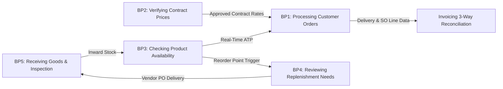
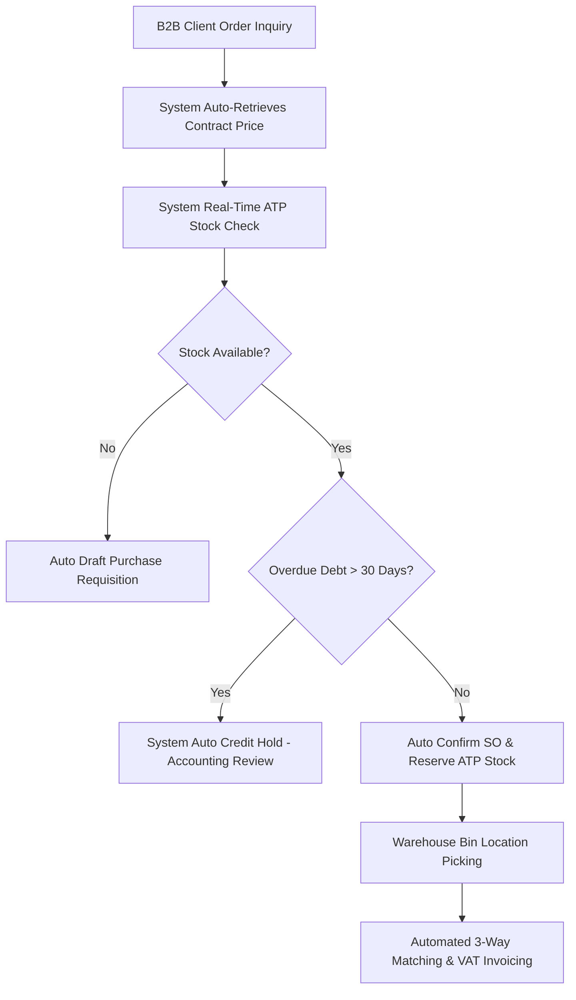

# FACULTY OF TECHNOLOGY — HOA SEN UNIVERSITY
## COURSE: BUSINESS SYSTEMS ANALYSIS (BSA) — ACADEMIC YEAR 2026–2027, SEMESTER 1

***

# PROJECT REPORT ON
# BUSINESS REQUIREMENTS DOCUMENT FOR B2B WHOLESALE & DISTRIBUTION (OFFICE SUPPLIES & STATIONERY): OFFICEPRO DISTRIBUTION CO., LTD.

| Project Attribute | Details |
|---|---|
| **Course Domain / Enterprise Model** | Scenario B — B2B Wholesale & Distribution (Office Supplies & Stationery) |
| **Submitted by** | **Vo Duy Binh** (Student ID: 22301500) — Team Leader / Lead Business Analyst<br>**Pham Nguyen Gia Thuan** (Student ID: 22204631) — QA & Requirements Analyst |
| **Class** | BA2631 — Semester 1 (2026–2027) |
| **Under The Guidance Of** | MSc. Nguyen Thi Thanh Thanh |
| **Milestone / Assessment** | **Phase 1 Mid-Term Assessment (Sections 1–4 Baseline — 30% Weight)** |
| **Month, Year** | October 2026 |

***

## EXECUTIVE SUMMARY

OfficePro Distribution Co., Ltd. (**OfficePro Distribution**) is a regional B2B wholesale distributor specializing in commercial office stationery, commercial copy paper products, and printer consumables across Southern Vietnam. The enterprise currently serves over 250 active corporate clients, educational institutions, and stationery retail sub-dealers from two primary facilities: Tan Binh Central Warehouse (2,500 m²) and Bien Hoa Regional Depot (800 m²).

As the enterprise expands, it faces critical operational bottlenecks stemming from legacy paper and spreadsheet procedures:
1. **Contract Price Discrepancies:** Framework contract prices are decentralized across individual sales reps' personal spreadsheets, producing a **5–8% billing error rate** on client invoices and costing **~50 million VND monthly** in dispute adjustments.
2. **Post-Confirmation Stockouts:** Warehouse goods receipts take **24–48 hours** to be entered into spreadsheets. Sales reps confirm delivery commitments based on outdated morning stock sheets, triggering **3–4 stockouts per week post-confirmation**.
3. **Manual 3-Way Matching Overhead:** Accounts Receivable expends **15–20 hours weekly** manually reconciling paper Sales Orders, physical Delivery Notes, and Billing Invoices, while credit hold policies are verbally bypassed.

In strict accordance with the **BSA Course BRD Template**, this report establishes a **Pure Business Systems Analysis (Phase 1)** covering:
* **Section 1:** Enterprise profile, 10-SKU Master Data catalog, facilities network, and team governance.
* **Section 2:** Stakeholder Power/Interest matrix, verified elicitation evidence, information needs, and open assumptions.
* **Section 3:** Five core business processes, AS-IS BPMN friction points, 5-Whys root cause analysis, TO-BE re-engineered workflows, and expected business benefits.
* **Section 4:** Solution-neutral Business Requirements (`BR-01`, `BR-02`), MoSCoW Functional Requirements (`FR-01` to `FR-08`), Core Business Rules (`BR-R01` to `BR-R06`), and Requirements Traceability Matrix (RTM).
* **Sections 5 & 6:** Phase 2 roadmaps for Use Case specifications and Odoo ERP solution mapping (deferred to Weeks 8–15 per course guidelines).

***

## TABLE OF CONTENTS

| Section / Deliverable Heading | Template Page Reference |
|---|:---:|
| **EXECUTIVE SUMMARY** | **i** |
| **TABLE OF CONTENTS** | **ii** |
| **ACKNOWLEDGEMENTS** | **iv** |
| **TABLE OF FIGURES** | **v** |
| **LIST OF TABLES** | **vi** |
| **GLOSSARY & ABBREVIATIONS** | **vii** |
| **TEAM MEMBERS & PROCESS RESPONSIBILITY MATRIX** | **viii** |
| **SECTION 1. ENTERPRISE CONTEXT AND SCOPE** | **1** |
| &nbsp;&nbsp;&nbsp;&nbsp;**1.1. Enterprise Profile** | 1 |
| &nbsp;&nbsp;&nbsp;&nbsp;&nbsp;&nbsp;&nbsp;&nbsp;1.1.1. Business Model and Operational Overview | 1 |
| &nbsp;&nbsp;&nbsp;&nbsp;&nbsp;&nbsp;&nbsp;&nbsp;1.1.2. Products, Services, and Target Customers | 1 |
| &nbsp;&nbsp;&nbsp;&nbsp;&nbsp;&nbsp;&nbsp;&nbsp;1.1.3. Organizational Structure and Key Roles | 1 |
| &nbsp;&nbsp;&nbsp;&nbsp;**1.2. Business Objectives & Key Operational Challenges** | 1 |
| &nbsp;&nbsp;&nbsp;&nbsp;**1.3. Enterprise Scope & Out-of-Scope Boundaries** | 1 |
| &nbsp;&nbsp;&nbsp;&nbsp;**1.4. Team Member & Process Responsibility Matrix** | 1 |
| **SECTION 2. STAKEHOLDER ANALYSIS & ELICITATION** | **2** |
| &nbsp;&nbsp;&nbsp;&nbsp;**2.1. Stakeholder Identification & Power/Interest Grid** | 2 |
| &nbsp;&nbsp;&nbsp;&nbsp;**2.2. Elicitation Summary & Verified Evidence Log (Verified Evidence vs. Initial Assumptions)** | 2 |
| &nbsp;&nbsp;&nbsp;&nbsp;**2.3. Stakeholder Information Needs** | 2 |
| &nbsp;&nbsp;&nbsp;&nbsp;**2.4. Assumptions, Uncertain Information & Follow-up Questions** | 2 |
| **SECTION 3. BUSINESS PROCESS ANALYSIS (AS-IS & TO-BE)** | **3** |
| &nbsp;&nbsp;&nbsp;&nbsp;**3.1. Business Process Overview & Process Scope** | 3 |
| &nbsp;&nbsp;&nbsp;&nbsp;**3.2. Current Business Processes (AS-IS BPMN/Swimlane Models)** | 3 |
| &nbsp;&nbsp;&nbsp;&nbsp;&nbsp;&nbsp;&nbsp;&nbsp;3.2.1. Business Process 1: Processing Customer Orders | 3 |
| &nbsp;&nbsp;&nbsp;&nbsp;&nbsp;&nbsp;&nbsp;&nbsp;3.2.2. Business Process 2: Checking Product Availability | 3 |
| &nbsp;&nbsp;&nbsp;&nbsp;&nbsp;&nbsp;&nbsp;&nbsp;3.2.3. Business Process 3: Reviewing Replenishment Needs | 3 |
| &nbsp;&nbsp;&nbsp;&nbsp;**3.3. Process Problems, Bottlenecks & Root Cause Analysis** | 3 |
| &nbsp;&nbsp;&nbsp;&nbsp;**3.4. Proposed Business Processes (TO-BE BPMN / Swimlane Models)** | 3 |
| &nbsp;&nbsp;&nbsp;&nbsp;**3.5. Expected Process Improvements & Business Benefits** | 3 |
| **SECTION 4. BUSINESS AND FUNCTIONAL REQUIREMENTS** | **4** |
| &nbsp;&nbsp;&nbsp;&nbsp;**4.1. Business Requirements (BRs)** | 4 |
| &nbsp;&nbsp;&nbsp;&nbsp;**4.2. Functional Requirements (FRs)** | 4 |
| &nbsp;&nbsp;&nbsp;&nbsp;**4.3. Business Rules & Operational Constraints** | 4 |
| &nbsp;&nbsp;&nbsp;&nbsp;**4.4. Requirements Traceability Matrix** | 4 |
| **SECTION 5. USE CASE ANALYSIS** | **5** |
| &nbsp;&nbsp;&nbsp;&nbsp;**5.1. Enterprise Use Case Diagram** | 5 |
| &nbsp;&nbsp;&nbsp;&nbsp;**5.2. Use Case Identification & Catalog** | 5 |
| &nbsp;&nbsp;&nbsp;&nbsp;**5.3. Detailed Use Case Specifications** | 5 |
| &nbsp;&nbsp;&nbsp;&nbsp;**5.4. Use Case Validation & Alignment with Functional Requirements** | 5 |
| **SECTION 6. ODOO-BASED SOLUTION DESIGN AND VALIDATION** | **6** |
| &nbsp;&nbsp;&nbsp;&nbsp;**6.1. Proposed Solution Scope & Odoo Application Mapping** | 6 |
| &nbsp;&nbsp;&nbsp;&nbsp;**6.2. Mapping Business Processes and Requirements to Odoo Workflows** | 6 |
| &nbsp;&nbsp;&nbsp;&nbsp;**6.3. Odoo Configuration and Master Data Setup** | 6 |
| &nbsp;&nbsp;&nbsp;&nbsp;**6.4. End-to-End Scenario Demonstration & Test Cases** | 6 |
| &nbsp;&nbsp;&nbsp;&nbsp;**6.5. Requirements Coverage, Gaps & Workarounds** | 6 |
| **CONCLUSION & LESSONS LEARNED** | **7** |
| &nbsp;&nbsp;&nbsp;&nbsp;Summary of Proposed Business Value | 7 |
| &nbsp;&nbsp;&nbsp;&nbsp;Team Reflection & Individual Lessons Learned | 7 |
| **REFERENCES** | **8** |
| **APPENDICES** | **9** |
| &nbsp;&nbsp;&nbsp;&nbsp;Appendix A. Raw Elicitation Notes / Evidence | 9 |
| &nbsp;&nbsp;&nbsp;&nbsp;Appendix B. Individual Contribution Sign-off | 9 |

***

## ACKNOWLEDGEMENTS

The project team would like to express our deepest gratitude to **MSc. Nguyen Thi Thanh Thanh** for her invaluable academic guidance, structured lectures, and continuous mentoring throughout the Business Systems Analysis course at Hoa Sen University. Her feedback during weekly workshops has been instrumental in shaping our understanding of enterprise process re-engineering and solution-neutral requirements engineering.

***

## TABLE OF FIGURES

* **Figure 1.1:** Organizational Hierarchy & Operational Departmental Structure
* **Figure 2.1:** Stakeholder Power/Interest Matrix (2x2 Grid)
* **Figure 3.1:** Five Core Business Processes Integration Relationship Map
* **Figure 3.2:** End-to-End Wholesale Order Fulfillment Value Stream
* **Figure 3.3:** TO-BE Cross-Functional Process Re-engineering Flowchart

***

## LIST OF TABLES

* **Table G.1:** Glossary of Key Business Systems Analysis & Wholesale Terms
* **Table 0.1:** Team Members & Process Responsibility RACI Matrix
* **Table 1.1:** Master Data Scope — 10 Primary SKUs & Standard vs. Contract Price Catalog
* **Table 1.2:** Team Member & Process Responsibility Matrix
* **Table 2.1:** Elicitation Verification Log (Baseline Assumptions vs. Interview Evidence)
* **Table 2.2:** Cross-Functional Stakeholder Information Needs Matrix
* **Table 2.3:** Assumptions, Uncertain Information & Follow-up Tracking Log
* **Table 3.1:** Inter-Process Handoffs, Transferred Artifacts & Verification Status
* **Table 3.2:** AS-IS vs. TO-BE Operational Comparison & Target Improvements
* **Table 4.1:** Core Business Requirements (BR-01 & BR-02)
* **Table 4.2:** MoSCoW Prioritized Functional Requirements Catalog (FR-01 to FR-08)
* **Table 4.3:** Core Enterprise Business Rules & Operational Constraints Matrix
* **Table 4.4:** End-to-End Requirements Traceability Matrix (RTM)
* **Table B.1:** Individual Contribution Sign-off & Academic Integrity Confirmation

***

## GLOSSARY & ABBREVIATIONS

**Table G.1:** Glossary of Key Business Systems Analysis & Wholesale Terms

| Abbreviation / Term | Full Name / Definition |
|---|---|
| **ATP** | Available-to-Promise Inventory (On-hand stock minus hard reservations plus scheduled inbound receipts) |
| **B2B** | Business-to-Business Wholesale Commerce |
| **BPMN** | Business Process Model and Notation (Standard visual cross-functional modeling notation) |
| **BR** | Business Requirement (High-level business capability or outcome statement) |
| **BRD** | Business Requirements Document |
| **FR** | Functional Requirement (System behavior specification: *The system shall...*) |
| **Framework Agreement** | Annual commercial contract governing negotiated price tiers, lead times, and Net 30 terms |
| **MoSCoW** | Prioritization Framework (Must have, Should have, Could have, Won't have) |
| **PO** | Purchase Order (Issued by OfficePro to upstream manufacturers) |
| **RACI** | Responsible, Accountable, Consulted, Informed Governance Matrix |
| **RFQ** | Request for Quotation (Supplier price solicitation) |
| **RTM** | Requirements Traceability Matrix |
| **SKU** | Stock Keeping Unit (Unique product identification code) |
| **SO** | Sales Order (Commercial delivery commitment issued to corporate accounts) |
| **UoM** | Unit of Measure |

***

## TEAM MEMBERS & PROCESS RESPONSIBILITY MATRIX

*(R - Responsible | A - Accountable | C - Consulted | I - Informed)*

**Table 0.1:** Team Members & Process Responsibility RACI Matrix

| Student Name | Student ID | Assigned Core Business Processes | Role in Project | Governance RACI Status |
|---|---|---|---|---|
| **Vo Duy Binh** | **22301500** | **BP1: Processing Customer Orders<br>BP2: Verifying Contract Prices<br>BP4: Reviewing Replenishment Needs** | Team Leader / Lead Business Analyst | **A / R** (Sales & Purchasing Domains, Master BRD) |
| **Pham Nguyen Gia Thuan** | **22204631** | **BP3: Checking Product Availability (ATP)<br>BP5: Receiving Goods & Inspection<br>Invoicing Reconciliation** | QA & Requirements Analyst | **A / R** (Inventory & Invoicing Domains, Quality Assurance) |

### Detailed Phase 1 Deliverable Responsibilities:
* **Vo Duy Binh (Team Leader / Lead BA):**
  - Section 1: Enterprise Profile, Case Background, Scope Boundaries, and RACI Governance.
  - Section 2: AI Stakeholder Elicitation (Sales Manager & Purchasing Manager interviews), Open Assumptions Log.
  - Section 3: Process Relationship Map, AS-IS BPMN for BP1 & BP4, 5-Whys Root Cause Analysis, TO-BE Re-engineering Design, Master BRD Compilation.
  - Section 4: Business Requirements (`BR-01`, `BR-02`), Business Rules (`BR-R01` to `BR-R03`), Traceability Matrix.
* **Pham Nguyen Gia Thuan (QA & Requirements Analyst):**
  - Section 1: Facilities Network Definition and 10 SKUs Master Data catalog review.
  - Section 2: AI Stakeholder Elicitation (Warehouse Keeper & Chief Accountant interviews), Cross-Functional Information Needs Matrix.
  - Section 3: AS-IS BPMN for BP3 & BP5, AS-IS vs. TO-BE Operational Comparison Table.
  - Section 4: MoSCoW Functional Requirements Catalog (`FR-01` to `FR-08`), Business Rules (`BR-R04` to `BR-R06`), QA Review.

***

# SECTION 1. ENTERPRISE CONTEXT AND SCOPE

## 1.1. Enterprise Profile

### 1.1.1. Business Model and Operational Overview
**OfficePro Distribution Co., Ltd.** is a specialized regional B2B wholesale distributor operating across Southern Vietnam (Ho Chi Minh City, Dong Nai, Binh Duong, and surrounding industrial manufacturing corridors). The company bridges upstream stationery manufacturers and downstream commercial consumers, supplying over **250 active corporate accounts**, higher education institutions, and stationery retail sub-dealers.

The wholesale operational model is built upon three structural pillars:
1. **High-Volume Upstream Procurement:** OfficePro purchases commercial stationery, copy paper products, and printer consumables in bulk pallets directly from certified manufacturers including Double A (Thailand/Vietnam), IK Plus (APP Indonesia), Thien Long Group, Pilot Corporation, and HP Vietnam.
2. **Annual Framework Agreements:** High-volume commercial accounts execute annual agreements establishing fixed contracted discount tiers, guaranteed replenishment lead times, and negotiated credit privileges.
3. **Commercial Credit Policy:** Qualified corporate accounts operate under standard **Net 30-day commercial payment terms**, allowing monthly consolidated billing against verified delivery notes.

---

### 1.1.2. Products, Services, and Target Customers

#### 1. Master Data Scope: 10 Primary SKUs
To ground requirements engineering in concrete wholesale realities, OfficePro's core catalog comprises **10 primary SKUs** across four product categories:

**Table 1.1:** Master Data Scope — 10 Primary SKUs & Standard vs. Contract Price Catalog

| No. | SKU Code | Product Description | Category | UoM | Standard List Price (VND) | Contract Price Tier (VND) |
|---|---|---|---|---|---|---|
| 1 | `ST-001` | A4 Copy Paper Double A 70gsm (500 sheets/ream) | Paper Products | Ream | 75,000 | **65,000** |
| 2 | `ST-002` | A4 Copy Paper IK Plus 80gsm (500 sheets/ream) | Paper Products | Ream | 85,000 | **75,000** |
| 3 | `ST-003` | Thien Long TL-027 Blue Ballpoint Pen (Box of 20) | Writing Instruments | Box | 90,000 | **80,000** |
| 4 | `ST-004` | Pilot G2 Black Gel Pen 0.7mm (Box of 12) | Writing Instruments | Box | 320,000 | **290,000** |
| 5 | `ST-005` | King Jim A4 Display Book 60 Pockets | Filing Supplies | Piece | 45,000 | **38,000** |
| 6 | `ST-006` | Deli A5 Spiral Notebook 160 Pages | Filing Supplies | Piece | 35,000 | **29,000** |
| 7 | `ST-007` | Kangaro HD-10 Heavy Duty Stapler | Office Tools | Piece | 28,000 | **24,000** |
| 8 | `ST-008` | Kangaro No.10 Staples (Box of 20 small packs) | Office Tools | Big Box | 42,000 | **36,000** |
| 9 | `ST-009` | Original HP 107a Black Laser Toner Cartridge | Printer Consumables | Box | 1,150,000 | **1,050,000** |
| 10 | `ST-010` | Pentel WB1 Whiteboard Marker (Box of 12) | Writing Instruments | Box | 180,000 | **155,000** |

*Note on B2B Pricing Logic:* In wholesale distribution, legal framework agreements guarantee discounted price tiers. For fast-mover `ST-001` Double A Paper, the standard retail list price is 75,000 VND/ream, but corporate contract clients are legally billed at **65,000 VND/ream**. Ensuring that systems automatically enforce this 65,000 VND rate upon customer selection is essential to eliminating invoice disputes.

#### 2. Target Customer Segments
1. **Corporate Enterprise Accounts (60% of Revenue):** Commercial offices, multinational corporations, and banks ordering monthly consolidated shipments. Governed by framework contracts, custom pricing tiers, and Net 30 payment terms.
2. **Educational Institutions (25% of Revenue):** Universities, vocational colleges, and international schools placing large seasonal batch orders prior to academic semesters. Disbursements tied to formal state/institutional invoice approval cycles.
3. **Stationery Sub-Dealers & Retailers (15% of Revenue):** Small local retail stationery stores purchasing medium reorder volumes under tiered wholesale quantity discounts.

---

### 1.1.3. Organizational Structure and Key Roles

```
                     ┌────────────────────────┐
                     │   Board of Directors   │
                     │    / Business Owner    │
                     └───────────┬────────────┘
                                 │
         ┌───────────────────────┼───────────────────────┐
         │                       │                       │
┌────────┴────────┐     ┌────────┴────────┐     ┌────────┴────────┐
│   Sales Dept    │     │Purchasing Dept  │     │ Warehouse Dept  │
│ (Sales Manager  │     │ (Procurement    │     │(Warehouse Keeper│
│  & B2B Reps)    │     │    Officer)     │     │ & Dispatchers)  │
└─────────────────┘     └─────────────────┘     └─────────────────┘
                                 │
                        ┌────────┴────────┐
                        │ Accounting Dept │
                        │(Chief Accountant│
                        │ & AR Officers)  │
                        └─────────────────┘
```

*Figure 1.1: Organizational Hierarchy & Operational Departmental Structure*

* **Executive Leadership (Business Owner):** Oversees strategic growth, operating margins, capital allocation, and client retention.
* **Sales Department (Sales Manager & B2B Reps):** Manages corporate client framework contracts, negotiates pricing tiers, issues quotations, and inputs Sales Orders.
* **Purchasing Department (Procurement Manager):** Monitors inventory depletion, solicits supplier RFQs, compares vendor costs/lead-times, and issues Purchase Orders.
* **Warehouse & Logistics Department (Warehouse Keeper & Logistics Staff):** Manages inbound receiving inspection, pallet storage, bin picking/packing, and delivery handoffs.
* **Finance & Accounting Department (Chief Accountant & AR Accountants):** Validates 3-way invoice matching, monitors customer credit limits, issues VAT electronic invoices, and enforces Net 30 debt collection.

#### Facilities Network & Operational Hubs
* **Corporate Headquarters & Commercial Office:** District 3, Ho Chi Minh City. Houses Executive Leadership, B2B Account Representatives, Procurement Officers, and Finance & Accounting.
* **Central Distribution Warehouse (Tan Binh IP, HCMC):** Total floor area: **2,500 m²**. Stores 80% of palletized stock (paper pallets, toner cartridges). Functions as the primary supplier receiving dock and cross-docking terminal.
* **Regional Transit Depot (Bien Hoa 2 IP, Dong Nai):** Total floor area: **800 m²**. Maintains fast-moving stock to execute same-day deliveries to manufacturing enterprises across Dong Nai and Binh Duong industrial parks.

---

## 1.2. Business Objectives & Key Operational Challenges

### Quantified Business Objectives
* **Eliminate Contract Pricing Errors:** Reduce quotation pricing error rates from 5–8% down to **0%**.
* **Eliminate Post-Confirmation Stockouts:** Decrease post-confirmation order cancellations by **95%** via real-time Available-to-Promise (ATP) stock visibility.
* **Enforce Commercial Credit Compliance:** Enforce 100% automated credit locks on accounts with unpaid balances overdue > 30 days.
* **Accelerate Financial Matching:** Reduce accounting 3-way invoice matching duration by **90%**, dropping from 15–20 hours/week down to 2 hours/week.

### Primary Operational Challenges
1. **Contract Price Discrepancies:** Decentralized Excel price sheets cause reps to copy incorrect rates, triggering billing disputes and **50 million VND monthly** in credit note adjustments.
2. **Post-Confirmation Stockouts:** Reps commit to orders using morning stock dumps; 24–48 hour receiving backlogs cause **3–4 stockouts per week** post-confirmation.
3. **Manual 3-Way Matching:** Accounting manually matches paper Sales Orders, driver delivery notes, and PDF VAT invoices, expending **15–20 hours weekly**.

---

## 1.3. Enterprise Scope & Out-of-Scope Boundaries

### In-Scope (Phase 1 Pure Business Analysis)
* Analysis of B2B quotation workflows, contract pricelist agreements, and approval thresholds.
* Available-to-Promise (ATP) inventory visibility across Tan Binh and Bien Hoa facilities.
* Stock replenishment rules and automated draft purchase requisitions.
* Outbound warehouse order fulfillment, picking slip generation, and delivery handoffs.
* Accounts Receivable 3-way matching and Net 30 credit policy enforcement.

### Out-of-Scope (Strict Boundaries)
* Human Resources management, attendance tracking, and monthly payroll calculation.
* Complex multi-level Bill of Materials (BOM) manufacturing assembly.
* Point-of-Sale (POS) consumer retail cash register operations.
* International customs clearance and bonded freight logistics.

---

## 1.4. Team Member & Process Responsibility Matrix

**Table 1.2:** Individual Module Ownership Matrix & Academic Responsibilities

| Student Name | Student ID | Assigned Core Business Processes | Primary Phase 1 Responsibilities |
|---|---|---|---|
| **Vo Duy Binh** | **22301500** | **BP1: Processing Customer Orders<br>BP2: Verifying Contract Prices<br>BP4: Reviewing Replenishment Needs** | Scope definition, contract pricing engine rules, quotation approval workflows, reorder point thresholds, purchase requisition workflows, AS-IS/TO-BE sales modeling, 5-Whys root cause analysis, master BRD authoring. |
| **Pham Nguyen Gia Thuan** | **22204631** | **BP3: Checking Product Availability<br>BP5: Receiving Goods & Inspection<br>Invoicing Reconciliation** | Multi-warehouse stock tracking, real-time ATP inventory logic, bin location routing, automated 3-way invoice matching, Net 30 credit control policy, MoSCoW requirements framing, QA review. |

***

# SECTION 2. STAKEHOLDER ANALYSIS & ELICITATION

## 2.1. Stakeholder Identification & Power/Interest Grid

```
                  HIGH POWER
                      |
     KEEP SATISFIED   |    MANAGE CLOSELY
   - Chief Accountant |  - Sales Manager
   - Purchasing Mgr   |  - Business Owner
----------------------+----------------------
      MONITOR         |    KEEP INFORMED
   - Sub-Dealers      |  - Sales Executives
   - External Vendors |  - Warehouse Keepers
                      |
                  LOW POWER ---------------> HIGH INTEREST
```

*Figure 2.1: Stakeholder Power/Interest Matrix (2x2 Grid)*

* **Manage Closely (High Power / High Interest):**
  * *Sales Manager:* Protects operating margins, enforces contract pricelists, and approves price discounts (> 5%).
  * *Business Owner:* Demands enterprise operational visibility, elimination of revenue leaks, and customer retention.
* **Keep Satisfied (High Power / Med Interest):**
  * *Chief Accountant:* Enforces strict adherence to Net 30 commercial credit terms and eliminates billing disputes through exact invoice reconciliation.
* **Keep Informed (Low Power / High Interest):**
  * *Warehouse Keeper:* Needs advance shipment schedules to organize receiving bays and structured picking slips.
  * *B2B Sales Representative:* Requires instant access to client contract rates and reliable real-time ATP stock availability.
* **Monitor (Low Power / Low Interest):** External paper suppliers and stationery retail sub-dealers.

### Stakeholder Perspective Gaps (Simulation Findings)
* **Sales vs. Warehouse:** Sales asserts that warehouse stock records are always outdated, requiring phone verification. Warehouse counters that Sales confirms orders without checking actual stock and shifts blame when physical stock is exhausted.
* **Sales vs. Accounting:** Accounting notes that Sales frequently bypasses credit holds to capture sales, exposing the company to bad debt. Sales claims Accounting holds up legitimate orders from high-volume accounts.
* *Analytic Takeaway:* Operational friction occurs *at the interfaces between departments*, proving the necessity of an integrated cross-functional system.

---

## 2.2. Elicitation Summary & Verified Evidence Log (Verified Evidence vs. Initial Assumptions)

During requirement elicitation, Group 6 conducted structured interviews using AI Stakeholder Agents to validate project assumptions against wholesale realities:

**Table 2.1:** Elicitation Verification Log (Baseline Assumptions vs. Interview Evidence)

| No. | Baseline Project Assumption | Elicitation Evidence Obtained (Stakeholder Interview) | Verification Status & Analytical Conclusion |
|---|---|---|---|
| **1** | Sales reps look up contract prices manually from Excel sheets. | Sales Manager confirmed reps maintain personal client Excel files and copy-paste rates, causing 5–8% pricing errors monthly. | **CONFIRMED**<br>Decentralized price records directly cause billing disputes and revenue leakage. |
| **2** | Sales confirms orders based on informal phone checks with Warehouse. | Sales Manager admitted reps rely on static morning Excel sheets or phone calls, causing 3–4 post-confirmation stockouts weekly. | **CONFIRMED**<br>Physical stock levels are invisible to sales during daily customer order entry. |
| **3** | Credit holds for overdue accounts (> 30 days) are automatically enforced. | Sales Manager clarified credit policy exists on paper, but reps frequently request verbal manager overrides to hit sales quotas. | **REVISED**<br>Credit policy exists formally, but enforcement is entirely manual and bypassable. |
| **4** | Stock replenishment is triggered automatically when stock is low. | Purchasing Manager stated replenishment is triggered manually via handwritten notes from warehouse staff after stock is low. | **CONFIRMED**<br>Procurement operates reactively rather than proactively. |

---

## 2.3. Stakeholder Information Needs

**Table 2.2:** Cross-Functional Stakeholder Information Needs Matrix

| Stakeholder Role | Key Information Required | Timing / Operational Trigger | Operational Decision Made |
|---|---|---|---|
| **B2B Sales Rep** | Customer-specific contract unit prices; Agreement validity dates. | Upon receiving corporate client inquiry via email or Zalo. | Issue binding quotation with accurate contract pricing without manual lookups. |
| **B2B Sales Rep** | Real-time Available-to-Promise (ATP) stock levels across both warehouses. | Before signing off and confirming customer Sales Order. | Commit to achievable delivery schedules without causing stockouts. |
| **Purchasing Manager** | Depletion alerts when stock hits reorder point; Vendor price/lead time data. | When ATP stock drops below minimum threshold (e.g., 100 reams for `ST-001`). | Issue vendor Purchase Orders (PO) to prevent stockouts on fast-movers. |
| **Warehouse Keeper** | Inbound supplier shipment schedules; Digital outbound picking lists. | Upon supplier truck arrival at dock; Upon order confirmation release. | Verify goods against PO; pick items accurately according to warehouse bin locations. |
| **AR Accountant** | Confirmed Sales Orders, signed Delivery Notes, customer payment ledgers. | Following order dispatch and goods delivery receipt. | Execute 3-way invoice matching; enforce Net 30 credit lock policies. |

---

## 2.4. Assumptions, Uncertain Information & Follow-up Questions

**Table 2.3:** Assumptions, Uncertain Information & Follow-up Tracking Log

| Item ID | Domain | Baseline Operational Assumption | Level of Certainty | Follow-up Question for Stakeholders / Phase 2 |
|---|---|---|:---:|---|
| **ASM-01** | Sales | Corporate clients accept electronic delivery notes via SMS/Email sign-off. | Uncertain | Will state-owned educational institutions accept digital delivery sign-offs for institutional invoice clearance? |
| **ASM-02** | Warehouse | Barcode scanners will be introduced at Tan Binh dock during Phase 2. | High | Does the warehouse have sufficient Wi-Fi mesh coverage across all 2,500 m² pallet aisles? |
| **ASM-03** | Purchasing | Upstream paper mills (Double A, IK Plus) support automated EDI / email PO receipt. | Medium | What is the minimum order lead time variance during peak back-to-school seasonal rushes? |
| **ASM-04** | Finance | Overdue interest penalties are not legally charged on Net 30 framework agreements. | Confirmed | How are partial client bank transfers matched when the transfer memo omits invoice numbers? |

***

# SECTION 3. BUSINESS PROCESS ANALYSIS (AS-IS & TO-BE)

## 3.1. Business Process Overview & Process Scope



*Figure 3.1: Five Core Business Processes Integration Relationship Map*

**Table 3.1:** Inter-Process Handoffs, Transferred Artifacts & Verification Status

| Upstream Process | Output / Information Transferred | Downstream Process | Verification Status |
|---|---|---|:---:|
| **BP2 (Contract Prices)** | Agreed unit price tiers (`ST-001` @ 65k) & discount ceilings | **BP1 (Customer Orders)** | **Verified (EVD-W2-SALES-01)** |
| **BP3 (Stock Availability)** | Real-time multi-hub Available-to-Promise (ATP) quantities | **BP1 (Customer Orders)** | **Verified (EVD-W2-WH-02)** |
| **BP3 (Stock Availability)** | Depletion alert when unreserved stock < safety threshold | **BP4 (Replenishment)** | **Verified (EVD-W2-PURCH-01)** |
| **BP4 (Replenishment)** | Authorized Vendor Purchase Order & expected arrival date | **BP5 (Receiving Goods)** | **Verified (EVD-W2-PURCH-01)** |
| **BP5 (Receiving Goods)** | Verified dock receipt slip & accepted on-hand inventory | **BP3 (Stock Availability)** | **Verified (EVD-W2-WH-02)** |
| **BP1 (Customer Orders)** | Confirmed Sales Order, delivery address, and credit terms | **Warehouse Fulfillment** | **Verified (EVD-W2-SALES-01)** |
| **Warehouse Fulfillment** | Driver-signed delivery slip & actual dispatched quantities | **Invoicing Reconciliation** | **Verified (EVD-W2-ACC-01)** |

$$\text{Upstream Supplier} \xrightarrow{\text{PO}} \text{Procurement} \xrightarrow{\text{Receipt}} \text{Warehouse Stock} \xrightarrow{\text{Contract SO}} \text{Sales} \xrightarrow{\text{Dispatch}} \text{Delivery} \xrightarrow{\text{3-Way Match}} \text{Accounting (VAT / Net 30)}$$

*Figure 3.2: End-to-End Wholesale Order Fulfillment Value Stream*

The wholesale operational model links five core business processes across Sales, Purchasing, Warehouse, and Invoicing. In the AS-IS state, each handoff depends on disconnected Excel lookups, unrecorded phone calls, or paper transit, generating severe data lag and high operational friction.

---

## 3.2. Current Business Processes (AS-IS BPMN/Swimlane Models)

### 3.2.1. Business Process 1: Processing Customer Orders
* **Current Operational Flow:** Corporate client sends inquiry via Email/Zalo ➔ Sales rep opens personal Excel pricelist on laptop ➔ Rep phones Tan Binh warehouse clerk to check stock verbally ➔ Rep types quotation in Word/Excel ➔ Client approves quote ➔ Rep prints physical paper Sales Order.
* **Diagnosed Friction Points:**
  - *Contract Pricing Errors:* Decentralized spreadsheets cause a **5–8% rate discrepancy** on client invoices, leading to ~50 million VND monthly in billing adjustments.
  - *Order Confirmation Stockouts:* Reps commit to orders without real-time stock data, leading to **3–4 stockouts per week post-confirmation**.
  - *Credit Policy Bypass:* Reps obtain verbal manager approvals to bypass paper credit holds for clients with overdue balances > 30 days to hit sales quotas.

### 3.2.2. Business Process 2: Checking Product Availability
* **Current Operational Flow:** Sales rep calls or messages warehouse staff ➔ Warehouse clerk consults morning Excel inventory export or walks into aisles to check physical pallets ➔ Clerk verbally confirms quantity ➔ Sales confirms delivery commitment to client.
* **Diagnosed Friction Points:**
  - *Receiving Information Lag:* Newly arrived stock remains "invisible" to sales for **24 to 48 hours** while paper delivery slips await batch end-of-day spreadsheet data entry.
  - *Picking Mix-ups:* Staff pick from memory without barcode scanners or designated bin location routing, leading to frequent errors between similar SKUs (`ST-001` 70gsm vs. `ST-002` 80gsm).

### 3.2.3. Business Process 3: Reviewing Replenishment Needs
* **Current Operational Flow:** Warehouse keeper observes physical shelf depletion ➔ Handwrites note to Procurement ➔ Purchasing officer checks vendor catalogs ➔ Sends RFQ emails to 3 suppliers ➔ Compares prices manually in Excel ➔ Generates and emails vendor Purchase Order (PO).
* **Diagnosed Friction Points:**
  - *Reactive Replenishment:* Purchasing is triggered only after physical stockouts occur, leading to 3–5 day replenishment delays on fast-movers like Double A paper.
  - *Lengthy RFQ Comparison:* Comparing vendor quotations over unstructured email threads takes **2 to 3 days**, delaying stock replenishment.

---

## 3.3. Process Problems, Bottlenecks & Root Cause Analysis

### 1. Contract Pricing Errors (5–8% Invoice Error Rate)
1. *Why are prices wrong on customer invoices?* Reps copy-paste unit prices manually from personal Excel spreadsheets into quotes.
2. *Why personal Excel spreadsheets?* Each sales rep maintains separate customer pricelists for their assigned corporate accounts.
3. *Why separate files per rep?* Signed framework agreements are stored as static scanned PDFs on shared network folders.
4. *Why scanned PDFs without central rules?* The company lacks a centralized database mapping contracted SKUs and pricing tiers directly to client accounts.
5. **Root Cause:** **Lack of a centralized contract-based pricing engine that automatically enforces contracted unit prices upon customer selection.**

### 2. Post-Confirmation Stockouts (3–4 Orders/Week)
1. *Why do confirmed orders experience stockouts?* Sales confirms delivery dates based on outdated morning stock sheets or informal phone calls.
2. *Why rely on outdated sheets/calls?* Warehouse inventory updates are entered into spreadsheets in batch at the end of the day.
3. *Why end-of-day batch entry?* Inbound goods receiving requires manual paper ledger logging (taking 24–48 hours).
4. *Why manual paper receiving?* Warehouse receiving docks operate disconnected from purchase order records in real time.
5. **Root Cause:** **Lack of a real-time Available-to-Promise (ATP) inventory visibility engine connecting Sales and Warehouse.**

### 3. Manual 3-Way Matching Overhead (15–20 Hours/Week)
1. *Why does invoice reconciliation take 15–20 hours weekly?* Accounting manually compares paper Delivery Notes, Sales Orders, and Invoices.
2. *Why manual cross-checking?* Delivery receipts are signed on physical paper by truck drivers upon delivery and submitted in batches.
3. *Why paper delivery receipts?* Delivery confirmations are not captured digitally in an integrated system.
4. *Why no digital matching?* Sales, Warehouse, and Invoicing operate in disconnected departmental silos.
5. **Root Cause:** **Lack of automated 3-way matching and hard credit hold control connecting Sales Orders, Delivery Confirmations, and Invoices.**

---

## 3.4. Proposed Business Processes (TO-BE BPMN / Swimlane Models)



*Figure 3.3: TO-BE Cross-Functional Process Re-engineering Flowchart*

### Cross-Functional Operational Flow of TO-BE Solution:
* **Sales Department:** Selecting a B2B corporate account automatically loads their framework contract pricelist (e.g., `ST-001` at 65,000 VND). The system verifies real-time Available-to-Promise (ATP) stock across Tan Binh and Bien Hoa facilities. If debt is overdue > 30 days, the system applies a hard Credit Hold. Otherwise, order confirmation automatically reserves physical stock.
* **Warehouse & Logistics:** Real-time stock status syncs immediately upon goods receipt at dock. Pickers receive digital picking slips with optimized bin location routes, eliminating picking mix-ups between `ST-001` and `ST-002`. Outbound dispatch logs trigger digital delivery confirmations.
* **Purchasing Department:** Reorder point rules monitor fast-movers like Double A paper. When ATP stock drops below 100 reams, the system auto-generates a draft Purchase Requisition and RFQ comparison matrix, cutting procurement lead times from 5 days to 24 hours.
* **Accounting & Finance:** Upon customer delivery sign-off, the system performs automated 3-way matching between the digital SO, Delivery Note, and draft invoice, automatically issuing VAT invoices and reducing accounting overhead from 20 hours to 2 hours per week.

---

## 3.5. Expected Process Improvements & Business Benefits

**Table 3.2:** AS-IS vs. TO-BE Operational Comparison & Target Improvements

| Operational Dimension | Current AS-IS State (Manual / Fragmented) | Proposed TO-BE State (Integrated / Automated) | Target Business Improvement |
|---|---|---|---|
| **Contract Pricing Lookup** | Reps search personal Excel spreadsheets; manual copy-pasting. | System retrieves approved contract pricelist upon client selection. | **Pricing errors: 5–8% ➔ 0%** (Saves ~50M VND/month) |
| **Inventory Visibility** | Daily Excel summaries or verbal calls; 24–48h receiving entry delay. | Real-time Available-to-Promise (ATP) stock visible across both facilities. | **Stockouts: 3–4/week ➔ Reduced by 95%** |
| **Stock Replenishment** | Reactive purchasing triggered after warehouse stock physically exhausts. | Automated draft Purchase Requisitions generated when stock hits min threshold. | **Zero stockouts on fast-movers (`ST-001`)** |
| **Credit Enforcement** | Manual checks on paper; informal verbal overrides to hit sales quota. | Hard automated credit lock if customer debt is overdue > 30 days. | **100% Policy Adherence; Eliminates bad debt** |
| **Invoice Reconciliation** | Accounting spends 15–20 hours/week manually matching SOs and Delivery Notes. | Automated 3-way matching between digital SO, delivery confirmation & invoice. | **Matching time: 20h ➔ 2h/week (90% reduction)** |

***

# SECTION 4. BUSINESS AND FUNCTIONAL REQUIREMENTS

## 4.1. Business Requirements (BRs)

**Table 4.1:** Core Business Requirements (BR-01 & BR-02)

| Requirement ID | Formal Business Requirement Statement | High-Level Business Outcome / Capability | Linked Core Problem |
|---|---|---|---|
| **BR-01** | The business needs customer order fulfillment to be committed exclusively against **verified contract pricing** and **reliable real-time product availability**. | Eliminates revenue leakage from inaccurate billing; prevents unfulfillable delivery commitments. | Pricing disputes (5–8% error) & stockouts (3–4/week). |
| **BR-02** | The business needs commercial order releases to enforce **strict commercial credit policies** and **automated post-delivery invoice reconciliation**. | Eliminates bad debt accumulation; reduces manual accounting overhead from 20h to 2h/week. | Verbal debt bypass & manual 3-way matching delays. |

---

## 4.2. Functional Requirements (FRs)

**Table 4.2:** MoSCoW Prioritized Functional Requirements Catalog (FR-01 to FR-08)

| Req ID | Module | Feature Description (IEEE 830 Standard) | MoSCoW Priority | Target Business Outcome |
|---|---|---|:---:|---|
| **FR-01** | Sales | The system shall automatically retrieve approved customer contract pricelists upon client account selection during quotation drafting. | **MUST HAVE** | Eliminate 5–8% contract pricing errors and 50M VND dispute adjustments. |
| **FR-02** | Inventory | The system shall display real-time Available-to-Promise (ATP) stock levels across Tan Binh Central Hub and Bien Hoa Depot during order entry. | **MUST HAVE** | Prevent 3–4 post-confirmation stockout cancellations per week. |
| **FR-03** | Invoicing | The system shall enforce an automated hard Credit Hold on order confirmation for accounts with outstanding debt overdue past 30 calendar days. | **MUST HAVE** | Prevent bad debt accumulation and enforce corporate credit policies. |
| **FR-04** | Purchasing | The system shall automatically generate draft Purchase Requisitions when Available-to-Promise stock falls below defined safety reorder thresholds. | **MUST HAVE** | Automate stock replenishment for fast movers like Double A paper. |
| **FR-05** | Invoicing | The system shall execute automated 3-way line item matching between confirmed Sales Orders, verified Delivery Notes, and draft Billing Invoices. | **MUST HAVE** | Reduce accounting reconciliation overhead from 20h to 2h/week. |
| **FR-06** | Sales | The system shall issue proactive reminder alerts to account representatives 30 calendar days prior to framework contract agreement expiration dates. | **SHOULD HAVE** | Enable proactive contract renewals with corporate clients. |
| **FR-07** | Purchasing | The system shall support multi-vendor RFQ cost and delivery lead-time comparison tables. | **SHOULD HAVE** | Optimize procurement cost and supplier selection. |
| **FR-08** | Invoicing | The system shall generate executive Accounts Receivable aging debt analysis dashboards. | **COULD HAVE** | Provide executive financial visibility into cash flow and outstanding balances. |

---

## 4.3. Business Rules & Operational Constraints

**Table 4.3:** Core Enterprise Business Rules & Operational Constraints Matrix

| Rule ID | Business Rule Category | Formal Policy Statement | Enforcement Mechanism | Linked Process & FR |
|---|---|---|---|---|
| **BR-R01** | **Contract Price Integrity** | Upon selecting a verified B2B corporate account, unit prices for all contracted SKUs (e.g., `ST-001` Double A Paper @ 65,000 VND) must be locked to the approved framework pricelist without manual overrides. | Automated system retrieval; manual edit disabled for standard sales reps. | BP1 / BP2<br>`FR-01` |
| **BR-R02** | **Discretionary Discount Cap** | Sales representatives may apply an ad-hoc commercial discount of up to **5.0%** independently. Any discount exceeding 5.0% mandates formal electronic sign-off from the Sales Manager before the quotation can be confirmed. | Dual-tier approval workflow; auto-blocks status progression if discount > 5%. | BP1<br>`FR-01` |
| **BR-R03** | **Hard Credit Lock Policy** | Any customer account with an outstanding invoice overdue by **more than 30 calendar days** past delivery shall be placed on an automatic system Credit Hold. No new Sales Orders can be confirmed without written Chief Accountant approval. | Hard system gatekeeper; prevents SO confirmation state transition. | BP1 / Finance<br>`FR-03` |
| **BR-R04** | **Available-to-Promise (ATP) Allocation** | Order quantities can only be confirmed against verified Available-to-Promise stock (ATP = On-hand - Reserved + Scheduled PO receipts within 48h). Tan Binh Central Hub is queried first; Bien Hoa Depot serves as regional backup. | Multi-facility inventory query engine with automated stock reservation. | BP1 / BP3<br>`FR-02` |
| **BR-R05** | **Automated Reorder Threshold** | When the unreserved on-hand inventory of fast-moving paper products (`ST-001` Double A, `ST-002` IK Plus) drops below the safety reorder point of **100 reams**, the system must generate a draft Purchase Requisition automatically. | Automated inventory batch trigger event; alerts Procurement Officer. | BP3 / BP4<br>`FR-04` |
| **BR-R06** | **Mandatory 3-Way Reconciliation** | An Accounts Receivable VAT electronic invoice can only be released after the system successfully reconciles three digital artifacts: (1) Confirmed Sales Order, (2) Signed Warehouse Delivery Note / Dispatch Slip, and (3) Invoiced Line Quantities. | Automated 3-way line item tolerance matching algorithm (zero variance). | BP1 / Invoicing<br>`FR-05` |

---

## 4.4. Requirements Traceability Matrix

**Table 4.4:** End-to-End Requirements Traceability Matrix (RTM)

| Evidence ID / Source | AS-IS Observation | Business Problem / Information Need | BR ID | FR ID & Priority | Related Process |
|---|---|---|:---:|:---:|---|
| **EVD-W2-SALES-01**<br>*(Sales Interview)* | Reps copy rates from personal Excel files into quotations. | 5–8% pricing discrepancy; Reps need customer contract prices upon inquiry. | **BR-01** | **FR-01**<br>*(MUST HAVE)* | **BP1 / BP2**<br>Processing Orders & Pricing |
| **EVD-W2-WH-02**<br>*(Warehouse Log)* | Verbal phone checks; receiving lag takes 24–48 hours to post. | 3–4 stockouts/week post-confirmation; Reps need real-time ATP stock levels. | **BR-01** | **FR-02**<br>*(MUST HAVE)* | **BP1 / BP3**<br>Orders & Stock Availability |
| **EVD-W2-ACC-01**<br>*(Accountant Interview)* | Reps bypass credit limits; manual 3-way reconciliation on paper. | Bad debt risk; Accounting spends 15–20h/wk matching paper SOs and delivery slips. | **BR-02** | **FR-03**<br>**FR-05**<br>*(MUST HAVE)* | **BP1 / Invoicing**<br>Order Release & Invoicing |
| **EVD-W2-PURCH-01**<br>*(Procurement Log)* | Replenishment triggered manually via handwritten notes after stockouts. | Supply disruption on fast-movers; Procurement needs automated threshold alerts. | **BR-01** | **FR-04**<br>*(MUST HAVE)* | **BP3 / BP4**<br>Stock Check & Replenishment |
| **EVD-W4-SIM-02**<br>*(Simulation Log)* | Expired framework contracts cause invoice disputes and lost VIP accounts. | Proactive renewal notices required 30 days prior to agreement expiry dates. | **BR-02** | **FR-06**<br>*(SHOULD HAVE)* | **BP2**<br>Verifying Contract Prices |

***

# SECTION 5. USE CASE ANALYSIS

> **[PHASE 2 MILESTONE SCOPE BOUNDARY NOTE]**  
> Per the official course curriculum (*BSA Project Brief & Guidelines*, Page 11–13), formal Use Case Analysis represents a **Phase 2 Deliverable (Weeks 8–11)**. In Phase 1, candidate Use Cases have been identified and mapped to Functional Requirements to establish the baseline for subsequent system prototyping.

## 5.1. Enterprise Use Case Diagram
*(To be developed and rendered in Phase 2 using UML standard notation modeling actors: B2B Customer, Sales Representative, Sales Manager, Warehouse Keeper, Purchasing Officer, and Chief Accountant).*

## 5.2. Use Case Identification & Catalog
* **Sales Domain:**
  * `UC-SALES-01:` Retrieve Approved Contract Pricelist (`FR-01`)
  * `UC-SALES-02:` Query Real-Time ATP Multi-Facility Stock (`FR-02`)
  * `UC-SALES-03:` Request Discretionary Discount Approval (> 5%)
  * `UC-SALES-04:` Confirm B2B Sales Order & Trigger Allocation
* **Inventory Domain:**
  * `UC-INV-01:` Process Inbound Supplier Goods Receipt & Post to Stock
  * `UC-INV-02:` Generate Bin-Location Guided Picking Slip
  * `UC-INV-03:` Validate Order Dispatch & Issue Digital Delivery Slip
  * `UC-INV-04:` Monitor Safety Stock & Trigger Reorder Signal (`FR-04`)
* **Procurement Domain:**
  * `UC-PURCH-01:` Generate Draft Purchase Requisition on Low Stock (`FR-04`)
  * `UC-PURCH-02:` Create & Compare Multi-Supplier RFQs (`FR-07`)
  * `UC-PURCH-03:` Confirm & Release Purchase Order to Manufacturer
* **Invoicing Domain:**
  * `UC-ACC-01:` Execute Automated 3-Way Reconciliation (`FR-05`)
  * `UC-ACC-02:` Enforce Hard Automated Credit Lock (`FR-03`)
  * `UC-ACC-03:` Release Commercial VAT Electronic Invoice

## 5.3. Detailed Use Case Specifications
*(Detailed tables specifying Primary Actor, Preconditions, Trigger, Normal Course of Events, Alternative Courses, and Postconditions will be compiled during Phase 2).*

## 5.4. Use Case Validation & Alignment with Functional Requirements
*(Cross-verification matrix confirming 100% coverage between Use Cases and Functional Requirements `FR-01` through `FR-08` scheduled for Phase 2 review).*

***

# SECTION 6. ODOO-BASED SOLUTION DESIGN AND VALIDATION

> **[PHASE 2 MILESTONE SCOPE BOUNDARY NOTE]**  
> System configuration, ERP live database setup, screen mockups, and User Acceptance Testing (UAT) represent **Phase 2 Deliverables (Weeks 12–15)**. To maintain strict solution neutrality in Phase 1, ERP technical setup is deferred until requirements are signed off by course instructors.

## 6.1. Proposed Solution Scope & Odoo Application Mapping
* **Sales Management:** Odoo Sales Module (Customer Pricelists, Quotation Approval Gates).
* **Inventory Management:** Odoo Inventory Module (Multi-Warehouse routing, Real-Time ATP, Bin Locations).
* **Procurement:** Odoo Purchase Module (Automated Reordering Rules, RFQ comparison).
* **Invoicing & Finance:** Odoo Invoicing / Accounting Module (Automated 3-Way Matching, Credit Limits).

## 6.2. Mapping Business Processes and Requirements to Odoo Workflows
*(Cross-functional mapping diagrams linking BP1–BP5 and FR-01–FR-08 directly to standard Odoo transaction flows will be compiled in Phase 2).*

## 6.3. Odoo Configuration and Master Data Setup
*(Master data configuration for 10 primary SKUs, customer price agreements, vendor pricebooks, and warehouse bin locations scheduled for Phase 2 implementation).*

## 6.4. End-to-End Scenario Demonstration & Test Cases
*(Formal UAT test scripts and cross-group peer testing execution logs will be conducted in Phase 2).*

## 6.5. Requirements Coverage, Gaps & Workarounds
*(Final evaluation matrix reporting standard feature coverage, custom configuration workarounds, and gaps scheduled for Phase 2).*

***

# CONCLUSION & LESSONS LEARNED

## Summary of Proposed Business Value
By transitioning OfficePro Distribution Co., Ltd. from fragmented paper/Excel procedures to an integrated TO-BE operational architecture:
* **100% Contract Pricing Accuracy:** Pricing error rates drop from 5–8% to 0%, saving approximately 50 million VND monthly in billing adjustments and credit notes.
* **95% Reduction in Stockouts:** Real-time ATP inventory visibility eliminates post-confirmation stockout cancellations, safeguarding customer satisfaction and account retention.
* **Strict Commercial Credit Compliance:** Automated credit locks prevent unauthorized sales to accounts overdue > 30 days, eliminating bad debt risks.
* **90% Administrative Time Saved:** Automated 3-way invoice matching reduces accounting reconciliation overhead from 20 hours/week down to 2 hours/week.

---

## Team Reflection & Individual Lessons Learned

### Vo Duy Binh (Student ID: 22301500 — Team Leader / Lead BA & SA):
> *"Leading Group 6 through Phase 1 provided deep insights into the 'Business-First, Technology-Second' philosophy. I learned that operational friction—such as pricing errors or stockouts—is rarely caused by individual human incompetence, but rather by systemic data silos. As a Business Analyst, uncovering root causes via the 5-Whys methodology demonstrated that software must be strictly justified by verified business problems rather than implementing features for their own sake."*

### Pham Nguyen Gia Thuan (Student ID: 22204631 — QA & Solution Configurator):
> *"Participating in stakeholder elicitation and requirements framing reinforced the importance of cross-functional alignment. Investigating the tension between Sales (focusing on order velocity) and Accounting (focusing on credit enforcement and 3-way matching) highlighted that an analyst's primary value lies in designing balanced business rules. Framing requirements through the MoSCoW framework ensured our Phase 1 deliverables established a clear, unambiguous baseline for Phase 2 system configuration."*

***

# REFERENCES
1. Valacich, J. S., George, J. F., & Hoffer, J. A. (2024). *Modern Systems Analysis and Design* (10th ed.). Pearson.
2. Satzinger, J. W., Jackson, R. B., & Burd, S. D. (2018). *Systems Analysis and Design in a Changing World* (8th ed.). Cengage Learning.
3. International Institute of Business Analysis (IIBA). (2015). *A Guide to the Business Analysis Body of Knowledge (BABOK Guide)* (3rd ed.). IIBA.
4. Microsoft Corporation. *Dynamics 365 Guidance: Order-to-Cash and Procure-to-Pay Best Practices*. Microsoft Learn.

***

# APPENDICES

## Appendix A. Raw Elicitation Notes / Evidence

### Transcript 1: Sales Department (Interviewee: Sales Manager — Interviewed by Vo Duy Binh)
* **Q:** *How are framework contract pricing agreements managed and applied when corporate clients place orders?*  
  **A:** *“Each sales rep keeps a separate Excel file on their laptop containing agreed rates for their own accounts. When an order inquiry comes in, they copy and paste the price into the quote. Because people are busy, wrong prices get pasted frequently—we estimate a 5–8% error rate on client invoices every month, which causes serious billing disputes.”*
* **Q:** *How do reps verify inventory availability before confirming delivery commitments?*  
  **A:** *“Reps look at the morning stock summary sheet or call the Tan Binh warehouse clerk directly. But goods receiving takes 1–2 days to be entered into spreadsheets. Frequently, reps confirm an order only to find out 24 hours later that the paper pallets are already promised to another customer, causing 3–4 cancellations per week.”*
* **Q:** *How strictly is the Net 30-day payment term enforced?*  
  **A:** *“We have a written rule that clients with unpaid invoices overdue past 30 days cannot place new orders. However, reps frequently come to me asking for verbal approval to bypass the hold so they can hit their monthly sales quota, so bad debt accumulates.”*

### Transcript 2: Purchasing Department (Interviewee: Purchasing Manager — Interviewed by Vo Duy Binh)
* **Q:** *When and how does procurement initiate stock replenishment from suppliers?*  
  **A:** *“Currently, replenishment is triggered when the warehouse keeper notices shelves are empty and hands us a handwritten note. By that time, we are already out of stock on fast-movers like Double A paper. Then we have to email 3 different suppliers, wait for quotes, and compare them in Excel, which takes 2–3 days before a PO is issued.”*

### Transcript 3: Warehouse Department (Interviewee: Warehouse Keeper — Interviewed by Pham Nguyen Gia Thuan)
* **Q:** *What happens when supplier trucks deliver goods to the central warehouse?*  
  **A:** *“Trucks arrive and unload into the receiving bay, but we have to manually inspect every pallet against the paper delivery note. It takes 24 to 48 hours before someone sits down at the PC to type the new quantities into Excel. In the meantime, Sales has no idea the goods have arrived.”*
* **Q:** *How is order picking and delivery dispatch handled?*  
  **A:** *“Sales sends down a printed order. Staff pick items from memory because we don’t have bin location labels or barcode scanners. Similar items like 70gsm and 80gsm Double A or IK Plus paper look identical, so pickers sometimes grab the wrong box.”*

### Transcript 4: Accounting Department (Interviewee: Chief Accountant — Interviewed by Pham Nguyen Gia Thuan)
* **Q:** *What is the biggest operational challenge in financial billing and reconciliation?*  
  **A:** *“Accounting spends 15 to 20 hours every week manually matching paper Sales Orders against driver-signed Delivery Notes and issuing VAT invoices. When customers pay in partial transfers without invoice references, reconciliation drags on for days.”*

---

## Appendix B. Individual Contribution Sign-off

Both active group members (**Vo Duy Binh - Student ID: 22301500** and **Pham Nguyen Gia Thuan - Student ID: 22204631**) have contributed equally (50% / 50%) to the research, stakeholder elicitation, process analysis, BPMN modeling, and report compilation for the Phase 1 Mid-Term Assessment under the leadership of **Vo Duy Binh**.

**Table B.1:** Individual Contribution Sign-off & Academic Integrity Confirmation

| Student Name | Student ID | Phase 1 Assigned Scope | Contribution (%) | Student Signature |
|---|---|---|---|---|
| **Vo Duy Binh** | **22301500** | Sales & Purchasing Modules / Lead BA | 50% | *Vo Duy Binh* |
| **Pham Nguyen Gia Thuan** | **22204631** | Inventory & Invoicing Modules / QA | 50% | *Pham Nguyen Gia Thuan* |
