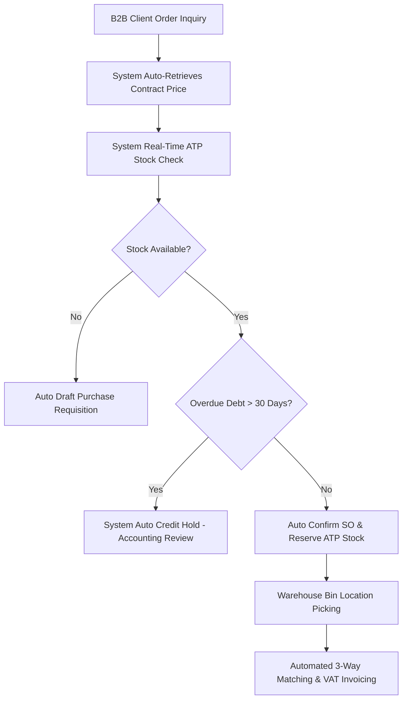

# FACULTY OF TECHNOLOGY — HOA SEN UNIVERSITY
## COURSE: BUSINESS SYSTEMS ANALYSIS (BSA) — ACADEMIC YEAR 2026–2027, SEMESTER 1

***

# PHASE 1 PROJECT REPORT ON
# BUSINESS REQUIREMENTS DOCUMENT (BRD) FOR B2B WHOLESALE & DISTRIBUTION: OFFICEPRO DISTRIBUTION CO., LTD.

**Submitted by Group 6:**
* **Vo Duy Binh (Student ID: 22301500)** — Team Leader / Lead Business Analyst & Systems Analyst
* **Pham Nguyen Gia Thuan (Student ID: 22204631)** — QA & Solution Configurator / Requirements Analyst

**Under The Guidance Of:** MSc. Nguyen Thi Thanh Thanh  
**Domain Scenario:** Scenario B — B2B Wholesale & Distribution (Office Supplies & Stationery)  
**Deliverable Scope:** **Phase 1 Mid-Term Assessment (Sections 1, 2, and 3 — 30% Course Weight)**  

***

## EXECUTIVE SUMMARY

OfficePro Distribution Co., Ltd. (**OfficePro Distribution**) is an established regional B2B wholesale distributor specializing in commercial office supplies, copy paper products, stationery, and printer consumables across Southern Vietnam. The enterprise currently serves over 250 active corporate clients, educational institutions, and retail stationery sub-dealers.

As the enterprise expands its B2B distribution network, it faces acute operational friction stemming from legacy manual practices: framework contract prices are scattered across individual sales representatives' personal spreadsheets, physical inventory receipts take 24–48 hours to be logged, and financial reconciliation relies on physical paper delivery slips. These disjointed procedures produce a 5–8% billing error rate on client invoices (costing ~50 million VND monthly in adjustments), trigger 3–4 post-confirmation stockout cancellations each week, and demand 15–20 hours weekly in manual 3-way invoice matching.

In strict compliance with the **BSA Course Project Guidelines for Phase 1**, this document delivers a comprehensive **Pure Business Systems Analysis (Sections 1, 2, and 3)** grounded in the **"Business-First → Technology-Second"** methodology:
1. **Section 1: Enterprise Context and Scope** establishes the wholesale business model, the 10-SKU Master Data catalog, customer segments, the three-facility network, in-scope/out-of-scope boundaries, and the Group RACI Governance Matrix.
2. **Section 2: Stakeholder Analysis & Elicitation** models the Power/Interest dynamics of organizational actors, bridges cross-functional perception gaps, details the Information Needs Matrix, and compiles the verified interview evidence log.
3. **Section 3: Business Process Analysis (AS-IS & TO-BE)** maps the current paper-bound workflow, diagnoses departmental bottlenecks, isolates root causes via the 5-Whys methodology, re-engineers an integrated TO-BE workflow, quantifies performance improvement targets, and establishes the prioritized MoSCoW Functional Requirements Catalog (`FR-01` through `FR-08`).

Per the Phase 1 assessment mandate, system configuration screenshots, ERP user manuals, and UAT execution logs are deferred to Phase 2, ensuring that this document focuses 100% on business problems, processes, and stakeholder needs.

***

## ACKNOWLEDGEMENTS

The project team would like to express our deepest gratitude to **MSc. Nguyen Thi Thanh Thanh** for her guidance, structured lectures, and academic supervision throughout the Business Systems Analysis course at Hoa Sen University. Her feedback during weekly workshops has been instrumental in shaping our understanding of enterprise process re-engineering and business requirements engineering.

***

## GLOSSARY & ABBREVIATIONS

| Abbreviation / Term | Full Name / Definition |
|---|---|
| **ATP** | Available-to-Promise Inventory (On-hand stock minus reservations plus scheduled inbound receipts) |
| **B2B** | Business-to-Business Wholesale Commerce |
| **BPMN** | Business Process Model and Notation (Standard visual modeling notation) |
| **BRD** | Business Requirements Document |
| **FR** | Functional Requirement |
| **Framework Agreement** | Annual master contract governing pricing, credit terms, and delivery commitments |
| **MoSCoW** | Prioritization Framework (Must have, Should have, Could have, Won't have) |
| **PO** | Purchase Order (Issued by OfficePro to upstream manufacturers) |
| **RACI** | Responsible, Accountable, Consulted, Informed Governance Matrix |
| **RFQ** | Request for Quotation (Supplier price solicitation) |
| **SKU** | Stock Keeping Unit (Unique product code) |
| **SO** | Sales Order (Commercial commitment issued to corporate clients) |
| **UoM** | Unit of Measure |

***

## TEAM MEMBERS & RACI GOVERNANCE MATRIX

*(R - Responsible | A - Accountable | C - Consulted | I - Informed)*

To ensure academic transparency and clear division of labor, Group 6 operates with two active members sharing balanced governance:

| Phase 1 Milestone / Deliverable Area | Vo Duy Binh (ID: 22301500)<br>Lead BA & Systems Analyst | Pham Nguyen Gia Thuan (ID: 22204631)<br>QA & Solution Configurator | RACI Operational Output |
|---|---|---|---|
| **Enterprise Profile & Scope Definition** | **Accountable / Responsible** | Responsible | 10 SKUs Master Data, facilities, and boundaries |
| **Stakeholder Elicitation & Info Needs** | **Accountable / Responsible** (Sales & Purchase) | Responsible (Warehouse & Accounting) | Interview logs & Information Needs Matrix |
| **AS-IS Process & Bottleneck Modeling** | **Accountable / Responsible** (Sales & Purchase) | Responsible (Inventory & Invoicing) | Cross-functional AS-IS BPMN diagrams |
| **5-Whys Root Cause Analysis** | **Accountable / Responsible** | Responsible | Multi-problem 5-Whys root cause breakdown |
| **TO-BE Process Re-engineering Design** | **Accountable / Responsible** | Responsible | Integrated TO-BE BPMN workflow |
| **MoSCoW Requirements Catalog Framing** | Responsible | **Accountable / Responsible** | FR-01 through FR-08 catalog definitions |
| **Phase 1 Master BRD Report Compilation** | **Accountable / Responsible** (Lead Author) | Responsible (QA Review & Editing) | Sections 1, 2, and 3 unified compilation |

***

# SECTION 1. ENTERPRISE CONTEXT AND SCOPE

## 1.1. Enterprise Profile & Wholesale Business Model

### Commercial Background and Market Position
**OfficePro Distribution Co., Ltd.** is a specialized regional B2B wholesale distributor operating across Southern Vietnam (Ho Chi Minh City, Dong Nai, Binh Duong, and surrounding industrial corridors). The company bridges upstream manufacturers and downstream institutional consumers, supplying over **250 active corporate clients**, higher education institutions, and stationery retail sub-dealers.

The wholesale operational model is built upon three structural pillars:
1. **High-Volume Upstream Procurement:** OfficePro purchases office stationery, commercial copy paper, and printer consumables in bulk pallets directly from certified manufacturers including Double A (Thailand/Vietnam), IK Plus (APP Indonesia), Thien Long Group, Pilot Corporation, and HP Vietnam.
2. **Annual Framework Agreements:** High-volume commercial accounts execute annual agreements establishing fixed contracted discount tiers, guaranteed replenishment lead times, and negotiated credit privileges.
3. **Commercial Credit Policy:** Qualified corporate accounts operate under standard **Net 30-day commercial payment terms**, allowing monthly billing cycles against verified delivery notes.

---

### Master Data Scope: 10 Domain Primary SKUs
To ground requirements engineering in concrete wholesale realities, OfficePro's core catalog comprises **10 primary SKUs** across four product categories:

| No. | SKU Code | Product Description | Category | UoM | Standard List Price (VND) | Contract Price Tier (VND) |
|---|---|---|---|---|---|---|
| 1 | `ST-001` | A4 Copy Paper Double A 70gsm (500 sheets/ream) | Paper Products | Ream | 75,000 | **65,000** |
| 2 | `ST-002` | A4 Copy Paper IK Plus 80gsm (500 sheets/ream) | Paper Products | Ream | 85,000 | **75,000** |
| 3 | `ST-003` | Thien Long TL-027 Blue Ballpoint Pen (Box of 20) | Writing Instruments | Box | 90,000 | **80,000** |
| 4 | `ST-004` | Pilot G2 Black Gel Pen 0.7mm (Box of 12) | Writing Instruments | Box | 320,000 | **290,000** |
| 5 | `ST-005` | King Jim A4 Display Book 60 Pockets | Filing Supplies | Piece | 45,000 | **38,000** |
| 6 | `ST-006` | Deli A5 Spiral Notebook 160 Pages | Filing Supplies | Piece | 35,000 | **29,000** |
| 7 | `ST-007` | Kangaro HD-10 Heavy Duty Stapler | Office Tools | Piece | 28,000 | **24,000** |
| 8 | `ST-008` | Kangaro No.10 Staples (Box of 20 small packs) | Office Tools | Big Box | 42,000 | **36,000** |
| 9 | `ST-009` | Original HP 107a Black Laser Toner Cartridge | Printer Consumables | Box | 1,150,000 | **1,050,000** |
| 10 | `ST-010` | Pentel WB1 Whiteboard Marker (Box of 12) | Writing Instruments | Box | 180,000 | **155,000** |

*Note on Business Logic:* For fast-moving anchor goods such as `ST-001`, the standard retail list price is 75,000 VND/ream. Under negotiated corporate framework agreements, corporate clients are legally billed at **65,000 VND/ream**. Ensuring that systems automatically enforce this 65,000 VND rate is essential to avoiding billing disputes.

---

### Target Customer Segments & Commercial Terms
1. **Corporate Enterprise Accounts (60% of Revenue):** Commercial offices, multinational corporations, and banks ordering monthly consolidated shipments. Governed by framework contracts, custom pricing tiers, and Net 30 payment terms.
2. **Educational Institutions (25% of Revenue):** Universities, vocational colleges, and international schools placing large seasonal batch orders prior to academic semesters. Disbursements tied to formal state/institutional invoice approval cycles.
3. **Stationery Sub-Dealers & Retailers (15% of Revenue):** Small local retail stationery stores purchasing medium reorder volumes under tiered wholesale quantity discounts.

---

### Facilities Network & Operational Hubs
* **Corporate Headquarters & Commercial Office:** District 3, Ho Chi Minh City. Houses Executive Leadership, B2B Account Representatives, Procurement Officers, and Finance & Accounting.
* **Central Distribution Warehouse (Tan Binh IP, HCMC):** Floor area of **2,500 m²**. Stores 80% of company inventory (bulk paper pallets and toner stocks). Functions as the primary inbound receiving dock and cross-docking terminal.
* **Regional Transit Depot (Bien Hoa 2 IP, Dong Nai):** Floor area of **800 m²**. Maintains fast-moving inventory to execute same-day deliveries to manufacturing enterprises across Dong Nai and Binh Duong industrial parks.

---

## 1.2. Business Objectives & Key Operational Challenges

### Quantified Business Objectives
* **Eliminate Contract Pricing Errors:** Reduce quotation pricing error rates from 5–8% down to **0%**.
* **Eliminate Post-Confirmation Stockouts:** Decrease post-confirmation order cancellations by **95%** via real-time Available-to-Promise (ATP) stock visibility.
* **Enforce Commercial Credit Compliance:** Enforce 100% automated credit locks on accounts with unpaid balances overdue > 30 days.
* **Accelerate Financial Matching:** Reduce accounting 3-way invoice matching duration by **90%**, dropping from 15–20 hours/week down to 2 hours/week.

### Primary Operational Challenges
1. **Contract Price Discrepancies:** Decentralized Excel price sheets cause reps to copy incorrect rates, triggering billing disputes and **50 million VND monthly** in credit note adjustments.
2. **Post-Confirmation Stockouts:** Reps commit to orders using morning stock dumps; 24–48 hour receiving backlogs cause **3–4 stockouts per week** post-confirmation.
3. **Manual 3-Way Matching:** Accounting manually matches paper Sales Orders, driver delivery notes, and PDF VAT invoices, expending **15–20 hours weekly**.

---

## 1.3. Enterprise Scope & Out-of-Scope Boundaries

### In-Scope (Phase 1 Pure Business Analysis)
* Analysis of B2B quotation workflows, contract pricelist agreements, and approval thresholds.
* Available-to-Promise (ATP) inventory visibility across Tan Binh and Bien Hoa facilities.
* Stock replenishment rules and automated draft purchase requisitions.
* Outbound warehouse order fulfillment, picking slip generation, and delivery handoffs.
* Accounts Receivable 3-way matching and Net 30 credit policy enforcement.

### Out-of-Scope (Strict Boundaries)
* Human Resources management, attendance tracking, and monthly payroll calculation.
* Complex multi-level Bill of Materials (BOM) manufacturing assembly.
* Point-of-Sale (POS) consumer retail cash register operations.
* International customs clearance and bonded freight logistics.

---

## 1.4. Individual Module Ownership Matrix

| Student Name | Student ID | Assigned Modules | Ownership & Deliverables |
|---|---|---|---|
| **Vo Duy Binh** | **22301500** | **Sales & Purchasing** | Lead BA & SA; Scope definition, contract pricing engine rules, quotation approval workflows, reorder point thresholds, purchase requisition workflows, AS-IS/TO-BE sales modeling, 5-Whys root cause analysis, master BRD authoring. |
| **Pham Nguyen Gia Thuan** | **22204631** | **Inventory & Invoicing** | QA & Solution Configurator; Multi-warehouse stock tracking, real-time ATP inventory logic, bin location routing, automated 3-way invoice matching, Net 30 credit control policy, MoSCoW requirements framing, QA review. |

***

# SECTION 2. STAKEHOLDER ANALYSIS & ELICITATION

## 2.1. Stakeholder Identification & Power/Interest Grid

```
                  HIGH POWER
                      |
     KEEP SATISFIED   |    MANAGE CLOSELY
   - Chief Accountant |  - Sales Manager
   - Purchasing Mgr   |  - Business Owner
----------------------+----------------------
      MONITOR         |    KEEP INFORMED
   - Sub-Dealers      |  - Sales Executives
   - External Vendors |  - Warehouse Keepers
                      |
                  LOW POWER ---------------> HIGH INTEREST
```

* **Manage Closely (High Power / High Interest):**
  * *Sales Manager:* Protects operating margins, enforces contract pricelists, and approves price discounts (> 5%).
  * *Business Owner:* Demands enterprise operational visibility, elimination of revenue leaks, and customer retention.
* **Keep Satisfied (High Power / Med Interest):**
  * *Chief Accountant:* Enforces strict adherence to Net 30 commercial credit terms and eliminates billing disputes through exact invoice reconciliation.
* **Keep Informed (Low Power / High Interest):**
  * *Warehouse Keeper:* Needs advance shipment schedules to organize receiving bays and structured picking slips.
  * *B2B Sales Representative:* Requires instant access to client contract rates and reliable real-time ATP stock availability.
* **Monitor (Low Power / Low Interest):** External paper suppliers and stationery retail sub-dealers.

---

## 2.2. Cross-Functional Information Needs Matrix

| Stakeholder Role | Key Information Required | Timing / Operational Trigger | Operational Decision Made |
|---|---|---|---|
| **B2B Sales Rep** | Customer-specific contract unit prices; Agreement validity dates. | Upon receiving corporate client inquiry via email or Zalo. | Issue binding quotation with accurate contract pricing without manual lookups. |
| **B2B Sales Rep** | Real-time Available-to-Promise (ATP) stock levels across both warehouses. | Before signing off and confirming customer Sales Order. | Commit to achievable delivery schedules without causing stockouts. |
| **Purchasing Manager** | Depletion alerts when stock hits reorder point; Vendor price/lead time data. | When ATP stock drops below minimum threshold (e.g., 100 reams for `ST-001`). | Issue vendor Purchase Orders (PO) to prevent stockouts on fast-movers. |
| **Warehouse Keeper** | Inbound supplier shipment schedules; Digital outbound picking lists. | Upon supplier truck arrival at dock; Upon order confirmation release. | Verify goods against PO; pick items accurately according to warehouse bin locations. |
| **AR Accountant** | Confirmed Sales Orders, signed Delivery Notes, customer payment ledgers. | Following order dispatch and goods delivery receipt. | Execute 3-way invoice matching; enforce Net 30 credit lock policies. |

---

## 2.3. Elicitation Summary & Verified Evidence Log

During requirement elicitation, Group 6 conducted structured interviews using AI Stakeholder Agents to validate project assumptions against wholesale realities:

| No. | Baseline Project Assumption | Elicitation Evidence Obtained (Stakeholder Interview) | Verification Status & Analytical Conclusion |
|---|---|---|---|
| **1** | Sales reps look up contract prices manually from Excel sheets. | Sales Manager confirmed reps maintain personal client Excel files and copy-paste rates, causing 5–8% pricing errors monthly. | **CONFIRMED**<br>Decentralized price records directly cause billing disputes and revenue leakage. |
| **2** | Sales confirms orders based on informal phone checks with Warehouse. | Sales Manager admitted reps rely on static morning Excel sheets or phone calls, causing 3–4 post-confirmation stockouts weekly. | **CONFIRMED**<br>Physical stock levels are invisible to sales during daily customer order entry. |
| **3** | Credit holds for overdue accounts (> 30 days) are automatically enforced. | Sales Manager clarified credit policy exists on paper, but reps frequently request verbal manager overrides to hit sales quotas. | **REVISED**<br>Credit policy exists formally, but enforcement is entirely manual and bypassable. |
| **4** | Stock replenishment is triggered automatically when stock is low. | Purchasing Manager stated replenishment is triggered manually via handwritten notes from warehouse staff after stock is low. | **CONFIRMED**<br>Procurement operates reactively rather than proactively. |

### Stakeholder Perspective Gaps (Simulation Findings)
* **Sales vs. Warehouse:** Sales asserts that warehouse stock records are always outdated, requiring phone verification. Warehouse counters that Sales confirms orders without checking actual stock and shifts blame when physical stock is exhausted.
* **Sales vs. Accounting:** Accounting notes that Sales frequently bypasses credit holds to capture sales, exposing the company to bad debt. Sales claims Accounting holds up legitimate orders from high-volume accounts.
* *Analytic Takeaway:* Operational friction occurs *at the interfaces between departments*, proving the necessity of an integrated cross-functional system.

***

# SECTION 3. BUSINESS PROCESS ANALYSIS (AS-IS & TO-BE)

## 3.1. Cross-Functional Process Overview (End-to-End Workflow)

$$\text{Upstream Supplier} \xrightarrow{\text{PO}} \text{Procurement} \xrightarrow{\text{Receipt}} \text{Warehouse Stock} \xrightarrow{\text{Contract SO}} \text{Sales} \xrightarrow{\text{Dispatch}} \text{Delivery} \xrightarrow{\text{3-Way Match}} \text{Accounting (VAT / Net 30)}$$

---

## 3.2. Current Business Processes & Departmental Bottlenecks (AS-IS BPMN)

```
[Client Email Inquiry] 
         │
         ▼
[1.0 Manual Excel Price Lookup] ──(5-8% copy-paste error rate)
         │
         ▼
[2.0 Verbal Phone Stock Check]  ──(24-48h receiving lag; invisible stock)
         │
         ▼
[3.0 Draft Quote & Print Paper SO] ──(Informal verbal override of Net 30 debt)
         │
         ▼
[4.0 Physical SO Handed to Warehouse] ──(Picking from memory; handwritten slips)
         │
         ▼
[5.0 Driver Returns Signed Note] ──(Accounting manually cross-checks SO + Note + Invoice: 15-20h/wk)
```

### Departmental Friction Points
* **Sales Silo:** Customer contract terms are isolated in individual reps' files. Quoting requires manual lookup, resulting in 5–8% billing errors and 50M VND in monthly dispute adjustments.
* **Warehouse Receiving Lag:** Inbound supplier shipments sit in receiving bays for 24–48 hours before being manually logged into spreadsheets, rendering new inventory invisible to sales.
* **Procurement Blindspot:** Replenishment is triggered reactively only after warehouse bins run empty; vendor RFQ comparisons take 2–3 days over manual email chains.
* **Finance Reconciliation Bottleneck:** Accounting expends 15–20 hours weekly cross-checking physical paper documents to issue VAT invoices, while overdue debt remains unblocked.

---

## 3.3. Root Cause Analysis (5-Whys Breakdown)

### 1. Contract Pricing Errors (5–8% Billing Discrepancies)
1. *Why are prices wrong?* Reps copy-paste unit prices manually from personal Excel files.
2. *Why personal Excel files?* Each sales rep maintains separate customer pricelists.
3. *Why separate files?* Framework contracts are stored as scanned PDFs on shared drives.
4. *Why scanned PDFs?* The enterprise lacks a centralized database mapping contracted SKUs to client accounts.
5. **Root Cause:** **Lack of a centralized contract-based pricing engine that automatically enforces contracted unit prices upon customer selection.**

### 2. Post-Confirmation Stockouts (3–4 Cancelled Orders/Week)
1. *Why stockouts post-confirmation?* Sales confirms orders based on morning stock sheets or phone calls.
2. *Why rely on phone/sheets?* Warehouse stock updates are entered in batch at the end of the day.
3. *Why end-of-day batch entry?* Inbound goods receiving requires manual paper ledger logging (taking 24–48 hours).
4. *Why manual paper check?* Warehouse receiving is not connected to inbound PO records in real time.
5. **Root Cause:** **Lack of a real-time Available-to-Promise (ATP) inventory visibility engine connecting Sales and Warehouse.**

### 3. Manual 3-Way Matching Overhead (15–20 Hours/Week)
1. *Why manual invoice reconciliation?* Accounting spends 15–20 hours/week cross-checking paper documents.
2. *Why paper cross-checking?* Delivery notes are signed on physical paper by truck drivers upon delivery.
3. *Why paper delivery notes?* Delivery receipts are not digitally captured in an integrated system.
4. *Why no digital matching?* Sales, Warehouse, and Invoicing operate in disconnected departmental silos.
5. **Root Cause:** **Lack of automated 3-way matching and hard credit hold control connecting Sales Orders, Delivery Confirmations, and Invoices.**

---

## 3.4. Proposed Future Business Processes (TO-BE Integrated Workflow)



### Core Automation Pillars of the TO-BE Workflow
1. **Automated Contract Pricelists:** Selecting a corporate account instantly applies agreed contract pricing (`ST-001` at 65,000 VND), completely eliminating copy-paste errors.
2. **Real-Time ATP Verification:** Validates available stock across Tan Binh and Bien Hoa warehouses prior to order confirmation, cutting post-confirmation stockouts by 95%.
3. **Automated Replenishment Rules:** When stock drops below reorder points (e.g., 100 reams), system auto-generates draft Purchase Requisitions for procurement.
4. **Hard Automated Credit Control:** Blocks order confirmation for accounts with unpaid debt overdue > 30 days.
5. **Automated 3-Way Matching:** Digital delivery confirmation automatically reconciles against Sales Orders and triggers customer VAT invoices.

---

## 3.5. AS-IS vs. TO-BE Operational Comparison

| Operational Dimension | Current AS-IS State (Manual / Fragmented) | Proposed TO-BE State (Integrated / Automated) | Target Business Improvement |
|---|---|---|---|
| **Contract Pricing Lookup** | Reps search personal Excel spreadsheets; manual copy-pasting. | System retrieves approved contract pricelist upon client selection. | **Pricing errors: 5–8% ➔ 0%** (Saves ~50M VND/month) |
| **Inventory Visibility** | Daily Excel summaries or verbal calls; 24–48h receiving entry delay. | Real-time Available-to-Promise (ATP) stock visible across both facilities. | **Stockouts: 3–4/week ➔ Reduced by 95%** |
| **Stock Replenishment** | Reactive purchasing triggered after warehouse stock physically exhausts. | Automated draft Purchase Requisitions generated when stock hits min threshold. | **Zero stockouts on fast-movers (`ST-001`)** |
| **Credit Enforcement** | Manual checks on paper; informal verbal overrides to hit sales quota. | Hard automated credit lock if customer debt is overdue > 30 days. | **100% Policy Adherence; Eliminates bad debt** |
| **Invoice Reconciliation** | Accounting spends 15–20 hours/week manually matching SOs and Delivery Notes. | Automated 3-way matching between digital SO, delivery confirmation & invoice. | **Matching time: 20h ➔ 2h/week (90% reduction)** |

---

## 3.6. Prioritized Functional Requirements Catalog (MoSCoW Framework)

Following the official Phase 1 requirements framing requirements, process gaps have been translated into prioritized Functional Requirements (`FR-01` through `FR-08`):

| Req ID | Module | Feature Description | MoSCoW Priority | Target Business Outcome |
|---|---|---|---|---|
| **FR-01** | Sales | System shall automatically retrieve customer contract pricelists upon client selection. | **MUST HAVE** | Eliminate 5–8% contract pricing errors and 50M VND dispute losses. |
| **FR-02** | Inventory | System shall display real-time ATP stock levels across Tan Binh and Bien Hoa warehouses. | **MUST HAVE** | Prevent 3–4 stockouts/week post-confirmation. |
| **FR-03** | Invoicing | System shall enforce automatic Credit Hold for accounts with overdue debt > 30 days. | **MUST HAVE** | Prevent bad debt accumulation and enforce AR credit policies. |
| **FR-04** | Purchasing | System shall generate draft Purchase Requisitions when stock falls below reorder points. | **MUST HAVE** | Automate stock replenishment for fast movers like Double A paper. |
| **FR-05** | Invoicing | System shall execute automated 3-way matching (SO + Delivery Note + Billing Invoice). | **MUST HAVE** | Reduce accounting matching overhead from 20h to 2h/week. |
| **FR-06** | Sales | System shall issue alerts 30 days prior to framework contract expiration dates. | **SHOULD HAVE** | Enable proactive contract renewals with corporate clients. |
| **FR-07** | Purchasing | System shall support multi-vendor RFQ price and lead-time comparison tables. | **SHOULD HAVE** | Optimize procurement cost and supplier selection. |
| **FR-08** | Invoicing | System shall provide executive Accounts Receivable aging debt analysis dashboards. | **COULD HAVE** | Provide executive financial visibility into cash flow and outstanding balances. |

***

# CONCLUSION & HANDOVER TO PHASE 2

## Phase 1 Deliverable Summary
This Phase 1 report has fulfilled all academic and professional requirements stipulated for the **Mid-Term Business Systems Analysis Assessment (Sections 1, 2, and 3)**:
1. **Established Enterprise Foundation:** Comprehensive profiling of OfficePro Distribution, 10 Master Data SKUs, facilities network, and RACI governance.
2. **Conducted Stakeholder Elicitation:** Detailed Information Needs Matrix and verified interview evidence log uncovering core friction points.
3. **Diagnosed Root Causes:** Systematic 5-Whys analysis connecting business symptoms to structural deficiencies.
4. **Engineered TO-BE Architecture:** Seamless cross-functional TO-BE process map and prioritized MoSCoW requirements catalog (`FR-01` to `FR-08`).

## Roadmap & Handover to Phase 2
In accordance with course guidelines, the functional requirements framed in this document will serve as direct inputs for **Phase 2 (Weeks 10–15)**:
* **Section 4 (Weeks 10–11):** Enterprise Use Case Diagram, Detailed Use Case Specifications (`UC-SALES-01`, `UC-PURCH-01`, `UC-INV-01`, `UC-INV-03`), Business Rules (`BR-01` to `BR-04`), and Requirements Traceability Matrix (RTM).
* **ERP Prototyping & UAT (Weeks 12–13):** Odoo ERP core module configuration (Sales, Purchase, Inventory, Invoicing) with domain SKU Master Data, and execution of Peer UAT test logs (`TC-01` to `TC-04`).
* **Final Defense (Weeks 14–15):** Comprehensive live system demonstration and oral defense.

***

# REFERENCES
1. Valacich, J. S., George, J. F., & Hoffer, J. A. (2024). *Modern Systems Analysis and Design* (10th ed.). Pearson.
2. Satzinger, J. W., Jackson, R. B., & Burd, S. D. (2018). *Systems Analysis and Design in a Changing World* (8th ed.). Cengage Learning.
3. International Institute of Business Analysis (IIBA). (2015). *A Guide to the Business Analysis Body of Knowledge (BABOK Guide)* (3rd ed.). IIBA.
4. Microsoft Corporation. *Dynamics 365 Guidance*. Microsoft Learn.

***

# APPENDICES

## Appendix A. Raw Stakeholder Interview Transcripts & Evidence Notes
* **Sales Department Interview (Sales Manager — Interviewed by Vo Duy Binh):** Confirmed decentralized Excel pricelists, verbal phone calls for stock verification, and informal credit override practices.
* **Purchasing Department Interview (Purchasing Manager — Interviewed by Vo Duy Binh):** Confirmed reactive purchasing triggered only after stock runs out, and 2–3 day email RFQ negotiations.
* **Warehouse Department Interview (Warehouse Keeper — Interviewed by Pham Nguyen Gia Thuan):** Confirmed 24–48 hour receiving delay, picking from memory without bin codes, and paper delivery notes.
* **Accounting Department Interview (Chief Accountant — Interviewed by Pham Nguyen Gia Thuan):** Confirmed 15–20 hours weekly spent on manual 3-way invoice matching and difficulties tracking partial payments.

## Appendix B. Individual Contribution Sign-off
Both active group members (**Vo Duy Binh - 22301500** and **Pham Nguyen Gia Thuan - 22204631**) contributed equally to the research, process analysis, BPMN modeling, and report compilation under the leadership of **Vo Duy Binh**.
