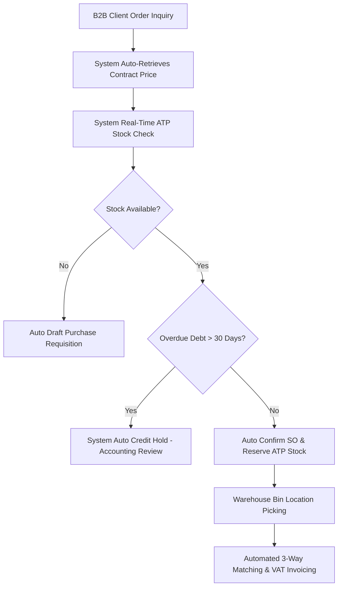

# FACULTY OF TECHNOLOGY — HOA SEN UNIVERSITY
## COURSE: BUSINESS SYSTEMS ANALYSIS (BSA) — ACADEMIC YEAR 2026–2027, SEMESTER 1

***

# PROJECT REPORT ON
# BUSINESS REQUIREMENTS DOCUMENT (BRD) FOR B2B WHOLESALE & DISTRIBUTION (OFFICE SUPPLIES & STATIONERY): OFFICEPRO DISTRIBUTION CO., LTD.

**Submitted by Group 6:**
* **Vo Duy Binh (Student ID: 22301500)** — Team Leader / Lead Business Analyst & Systems Analyst
* **Pham Nguyen Gia Thuan (Student ID: 22204631)** — QA & Solution Configurator / Requirements Analyst

**Under The Guidance Of:** MSc. Nguyen Thi Thanh Thanh  
**Course Domain:** Scenario B — B2B Wholesale & Distribution (Office Supplies & Stationery)  
**Deliverable Milestone:** **Phase 1 Mid-Term Assessment (Sections 1, 2, and 3 + Requirements Catalog — 30% Course Weight)**  
**Submission Date:** October 2026  

***

## EXECUTIVE SUMMARY

OfficePro Distribution Co., Ltd. (**OfficePro Distribution**) is an established regional B2B wholesale distributor specializing in commercial office supplies, copy paper products, stationery, and printer consumables across Southern Vietnam. The enterprise currently serves over 250 active corporate clients, educational institutions, and retail stationery sub-dealers.

As the enterprise expands its distribution network, it faces acute operational friction stemming from legacy manual practices: framework contract prices are scattered across individual sales representatives' personal spreadsheets, physical inventory receipts take 24–48 hours to be logged, and financial reconciliation relies on physical paper delivery slips. These disjointed procedures produce a 5–8% billing error rate on client invoices (costing ~50 million VND monthly in adjustments), trigger 3–4 post-confirmation stockout cancellations each week, and demand 15–20 hours weekly in manual 3-way invoice matching.

In strict compliance with the **BSA Course Project Guidelines for Phase 1**, this document delivers a comprehensive **Pure Business Systems Analysis** structured to mirror the official university BRD template:
1. **Section 1: Enterprise Context and Scope** establishes the wholesale business model, the 10-SKU Master Data catalog, customer segments, organizational structure, physical facilities network, project boundaries, and the Group RACI Governance Matrix.
2. **Section 2: Stakeholder Analysis & Elicitation** models the Power/Interest dynamics of organizational actors, bridges cross-functional perception gaps, details the Information Needs Matrix, and compiles the verified interview evidence log.
3. **Section 3: Business Process Analysis (AS-IS & TO-BE)** maps the current paper-bound workflow across Sales, Inventory, Purchasing, and Invoicing; diagnoses departmental bottlenecks; isolates root causes via the 5-Whys methodology; re-engineers an integrated TO-BE workflow by module; and quantifies performance improvement targets.
4. **Section 4.1: System Feature Catalog (Functional Requirements List)** frames the prioritized MoSCoW Functional Requirements Catalog (`FR-01` through `FR-08`), establishing the baseline for Phase 2 system mapping.

Per the Phase 1 assessment mandate, system configuration screenshots, ERP user manuals, and UAT execution logs are deferred to Phase 2, ensuring that this document focuses 100% on business problems, processes, and stakeholder needs.

***

## ACKNOWLEDGEMENTS

The project team would like to express our deepest gratitude to **MSc. Nguyen Thi Thanh Thanh** for her guidance, structured lectures, and academic supervision throughout the Business Systems Analysis course at Hoa Sen University. Her feedback during weekly workshops has been instrumental in shaping our understanding of enterprise process re-engineering and business requirements engineering.

***

## GLOSSARY & ABBREVIATIONS

| Abbreviation / Term | Full Name / Definition |
|---|---|
| **ATP** | Available-to-Promise Inventory (On-hand stock minus reservations plus scheduled inbound receipts) |
| **B2B** | Business-to-Business Wholesale Commerce |
| **BPMN** | Business Process Model and Notation (Standard visual modeling notation) |
| **BRD** | Business Requirements Document |
| **FR** | Functional Requirement |
| **Framework Agreement** | Annual master contract governing pricing, credit terms, and delivery commitments |
| **MoSCoW** | Prioritization Framework (Must have, Should have, Could have, Won't have) |
| **PO** | Purchase Order (Issued by OfficePro to upstream manufacturers) |
| **RACI** | Responsible, Accountable, Consulted, Informed Governance Matrix |
| **RFQ** | Request for Quotation (Supplier price solicitation) |
| **SKU** | Stock Keeping Unit (Unique product identification code) |
| **SO** | Sales Order (Commercial commitment issued to corporate clients) |
| **UoM** | Unit of Measure |

***

## TEAM MEMBERS & MODULE ASSIGNMENT MATRIX

*(R - Responsible | A - Accountable | C - Consulted | I - Informed)*

To ensure academic transparency and clear division of labor, Group 6 operates with two active members sharing balanced governance:

| Student Name | Student ID | Primary Focus / Assigned Modules | Role in Project | RACI Status |
|---|---|---|---|---|
| **Vo Duy Binh** | **22301500** | **Sales & Purchasing** | Team Leader / Lead BA & SA | **A / R** (Sales, Purchasing & Master BRD) |
| **Pham Nguyen Gia Thuan** | **22204631** | **Inventory & Invoicing** | QA & Solution Configurator | **A / R** (Inventory, Invoicing & Requirements QA) |

### Detailed Phase 1 Deliverable Responsibilities:
* **Vo Duy Binh (Lead BA & Systems Analyst):**
  - Section 1: Enterprise Profile, Case Background, Scope Boundaries, and RACI Matrix setup.
  - Section 2: AI Stakeholder Elicitation (Sales Manager & Purchasing Manager interviews), Sales Information Needs.
  - Section 3: AS-IS Process Modeling for Sales & Purchasing, 5-Whys Root Cause Analysis, TO-BE Process Design, and Master BRD Authoring.
* **Pham Nguyen Gia Thuan (QA & Solution Configurator):**
  - Section 1: Facilities Network Definition and 10 SKUs Master Data catalog review.
  - Section 2: AI Stakeholder Elicitation (Warehouse Keeper & Chief Accountant interviews), Cross-Functional Information Needs Matrix.
  - Section 3: AS-IS Process Modeling for Inventory & Invoicing, AS-IS vs. TO-BE Operational Comparison Table.
  - Section 4: System Feature Catalog (MoSCoW Prioritized Requirements `FR-01` to `FR-08`) and Quality Assurance review.

***

# SECTION 1. ENTERPRISE CONTEXT AND SCOPE

## 1.1. Enterprise Profile

### Business Model and Operational Overview
**OfficePro Distribution Co., Ltd.** is a specialized regional B2B wholesale distributor operating across Southern Vietnam (Ho Chi Minh City, Dong Nai, Binh Duong, and surrounding industrial manufacturing corridors). The company bridges upstream manufacturers and downstream corporate consumers, supplying over **250 active corporate accounts**, higher education institutions, and stationery retail sub-dealers.

The wholesale operational model is built upon three structural pillars:
1. **High-Volume Upstream Procurement:** OfficePro purchases commercial stationery, copy paper products, and printer consumables in bulk pallets directly from certified manufacturers including Double A (Thailand/Vietnam), IK Plus (APP Indonesia), Thien Long Group, Pilot Corporation, and HP Vietnam.
2. **Annual Framework Agreements:** High-volume commercial accounts execute annual agreements establishing fixed contracted discount tiers, guaranteed replenishment lead times, and negotiated credit privileges.
3. **Commercial Credit Policy:** Qualified corporate accounts operate under standard **Net 30-day commercial payment terms**, allowing monthly billing cycles against verified delivery notes.

---

### Products, Services, and Target Customers

#### 1. Master Data Scope: 10 Primary SKUs
To ground requirements engineering in concrete wholesale realities, OfficePro's core catalog comprises **10 primary SKUs** across four product categories:

| No. | SKU Code | Product Description | Category | UoM | Standard List Price (VND) | Contract Price Tier (VND) |
|---|---|---|---|---|---|---|
| 1 | `ST-001` | A4 Copy Paper Double A 70gsm (500 sheets/ream) | Paper Products | Ream | 75,000 | **65,000** |
| 2 | `ST-002` | A4 Copy Paper IK Plus 80gsm (500 sheets/ream) | Paper Products | Ream | 85,000 | **75,000** |
| 3 | `ST-003` | Thien Long TL-027 Blue Ballpoint Pen (Box of 20) | Writing Instruments | Box | 90,000 | **80,000** |
| 4 | `ST-004` | Pilot G2 Black Gel Pen 0.7mm (Box of 12) | Writing Instruments | Box | 320,000 | **290,000** |
| 5 | `ST-005` | King Jim A4 Display Book 60 Pockets | Filing Supplies | Piece | 45,000 | **38,000** |
| 6 | `ST-006` | Deli A5 Spiral Notebook 160 Pages | Filing Supplies | Piece | 35,000 | **29,000** |
| 7 | `ST-007` | Kangaro HD-10 Heavy Duty Stapler | Office Tools | Piece | 28,000 | **24,000** |
| 8 | `ST-008` | Kangaro No.10 Staples (Box of 20 small packs) | Office Tools | Big Box | 42,000 | **36,000** |
| 9 | `ST-009` | Original HP 107a Black Laser Toner Cartridge | Printer Consumables | Box | 1,150,000 | **1,050,000** |
| 10 | `ST-010` | Pentel WB1 Whiteboard Marker (Box of 12) | Writing Instruments | Box | 180,000 | **155,000** |

*Note on B2B Pricing Logic:* In wholesale distribution, legal framework agreements guarantee discounted price tiers. For fast-mover `ST-001` Double A Paper, the standard retail list price is 75,000 VND/ream, but corporate contract clients are legally billed at **65,000 VND/ream**. Ensuring that systems automatically enforce this 65,000 VND rate upon customer selection is essential to eliminating invoice disputes.

#### 2. Target Customer Segments
1. **Corporate Enterprise Accounts (60% of Revenue):** Commercial offices, multinational corporations, and banks ordering monthly consolidated shipments. Governed by framework contracts, custom pricing tiers, and Net 30 payment terms.
2. **Educational Institutions (25% of Revenue):** Universities, vocational colleges, and international schools placing large seasonal batch orders prior to academic semesters. Disbursements tied to formal state/institutional invoice approval cycles.
3. **Stationery Sub-Dealers & Retailers (15% of Revenue):** Small local retail stationery stores purchasing medium reorder volumes under tiered wholesale quantity discounts.

---

### Organizational Structure and Key Roles

```
                     ┌────────────────────────┐
                     │   Board of Directors   │
                     │    / Business Owner    │
                     └───────────┬────────────┘
                                 │
         ┌───────────────────────┼───────────────────────┐
         │                       │                       │
┌────────┴────────┐     ┌────────┴────────┐     ┌────────┴────────┐
│   Sales Dept    │     │Purchasing Dept  │     │ Warehouse Dept  │
│ (Sales Manager  │     │ (Procurement    │     │(Warehouse Keeper│
│  & B2B Reps)    │     │    Officer)     │     │ & Dispatchers)  │
└─────────────────┘     └─────────────────┘     └─────────────────┘
                                 │
                        ┌────────┴────────┐
                        │ Accounting Dept │
                        │(Chief Accountant│
                        │ & AR Officers)  │
                        └─────────────────┘
```

* **Executive Leadership (Business Owner):** Oversees strategic growth, operating margins, capital allocation, and client retention.
* **Sales Department (Sales Manager & B2B Reps):** Manages corporate client framework contracts, negotiates pricing tiers, issues quotations, and inputs Sales Orders.
* **Purchasing Department (Procurement Manager):** Monitors inventory depletion, solicits supplier RFQs, compares vendor costs/lead-times, and issues Purchase Orders.
* **Warehouse & Logistics Department (Warehouse Keeper & Logistics Staff):** Manages inbound receiving inspection, pallet storage, bin picking/packing, and delivery handoffs.
* **Finance & Accounting Department (Chief Accountant & AR Accountants):** Validates 3-way invoice matching, monitors customer credit limits, issues VAT electronic invoices, and enforces Net 30 debt collection.

#### Facilities Network & Operational Hubs
* **Corporate Headquarters & Commercial Office:** District 3, Ho Chi Minh City. Houses Executive Leadership, B2B Account Representatives, Procurement Officers, and Finance & Accounting.
* **Central Distribution Warehouse (Tan Binh IP, HCMC):** Total floor area: **2,500 m²**. Stores 80% of palletized stock (paper pallets, toner cartridges). Functions as the primary supplier receiving dock and cross-docking terminal.
* **Regional Transit Depot (Bien Hoa 2 IP, Dong Nai):** Total floor area: **800 m²**. Maintains fast-moving stock to execute same-day deliveries to manufacturing enterprises across Dong Nai and Binh Duong industrial parks.

---

## 1.2. Business Objectives & Key Operational Challenges

### Quantified Business Objectives
* **Eliminate Contract Pricing Errors:** Reduce quotation pricing error rates from 5–8% down to **0%**.
* **Eliminate Post-Confirmation Stockouts:** Decrease post-confirmation order cancellations by **95%** via real-time Available-to-Promise (ATP) stock visibility.
* **Enforce Commercial Credit Compliance:** Enforce 100% automated credit locks on accounts with unpaid balances overdue > 30 days.
* **Accelerate Financial Matching:** Reduce accounting 3-way invoice matching duration by **90%**, dropping from 15–20 hours/week down to 2 hours/week.

### Primary Operational Challenges
1. **Contract Price Discrepancies:** Decentralized Excel price sheets cause reps to copy incorrect rates, triggering billing disputes and **50 million VND monthly** in credit note adjustments.
2. **Post-Confirmation Stockouts:** Reps commit to orders using morning stock dumps; 24–48 hour receiving backlogs cause **3–4 stockouts per week** post-confirmation.
3. **Manual 3-Way Matching:** Accounting manually matches paper Sales Orders, driver delivery notes, and PDF VAT invoices, expending **15–20 hours weekly**.

---

## 1.3. Enterprise Scope & Out-of-Scope Boundaries

### In-Scope (Phase 1 Pure Business Analysis)
* Analysis of B2B quotation workflows, contract pricelist agreements, and approval thresholds.
* Available-to-Promise (ATP) inventory visibility across Tan Binh and Bien Hoa facilities.
* Stock replenishment rules and automated draft purchase requisitions.
* Outbound warehouse order fulfillment, picking slip generation, and delivery handoffs.
* Accounts Receivable 3-way matching and Net 30 credit policy enforcement.

### Out-of-Scope (Strict Boundaries)
* Human Resources management, attendance tracking, and monthly payroll calculation.
* Complex multi-level Bill of Materials (BOM) manufacturing assembly.
* Point-of-Sale (POS) consumer retail cash register operations.
* International customs clearance and bonded freight logistics.

---

## 1.4. Individual Module Ownership Matrix (Student Name <-> Assigned Module)

| Student Name | Student ID | Assigned Core Modules | Primary Phase 1 Responsibilities |
|---|---|---|---|
| **Vo Duy Binh** | **22301500** | **Sales & Purchasing** | Scope definition, contract pricing engine rules, quotation approval workflows, reorder point thresholds, purchase requisition workflows, AS-IS/TO-BE sales modeling, 5-Whys root cause analysis, master BRD authoring. |
| **Pham Nguyen Gia Thuan** | **22204631** | **Inventory & Invoicing** | Multi-warehouse stock tracking, real-time ATP inventory logic, bin location routing, automated 3-way invoice matching, Net 30 credit control policy, MoSCoW requirements framing, QA review. |

***

# SECTION 2. STAKEHOLDER ANALYSIS & ELICITATION

## 2.1. Stakeholder Identification & Power/Interest Grid

```
                  HIGH POWER
                      |
     KEEP SATISFIED   |    MANAGE CLOSELY
   - Chief Accountant |  - Sales Manager
   - Purchasing Mgr   |  - Business Owner
----------------------+----------------------
      MONITOR         |    KEEP INFORMED
   - Sub-Dealers      |  - Sales Executives
   - External Vendors |  - Warehouse Keepers
                      |
                  LOW POWER ---------------> HIGH INTEREST
```

* **Manage Closely (High Power / High Interest):**
  * *Sales Manager:* Protects operating margins, enforces contract pricelists, and approves price discounts (> 5%).
  * *Business Owner:* Demands enterprise operational visibility, elimination of revenue leaks, and customer retention.
* **Keep Satisfied (High Power / Med Interest):**
  * *Chief Accountant:* Enforces strict adherence to Net 30 commercial credit terms and eliminates billing disputes through exact invoice reconciliation.
* **Keep Informed (Low Power / High Interest):**
  * *Warehouse Keeper:* Needs advance shipment schedules to organize receiving bays and structured picking slips.
  * *B2B Sales Representative:* Requires instant access to client contract rates and reliable real-time ATP stock availability.
* **Monitor (Low Power / Low Interest):** External paper suppliers and stationery retail sub-dealers.

### Stakeholder Perspective Gaps (Simulation Findings)
* **Sales vs. Warehouse:** Sales asserts that warehouse stock records are always outdated, requiring phone verification. Warehouse counters that Sales confirms orders without checking actual stock and shifts blame when physical stock is exhausted.
* **Sales vs. Accounting:** Accounting notes that Sales frequently bypasses credit holds to capture sales, exposing the company to bad debt. Sales claims Accounting holds up legitimate orders from high-volume accounts.
* *Analytic Takeaway:* Operational friction occurs *at the interfaces between departments*, proving the necessity of an integrated cross-functional system.

---

## 2.2. Elicitation Summary & Verified Evidence Log (Verified Evidence vs. Initial Assumptions)

During requirement elicitation, Group 6 conducted structured interviews using AI Stakeholder Agents to validate project assumptions against wholesale realities:

| No. | Baseline Project Assumption | Elicitation Evidence Obtained (Stakeholder Interview) | Verification Status & Analytical Conclusion |
|---|---|---|---|
| **1** | Sales reps look up contract prices manually from Excel sheets. | Sales Manager confirmed reps maintain personal client Excel files and copy-paste rates, causing 5–8% pricing errors monthly. | **CONFIRMED**<br>Decentralized price records directly cause billing disputes and revenue leakage. |
| **2** | Sales confirms orders based on informal phone checks with Warehouse. | Sales Manager admitted reps rely on static morning Excel sheets or phone calls, causing 3–4 post-confirmation stockouts weekly. | **CONFIRMED**<br>Physical stock levels are invisible to sales during daily customer order entry. |
| **3** | Credit holds for overdue accounts (> 30 days) are automatically enforced. | Sales Manager clarified credit policy exists on paper, but reps frequently request verbal manager overrides to hit sales quotas. | **REVISED**<br>Credit policy exists formally, but enforcement is entirely manual and bypassable. |
| **4** | Stock replenishment is triggered automatically when stock is low. | Purchasing Manager stated replenishment is triggered manually via handwritten notes from warehouse staff after stock is low. | **CONFIRMED**<br>Procurement operates reactively rather than proactively. |

---

### Cross-Functional Information Needs Matrix

| Stakeholder Role | Key Information Required | Timing / Operational Trigger | Operational Decision Made |
|---|---|---|---|
| **B2B Sales Rep** | Customer-specific contract unit prices; Agreement validity dates. | Upon receiving corporate client inquiry via email or Zalo. | Issue binding quotation with accurate contract pricing without manual lookups. |
| **B2B Sales Rep** | Real-time Available-to-Promise (ATP) stock levels across both warehouses. | Before signing off and confirming customer Sales Order. | Commit to achievable delivery schedules without causing stockouts. |
| **Purchasing Manager** | Depletion alerts when stock hits reorder point; Vendor price/lead time data. | When ATP stock drops below minimum threshold (e.g., 100 reams for `ST-001`). | Issue vendor Purchase Orders (PO) to prevent stockouts on fast-movers. |
| **Warehouse Keeper** | Inbound supplier shipment schedules; Digital outbound picking lists. | Upon supplier truck arrival at dock; Upon order confirmation release. | Verify goods against PO; pick items accurately according to warehouse bin locations. |
| **AR Accountant** | Confirmed Sales Orders, signed Delivery Notes, customer payment ledgers. | Following order dispatch and goods delivery receipt. | Execute 3-way invoice matching; enforce Net 30 credit lock policies. |

***

# SECTION 3. BUSINESS PROCESS ANALYSIS (AS-IS & TO-BE)

## 3.1. Cross-Functional Process Overview (End-to-End Workflow)

$$\text{Upstream Supplier} \xrightarrow{\text{PO}} \text{Procurement} \xrightarrow{\text{Receipt}} \text{Warehouse Stock} \xrightarrow{\text{Contract SO}} \text{Sales} \xrightarrow{\text{Dispatch}} \text{Delivery} \xrightarrow{\text{3-Way Match}} \text{Accounting (VAT / Net 30)}$$

The current wholesale process operates across four functional departments: Sales, Purchasing, Warehouse, and Invoicing. Currently, each departmental handoff requires physical transit of paperwork, unrecorded phone calls, or manual copy-pasting between spreadsheets, creating severe information delays and high operational error rates.

---

## 3.2. Current Business Processes & Bottlenecks (AS-IS BPMN by Module)

### Module 1: Sales — AS-IS BPMN & Friction Points
* **Process Flow:** Client sends email/Zalo RFQ ➔ Sales Rep opens personal Excel pricelist ➔ Rep calls warehouse keeper to check inventory verbally ➔ Rep drafts quote in Excel ➔ Client approves via email ➔ Rep prints physical paper Sales Order.
* **Friction Points:**
  - *Contract Pricing Errors:* Decentralized spreadsheets cause a **5–8% rate discrepancy** on client invoices, leading to ~50 million VND monthly in billing adjustments.
  - *Order Confirmation Stockouts:* Reps confirm delivery dates without real-time stock data, leading to **3–4 stockouts per week post-confirmation**.
  - *Credit Policy Bypass:* Reps obtain verbal manager approvals to bypass paper credit holds for clients with overdue balances > 30 days to hit sales quotas.

### Module 2: Inventory — AS-IS BPMN & Friction Points
* **Process Flow:** Supplier delivery truck arrives at receiving dock ➔ Goods held 24–48 hours in receiving bay ➔ Warehouse clerk manually checks paper packing list against PO ➔ Items moved to shelves from memory (no bin codes) ➔ Clerk batch-updates spreadsheet at day's end ➔ Picking for sales orders executed from printed paper slips.
* **Friction Points:**
  - *Receiving Information Lag:* Newly arrived stock remains "invisible" to sales for **24 to 48 hours**, causing unnecessary stockout rejections.
  - *Picking Mix-ups:* Staff pick from memory without barcode scanners or designated bin location routing, leading to frequent errors between similar SKUs (`ST-001` 70gsm vs. `ST-002` 80gsm).

### Module 3: Purchasing — AS-IS BPMN & Friction Points
* **Process Flow:** Warehouse keeper observes empty shelves ➔ Handwrites note to Procurement ➔ Purchasing officer checks vendor catalogs ➔ Sends RFQ emails to 3 suppliers ➔ Compares prices manually in Excel ➔ Generates and emails vendor Purchase Order (PO).
* **Friction Points:**
  - *Reactive Replenishment:* Purchasing is triggered only after physical stockouts occur, leading to 3–5 day replenishment delays on fast-movers like Double A paper.
  - *Lengthy RFQ Comparison:* Comparing vendor quotations over unstructured email threads takes **2 to 3 days**, delaying stock replenishment.

### Module 4: Invoicing — AS-IS BPMN & Friction Points
* **Process Flow:** Driver delivers stationery to customer ➔ Customer signs paper Delivery Note ➔ Driver returns signed slip to Accounting ➔ Accountant manually cross-checks line items on paper SO, Delivery Note, and Billing Invoice ➔ Accountant manually creates VAT electronic invoice.
* **Friction Points:**
  - *Labor-Intensive 3-Way Matching:* Accounting expends **15 to 20 hours every week** manually reconciling line items across paper documents.
  - *Delayed Credit Enforcement:* Without system-enforced credit holds, overdue corporate accounts continue ordering, accumulating bad debt risk.

---

### Proposed Process Improvements (AS-IS vs. TO-BE Operational Comparison)

| Operational Dimension | Current AS-IS State (Manual / Fragmented) | Proposed TO-BE State (Integrated / Automated) | Target Business Improvement |
|---|---|---|---|
| **Contract Pricing Lookup** | Reps search personal Excel spreadsheets; manual copy-pasting. | System retrieves approved contract pricelist upon client selection. | **Pricing errors: 5–8% ➔ 0%** (Saves ~50M VND/month) |
| **Inventory Visibility** | Daily Excel summaries or verbal calls; 24–48h receiving entry delay. | Real-time Available-to-Promise (ATP) stock visible across both facilities. | **Stockouts: 3–4/week ➔ Reduced by 95%** |
| **Stock Replenishment** | Reactive purchasing triggered after warehouse stock physically exhausts. | Automated draft Purchase Requisitions generated when stock hits min threshold. | **Zero stockouts on fast-movers (`ST-001`)** |
| **Credit Enforcement** | Manual checks on paper; informal verbal overrides to hit sales quota. | Hard automated credit lock if customer debt is overdue > 30 days. | **100% Policy Adherence; Eliminates bad debt** |
| **Invoice Reconciliation** | Accounting spends 15–20 hours/week manually matching SOs and Delivery Notes. | Automated 3-way matching between digital SO, delivery confirmation & invoice. | **Matching time: 20h ➔ 2h/week (90% reduction)** |

---

## 3.3. Root Cause Analysis (5-Whys / Fishbone per Module)

### 1. Sales Module (Contract Pricing Errors: 5–8% Error Rate)
1. *Why are prices wrong on customer invoices?* Reps copy-paste unit prices manually from personal Excel spreadsheets into quotes.
2. *Why personal Excel spreadsheets?* Each sales rep maintains separate customer pricelists for their assigned corporate accounts.
3. *Why separate files per rep?* Signed framework agreements are stored as static scanned PDFs on shared network folders.
4. *Why scanned PDFs without central rules?* The company lacks a centralized database mapping contracted SKUs and pricing tiers directly to client accounts.
5. **Root Cause:** **Lack of a centralized contract-based pricing engine that automatically enforces contracted unit prices upon customer selection.**

### 2. Inventory Module (Post-Confirmation Stockouts: 3–4 Orders/Week)
1. *Why do confirmed orders experience stockouts?* Sales confirms delivery dates based on outdated morning stock sheets or informal phone calls.
2. *Why rely on outdated sheets/calls?* Warehouse inventory updates are entered into spreadsheets in batch at the end of the day.
3. *Why end-of-day batch entry?* Inbound goods receiving requires manual paper ledger logging (taking 24–48 hours).
4. *Why manual paper receiving?* Warehouse receiving docks operate disconnected from purchase order records in real time.
5. **Root Cause:** **Lack of a real-time Available-to-Promise (ATP) inventory visibility engine connecting Sales and Warehouse.**

### 3. Invoicing Module (Manual 3-Way Matching Overhead: 15–20 Hours/Week)
1. *Why does invoice reconciliation take 15–20 hours weekly?* Accounting manually compares paper Delivery Notes, Sales Orders, and Invoices.
2. *Why manual cross-checking?* Delivery receipts are signed on physical paper by truck drivers upon delivery and submitted in batches.
3. *Why paper delivery receipts?* Delivery confirmations are not captured digitally in an integrated system.
4. *Why no digital matching?* Sales, Warehouse, and Invoicing operate in disconnected departmental silos.
5. **Root Cause:** **Lack of automated 3-way matching and hard credit hold control connecting Sales Orders, Delivery Confirmations, and Invoices.**

---

## 3.4. Proposed Future Business Processes (TO-BE BPMN by Module)



### Module Breakdown of TO-BE Integrated Workflow:
* **Module 1: Sales (TO-BE):** Selecting a B2B corporate account automatically loads their framework contract pricelist (e.g., `ST-001` at 65,000 VND). The system verifies real-time Available-to-Promise (ATP) stock across Tan Binh and Bien Hoa facilities. If debt is overdue > 30 days, the system applies a hard Credit Hold. Otherwise, order confirmation automatically reserves physical stock.
* **Module 2: Inventory (TO-BE):** Real-time stock status syncs immediately upon goods receipt at dock. Pickers receive digital picking slips with optimized bin location routes, eliminating picking mix-ups between `ST-001` and `ST-002`. Outbound dispatch logs trigger digital delivery confirmations.
* **Module 3: Purchasing (TO-BE):** Reorder point rules monitor fast-movers like Double A paper. When ATP stock drops below 100 reams, the system auto-generates a draft Purchase Requisition and RFQ comparison matrix, cutting procurement lead times from 5 days to 24 hours.
* **Module 4: Invoicing (TO-BE):** Upon customer delivery sign-off, the system performs automated 3-way matching between the digital SO, Delivery Note, and draft invoice, automatically issuing VAT invoices and reducing accounting overhead from 20 hours to 2 hours per week.

***

# SECTION 4. FUNCTIONAL REQUIREMENTS AND USE CASES

## 4.1. System Feature Catalog (Functional Requirements List — MoSCoW Framework)

In accordance with Phase 1 requirements framing requirements, process gaps have been translated into a prioritized Functional Requirements Catalog (`FR-01` through `FR-08`):

| Req ID | Module | Feature Description | MoSCoW Priority | Target Business Outcome |
|---|---|---|---|---|
| **FR-01** | Sales | System shall automatically retrieve customer contract pricelists upon client selection. | **MUST HAVE** | Eliminate 5–8% contract pricing errors and 50M VND dispute losses. |
| **FR-02** | Inventory | System shall display real-time ATP stock levels across Tan Binh and Bien Hoa warehouses. | **MUST HAVE** | Prevent 3–4 stockouts/week post-confirmation. |
| **FR-03** | Invoicing | System shall enforce automatic Credit Hold for accounts with overdue debt > 30 days. | **MUST HAVE** | Prevent bad debt accumulation and enforce AR credit policies. |
| **FR-04** | Purchasing | System shall generate draft Purchase Requisitions when stock falls below reorder points. | **MUST HAVE** | Automate stock replenishment for fast movers like Double A paper. |
| **FR-05** | Invoicing | System shall execute automated 3-way matching (SO + Delivery Note + Billing Invoice). | **MUST HAVE** | Reduce accounting matching overhead from 20h to 2h/week. |
| **FR-06** | Sales | System shall issue alerts 30 days prior to framework contract expiration dates. | **SHOULD HAVE** | Enable proactive contract renewals with corporate clients. |
| **FR-07** | Purchasing | System shall support multi-vendor RFQ price and lead-time comparison tables. | **SHOULD HAVE** | Optimize procurement cost and supplier selection. |
| **FR-08** | Invoicing | System shall provide executive Accounts Receivable aging debt analysis dashboards. | **COULD HAVE** | Provide executive financial visibility into cash flow and outstanding balances. |

---

### [NOTE ON SECTIONS 4.2 – 4.5: DEFERRED TO PHASE 2]
> *Per the official BSA Course Guidelines (BSA_Project_Brief__Guidelines.pdf, Page 11–13):*  
> Sections 4.2 (Enterprise Use Case Diagram), 4.3 (Use Case Identification & Module Breakdown), 4.4 (Detailed Use Case Specifications), and 4.5 (Business Rules & Operational Constraints Matrix) represent **Phase 2 Deliverables (Weeks 10–11)** and will be fully elaborated alongside Odoo ERP prototyping and UAT test execution in the Phase 2 Final Report.

***

# CONCLUSION & LESSONS LEARNED

## Summary of Proposed Business Value
By transitioning OfficePro Distribution Co., Ltd. from fragmented paper/Excel procedures to an integrated TO-BE operational architecture:
* **100% Contract Pricing Accuracy:** Pricing error rates drop from 5–8% to 0%, saving approximately 50 million VND monthly in billing adjustments and credit notes.
* **95% Reduction in Stockouts:** Real-time ATP inventory visibility eliminates post-confirmation stockout cancellations, safeguarding customer satisfaction and account retention.
* **Strict Commercial Credit Compliance:** Automated credit locks prevent unauthorized sales to accounts overdue > 30 days, eliminating bad debt risks.
* **90% Administrative Time Saved:** Automated 3-way invoice matching reduces accounting reconciliation overhead from 20 hours/week down to 2 hours/week.

---

## Team Reflection & Individual Lessons Learned

### Vo Duy Binh (Student ID: 22301500 — Team Leader / Lead BA & SA):
> *"Leading Group 6 through Phase 1 provided deep insights into the 'Business-First, Technology-Second' philosophy. I learned that operational friction—such as pricing errors or stockouts—is rarely caused by individual human incompetence, but rather by systemic data silos. As a Business Analyst, uncovering root causes via the 5-Whys methodology demonstrated that software must be strictly justified by verified business problems rather than implementing features for their own sake."*

### Pham Nguyen Gia Thuan (Student ID: 22204631 — QA & Solution Configurator):
> *"Participating in stakeholder elicitation and requirements framing reinforced the importance of cross-functional alignment. Investigating the tension between Sales (focusing on order velocity) and Accounting (focusing on credit enforcement and 3-way matching) highlighted that an analyst's primary value lies in designing balanced business rules. Framing requirements through the MoSCoW framework ensured our Phase 1 deliverables established a clear, unambiguous baseline for Phase 2 system configuration."*

***

# REFERENCES
1. Valacich, J. S., George, J. F., & Hoffer, J. A. (2024). *Modern Systems Analysis and Design* (10th ed.). Pearson.
2. Satzinger, J. W., Jackson, R. B., & Burd, S. D. (2018). *Systems Analysis and Design in a Changing World* (8th ed.). Cengage Learning.
3. International Institute of Business Analysis (IIBA). (2015). *A Guide to the Business Analysis Body of Knowledge (BABOK Guide)* (3rd ed.). IIBA.
4. Microsoft Corporation. *Dynamics 365 Guidance: Order-to-Cash and Procure-to-Pay Best Practices*. Microsoft Learn.

***

# APPENDICES

## Appendix A. Raw Elicitation Notes / Evidence

### Transcript 1: Sales Department (Interviewee: Sales Manager — Interviewed by Vo Duy Binh)
* **Q:** *How are framework contract pricing agreements managed and applied when corporate clients place orders?*  
  **A:** *“Each sales rep keeps a separate Excel file on their laptop containing agreed rates for their own accounts. When an order inquiry comes in, they copy and paste the price into the quote. Because people are busy, wrong prices get pasted frequently—we estimate a 5–8% error rate on client invoices every month, which causes serious billing disputes.”*
* **Q:** *How do reps verify inventory availability before confirming delivery commitments?*  
  **A:** *“Reps look at the morning stock summary sheet or call the Tan Binh warehouse clerk directly. But goods receiving takes 1–2 days to be entered into spreadsheets. Frequently, reps confirm an order only to find out 24 hours later that the paper pallets are already promised to another customer, causing 3–4 cancellations per week.”*
* **Q:** *How strictly is the Net 30-day payment term enforced?*  
  **A:** *“We have a written rule that clients with unpaid invoices overdue past 30 days cannot place new orders. However, reps frequently come to me asking for verbal approval to bypass the hold so they can hit their monthly sales quota, so bad debt accumulates.”*

### Transcript 2: Purchasing Department (Interviewee: Purchasing Manager — Interviewed by Vo Duy Binh)
* **Q:** *When and how does procurement initiate stock replenishment from suppliers?*  
  **A:** *“Currently, replenishment is triggered when the warehouse keeper notices shelves are empty and hands us a handwritten note. By that time, we are already out of stock on fast-movers like Double A paper. Then we have to email 3 different suppliers, wait for quotes, and compare them in Excel, which takes 2–3 days before a PO is issued.”*

### Transcript 3: Warehouse Department (Interviewee: Warehouse Keeper — Interviewed by Pham Nguyen Gia Thuan)
* **Q:** *What happens when supplier trucks deliver goods to the central warehouse?*  
  **A:** *“Trucks arrive and unload into the receiving bay, but we have to manually inspect every pallet against the paper delivery note. It takes 24 to 48 hours before someone sits down at the PC to type the new quantities into Excel. In the meantime, Sales has no idea the goods have arrived.”*
* **Q:** *How is order picking and delivery dispatch handled?*  
  **A:** *“Sales sends down a printed order. Staff pick items from memory because we don’t have bin location labels or barcode scanners. Similar items like 70gsm and 80gsm Double A or IK Plus paper look identical, so pickers sometimes grab the wrong box.”*

### Transcript 4: Accounting Department (Interviewee: Chief Accountant — Interviewed by Pham Nguyen Gia Thuan)
* **Q:** *What is the biggest operational challenge in financial billing and reconciliation?*  
  **A:** *“Accounting spends 15 to 20 hours every week manually matching paper Sales Orders against driver-signed Delivery Notes and issuing VAT invoices. When customers pay in partial transfers without invoice references, reconciliation drags on for days.”*

---

## Appendix B. Individual Contribution Sign-off

Both active group members (**Vo Duy Binh - Student ID: 22301500** and **Pham Nguyen Gia Thuan - Student ID: 22204631**) have contributed equally (50% / 50%) to the research, stakeholder elicitation, process analysis, BPMN modeling, and report compilation for the Phase 1 Mid-Term Assessment under the leadership of **Vo Duy Binh**.

| Student Name | Student ID | Phase 1 Assigned Scope | Contribution (%) | Student Signature |
|---|---|---|---|---|
| **Vo Duy Binh** | **22301500** | Sales & Purchasing Modules / Lead BA | 50% | *Vo Duy Binh* |
| **Pham Nguyen Gia Thuan** | **22204631** | Inventory & Invoicing Modules / QA | 50% | *Pham Nguyen Gia Thuan* |
