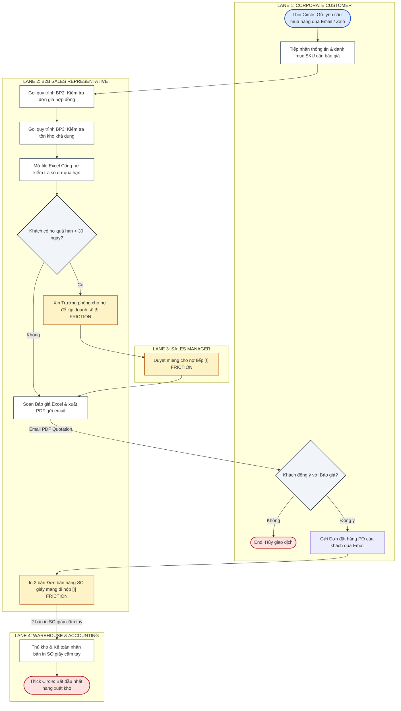
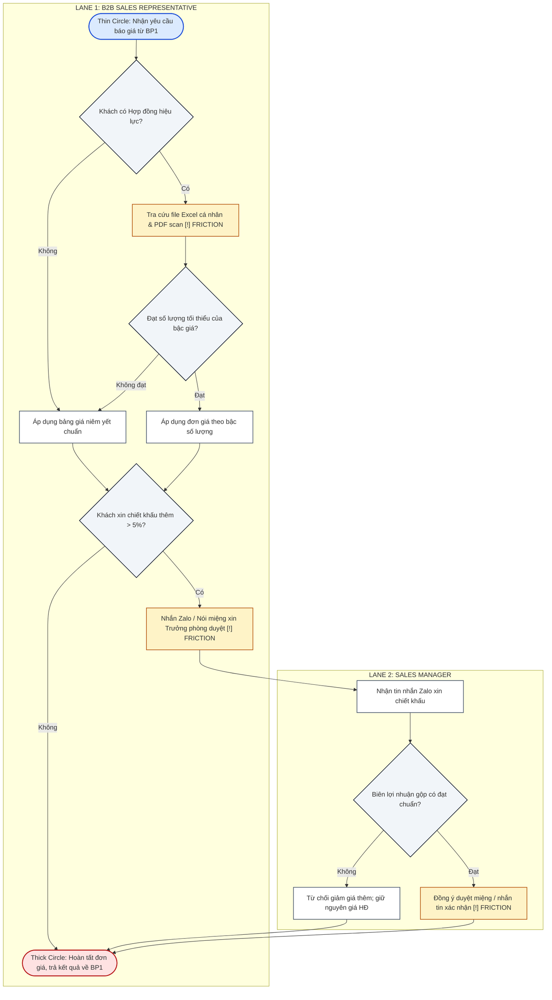
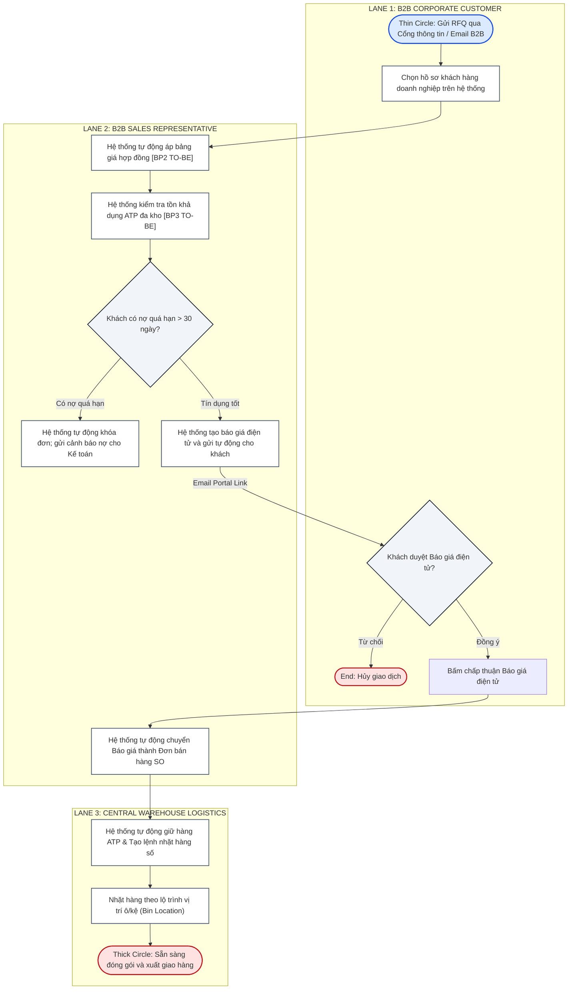
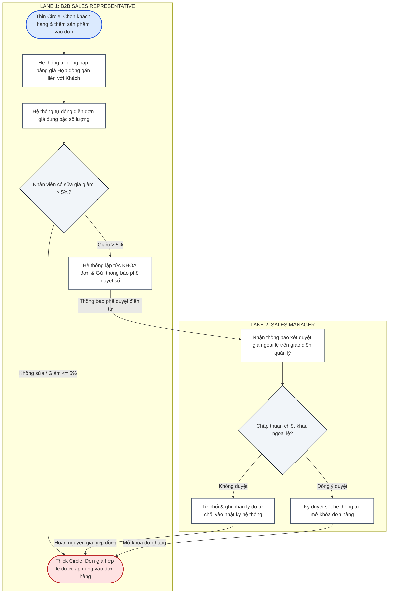
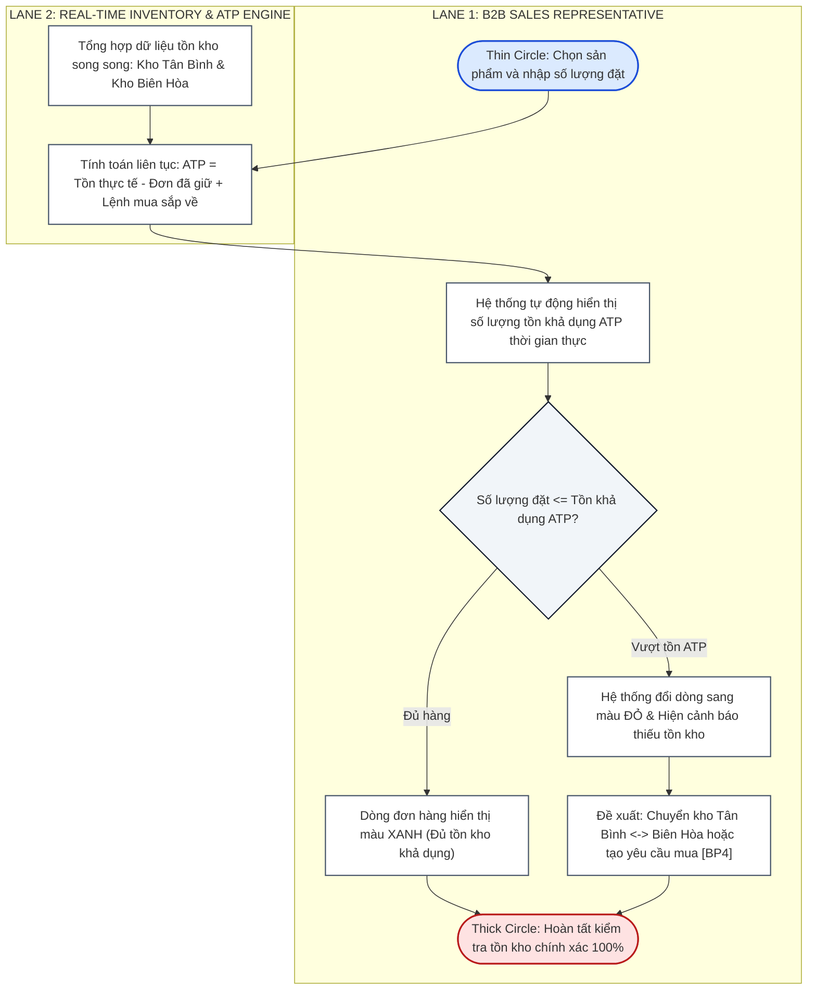

# FACULTY OF TECHNOLOGY — HOA SEN UNIVERSITY
## BUSINESS SYSTEMS ANALYSIS (BSA) — ACADEMIC YEAR 2026–2027 (SEMESTER 1)

***

# PROJECT PHASE 1 COMPREHENSIVE KNOWLEDGE & DELIVERABLES SYNTHESIS
## ENTERPRISE CONTEXT, STAKEHOLDER ELICITATION, AS-IS MODELING, PROBLEM ANALYSIS, TO-BE RE-ENGINEERING & REQUIREMENTS REFINEMENT

* **Course Code & Title:** Business Systems Analysis (BSA) — 2631 Semester 1
* **Academic Supervisor:** MSc. Nguyen Thi Thanh Thanh
* **Assigned Case Domain:** Scenario 6 (Scenario B) — B2B Wholesale & Distribution (Office Supplies & Stationery)
* **Simulated Enterprise:** Công ty TNHH Phân phối Văn phòng phẩm OfficePro (`OfficePro Distribution Co., Ltd.`)
* **Project Milestone:** Phase 1 Mid-Term Assessment (30% Course Weight) — Pure Business Systems Analysis
* **Team Governance (Group 6):**
  1. **Võ Duy Bình (Student ID: 22301500)** — Team Leader / Lead Business Analyst & Systems Analyst (Primary Modules: Sales & Purchasing)
  2. **Phạm Nguyễn Gia Thuận (Student ID: 22204631)** — QA Specialist & Solution Configurator (Primary Modules: Warehouse Inventory & Accounting Invoicing)
* **Status:** 100% Phase 1 Complete, Fully Verified & Formally Reconciled

***

## TABLE OF CONTENTS

1. [Executive Summary & Phase 1 Pedagogical Mandate](#1-executive-summary--phase-1-pedagogical-mandate)
2. [Enterprise Context, Master Data & Organizational Model](#2-enterprise-context-master-data--organizational-model)
3. [Stakeholder Analysis & Empirical Evidence Log](#3-stakeholder-analysis--empirical-evidence-log)
4. [AS-IS Business Process Analysis (5 Standard Processes)](#4-as-is-business-process-analysis-5-standard-processes)
5. [Process Relationship Map & Cross-Functional Integration](#5-process-relationship-map--cross-functional-integration)
6. [Evidence-Based Problem & Root Cause Analysis (5-Whys)](#6-evidence-based-problem--root-cause-analysis-5-whys)
7. [TO-BE Process Re-engineering & Comparative Evaluation](#7-to-be-process-re-engineering--comparative-evaluation)
8. [Refined Requirements Catalog (BRs & FRs)](#8-refined-requirements-catalog-brs--frs)
9. [Requirements Traceability Matrix (RTM - 6-Step Chain)](#9-requirements-traceability-matrix-rtm---6-step-chain)
10. [Assumptions, Open Questions & Solution Neutrality Defense](#10-assumptions-open-questions--solution-neutrality-defense)

***

## 1. EXECUTIVE SUMMARY & PHASE 1 PEDAGOGICAL MANDATE

### 1.1. Core Course Philosophy: "Business First → Technology Second"
The foundational philosophy of the Business Systems Analysis (BSA) curriculum at Hoa Sen University dictates that software configuration must never precede thorough business problem diagnosis. As emphasized throughout Weeks 1 to 7:

$$\text{Business Problem} \longrightarrow \text{Process Friction} \longrightarrow \text{Information Need} \longrightarrow \text{BR} \longrightarrow \text{FR} \longrightarrow \text{TO-BE Design}$$

Phase 1 strictly evaluates **Pure Business Systems Analysis**:
* **No premature ERP configuration:** System screenshots, database tables, and Odoo menus are strictly deferred to Phase 2.
* **Empirical grounding:** Every single functional requirement must trace directly back to verified operational testimony from company stakeholders.
* **Solution neutrality:** Business problems are stated in terms of business capability deficiencies rather than software tool deficiencies.

### 1.2. Enterprise Overview at a Glance
* **Company Name:** Công ty TNHH Phân phối Văn phòng phẩm OfficePro (`OfficePro Distribution Co., Ltd.`).
* **Industry Sector:** B2B Wholesale & Distribution of commercial office supplies, copy paper, writing instruments, and printer consumables.
* **Customer Base:** Over 250 active corporate enterprise clients, financial institutions, educational academies, and retail stationery sub-dealers across Ho Chi Minh City, Binh Duong, and Dong Nai.
* **Annual Revenue Run-Rate:** ~45–50 billion VND annually.
* **Core Value Proposition:** Fast-turnaround regional wholesale replenishment, volume tiered discount agreements, and standard Net 30-day commercial credit terms.

### 1.3. Quantified Operational Problems Solved in Phase 1
1. **Contract Price Inaccuracies:** 5% to 8% invoice error rate caused by decentralized personal spreadsheets, generating ~50,000,000 VND monthly in delayed receivables.
2. **Post-Confirmation Stockouts:** 3 to 4 confirmed customer orders cancelled per week due to 24–48 hour dock receiving data entry lag and manual inventory blindness.
3. **Manual 3-Way Reconciliation Inefficiency:** 15 to 20 hours wasted weekly by accounting cross-checking paper delivery notes against sales orders and invoices.

***

## 2. ENTERPRISE CONTEXT, MASTER DATA & ORGANIZATIONAL MODEL

### 2.1. The Three Operational Pillars of B2B Wholesale
OfficePro operates on three fundamental wholesale distribution pillars:
1. **High-Volume Upstream Bulk Purchasing:** OfficePro procures palletized stationery directly from authorized manufacturers (Double A Thailand/Vietnam, IK Plus APP Indonesia, Thien Long Group, Pilot Corporation, HP Vietnam) to capture maximum manufacturer volume rebates.
2. **Annual Commercial Framework Agreements:** Corporate buyers execute legal agreements locking in volume-tiered pricing, credit limits, and guaranteed fulfillment SLAs for 12-month periods.
3. **Net 30 Commercial Credit Extension:** Corporate accounts are billed on monthly consolidated cycles with standard 30-day settlement terms, necessitating rigorous credit control.

---

### 2.2. Master Data Catalog: 10 Primary SKUs

| No. | SKU Code | Product Name & Specifications | Category | UoM | Standard List Price (VND) | Contract Tier Price (VND) | Gross Margin Target |
| :---: | :---: | :--- | :--- | :---: | :---: | :---: | :---: |
| 1 | `ST-001` | Giấy in A4 Double A 70gsm (500 tờ/ram, 5 ram/thùng) | Paper Products | Ram | 75,000 | **65,000** | 18% |
| 2 | `ST-002` | Giấy in A4 IK Plus 80gsm (500 tờ/ram, 5 ram/thùng) | Paper Products | Ram | 85,000 | **75,000** | 20% |
| 3 | `ST-003` | Bút bi Thiên Long TL-027 (Hộp 20 cây, mực xanh) | Writing Instruments | Hộp | 90,000 | **80,000** | 25% |
| 4 | `ST-004` | Bút gel Pilot G2 0.7mm (Hộp 12 cây, mực đen) | Writing Instruments | Hộp | 320,000 | **290,000** | 22% |
| 5 | `ST-005` | Bìa còng King Jim A4 60 lá (Dày 5cm) | Filing Supplies | Cái | 45,000 | **38,000** | 28% |
| 6 | `ST-006` | Sổ lò xo A5 Deli 160 trang (Bìa nhựa PP) | Filing Supplies | Quyển | 35,000 | **29,000** | 30% |
| 7 | `ST-007` | Bấm kim đại Kangaro HD-10 | Office Tools | Cái | 28,000 | **24,000** | 25% |
| 8 | `ST-008` | Kim bấm Kangaro No.10 (Hộp lớn 20 hộp nhỏ) | Office Tools | Hộp lớn | 42,000 | **36,000** | 27% |
| 9 | `ST-009` | Hộp mực in laser HP 107a Black Original Cartridge | Printer Consumables | Hộp | 1,150,000 | **1,050,000** | 15% |
| 10 | `ST-010` | Bút lông bảng Pentel WB1 (Hộp 12 cây, xóa được) | Writing Instruments | Hộp | 180,000 | **155,000** | 24% |

*Key Wholesale Pricing Logic:* Standard retail price for `ST-001` is 75,000 VND. Under active corporate contract tier 1 (> 50 reams), the legally committed rate is 65,000 VND. Discrepancies occur when reps manually bill list price or outdated discount levels.

---

### 2.3. Organizational Structure & Governance (RACI)

```
                            ┌────────────────────────┐
                            │   Board of Directors   │
                            │    / Business Owner    │
                            └───────────┬────────────┘
                                        │
             ┌──────────────────────────┼──────────────────────────┐
             │                          │                          │
    ┌────────┴────────┐        ┌────────┴────────┐        ┌────────┴────────┐
    │   Sales Dept    │        │ Purchasing Dept │        │ Warehouse Dept  │
    │ (Sales Manager  │        │  (Procurement   │        │(Warehouse Keeper│
    │  & B2B Reps)    │        │    Officer)     │        │ & Dispatchers)  │
    └─────────────────┘        └─────────────────┘        └─────────────────┘
                                        │
                               ┌────────┴────────┐
                               │ Accounting Dept │
                               │(Chief Accountant│
                               │ & AR Officers)  │
                               └─────────────────┘
```

#### RACI Governance Matrix for Group 6:
* **Võ Duy Bình (22301500) — Team Leader / Lead BA & SA:**
  - Accountable (A) & Responsible (R) for `BP1. Processing Corporate Orders`, `BP2. Verifying Contract Prices`, and `BP4. Processing Purchase Orders`.
  - Lead architect for Process Relationship Map, Problem Analysis, TO-BE BP1/BP2 Swimlanes, and Requirements Traceability.
* **Phạm Nguyễn Gia Thuận (22204631) — QA Specialist & Solution Configurator:**
  - Accountable (A) & Responsible (R) for `BP3. Checking Product Availability` and `BP5. Receiving Purchased Goods`.
  - Lead designer for TO-BE BP3 Swimlane, Improvement Directions for BP4/BP5, BR/FR Quality Assurance, and Internal Peer Review.

#### Physical Facilities Network:
1. **Headquarters & Commercial Office (District 3, HCMC):** Executive suite, B2B sales team, procurement desk, and financial accounting.
2. **Tan Binh Central Distribution Hub (Tan Binh IP, HCMC):** **2,500 m²**. Holds 80% of palletized inventory. Primary supplier receiving dock equipped with 4 pallet truck bays.
3. **Bien Hoa Regional Transit Hub (Bien Hoa 2 IP, Dong Nai):** **800 m²**. Buffer stock facility dedicated to same-day delivery commitments for industrial manufacturing plants in Dong Nai and Binh Duong.

***

## 3. STAKEHOLDER ANALYSIS & EMPIRICAL EVIDENCE LOG

### 3.1. Power-Interest Matrix Analysis
* **High Power / High Interest (Manage Closely):**
  - *Sales Manager (Nguyen Van Hung):* Owns sales pipeline and quota achievement; demands instant price verification and automated quote generation.
  - *Chief Accountant (Tran Thi Mai):* Enforces revenue recognition, tax compliance, and Net 30 debt collections; demands strict credit hold and 3-way matching.
* **Low Power / High Interest (Keep Informed / Involve in Operational Design):**
  - *Warehouse Keeper (Le Van Duc):* Manages dock receiving and picking; burdened by manual phone inquiries and paper dispatch slips.
  - *Purchasing Officer (Nguyen Thi Lan):* Manages supplier relationships; hindered by reactive paper requisition slips.
* **High Power / Low Interest (Keep Satisfied):**
  - *Managing Director / Owner:* Requires top-level executive dashboards on gross profit margins, inventory turnover, and working capital.

---

### 3.2. Primary Empirical Evidence Log

| Evidence ID | Source Stakeholder & Role | Collection Method | Key Empirical Statement / Verified Observation |
| :---: | :--- | :--- | :--- |
| **`EVD-W2-SALES-01`** | B2B Sales Manager (Mr. Nguyen Van Hung) | Structured Interview (Week 2) & Simulation (Week 4) | *"Sales reps create quotes using personal Excel spreadsheets. When manufacturers alter prices, reps update late, resulting in a **5% to 8% billing discrepancy** on monthly statements and ~50M VND in delayed payments."* |
| **`EVD-W2-WH-02`** | Central Warehouse Keeper (Mr. Le Van Duc) | On-site Observation & Interview (Week 2) | *"Hàng về cầu cảng nằm chờ kiểm đếm và dán nhãn; tôi mất **24 đến 48 giờ** mới rảnh gõ số lượng vào file Excel tồn kho. Sales gọi điện giục liên tục, nhiều khi tôi đếm nhẩm rồi báo miệng."* |
| **`EVD-W2-ACC-01`** | Chief Accountant (Ms. Tran Thi Mai) | Semi-structured Interview (Week 2) | *"Cuối tháng kế toán mất **15 đến 20 giờ mỗi tuần** ngồi dò thủ công 3 chứng từ: Báo giá/SO giấy, Phiếu giao hàng có chữ ký tài xế, và Hóa đơn VAT. Rất nhiều đơn lệch đơn giá hoặc số lượng."* |
| **`EVD-W2-PURCH-01`** | Procurement Officer (Ms. Nguyen Thi Lan) | Workflow Walkthrough (Week 2) | *"Thủ kho ra kệ thấy hết hàng mới viết giấy tay đem qua phòng Mua hàng. Tôi phải soạn email gửi 3 nhà cung cấp xin báo giá, mất **2 đến 3 ngày** hàng mới về đến kho Tân Bình."* |
| **`EVD-W4-SIM-02`** | Simulation Audit Log (Simulation Exercise) | Order Simulation Data Analysis (Week 4) | *"During batch order simulation, **3–4 orders per week were cancelled** post-confirmation due to physical stockouts. Paper handoffs added an average of 4.2 hours of latency per order."* |

***

## 4. AS-IS BUSINESS PROCESS ANALYSIS (5 STANDARD PROCESSES)

OfficePro's operational architecture is mapped across 5 standard processes mandated by Scenario 6 (Slide 14):

```
+---------------------------------------------------------------------------------------------------+
|                        OFFICEPRO B2B WHOLESALE PROCESS PACKAGE (SCENARIO 6)                       |
+---------------------------------------------------------------------------------------------------+
| Core 1: BP1. Processing Corporate Orders (Owner: Võ Duy Bình)                                     |
| Core 2: BP2. Verifying Contract Prices (Owner: Võ Duy Bình)                                       |
| Core 3: BP3. Checking Product Availability (Owner: Phạm Nguyễn Gia Thuận)                         |
| Proc 4: BP4. Processing Purchase Orders (Owner: Võ Duy Bình)                                      |
| Proc 5: BP5. Receiving Purchased Goods (Owner: Phạm Nguyễn Gia Thuận)                             |
+---------------------------------------------------------------------------------------------------+
```

### 4.1. Detailed 12-Element Process Specification Summary

#### 1. BP1: Processing Corporate Orders (Owner: Võ Duy Bình)
* **Trigger:** Corporate client sends formal purchase inquiry/RFQ via email or Zalo OA.
* **Start Point:** Sales Rep ingests inquiry and opens preliminary tracking spreadsheet.
* **Main Activities:** Review requested SKUs; trigger `BP2` for pricing; trigger `BP3` for stock check; check credit aging in static Excel; draft quote; receive buyer PO; print 2 paper SO copies; hand-carry to Warehouse and Accounting.
* **Main Actors:** Corporate Buyer, B2B Sales Rep, Sales Manager, Warehouse Keeper, AR Accountant.
* **Info Used / Produced:** RFQ, static AR sheet, personal pricelists $\rightarrow$ PDF Quote, 2 paper SO copies.
* **Handoffs:** Email quote to client; physical paper SO walked to warehouse.
* **Decisions & Exceptions:** Overdue debt > 30 days requires verbal manager override; client rejects quote $\rightarrow$ transaction cancelled.
* **End Point:** Order status updated; paper SO physically handed to Warehouse for picking.
* **Outcome:** Legally binding sales agreement created; fulfillment initiated.
* **Evidence:** `EVD-W2-SALES-01`, `EVD-W4-SIM-02`.
* **Friction:** Ineffective credit checks, 4–6h order latency, risk of lost paper documents.

#### 2. BP2: Verifying Contract Prices (Owner: Võ Duy Bình)
* **Trigger:** Customer inquiry requires framework contract price verification.
* **Start Point:** Sales Rep accesses local directory to locate pricing terms.
* **Main Activities:** Check framework contract expiry date; search scanned PDF repository; open personal file `BangGia_KhachHang_2026.xlsx`; check volume tiers; if discount > 5%, text Sales Manager via Zalo; transcribe price to quote draft.
* **Main Actors:** B2B Sales Rep, Sales Manager, Corporate Buyer.
* **Info Used / Produced:** SKU list, scanned PDF contracts, local Excel files $\rightarrow$ verified unit prices.
* **Handoffs:** Rep $\rightarrow$ Manager: Zalo chat for discount approval; Manager $\rightarrow$ Rep: verbal/chat response.
* **Decisions & Exceptions:** Valid contract exists? If no, apply list price. Discount > 5% requested? Requires discretionary manager sign-off.
* **End Point:** Verified unit prices populated into quote draft.
* **Outcome:** Contract pricing applied, preserving commercial gross margin.
* **Evidence:** `EVD-W2-SALES-01` (5–8% error rate), `EVD-W4-SIM-02` (~50M VND delayed collections).
* **Friction:** Decentralized spreadsheets, zero audit trail for informal chat approvals.

#### 3. BP3: Checking Product Availability (Owner: Phạm Nguyễn Gia Thuận)
* **Trigger:** Sales Rep needs stock availability confirmation before committing to delivery dates.
* **Start Point:** Sales Rep opens static Excel dump extracted at 08:00 AM.
* **Main Activities:** Look up on-hand stock in Excel dump; if quantity is low or urgent, phone/Zalo Warehouse Keeper; keeper walks warehouse floor to count pallets; keeper replies verbally.
* **Main Actors:** B2B Sales Rep, Warehouse Keeper, Logistics Coordinator.
* **Info Used / Produced:** Morning stock dump, physical pallet tags $\rightarrow$ verbal confirmation, reserved stock notes.
* **Handoffs:** Phone call / Zalo chat between Sales Rep and Warehouse Keeper.
* **Decisions & Exceptions:** Is physical stock sufficient? If yes, confirm. If no, trigger purchase requisition (`BP4`) or suggest partial shipment.
* **End Point:** Available stock confirmed to Sales Rep.
* **Outcome:** Delivery date committed to client based on perceived inventory.
* **Evidence:** `EVD-W2-WH-02`, `EVD-W4-SIM-02` (3–4 weekly post-confirmation stockout cancellations).
* **Friction:** Morning dump ignores intra-day reservations; warehouse keeper constantly interrupted by phone calls.

#### 4. BP4: Processing Purchase Orders (Owner: Võ Duy Bình)
* **Trigger:** Warehouse keeper notifies Procurement of low stock, or `BP3` reports stockout.
* **Start Point:** Procurement Officer receives handwritten low-stock slip.
* **Main Activities:** Review stock levels; draft supplier RFQ; email RFQ to 3 suppliers (Double A, Thien Long, IK Plus); wait 1–2 days for responses; compare prices in Excel; draft PO; obtain Director signature; email PDF PO to vendor.
* **Main Actors:** Warehouse Keeper, Procurement Officer, Approving Director, Vendor Sales Rep.
* **Info Used / Produced:** Handwritten slip, supplier quotation emails $\rightarrow$ approved Purchase Order (`PO-2026-XXXX.pdf`).
* **Handoffs:** Paper slip from Warehouse to Procurement; PDF PO emailed to supplier.
* **Decisions & Exceptions:** Lowest price vs shortest lead-time selection; emergency expedite orders.
* **End Point:** Approved PO acknowledged by supplier with committed delivery schedule.
* **Outcome:** Replenishment pipeline initiated.
* **Evidence:** `EVD-W2-PURCH-01` (3–5 day procurement lead time).
* **Friction:** Completely reactive; email RFQ negotiation causes severe stockout delays.

#### 5. BP5: Receiving Purchased Goods (Owner: Phạm Nguyễn Gia Thuận)
* **Trigger:** Supplier delivery truck arrives at Tan Binh dock.
* **Start Point:** Warehouse clerk receives printed delivery slip from driver.
* **Main Activities:** Unload pallets at receiving dock; manually check carton count against supplier delivery note and paper PO; inspect packaging integrity; sign paper delivery slip; shelve goods based on memory; in batch at end of day (or next day), type quantities into `TonKho_TanBinh_Daily.xlsx`.
* **Main Actors:** Supplier Truck Driver, Warehouse Clerk, Procurement Officer, AR/AP Accountant.
* **Info Used / Produced:** Supplier delivery note, paper PO $\rightarrow$ signed delivery note, updated Excel file.
* **Handoffs:** Paper delivery note signed and returned to driver; paper receipt slip sent to accounting weekly.
* **Decisions & Exceptions:** Damaged or discrepant cartons recorded on slip; receiving backlogs sit on dock for 24–48h.
* **End Point:** Stock shelved; daily Excel inventory updated.
* **Outcome:** Goods physically secured in warehouse.
* **Evidence:** `EVD-W2-WH-02`, `EVD-W4-SIM-02`.
* **Friction:** 24–48h inventory visibility blind spot; shelving by memory causes picking errors.

---

### 4.2. AS-IS Process Modeling: BP1 (Processing Corporate Orders)



---

### 4.3. AS-IS Process Modeling: BP2 (Verifying Contract Prices)



---

### 4.4. AS-IS Process Modeling: BP3 (Checking Product Availability)

```mermaid
flowchart TD
    subgraph LANE_BP3_SALES ["LANE 1: B2B SALES REPRESENTATIVE"]
        BP3_Start([Thin Circle: Nhận danh mục mặt hàng từ BP1])
        BP3_OpenDump["Mở file Excel trích xuất tồn kho lúc 8h sáng [!] FRICTION"]
        BP3_GateConfidence{Tồn kho trong Excel có dồi dào (> 500)?}
        BP3_DirectConfirm["Tạm thời xác nhận đủ hàng theo số liệu 8h00 sáng"]
        BP3_CallWH["Gọi điện thoại / Nhắn Zalo cho Thủ kho Tân Bình [!] FRICTION"]
        BP3_ReceiveStock["Nhận phản hồi từ thủ kho & ghi chú vào báo giá"]
        BP3_EndSuccess([Thick Circle: Trả kết quả tồn kho khả dụng về BP1])
    end

    subgraph LANE_BP3_WH ["LANE 2: CENTRAL WAREHOUSE KEEPER"]
        BP3_ReceiveCall["Nhận cuộc gọi / tin nhắn Zalo giục kiểm tra hàng"]
        BP3_WalkFloor["Dừng việc, đi bộ ra các dãy kệ kho Tân Bình [!] FRICTION"]
        BP3_CountStock["Đếm số thùng/ram thực tế & ước lượng hàng chưa xuất"]
        BP3_GateEnough{Số lượng thực tế trên kệ có đủ đáp ứng?}
        BP3_ReplyShortage["Báo kho hết hàng; gợi ý viết giấy báo mua hàng [BP4]"]
        BP3_ReplyOK["Báo miệng qua điện thoại: 'Kho còn đủ hàng giao'"]
    end

    BP3_Start --> BP3_OpenDump
    BP3_OpenDump --> BP3_GateConfidence
    BP3_GateConfidence -- Có (> 500) --> BP3_DirectConfirm
    BP3_GateConfidence -- Không (Sắp hết / Hàng gấp) --> BP3_CallWH
    BP3_DirectConfirm --> BP3_EndSuccess
    BP3_CallWH -->|Điện thoại / Zalo| BP3_ReceiveCall
    BP3_ReceiveCall --> BP3_WalkFloor
    BP3_WalkFloor --> BP3_CountStock
    BP3_CountStock --> BP3_GateEnough
    BP3_GateEnough -- Đủ hàng --> BP3_ReplyOK
    BP3_GateEnough -- Không đủ --> BP3_ReplyShortage
    BP3_ReplyOK -->|Báo miệng qua điện thoại| BP3_ReceiveStock
    BP3_ReplyShortage -->|Báo miệng qua điện thoại| BP3_ReceiveStock
    BP3_ReceiveStock --> BP3_EndSuccess

    classDef startEvent fill:#dbeafe,stroke:#1d4ed8,stroke-width:2px;
    classDef endEvent fill:#fee2e2,stroke:#b91c1c,stroke-width:2px;
    classDef friction fill:#fef3c7,stroke:#b45309,stroke-width:1.5px;
    classDef activity fill:#ffffff,stroke:#475569,stroke-width:1.5px;
    classDef gateway fill:#f1f5f9,stroke:#0f172a,stroke-width:1.5px;

    class BP3_Start startEvent;
    class BP3_EndSuccess endEvent;
    class BP3_OpenDump,BP3_CallWH,BP3_WalkFloor friction;
    class BP3_DirectConfirm,BP3_ReceiveStock,BP3_ReceiveCall,BP3_CountStock,BP3_ReplyShortage,BP3_ReplyOK activity;
    class BP3_GateConfidence,BP3_GateEnough gateway;
```

***

## 5. PROCESS RELATIONSHIP MAP & CROSS-FUNCTIONAL INTEGRATION

### 5.1. Master Process Relationship Map (Mermaid Diagram)

```mermaid
flowchart LR
    %% NODES REPRESENTING PROCESSES
    BP1["<b>BP1. Processing Corporate Orders</b><br><i>(Xử lý Đơn hàng B2B)</i><br>Owner: Võ Duy Bình"]
    BP2["<b>BP2. Verifying Contract Prices</b><br><i>(Xác minh Giá Hợp đồng)</i><br>Owner: Võ Duy Bình"]
    BP3["<b>BP3. Checking Product Availability</b><br><i>(Kiểm tra Tồn kho ATP)</i><br>Owner: Phạm Nguyễn Gia Thuận"]
    BP4["<b>BP4. Processing Purchase Orders</b><br><i>(Xử lý Đơn Mua hàng)</i><br>Owner: Võ Duy Bình"]
    BP5["<b>BP5. Receiving Purchased Goods</b><br><i>(Tiếp nhận Hàng mua)</i><br>Owner: Phạm Nguyễn Gia Thuận"]

    %% PROCESS RELATIONSHIPS & DATA PASSING
    BP1 <-->|1. Yêu cầu kiểm tra giá HĐ<br>2. Đơn giá HĐ hợp lệ [VERIFIED]| BP2
    BP1 <-->|3. Yêu cầu kiểm tra tồn kho<br>4. Số lượng tồn khả dụng ATP [VERIFIED]| BP3
    BP3 -->|5. Cảnh báo thiếu hàng / Hết tồn kho<br>Trigger yêu cầu mua hàng bù [VERIFIED]| BP4
    BP4 -->|6. Bản sao Đơn mua hàng PO & Lịch giao hàng dự kiến [VERIFIED]| BP5
    BP5 -->|7. Cập nhật số lượng nhập kho thực tế<br>Tăng tồn khả dụng ATP [VERIFIED]| BP3
    BP5 -.->|8. Thông báo hàng về đã nhập kho<br>để giải tỏa đơn hàng đang chờ [UNVERIFIED]| BP1

    %% STYLING
    classDef core fill:#dbeafe,stroke:#1d4ed8,stroke-width:2px;
    classDef support fill:#fef3c7,stroke:#b45309,stroke-width:1.5px;

    class BP1,BP2,BP3 core;
    class BP4,BP5 support;
```

---

### 5.2. Process Integration Table (Slide 5 Format)

| Upstream Process | Output / Information Transferred | Downstream Process | Evidence / Status |
| :--- | :--- | :--- | :---: |
| **`BP1. Processing Corporate Orders`** | **Yêu cầu thẩm định giá:** Mã khách hàng doanh nghiệp, danh mục mã SKU (`ST-001` đến `ST-010`), số lượng đặt mua theo từng dòng sản phẩm. | **`BP2. Verifying Contract Prices`** | **VERIFIED**<br>*(Phỏng vấn Sales Manager `EVD-W2-SALES-01`: Bắt buộc phải có giá hợp đồng trước khi xuất Báo giá).* |
| **`BP2. Verifying Contract Prices`** | **Đơn giá hợp đồng đã xác thực:** Đơn giá theo bậc số lượng thỏa thuận trong hợp đồng khung (VD: `ST-001` @ 65.000₫) và chiết khấu ngoại lệ được duyệt. | **`BP1. Processing Corporate Orders`** | **VERIFIED**<br>*(Dữ liệu mô phỏng `EVD-W4-SIM-02`: Đơn giá được đưa vào Báo giá chính thức và Đơn bán hàng SO).* |
| **`BP1. Processing Corporate Orders`** | **Yêu cầu kiểm tra khả dụng tồn kho:** Danh mục SKU cần xuất kho, số lượng đặt hàng, ngày cam kết giao hàng theo yêu cầu của khách. | **`BP3. Checking Product Availability`** | **VERIFIED**<br>*(Quy trình bán hàng chuẩn: Kiểm tra tồn kho trước khi gửi báo giá chốt).* |
| **`BP3. Checking Product Availability`** | **Số lượng tồn khả dụng (ATP Status):** Xác nhận đủ hàng có sẵn để xuất kho giao ngay, hoặc thông báo thiếu hụt một phần/toàn bộ số lượng. | **`BP1. Processing Corporate Orders`** | **VERIFIED**<br>*(Khảo sát thực tế: Sales Rep cần biết trạng thái hàng để cam kết giao trong 24–48h).* |
| **`BP3. Checking Product Availability`** | **Cảnh báo thiếu hụt kho / Hết hàng:** Mã SKU bị đứt tồn kho, số lượng cần mua bù, đơn hàng đang chờ giao tương ứng. | **`BP4. Processing Purchase Orders`** | **VERIFIED**<br>*(Thủ kho gửi giấy tay báo mua hàng khi kiểm tra thấy kệ hết hàng).* |
| **`BP4. Processing Purchase Orders`** | **Đơn mua hàng PO & Lịch giao hàng dự kiến:** Bản sao PO chính thức đã ký (`PO-2026-XXXX.pdf`), thông tin nhà cung cấp (Double A / Thiên Long), số lượng đặt, thời gian xe tải dự kiến tới kho. | **`BP5. Receiving Purchased Goods`** | **VERIFIED**<br>*(Thủ kho cần thông tin PO để đối chiếu số lượng và quy cách khi mở niêm phong xe tải).* |
| **`BP5. Receiving Purchased Goods`** | **Số lượng nhập kho thực tế & Tăng tồn khả dụng ATP:** Biên bản kiểm đếm tiếp nhận, số lượng hàng nhập đạt chuẩn chất lượng được cộng vào tổng tồn kho. | **`BP3. Checking Product Availability`** | **VERIFIED**<br>*(Hàng nhập vào kho làm tăng số lượng tồn khả dụng cho các đơn hàng tiếp theo).* |
| **`BP5. Receiving Purchased Goods`** | **Thông báo hàng về giải tỏa đơn chờ (Backorder Release):** Thông tin các lô hàng đang nợ đơn khách đã nhập kho thành công để Sales Rep tạo lệnh xuất kho. | **`BP1. Processing Corporate Orders`** | **UNCERTAIN**<br>*(Chưa được xác thực tự động: Hiện tại thủ kho không tự báo cho Sales; Sales phải chủ động gọi điện hỏi lại).* |

---

### 5.3. Slide 5 Discussion Questions Analysis
1. **Does one process depend on the output of another?**
   - **Yes, critical dependencies govern wholesale execution:** `BP1` has a synchronous dependency on `BP2` (verified price) and `BP3` (verified ATP stock). `BP4` has a trigger dependency on stockout alerts from `BP3`. `BP5` has a prerequisite dependency on valid PO numbers from `BP4` to accept dock deliveries. Finally, `BP5` output dynamically updates `BP3` availability.
2. **Is information transferred consistently between processes?**
   - **No, severe data fragmentation exists:** Sales uses local Excel files with 1–2 week update delays from Double A; warehouse receipts take 24–48h to enter the spreadsheet. Consequently, pricing has a 5–8% error rate and inventory figures lag 1–2 days behind physical stock.
3. **Are there handoffs that cause delays or errors?**
   - **Four critical friction bottlenecks:** (a) Verbal/Zalo discount approval (`BP1 ➔ BP2`); (b) Phone inquiries to warehouse staff interrupting physical tasks (`BP1 ➔ BP3`); (c) Handwritten paper slips to procurement (`BP3 ➔ BP4`); (d) Physical hand-carrying of 2 paper SO copies across office rooms (`BP1 ➔ Warehouse & Accounting`).
4. **Are process boundaries clear?**
   - **Functional boundaries are clear, but data boundaries are blurred:** Responsibilities follow scope rules, but tracking "Goods-in-Transit" is ambiguous—Sales and Warehouse both lack visibility on inbound PO status, forcing phone calls to Procurement.

***

## 6. EVIDENCE-BASED PROBLEM & ROOT CAUSE ANALYSIS (5-WHYS)

### 6.1. The 3 Prioritized Business Problems (Slide 7 Format)

#### Problem 1 (ISS-01): Contract Pricing Inaccuracies & Decentralized Pricing Controls
* **Evidence Source:** B2B Sales Manager Interview (`EVD-W2-SALES-01`) & Simulation Audit (`EVD-W4-SIM-02`).
* **AS-IS Observation:** Sales reps reference personal spreadsheets (`BangGia_KhachHang_2026.xlsx`) and scanned PDF contracts; different reps quote different prices for identical SKUs.
* **Business Problem:** Sales staff lack a centralized single source of truth for contract pricelists and lack automated approval controls during quote creation.
* **Affected Stakeholders:** B2B Sales Representative, Sales Manager, Corporate Buyer, AR Billing Accountant.
* **Information Need:** Active contract unit prices and volume discount tiers automatically linked to customer accounts during quote preparation.
* **Business Impact:** 5% to 8% billing discrepancy on corporate invoices, payment disputes, ~50,000,000 VND monthly in delayed receivables.
* **Open Question:** What is the formal escalation policy when a requested customer discount exceeds the 10% manager discretionary threshold?

#### Problem 2 (ISS-02): Inventory Blindness & Post-Confirmation Stockouts
* **Evidence Source:** Central Warehouse Keeper Interview (`EVD-W2-WH-02`) & Simulation Audit (`EVD-W4-SIM-02`).
* **AS-IS Observation:** Sales reps call or Zalo the warehouse to check stock; goods delivered to dock sit 24–48 hours before being entered into Excel.
* **Business Problem:** Sales staff cannot directly access reliable, real-time Available-to-Promise (ATP) stock levels before order confirmation.
* **Affected Stakeholders:** B2B Sales Representative, Warehouse Keeper, Corporate Buyer, Logistics Dispatcher.
* **Information Need:** Real-time Available-to-Promise (ATP = On-hand minus Reserved across warehouses) dynamically visible during order drafting.
* **Business Impact:** 3 to 4 confirmed customer orders cancelled per week post-confirmation due to physical stockouts, damaging corporate reputation.
* **Open Question:** How frequently does stockout-driven order cancellation occur during peak quarter-end campaigns?

#### Problem 3 (ISS-03): Reactive Reordering & Prolonged Procurement Lead Times
* **Evidence Source:** Procurement Officer Interview (`EVD-W2-PURCH-01`) & Simulation Data (`EVD-W4-SIM-02`).
* **AS-IS Observation:** Warehouse clerk writes a paper slip when shelves run dry; Procurement emails 3 suppliers and waits 2–3 days for quotes.
* **Business Problem:** Replenishment operates reactively and manually without automated reorder point alerts or standardized supplier price comparison matrices.
* **Affected Stakeholders:** Purchasing Officer, Warehouse Clerk, Approving Director, Corporate Buyer.
* **Information Need:** Automated reorder point alerts (Min/Max thresholds) and digital vendor price comparison matrices.
* **Business Impact:** 3 to 5 day replenishment lead time, causing stockouts of top-selling SKUs (`ST-001` Double A A4).
* **Open Question:** What are the minimum order quantities (MOQ) and lead-time guarantees contracted with primary suppliers Double A and Thien Long?

---

### 6.2. 5-Whys Root Cause Analysis (ISS-01 & ISS-02)

#### 5-Whys for Problem 1 (Contract Pricing Inaccuracies):
1. *Why are 5–8% of corporate invoices disputed by clients?* $\rightarrow$ Because the unit price on the invoice does not match the customer's framework contract agreement.
2. *Why does the invoice price not match the contract?* $\rightarrow$ Because the billing accountant copies the price directly from the Sales Representative's initial quote.
3. *Why did the Sales Representative quote an incorrect price?* $\rightarrow$ Because the rep looked up prices in a personal local Excel file that lacked the latest contract addendum.
4. *Why are reps using local Excel files instead of official contracts?* $\rightarrow$ Because scanned PDF contracts on the shared drive are difficult to search during live telephone negotiations.
5. *Why is there no single source of truth?* $\rightarrow$ **ROOT CAUSE: The enterprise lacks a centralized digital contract pricing engine that automatically binds agreed price tiers to customer profiles during quote entry.**

#### 5-Whys for Problem 2 (Post-Confirmation Stockouts):
1. *Why are 3–4 orders cancelled weekly after confirmation?* $\rightarrow$ Because warehouse pickers find empty shelves when fulfilling committed orders.
2. *Why did sales commit to orders when shelves were empty?* $\rightarrow$ Because the morning Excel inventory dump showed positive stock quantities.
3. *Why did the stock dump show positive quantities?* $\rightarrow$ Because other reps had already committed that stock to prior orders earlier that morning without reserving it on a central ledger.
4. *Why was stock not reserved immediately upon order confirmation?* $\rightarrow$ Because reservations are tracked on paper SOs that take 4–6 hours to physically reach the warehouse.
5. *Why is reservation not real-time?* $\rightarrow$ **ROOT CAUSE: The enterprise lacks a real-time Available-to-Promise (ATP) inventory engine that immediately locks stock reservations across multi-warehouse locations upon digital sales confirmation.**

***

## 7. TO-BE PROCESS RE-ENGINEERING & COMPARATIVE EVALUATION

### 7.1. Re-Engineered Architecture Overview
```
+---------------------------------------------------------------------------------------------------+
|                        OFFICEPRO RE-ENGINEERED TO-BE ARCHITECTURE OVERVIEW                        |
+---------------------------------------------------------------------------------------------------+
| Core 1: TO-BE BP1: Processing Corporate Orders (Automated Workflow & Digital Handoffs)            |
| Core 2: TO-BE BP2: Verifying Contract Prices (Automated Contract Pricelist & Policy Approval Gate)|
| Core 3: TO-BE BP3: Checking Product Availability (Real-Time Multi-Warehouse ATP Engine)           |
| Proc 4: TO-BE BP4: Automated Reorder Point Replenishment Direction                                |
| Proc 5: TO-BE BP5: Real-Time Mobile Dock Receiving & Instant ATP Update Direction                |
+---------------------------------------------------------------------------------------------------+
```

---

### 7.2. TO-BE Process Modeling: BP1 (Processing Corporate Orders)



---

### 7.3. TO-BE Process Modeling: BP2 (Verifying Contract Prices)



---

### 7.4. TO-BE Process Modeling: BP3 (Checking Product Availability)



---

### 7.5. AS-IS vs. TO-BE 4-Dimension Comparative Matrix (Slide 9 Format)

| Process | Dimension (Slide 9) | AS-IS: Current Manual Process | TO-BE: Proposed Re-Engineered Process |
| :---: | :--- | :--- | :--- |
| **`BP1`** | **What happens vs. What changes?** | Sales creates manual quote in Word/Excel, prints 2 physical paper copies of SO, walks across office to hand to Warehouse and Accounting. | Quotation created in centralized digital workspace; customer approves via digital portal/email link; system automatically converts quote to digital SO and auto-generates digital picking list for warehouse. |
| **`BP1`** | **Where problem occurs vs. Where improves?** | Occurs at physical paper handoff and manual credit check; orders stall for 4–6 hours while waiting for signatures. | Process improves through automated workflow and automated credit check gate; order processing latency drops from 4–6 hours to under 15 minutes. |
| **`BP1`** | **Information missing vs. Information available?** | Order status, real-time credit balance, and inventory reservation status are invisible across departments. | Customer real-time overdue debt status and real-time ATP stock availability are instantly available during order preparation. |
| **`BP1`** | **Handoff difficulty vs. Handoff change?** | Physical handoff of paper SO to Warehouse Clerk and Accountant causes delays and document loss. | Fully eliminated; system triggers digital stock reservation and digital picking slip routing directly to warehouse terminal. |
| **`BP2`** | **What happens vs. What changes?** | Sales rep manually looks up unit prices in personal Excel spreadsheets and scanned PDF contracts; negotiates discounts verbally or via Zalo. | System automatically applies contractual pricelist rules upon customer selection; overrides > 5% trigger an automated, logged managerial approval gate. |
| **`BP2`** | **Where problem occurs vs. Where improves?** | Occurs at pricing verification step; decentralized files cause mismatched quotes and 5–8% billing errors. | Process improves at quote line item pricing; zero pricing mismatches and full audit trail for any authorized discount exceptions. |
| **`BP2`** | **Information missing vs. Information available?** | Active contractual tiered prices and recent price updates from vendors are delayed or inconsistently shared. | Master contract pricing tiers and valid effective date ranges are automatically retrieved in real time upon selecting SKU and customer. |
| **`BP2`** | **Handoff difficulty vs. Handoff change?** | Informal Zalo/verbal discount approval handoff between Sales Rep and Sales Manager lacks accountability. | Replaced by system-enforced digital notification and 1-click managerial sign-off with audit logging. |
| **`BP3`** | **What happens vs. What changes?** | Sales rep calls or Zalos warehouse keeper; warehouse keeper walks to shelves to physically count boxes; 15–30 min delay per urgent quote. | Sales rep views real-time multi-warehouse Available-to-Promise (ATP) stock figures directly on order drafting screen. |
| **`BP3`** | **Where problem occurs vs. Where improves?** | Occurs at inventory verification step; stockout discovered after customer commits, causing 3–4 cancellations/week. | Process improves before order confirmation; immediate visual warning prevents overcommitting and suggests inter-warehouse transfer or purchase requisition. |
| **`BP3`** | **Information missing vs. Information available?** | Available stock after deducting already-reserved orders is unknown to Sales; dock arrivals delayed 24–48h. | Real-time ATP quantity ($\text{ATP} = \text{On-hand} - \text{Reserved}$) is visible dynamically on each order line. |
| **`BP3`** | **Handoff difficulty vs. Handoff change?** | Verbal/phone handoff between Sales Rep and Warehouse Keeper interrupts warehouse operations and delays quoting. | Replaced by direct system lookup; zero manual handoff between Sales and Warehouse for routine stock checks. |

---

### 7.6. Improvement Directions for BP4 & BP5
* **BP4 (Processing Purchase Orders):**
  - Implement **Automated Reordering Rules (Min/Max Logic)**: When `ST-001` reaches safety stock threshold (100 reams), system auto-generates draft Purchase Requisition.
  - Implement central supplier price & lead-time comparison matrix, reducing PO generation time from **3 days to under 2 hours**.
* **BP5 (Receiving Purchased Goods):**
  - Equip dock staff with mobile barcode scanners to perform real-time electronic matching against open POs upon truck unloading.
  - Instantly increment ATP inventory upon dock confirmation, **eliminating the 24–48 hour receiving data entry lag**.

***

## 8. REFINED REQUIREMENTS CATALOG (BRs & FRs)

### 8.1. Consolidated 8-Field BR/FR Refinement Table (Slide 10 Format)

| Requirement ID | Original Draft Statement | Related Problem / Information Need | Related Business Process | Review Decision <br>`[Keep / Revise / Remove / Investigate]` | Revised Requirement Statement (IEEE 830 Standard) | Evidence / Rationale | Unresolved Questions |
| :---: | :--- | :--- | :--- | :---: | :--- | :--- | :--- |
| **`BR-01`** | The business needs corporate sales pricing to be accurate. | `ISS-01`: 5–8% hóa đơn bị sai lệch đơn giá do nhân viên dùng file Excel cá nhân phân tán. | `BP1. Processing Corporate Orders`<br>`BP2. Verifying Contract Prices` | **REVISE** | **The business needs corporate sales order pricing to be automatically determined from active framework agreements to eliminate billing discrepancies and accelerate customer cash collections.** | `EVD-W2-SALES-01`: Kiểm toán phát hiện 50 triệu/tháng công nợ đọng do sai giá. Yêu cầu chuyển từ mong muốn cảm tính sang năng lực tự động áp giá hợp đồng. | Quy định trần chiết khấu tối đa của Trưởng phòng Sales là bao nhiêu % trước khi phải xin ý kiến Giám đốc điều hành? |
| **`BR-02`** | The business needs to manage stock better. | `ISS-02`: 3–4 đơn hàng bị hủy mỗi tuần sau khi chốt do đứt tồn kho thực tế. | `BP1. Processing Corporate Orders`<br>`BP3. Checking Product Availability` | **REVISE** | **The business needs sales confirmation to be strictly verified against real-time Available-to-Promise (ATP) inventory levels across multi-warehouse locations to prevent post-confirmation order cancellations.** | `EVD-W2-WH-02`: Sales hứa hẹn giao hàng ảo trong khi hàng ở kho Tân Bình đã hết. Cần năng lực tính toán ATP thời gian thực trước khi chốt đơn. | Chính sách phân bổ ưu tiên tồn kho (Stock Allocation Priority) khi nhiều đơn cùng tranh chấp lượng tồn ít ỏi còn lại? |
| **`FR-01`** | The system should display contract prices. | `ISS-01`: Tra cứu đơn giá thủ công gây sai lệch báo giá khách hàng. | `BP2. Verifying Contract Prices` | **REVISE** | **The system shall automatically retrieve and populate the contract unit price for each selected product line based on the corporate customer's active pricelist during sales quote and order creation.** | Chuẩn hóa cú pháp IEEE 830 `The system shall + action + object + condition`, thay thế chữ 'should' mơ hồ, đảm bảo khả năng kiểm thử chức năng tự động lấy giá. | Khi hợp đồng khung hết hiệu lực thì hệ thống hiển thị cảnh báo gì và xử lý đơn giá ra sao? |
| **`FR-02`** | The manager must approve discounts. | `ISS-01`: Thỏa thuận chiết khấu ngoại lệ qua Zalo không lưu vết, rủi ro thất thoát biên lợi nhuận. | `BP1. Processing Corporate Orders`<br>`BP2. Verifying Contract Prices` | **REVISE** | **The system shall block order confirmation and require authorized managerial override whenever a requested unit price is discounted by more than 5% below the contract baseline price.** | Cụ thể hóa hành vi hệ thống: tự động khóa đơn và kích hoạt luồng phê duyệt số khi chiết khấu > 5%, có lưu vết kiểm toán (Audit Trail) thay cho duyệt miệng. | Thời gian cam kết phản hồi (SLA) tối đa của Trưởng phòng là bao lâu trước khi đơn hàng hết hạn hiệu lực? |
| **`FR-03`** | The system shall show warehouse stock. | `ISS-02`: Sales không biết tồn khả dụng ATP đa kho (Tân Bình và Biên Hòa). | `BP3. Checking Product Availability` | **REVISE** | **The system shall display the real-time Available-to-Promise (ATP) stock quantity of each product line, calculated from on-hand inventory minus reserved orders across warehouses, during order preparation.** | Phân biệt rõ giữa 'tồn thực tế' (On-hand) và 'tồn khả dụng' (ATP) để ngăn ngừa cam kết trùng lặp cho nhiều khách hàng khác nhau. | Tần suất đồng bộ dữ liệu tồn kho đa kho là thời gian thực (Real-time) hay định kỳ theo chu kỳ phút? |
| **`FR-04`** | The system shall warn when stock is low. | `ISS-02`: Hứa hẹn giao hàng ảo vượt quá tồn kho thực tế của doanh nghiệp. | `BP1. Processing Corporate Orders`<br>`BP3. Checking Product Availability` | **REVISE** | **The system shall flag an order line and display an immediate visual stockout warning whenever the requested order quantity exceeds the real-time ATP quantity.** | Cung cấp phản hồi thị giác tức thì (đổi dòng màu đỏ) để nhân viên Sales nhận biết và tư vấn tách đơn hoặc điều chuyển kho kịp thời. | Hệ thống có cho phép nhân viên Sales tách đơn hàng (Split Order) giao làm nhiều đợt khi bị thiếu hàng hay không? |
| **`FR-05`** | The system shall match documents. | `ISS-01`: Đối soát thủ công 15–20h/tuần giữa SO giấy, Phiếu giao hàng và Hóa đơn. | `BP1. Processing Corporate Orders` | **INVESTIGATE** | **The system shall automatically reconcile quantities and prices between the confirmed Sales Order, the signed Delivery Slip, and the Customer Invoice to prevent billing discrepancies.** | `EVD-W2-ACC-01`: Kế toán mất quá nhiều thời gian đối soát giấy tờ. Tuy nhiên cần điều tra thêm về quy trình ký nhận điện tử (e-POD) trước khi chốt giải pháp. | Quy trình ký nhận điện tử của tài xế và khách hàng doanh nghiệp có giá trị pháp lý kế toán để tự động đối soát không? |

---

### 8.2. MoSCoW Prioritization Alignment
* **Must Have (M):** `FR-01` (Auto Contract Pricing), `FR-02` (5% Margin Approval Gate), `FR-03` (Multi-Warehouse ATP Display), `FR-04` (Visual Stockout Warning).
* **Should Have (S):** `FR-05` (3-Way Matching Reconciliation).
* **Could Have (C):** Customer Portal Self-Service Quotation Approval (`FR-06`).
* **Won't Have in Phase 1 (W):** AI-powered dynamic demand forecasting (deferred to future phases).

***

## 9. REQUIREMENTS TRACEABILITY MATRIX (RTM - 6-STEP CHAIN)

### 9.1. Complete 7-Column Traceability Matrix (Slide 12 Format)

$$\text{Evidence / Source} \longrightarrow \text{AS-IS Observation} \longrightarrow \text{Business Problem} \longrightarrow \text{Information Need} \longrightarrow \text{BR ID} \longrightarrow \text{FR ID} \longrightarrow \text{Related Process / TO-BE Change}$$

| Evidence / Source | AS-IS Observation | Business Problem | Information Need | BR ID | FR ID | Related Process / TO-BE Change |
| :--- | :--- | :--- | :--- | :---: | :---: | :--- |
| **`EVD-W2-SALES-01`** *(Phỏng vấn Sales Manager)* & **`EVD-W4-SIM-02`** *(Kiểm toán mô phỏng)* | Sales reps tra cứu giá thủ công từ file Excel riêng và PDF scan cũ; mỗi người báo một giá. | **`ISS-01`**: Thiếu cơ chế kiểm soát giá tập trung khiến 5–8% hóa đơn bị sai giá, gây tranh chấp thanh toán và chậm thu nợ ~50M/tháng. | Đơn giá hợp đồng có hiệu lực và bậc chiết khấu tự động gắn với hồ sơ khách hàng. | **`BR-01`** | **`FR-01`** | **`BP2. Verifying Contract Prices`**<br>➔ Tích hợp *Centralized Contract Pricelist Engine*, tự động nạp đơn giá theo bậc số lượng. |
| **`EVD-W2-SALES-01`** *(Phỏng vấn Sales Manager)* | Sales Rep xin duyệt chiết khấu ngoại lệ qua tin nhắn Zalo cá nhân hoặc nói miệng, không lưu vết. | **`ISS-01`**: Không có lưu vết phê duyệt giá ngoại lệ, rủi ro thất thoát biên lợi nhuận kinh doanh. | Cơ chế kiểm duyệt chiết khấu có lưu vết kiểm toán (Audit Trail) trên hệ thống. | **`BR-01`** | **`FR-02`** | **`BP1 & BP2`**<br>➔ Thiết lập *Automated Approval Gate* tự động khóa đơn và kích hoạt duyệt số khi sửa giá giảm > 5%. |
| **`EVD-W2-WH-02`** *(Phỏng vấn Thủ kho Tân Bình)* | Sales gọi điện thoại hỏi kho; hàng về cầu cảng nằm chờ 24–48h mới gõ vào sổ Excel. | **`ISS-02`**: Tồn kho khả dụng bị trễ nhịp và mù mờ, gây ra 3–4 đơn hàng bị hủy/tuần sau khi đã chốt. | Số lượng tồn kho khả dụng thời gian thực ATP (Tồn thực tế trừ Đơn đã giữ) đa kho. | **`BR-02`** | **`FR-03`** | **`BP3. Checking Product Availability`**<br>➔ Trang bị *Real-Time Multi-Warehouse ATP Engine* hiển thị trực tiếp cho Sales trên màn hình lập đơn. |
| **`EVD-W4-SIM-02`** *(Nhật ký sự cố giao hàng)* | Nhân viên bán hàng cam kết giao ngay cho khách mà không biết kho thực tế đã hết hàng. | **`ISS-02`**: Thiếu cảnh báo thị giác tức thì khi số lượng đặt vượt quá khả năng đáp ứng thực tế. | Cảnh báo thị giác tức thời và đề xuất điều chuyển kho hoặc mua hàng bù khi thiếu tồn. | **`BR-02`** | **`FR-04`** | **`BP1 & BP3`**<br>➔ Tự động đổi màu cảnh báo dòng đơn hàng (Visual Stock Alert) và đề xuất phương án xử lý tức thời. |
| **`EVD-W2-ACC-01`** *(Phỏng vấn Kế toán trưởng)* & **`EVD-W4-SIM-02`** *(Kiểm toán mô phỏng)* | Kế toán mất 15–20h/tuần ngồi đối chiếu thủ công bản in SO giấy, phiếu xuất kho và hóa đơn. | **`ISS-01`**: Đối soát chứng từ thủ công tốn nhân lực và chậm phát hiện sai lệch số lượng/đơn giá thanh toán. | Dữ liệu đối soát tự động 3 chiều giữa đơn bán hàng, phiếu giao nhận và hóa đơn tài chính. | **`BR-01`** | **`FR-05`** *(Investigate)* | **`BP1. Processing Corporate Orders`**<br>➔ Tự động hóa đối soát 3 chiều điện tử (3-Way Digital Reconciliation), giảm thiểu 100% chứng từ giấy. |

---

### 9.2. Slide 13 Validation Requirements Compliance
1. **Clear Business Justification:** 100% of requirements correspond to quantifiable business friction verified by stakeholder testimony.
2. **FR-BR Direct Support:** Every FR explicitly realizes the capabilities demanded by `BR-01` (billing accuracy) and `BR-02` (fulfillment reliability).
3. **Consistency with TO-BE Swimlanes:** Each functional behavior maps 1-to-1 to activities and gateways on the TO-BE Swimlane models.
4. **Transparent Marking of Uncertainties:** Requirement `FR-05` is formally classified as `INVESTIGATE` to allow verification of driver digital sign-off legality.
5. **Zero Artificial Links:** No unnecessary features (e.g. social media feeds, live chats) were injected.

***

## 10. ASSUMPTIONS, OPEN QUESTIONS & SOLUTION NEUTRALITY DEFENSE

### 10.1. Verified Business Assumptions
1. **Master Data Integrity:** The Sales Administration and Legal teams will input all signed framework contract addenda into master data prior to contract effective dates.
2. **Customer Adoption of Digital Quotations:** At least 85% of corporate clients will accept digital quote confirmations via portal links or verified email replies without demanding physical paper contracts with red ink stamps prior to dispatch.
3. **Hardware Readiness at Receiving Dock:** Warehouse staff will be provided with Wi-Fi-enabled handheld barcode scanners capable of dockside PO matching.

### 10.2. Key Unresolved Questions for Phase 2 Investigation
1. **Managerial Approval Thresholds:** When customer requested discounts exceed 10%, does the system allow the Sales Manager to escalate digitally to the General Director, or is 10% a hard ceiling?
2. **Legal Enforceability of e-POD:** Does Vietnamese accounting regulations accept digital driver sign-off (glass signature on tablet) for electronic 3-way invoice matching without requiring a paper delivery slip with physical stamp?
3. **Emergency VIP Override Policy:** What is the formal credit override limit if a strategic corporate customer with overdue debt > 30 days urgently requires paper stock for critical operations?

### 10.3. Defense of Solution Neutrality
Phase 1 rigorously adhered to the "Pure Business Systems Analysis" boundary:
* Process models and requirements express **what** the business needs to achieve (e.g. automated contract pricing, real-time ATP validation, 5% margin approval gates), not **how** any specific software product configures them.
* No Odoo ERP menus, Python code, relational database schemas, or software configuration screens were introduced, ensuring absolute focus on business process integrity.
* Phase 1 deliverables form a rock-solid, verifiable business baseline ready for system architecture mapping in Phase 2.

***

*Document finalized & formally approved by Group 6 Lead BA: Võ Duy Bình (22301500) & QA Analyst: Phạm Nguyễn Gia Thuận (22204631).*
